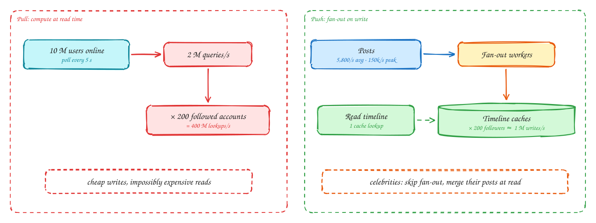
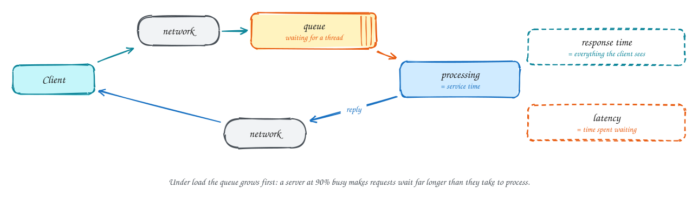
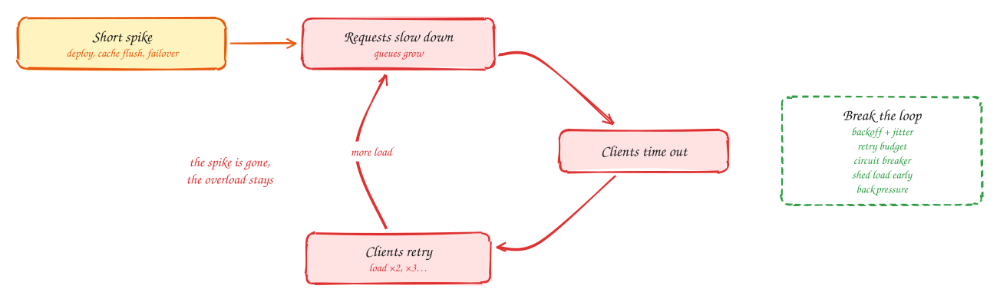
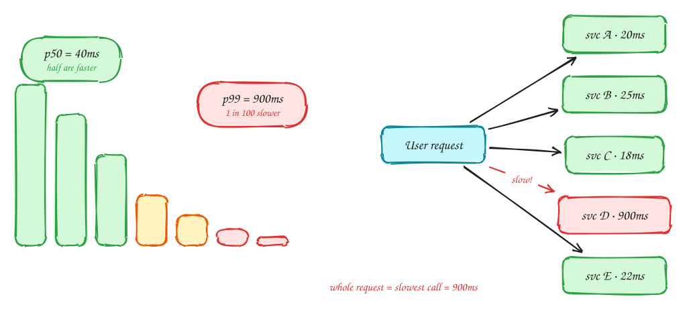
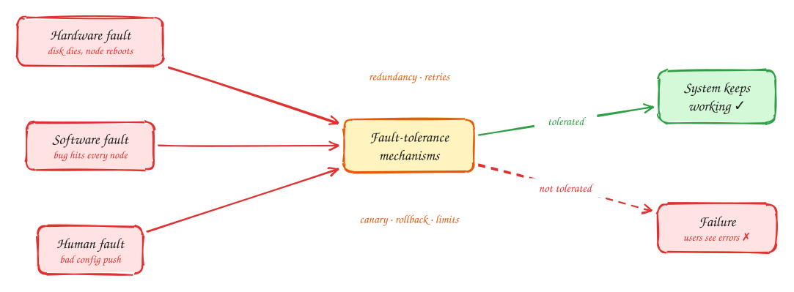
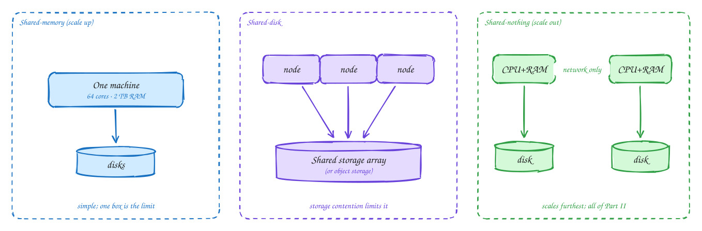

# DDIA Chapter 2: Defining Nonfunctional Requirements

Intermediate

> These DDIA pages are study notes in our own words and diagrams, following the **2nd edition** of *Designing Data-Intensive Applications* by Martin Kleppmann and Chris Riccomini. They connect the book to interview problems and don't replace it; the book is worth reading in full.

> [!TIP]
> **Revision sketchnote:** [reliability, scalability, maintainability on one page](../sketchnotes/ddia-01.svg) (drawn for the 1st edition, where this was Chapter 1).

## TL;DR

Functional requirements say *what* the app does. Nonfunctional requirements say *how well*: how fast (performance), how dependably (reliability), how it copes with growth (scalability) and how easy it is to run and change (maintainability). This chapter turns each of those words into something you can measure, using one running example: a social network's home timeline.

**Key ideas:** fan-out · response time vs service time · queueing · retry storms · p99 · tail amplification · SLOs · fault vs failure · shared-nothing · operability, simplicity, evolvability

## Case study: social network timelines

*Describing load*

"Will it scale?" can't be answered until you say **what is growing**. "Lots of users" isn't specific enough. You need the few numbers that actually stress the system. The book works them out for a social network like X (Twitter):

- Users write **500 million posts a day**. Spread over 86,400 seconds that's about **5,800 posts a second** on average, with spikes up to **150,000 a second** during big events.
- A typical user follows about **200** accounts and has about 200 followers (a few celebrities have millions).
- The main read is the **home timeline**: recent posts from everyone I follow.

**Approach 1: compute the timeline when someone reads it (pull).**

1. Posting is cheap: insert one row.
2. Reading means: find the ~200 accounts I follow, fetch their recent posts, merge by time.
3. Suppose **10 million** users are online and each app refreshes every **5 seconds**: that's 2 million timeline queries a second.
4. Each one looks up ~200 accounts, so the database does about **400 million lookups a second**. That is far beyond what a database can do cheaply.

**Approach 2: compute it when someone writes (push, or fan-out on write).**

1. Keep a precomputed timeline per user, like a mailbox, in a cache.
2. When someone posts, a background worker inserts the post ID into each follower's timeline: 5,800 posts/s × 200 followers ≈ **1 million+ timeline writes a second**. A lot, but far fewer than 400 million reads.
3. Reading a timeline is now a single cache lookup.

**The number that breaks approach 2** is followers per account. A celebrity with 100 million followers would trigger 100 million writes for one post. So real systems use a **hybrid**: fan out for normal accounts, and for celebrities, fetch their recent posts at read time and merge them in.

The point isn't Twitter. Find the numbers that decide the design (here, reads vs writes and the fan-out per post), compute them, and design around them. Timelines also only store **post IDs**; the post text, author name and like count are looked up when the timeline is shown, so an edit or a new like doesn't have to update millions of copies.

> [!TIP]
> **Say this in the interview:** "The load parameter that matters is fan-out per post, not total users. Pull costs about 400 million lookups a second; push costs about a million writes a second. So push, with celebrities merged at read time."

## Describing performance

*Response time, throughput, queueing*

Two families of numbers describe performance: **response time** (how long one request takes, as the user sees it) and **throughput** (how many requests or how much data per second the system handles). They are linked: as throughput approaches capacity, response time climbs steeply.

**Why that happens: the request spends most of its life waiting.** Break a request down:

- **Service time** is the time the server actually spends working on the request.
- **Queueing delay** is time spent waiting for a free CPU or thread, because other requests got there first.
- **Network delay** is time on the wire, both ways.
- **Response time** is the whole thing, what the client measures. **Latency** is, strictly, the time a request is *waiting* (in the network or a queue), not being worked on.

Under light load, queues are empty and response time ≈ service time + network. As the server gets busier, queues form, and because a server can only work through a queue at its own pace, **a few slow requests hold up everything behind them** (head-of-line blocking). That's why you should measure response time **on the client side**: the server's own timer starts only after the request has left the queue.

### When overload feeds itself: retry storms

**Why it gets worse than "slow".** When responses get slow, clients time out and **retry**. Each retry is extra load on a server that's already overloaded, so it gets slower, so more clients time out and retry.

1. A short spike (a deploy, a cache flush, a failover) makes the server slow for a few seconds.
2. Clients time out and retry, so load doubles or triples.
3. The server stays overloaded **even after the spike is gone**, because the retries are now the load.

This is called a **metastable failure**: the system has a healthy state and an overloaded state, and once pushed into the bad one it stays there until someone intervenes. **How to prevent it:** exponential backoff with random jitter on retries, a retry budget (e.g. at most 10% extra requests), circuit breakers that stop calling a failing service, load shedding (reject early, cheaply, when queues are full), and backpressure (tell callers to slow down).

> [!NOTE]
> See [Timeouts and retries](../101/timeouts-and-retries.md), [Circuit breaker](../101/circuit-breaker.md) and [Load shedding](../101/load-shedding.md) for the mechanics.

## Percentiles and tail latency

*Averages lie*

The natural instinct is to describe response time by its **average**. That hides the users having a bad time.

1. Response times aren't all similar. Most requests are fast, but there is a **long tail** of slow ones: a cache miss, a GC pause, a retransmitted packet. A 50 ms average can hide 1 in 100 requests taking 2 seconds.
2. So use **percentiles**. Sort all response times. The **p50** (median) is what a typical request sees. The **p99** is the time that 99% of requests beat. Amazon has described targeting the **p99.9** for internal services, because the slowest requests often belong to the most valuable customers: the ones with the most data and the biggest orders.
3. **Tail latency amplification:** one page often calls many backends in parallel and can't render until the **slowest** returns. Even if each backend is slow only 1% of the time, a page calling 100 of them is slow most of the time.

> [!NOTE]
> **The math:** the chance that all 100 calls are fast is 0.99¹⁰⁰ ≈ 0.37. So **63% of page loads hit at least one slow call**.

**Using percentiles in practice:**

- **SLOs and SLAs.** A service level objective states a target, such as "p99 under 200 ms, measured over 5 minutes, and 99.9% of requests succeed". A service level agreement is a contract that says what happens (refunds, say) if it's missed.
- **Computing them.** You can't keep every response time forever. Monitoring systems keep compact sketches such as **HdrHistogram**, **t-digest** or **DDSketch**, which estimate percentiles in little memory.
- **Combining them.** You **can't average percentiles**: the mean of ten servers' p99s isn't the overall p99. Add up the underlying histograms first, then read the percentile off the combined histogram.

Defences against the tail: tight timeouts with graceful degradation (render the page without the slow piece), and **hedged requests** (if a call hasn't returned by the p95 time, send it to a second replica and take whichever answers first).

## Reliability and fault tolerance

*Fault ≠ failure*

"Reliable" doesn't mean nothing ever goes wrong. In any system bigger than one machine, something is **always** going wrong. The book separates two words:

- A **fault** is one part misbehaving: one disk, one server, one bad config value.
- A **failure** is the system as a whole stopping working for users.

You can't prevent faults, so a **fault-tolerant** system keeps working despite them: a replica dies, health checks route around it, clients retry, and users notice nothing. A component whose fault *does* become a failure is a **single point of failure (SPOF)**. Some teams go further and **inject faults deliberately** (killing processes at random, as Netflix's Chaos Monkey does) so that recovery paths are exercised every day rather than discovered during an outage.

**Hardware faults are routine at scale.** Rough rates the book cites:

- Hard disks fail at about **2–5% a year**, SSDs at about **0.5–1%** (though SSDs suffer more uncorrectable read errors). With 10,000 disks, expect a dead disk most days.
- Around **1 in 1,000** machines has a CPU core that occasionally computes **wrong results**, silently.
- More than **1% of machines** a year hit a memory error that even ECC can't correct.
- Whole datacenters lose power or network. That's why clouds offer **availability zones** (separate buildings and power) and regions; replicate across zones to survive one going down.

Because hardware faults are expected, systems are designed so a machine can be taken away **without downtime**, which also enables **rolling upgrades**: patch one node at a time while the others serve traffic.

> [!WARNING]
> **Software faults are worse, because they are correlated.** Two disks rarely die in the same minute, but a bug runs on every server at once. Examples: the 2012 leap second, which hung many Linux servers simultaneously; an SSD firmware bug that bricked drives after exactly **32,768 hours** of running, so drives installed together died together; a service that slows down and drags its callers with it (a **cascading failure**). Extra replicas don't help, because they run the same bug. Defences: careful testing, process isolation, staged rollouts (canaries), fast rollback, and monitoring.

**Humans.** Studies of outages find that **configuration changes by operators** are the leading cause, with hardware faults behind only about 10–25%. The answer isn't blaming people; it's systems that make the right thing easy: good tooling, staged config rollouts, quick rollback, and **blameless postmortems** that fix the process rather than punishing a person. The book's sobering example is the UK Post Office Horizon scandal, where hundreds of postmasters were prosecuted because a buggy accounting system was trusted over them.

## Scalability

*Shared-memory, shared-disk, shared-nothing*

Scalability isn't a yes/no property ("X is scalable"). It's a question: **if load grows in this particular way, what are our options?**

- **Shared-memory (vertical scaling, scale up).** Buy a bigger machine. Simple, no distribution bugs, and a single big Postgres server handles a lot. But cost grows faster than size, and one machine is the ceiling.
- **Shared-disk.** Several machines with their own CPUs and RAM share one storage array. Used by some warehouses; contention on the shared storage and locking limit it.
- **Shared-nothing (horizontal scaling, scale out).** Each node has its own CPU, RAM and disk and talks to others only over the network. It scales furthest and survives losing machines, but brings every problem in Part II of the book. Cloud-native systems often blend this with shared storage (Chapter 1).

**Principles that hold up:**

- An architecture that suits one load level rarely suits 10× that load. Expect to **rethink the design at each order of magnitude**, and don't build for 100× today.
- Break the system into parts that can scale **independently** (e.g. stateless web servers scale out trivially; the database is the hard part).
- **Design for the load you calculated**, not for a generic idea of scale. A system for 100k requests/s of 1 KB reads looks nothing like one for three 2 GB uploads a minute.

## Maintainability

Most of a system's cost comes **after** launch: running it, debugging it and changing it for years. Three properties keep that cost down:

| Property | What it means | How you get it |
|---|---|---|
| **Operability** | Easy for operators to keep it healthy | Good monitoring and observability, sensible defaults, predictable behaviour, automation, runbooks, the ability to drain a node safely |
| **Simplicity** | Easy for new engineers to understand | Remove accidental complexity with good abstractions (SQL hides storage layout and concurrency; a cloud service hides operations) |
| **Evolvability** | Easy to change as requirements change | Loose coupling, schema evolution (Chapter 5), reversible changes, tests, small deploys |

## In the system design interview

> [!IMPORTANT]
> **Interviewer asks:** "How will this scale?"
> → Name the **load parameter** (reads/sec, fan-out per post, data size), calculate it, then say which component breaks first.

> [!IMPORTANT]
> **Interviewer asks:** "What's your latency target?"
> → An SLO on **p99** (e.g. < 200 ms for reads), measured client-side, not the average. Mention tail amplification if one request fans out.

> [!IMPORTANT]
> **Interviewer asks:** "What happens when a downstream service slows down?"
> → Timeouts plus retries with backoff and jitter, a retry budget and circuit breaker so retries can't turn a blip into a retry storm, and load shedding at the edge.

> [!IMPORTANT]
> **Interviewer asks:** "What if a node dies?"
> → "A node dying is a fault. Replicas across availability zones plus health checks mean it never becomes a failure."

## Self-check

Try to answer before you open each one.

Why does fan-out on write beat computing timelines on read for a social network?

Reads vastly outnumber writes. Pull costs roughly 2 million queries/s × 200 followed accounts = 400 million lookups/s; push costs about 5,800 posts/s × 200 followers ≈ 1 million cache writes/s, and each read becomes one lookup.

Why should response time be measured on the client, not inside the server?

The server's timer starts only when it picks the request up, so it misses the time the request spent queued and on the network. Under load the queueing part dominates, so server-side numbers look fine while users wait.

Ten servers each report a p99. How do you get the p99 for the whole service?

Merge their latency histograms (or sketches like t-digest) and compute the p99 from the combined distribution. Averaging the ten p99 values gives a meaningless number.

A brief spike passed, but the service stays overloaded. What's likely going on, and how do you stop it?

A retry storm (metastable failure): clients timed out and retried, and the retries keep the load above capacity. Use exponential backoff with jitter, retry budgets, circuit breakers and load shedding so the system can recover.

Why don't more replicas protect against a software bug?

Every replica runs the same code, so the bug hits them all at once (a correlated fault). Defences are staged rollouts, quick rollback and limiting the blast radius of each change.

## Related

- [News feed](../problems/news-feed.md) applies the timeline case study end to end
- [Timeouts and retries](../101/timeouts-and-retries.md) · [Load shedding](../101/load-shedding.md) · [Safe deploys](../101/safe-deploys.md) · [Observability](../101/observability.md)

---

← [Ch 1: Trade-offs in data systems architecture](01-trade-offs-in-data-systems-architecture.md) · [Ch 3: Data models](03-data-models.md) →
