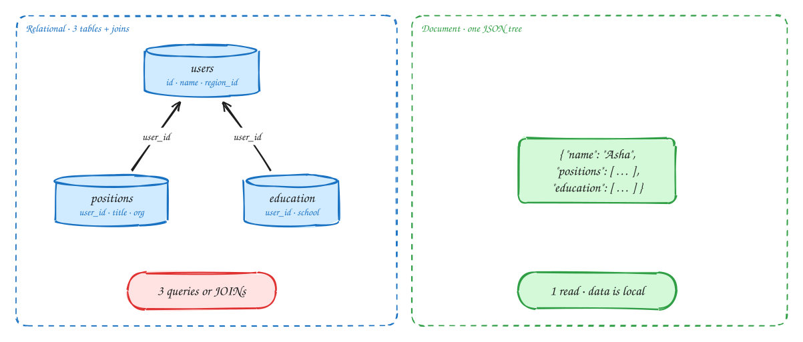
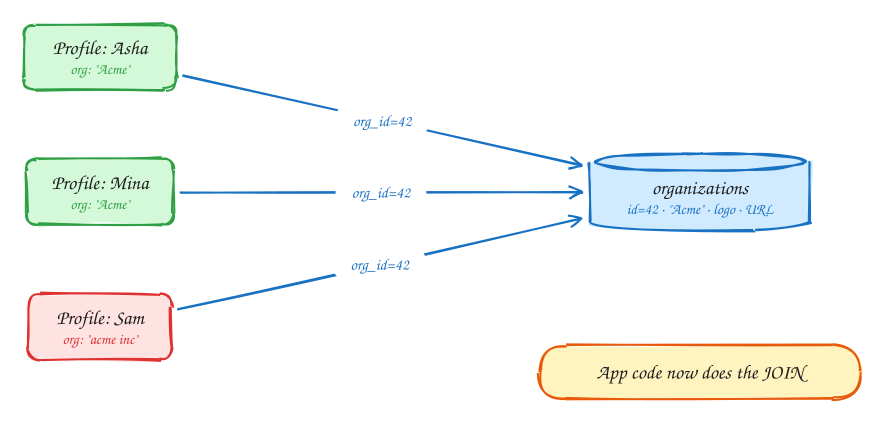
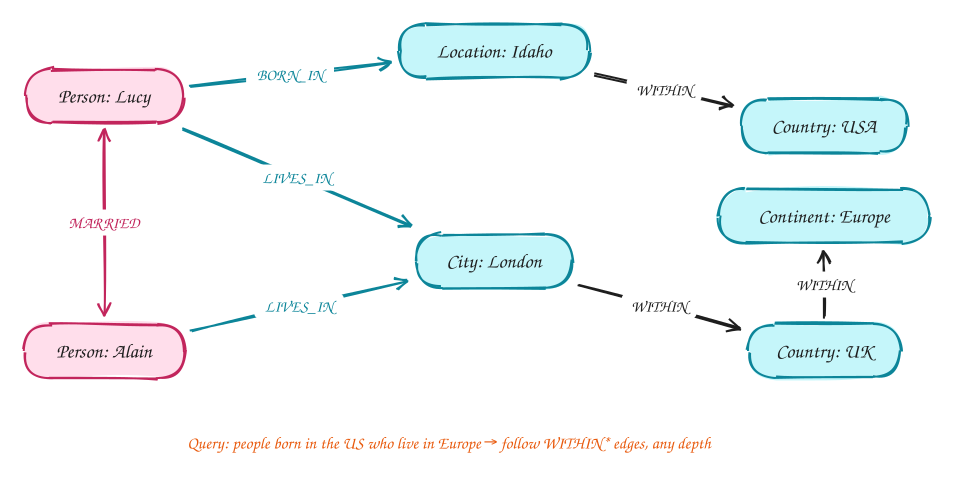
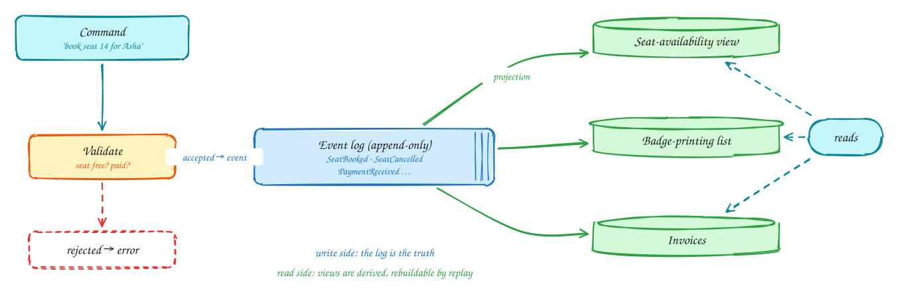

# DDIA Chapter 3: Data Models & Query Languages

Intermediate

> These DDIA pages are study notes in our own words and diagrams, following the **2nd edition** of *Designing Data-Intensive Applications* by Martin Kleppmann and Chris Riccomini. They connect the book to interview problems and don't replace it; the book is worth reading in full.

> [!TIP]
> **Revision sketchnote:** [Data models & query languages on one page](../sketchnotes/ddia-02.svg) (drawn for the 1st edition, where this was Chapter 2).

## TL;DR

The shape of your data decides which model fits. Trees of data that are read together (one-to-many) suit documents. Data full of references (many-to-many) suits relational. Data where relationships are the point suits graphs. Two more models get their own place in the 2nd edition: **event sourcing**, which stores what happened rather than the current state, and **DataFrames and arrays**, the shape that analytics and machine learning work in.

**Key ideas:** relational · document · graph · normalization · star schema · schema-on-read · locality · event sourcing · CQRS · DataFrames

## One LinkedIn profile, two models

*Relational vs document*

Take one LinkedIn-style profile: a name, a headline, several past jobs, a few schools and some contact details. How should it be stored?

1. **Relational:** split the profile into tables, with `users` holding one row per person, `positions` one row per job, `education` one row per school, each pointing back with `user_id`. To show the page, you **join** them back together. In your code, though, a profile is one object with nested lists. Translating between that object and the tables is boilerplate (it's why ORMs exist), and the book calls the mismatch **impedance mismatch**.
2. **Document:** store the whole profile as one JSON document, with the jobs and schools nested inside it. One read returns everything the page needs, because all of it is stored together on disk. This is called **locality**. The structure in the database matches the object in your code.

The document model fits well here because of the data's **shape**: a profile is a **tree**. One person has many jobs (one-to-many), each job belongs to exactly one profile, and you usually load the whole profile at once.

> [!NOTE]
> **When the document model wins:** the data forms a tree, you nearly always load the whole tree together, and there are few references from one document to another. Examples: a resume, a product page, an order with its line items.

## Where documents break: many-to-one and many-to-many

*Normalization*

Look at the profile again. "Worked at **Acme Corp**". Is the company name just text in the profile, or a link to a company that exists on its own?

1. If you store `"company": "Acme Corp"` as text in every profile, the same company is copied into thousands of documents.
2. Copies drift apart. One says "Acme Corp", another "ACME Corporation", a third has a typo. If Acme renames itself or changes its logo, you must find and update every document that mentions it, and you'll miss some.
3. The fix is to **normalize**: store the company once, with an ID, and put only `company_id: 42` in each profile. Many profiles now point to one company. That is a **many-to-one** relationship. Add "people can endorse each other's skills" and you have **many-to-many**.
4. Now, to display a profile, you need the company names, which means a **join**. Document databases traditionally have weak join support, so your application code ends up doing it: fetch the profile, collect the company IDs, fetch the companies, stitch them together.

**Normalize or denormalize?** Normalized data (each fact stored once, referenced by ID) is consistent and cheap to update, but reads need joins. Denormalized data (copies stored where they're read) is fast to read but every copy must be updated on change. Big systems often mix both deliberately: X's home timelines (Chapter 2) store only **post IDs**, a denormalized list, and then **hydrate** each ID by looking up the current post text, author and like counts, normalized data that changes often. Choose per field, based on how often it's read vs changed.

That is the real trade-off. Documents are great while the data is a self-contained tree. As soon as the data is full of **references** between records, you are doing joins anyway, and the relational model, which was built for joins, wins again. Most real applications start as trees and grow references over time.

> [!TIP]
> **Say this in the interview:** "Bookings reference hotels, users and rooms, which is many-to-many, so I'll use Postgres. Each hotel's static content is one tree read as a whole, so it can live in a document store or as cached JSON."

## Schema-on-write vs schema-on-read

*Schema flexibility*

Document databases are often called "schemaless", but that isn't quite true. The real question is **when** the structure of your data is checked.

- **Schema-on-write** (relational): the database enforces the structure when you write. Every row in `users` has the same columns, and inserting a row that doesn't fit fails immediately.
- **Schema-on-read** (document): the database accepts any shape, and your **reading code** interprets it. If old documents have `name` and new ones have `first_name` and `last_name`, the code that reads them must handle both.

It is like static versus dynamic typing in programming languages: neither is always better, and the table shows where each fits.

|  | Schema-on-write (relational) | Schema-on-read (document) |
|---|---|---|
| Analogy | Static typing: checked at compile time | Dynamic typing: checked at run time |
| Change a field | ALTER TABLE + migration (fast in Postgres; MySQL used to copy the whole table) | Just write new docs; code handles both old and new shapes |
| Good for | Uniform records with stable structure | Heterogeneous items: different shapes per type, or external data you don't control |
| Locality | Rows are spread across tables (but see Postgres JSONB, Spanner interleaving) | Whole doc stored together; rewrites the whole doc on update, so keep docs small |
| Joins | Native, optimized by query planner | Weak or none; done in application |

**The two models are converging.** Postgres and MySQL store and index JSON columns, so a relational table can hold a document. MongoDB added joins (`$lookup`) and multi-document transactions. Spanner can **interleave** child rows physically next to their parent row, giving relational tables document-like locality. In practice you choose a database for its operational qualities as much as for its model.

**Analytics has its own relational shape.** Warehouses (Chapter 1) usually model data as a **star schema**: a huge central **fact table** where each row is an event (a sale, a click), with foreign keys into smaller **dimension tables** (product, store, date, customer). A **snowflake schema** breaks dimensions into further sub-tables. Some teams flatten everything into **one big table** with the dimensions denormalized into every row, since column storage compresses the repetition well.

> [!WARNING]
> **"NoSQL is schemaless" is misleading.** There is always a schema; with documents it is **implicit**, spread through every piece of code that reads the data. You still pay for changing it, just later and in more places, often as `if field missing then …` branches that stay forever.

## Graph model: when relationships are the data

*Property graphs*

Some data is mostly **connections**: who knows whom, which account sent money to which, which place is inside which region. You can store connections in tables, but the questions you ask, like "friends of friends of friends" or "everything inside Europe, however deeply nested", need a variable number of joins. A **graph** model makes the connections themselves the main thing.

1. A graph has **vertices** (things: people, places, accounts) and **edges** (relationships: LIVES_IN, KNOWS, WITHIN). Both can carry properties, such as a name or a date.
2. Real-world structure is irregular. Boise is WITHIN Idaho, which is WITHIN the USA. A French city is WITHIN a département, WITHIN a region, WITHIN France. The depth differs from place to place.
3. Anything can connect to anything. A new kind of relationship is just a new edge label; no schema change is needed.
4. That makes recursive questions easy. "Find people born in the USA and now living in Europe" follows WITHIN edges **any number of hops** up from each city. In a graph query language like Cypher that's one short pattern. In SQL it needs a recursive common table expression, which is long and hard to get right.

> [!NOTE]
> **In interviews:** graph databases come up for fraud rings, "people you may know" and knowledge graphs. Most interview problems don't need one: a follows table in Postgres, or adjacency lists in Redis, handle one or two hops perfectly well.

**Query languages in brief.** SQL (with recursive CTEs), Cypher for property graphs, and SPARQL for triple stores all express graph traversals. **Datalog** builds queries from small rules that can refer to each other, which suits recursive questions. **GraphQL** is different: it lets a client ask for exactly the fields a screen needs in one request. It is deliberately restrictive (no arbitrary recursion or joins) so that a public API can't be asked for an unboundedly expensive query.

## Event sourcing and CQRS

*Store what happened, derive what is*

**Why.** A normal table stores the **current state**: seat 14 is booked by Asha. When she cancels, that row is updated or deleted, and the history is gone. Yet many questions are about history ("how many people cancelled after the price change?"), and many bugs are only explainable with it. And one table layout can't serve every read efficiently: the booking screen, the badge printer and the invoicing system want the same facts arranged differently.

**How.** The book uses a conference-booking system as its example:

1. A user's request arrives as a **command**: "book seat 14 for Asha". A command can still fail.
2. The system **validates** it against the current state: is the seat free, has the attendee paid?
3. If it passes, the command becomes an **event**, a fact in the past tense: `SeatBooked{seat: 14, attendee: Asha}`. Events are **appended** to a log and never changed. A cancellation is a new event, `SeatCancelled`, not a deletion.
4. **Projections** read the event log and build whatever read-optimised views are needed: seat availability, a badge-printing list, invoices. Each view is a **materialized view** of the log.
5. This split is **CQRS** (command query responsibility segregation): writes go to one model (the event log), reads come from others (the views).

**What you gain:**

- A full **audit trail** and the ability to answer new questions about the past.
- **Rebuildable views:** a buggy projection is fixed by correcting the code and replaying the log. A new feature gets a new view, built from all past events.
- Each view can use the storage that suits its reads (a relational table, a search index, a cache).

**What it costs:**

- Events must be processed **deterministically**. If the projection calls an external service (an exchange rate, say), replaying gives a different answer unless the external result was stored in the event.
- **Deleting personal data** is awkward in an immutable log. A common answer is **crypto-shredding**: encrypt each person's data with their own key and delete the key when they ask to be forgotten.
- **Side effects** like sending emails must not be repeated when you replay to rebuild a view.
- Views are eventually consistent with the log, so a user may not see their own booking for a moment (Chapter 6 covers how to hide that).

> [!NOTE]
> Chapter 12 shows the same idea at the scale of whole systems: a Kafka topic as the log, stream processors as projections. See also [Event sourcing in stream processing](12-stream-processing.md).

## DataFrames, matrices and arrays

**Why another model.** Data scientists and ML engineers mostly don't query with SQL; they work with **DataFrames** (pandas, Spark, Polars): a table you transform step by step in code, with filters, joins, group-bys and pivots. And many ML algorithms want something stricter still: a **matrix** of numbers.

**How relational data becomes a matrix.** Take a table of movie ratings with columns `(user, movie, rating)`. Pivot it so each user is a row and each movie a column, and you get a matrix, mostly empty (a **sparse** matrix) because each user rated few movies. Non-numeric values are turned into numbers, for example with **one-hot encoding**: a `colour` column with values red/green/blue becomes three 0-or-1 columns. Array databases such as TileDB store such multidimensional arrays directly, which suits scientific and geospatial data.

## In the system design interview

| Data shape | Pick | Interview example |
|---|---|---|
| Lots of cross-references, need transactions | Relational (Postgres) | Bookings, payments, inventory, users |
| Self-contained tree, read whole | Document (Mongo, DynamoDB item, JSONB) | Hotel content, product catalog page, chat message |
| Relationships are the query | Graph (Neo4j) or adjacency list | Social graph, recommendations, fraud |
| Huge write volume, simple key access | Wide-column (Cassandra) | Chat history, metrics, activity logs |

> [!TIP]
> **Say this in the interview:** "I start from access patterns. The two hot queries are X and Y, and both are key lookups with one join, so Postgres with the right indexes covers it. I'd only move to Cassandra if write volume passes about 50k/sec."

> [!IMPORTANT]
> **Interviewer asks:** "Do you need the history of changes, or several very different read views?"
> → Consider event sourcing: an append-only log of events as the source of truth, with projections building each read model. Mention the costs: deterministic replay, eventual consistency of views, and deleting personal data.

## Self-check

Try to answer before you open each one.

Why do references between records (many-to-one, many-to-many) push you back towards the relational model?

Normalized references need joins to display, and relational databases are built and optimized for joins. In a document store without good joins, the application ends up doing them in code, with extra round trips and more bugs.

Why does a home timeline store only post IDs instead of whole posts?

Post text, author name and like counts change; copying them into millions of timelines would mean millions of updates per change. Storing IDs keeps the timeline small, and the current details are looked up (hydrated) at read time.

In event sourcing, what is the difference between a command and an event?

A command is a request that may still be rejected ("book seat 14"). After validation succeeds it becomes an event, an immutable fact in the past tense ("seat 14 was booked") that is appended to the log and never changed.

A projection had a bug and the seat-availability view is wrong. How do you fix it?

Fix the projection code, throw the view away and rebuild it by replaying the event log from the start. The log, not the view, is the source of truth.

## Related

- [Data modeling](../core-concepts/data-modeling.md) · [SQL vs NoSQL](../101/sql-vs-nosql.md)
- [Ticketmaster](../problems/ticketmaster.md) (relational with transactions) · [News feed](../problems/news-feed.md) (denormalized timelines)

---

← [Ch 2: Defining nonfunctional requirements](02-nonfunctional-requirements.md) · [Ch 4: Storage and retrieval](04-storage-and-retrieval.md) →
