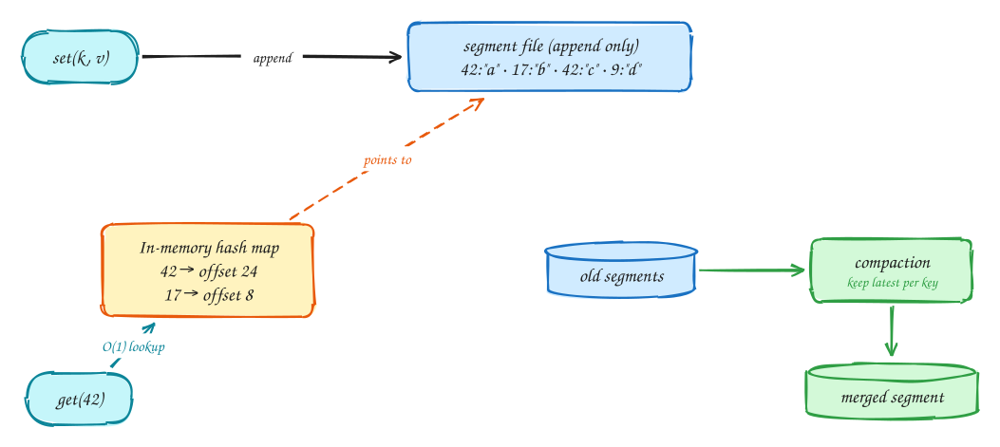
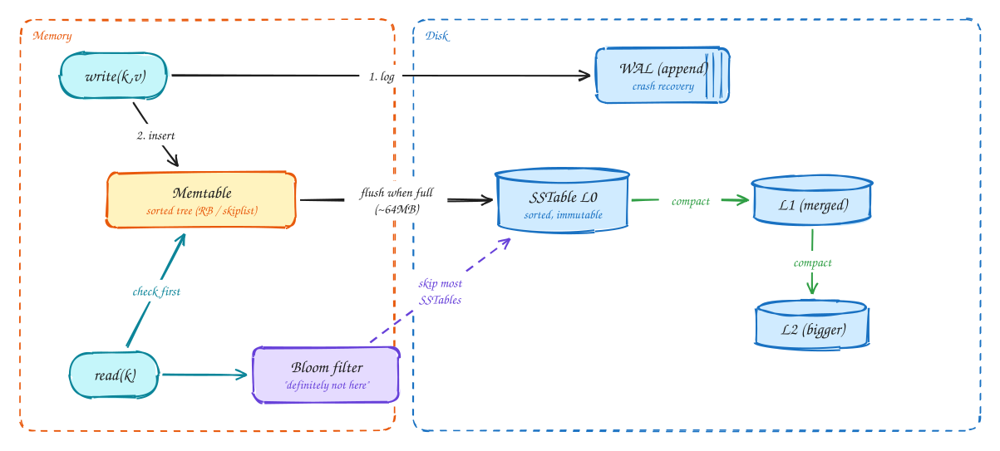
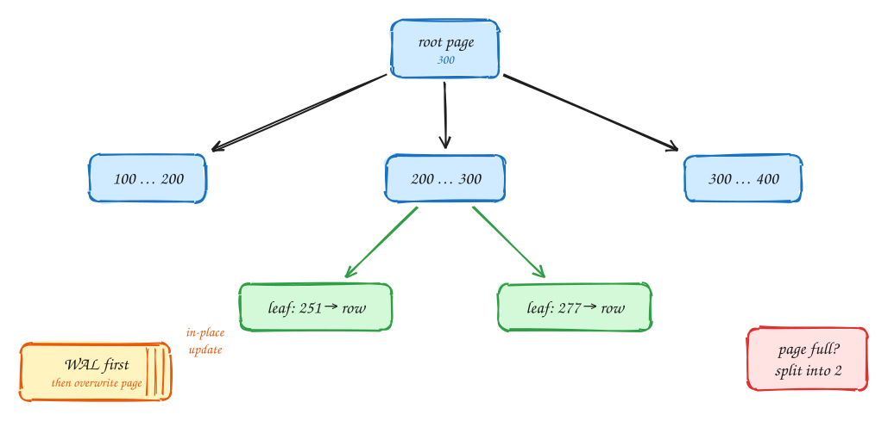
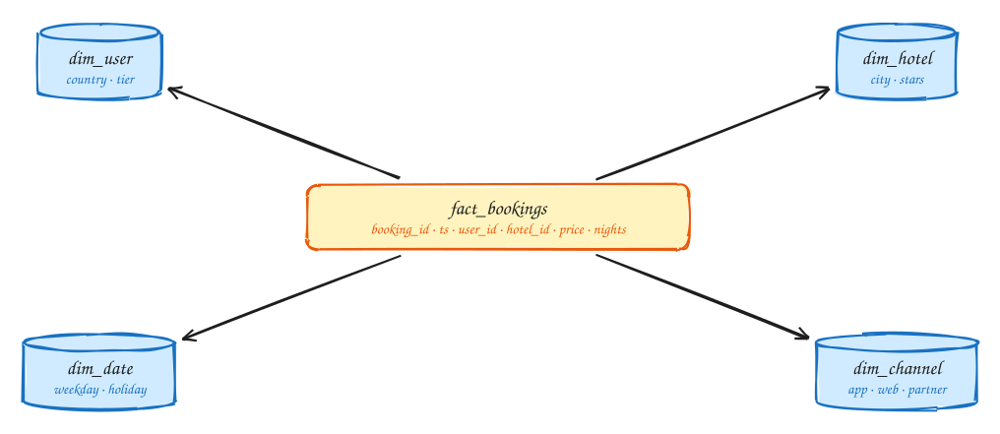
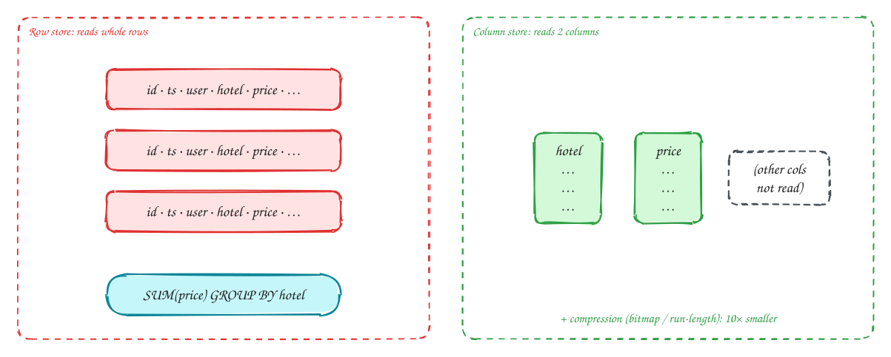

# DDIA Chapter 3: Storage & Retrieval

> These DDIA pages are study notes in our own words and diagrams, connecting the book to interview problems. They don't replace the book; *Designing Data-Intensive Applications* by Martin Kleppmann is worth reading in full.

## TL;DR

How a database actually stores bytes. Two families power almost everything: **log-structured** engines (LSM trees in Cassandra, RocksDB, Kafka) that append, and **page-oriented** engines (B-trees in Postgres, MySQL) that update in place. Plus why analytics needs column storage.

**Key ideas:** append-only log · hash index · SSTable · LSM-tree · B-tree · WAL · column store · star schema

## The simplest database: append-only log + hash index

*Log-structured storage (Bitcask)*

1. Every write is **appended** to the end of a file. Sequential writes are the fastest thing a disk can do.
2. An in-memory hash map stores, for each key, the byte offset of its latest value.
3. A read is one hash lookup plus one disk seek.
4. Old values pile up, so background **compaction** merges segments and keeps only the latest value per key.

> [!WARNING]
> **Limits:** All keys must fit in RAM, and range queries ("all keys between A and F") are impossible. SSTables fix both.

## LSM-tree: how Cassandra and RocksDB write so fast

*SSTables + LSM*

1. A write goes to a WAL (for durability) and an in-memory sorted **memtable**. No random disk I/O.
2. When the memtable is full it is flushed as an **SSTable**, a sorted immutable file, with one sequential write.
3. Background **compaction** merges SSTables into bigger levels and drops overwritten or deleted keys (tombstones).
4. A read checks the memtable, then SSTables from newest to oldest. **Bloom filters** skip files that can't contain the key, so reads cost more than writes.

> [!NOTE]
> **Why it matters:** Sequential writes only, so you get very high write throughput. Cassandra handles about **10k+ writes/sec per node** easily. That makes LSM the default for metrics, logs, chat, and events.

## B-tree: how Postgres and MySQL store data

*Page-oriented storage*

1. Data lives in fixed-size **pages** (4–16KB). The root page holds key ranges that point to child pages.
2. Each level narrows the range. A branching factor of about 500 means **4 levels hold 256TB**.
3. The leaf page holds the row (or a pointer to it). A lookup is O(log n) page reads, usually 3–4.
4. Updates overwrite the page **in place**, after writing to the WAL first so a crash mid-write can be repaired. A full page splits in two.

> [!NOTE]
> **Why it matters:** Predictable reads, and each key exists in exactly one place, which makes row locks and transactions simple. That is why OLTP and ACID databases are B-tree based.

## LSM vs B-tree: the trade-off you will be asked about

*Comparison*

|  | LSM-tree (Cassandra, RocksDB, HBase) | B-tree (Postgres, MySQL InnoDB) |
|---|---|---|
| Writes | Faster: sequential appends, less write amplification | Slower: random page writes + WAL (each write ≥ 2 writes) |
| Reads | Slower: may check several SSTables (Bloom filters help) | Faster, predictable: one path root → leaf |
| Space | Compresses well, little fragmentation | Pages partly empty after splits |
| Weak spot | Compaction competes with live traffic, so p99 spikes | Write-heavy workloads hit I/O limits |
| Transactions | Key may exist in many files, so locking is harder | Key in one place: easy range locks |
| Pick when | Write-heavy: metrics, logs, chat, IoT, events | Read-heavy, transactional: bookings, payments, users |

> [!TIP]
> **Say this in the interview:** "Ad clicks are write-heavy and append-only, around 10k/sec, so an LSM-based store like Cassandra fits. Bookings need transactions and point reads, so a B-tree store like Postgres fits."

## Index types you should name in interviews

*Secondary indexes*

| Index | How | Use for |
|---|---|---|
| B-tree (default) | Sorted tree on column(s) | Equality + range: WHERE created_at > X, ORDER BY |
| Composite | Sorted by (a, b): leftmost prefix rule | WHERE user_id=? ORDER BY ts DESC: one index scan |
| Covering / INCLUDE | Index stores extra columns | Index-only scans: no heap lookup |
| Clustered | Rows stored in index order | InnoDB primary key; range scans on PK are cheap |
| Hash | Hash map | Equality only; no ranges |
| Geospatial | R-tree, geohash, quadtree (PostGIS) | "Hotels within 5km": Yelp, Uber, Gopuff |
| Inverted | term → list of doc IDs | Full-text search: Elasticsearch, Postgres GIN |
| Bloom filter | Probabilistic set membership | "Seen this URL?" in a web crawler, LSM reads |

> [!WARNING]
> **Indexes are not free:** Each index slows down every write and uses disk. Index for the **hot read queries** you named, not for every column.

## OLTP vs OLAP, and the star schema

*Analytics*

1. The **fact table** holds one row per event (each booking). It has billions of rows and is narrow but very long.
2. **Dimension tables** hold the who, what, where, and when. Queries filter on dimensions and aggregate facts: "revenue by city by weekday".

|  | OLTP | OLAP |
|---|---|---|
| Pattern | Few rows by key | Scan millions, aggregate |
| Users | App / customers | Analysts, dashboards |
| Size | GB – TB | TB – PB |
| Engine | Postgres, MySQL | Snowflake, BigQuery, ClickHouse, Druid |

## Column-oriented storage: why analytics is fast

*Column stores*

1. A row store reads every column of every row from disk, even though the query needs two.
2. A column store keeps each column in its own file and reads only **hotel** and **price**, so it touches far less disk.
3. Values in one column look alike, so they compress very well. Vectorized CPU processing on top makes these scans 10–100× faster.

> [!TIP]
> **Say this in the interview:** "The ad-click dashboard is an OLAP query, so I won't run it on the OLTP Postgres. Clicks flow through Kafka into a column store like ClickHouse or Druid for aggregation."

## In the interview

> [!IMPORTANT]
> **Interviewer asks:** "Why Cassandra for this?"  
> → "LSM-tree storage: writes are sequential appends to memtable + commit log, so write throughput is very high. Reads are slower, which is fine for this append-heavy workload."

> [!IMPORTANT]
> **Interviewer asks:** "How do you make this query fast?"  
> → Name the **exact index**: "a composite index on (user_id, created_at DESC) turns it into a single index range scan."

> [!IMPORTANT]
> **Interviewer asks:** "Where do analytics queries run?"  
> → Never on the OLTP primary. Use CDC or Kafka into a column store (ClickHouse, BigQuery, Druid).

> [!IMPORTANT]
> **Interviewer asks:** "What does a WAL do?"  
> → Log the change before applying it. After a crash, replay the log. The same idea powers replication (Ch 5) and CDC (Ch 11).

---

← [Ch 2: Data models](02-data-models.md) · [Ch 4: Encoding and evolution](04-encoding-and-evolution.md) →
