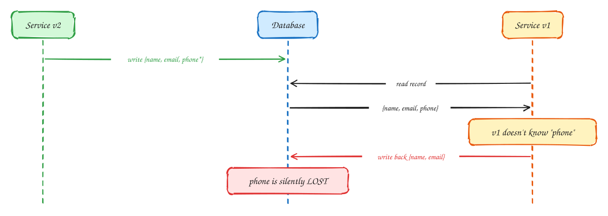
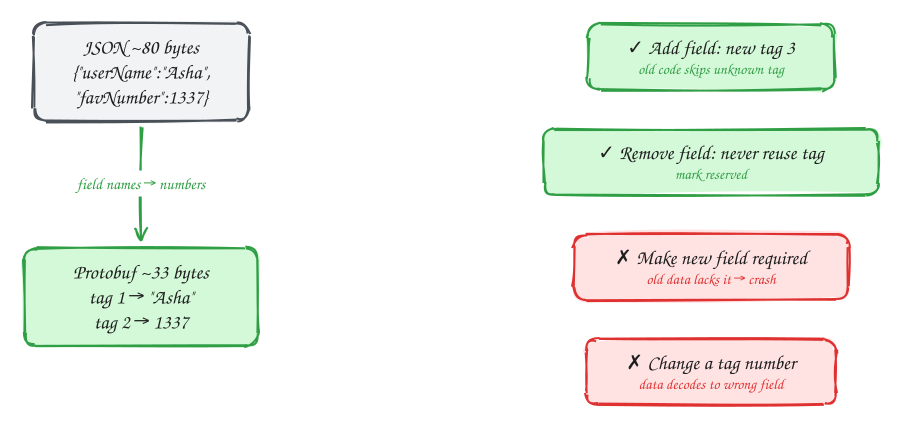
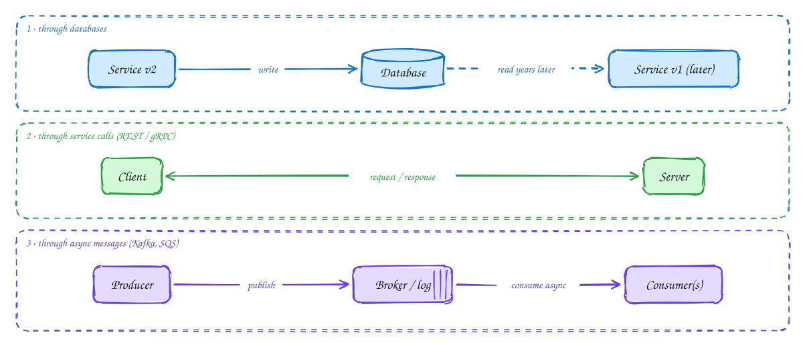

# DDIA Chapter 4: Encoding & Evolution

> These DDIA pages are study notes in our own words and diagrams, connecting the book to interview problems. They don't replace the book; *Designing Data-Intensive Applications* by Martin Kleppmann is worth reading in full.

> [!TIP]
> **One-page sketchnote:** [DDIA 4 · ENCODING & EVOLUTION on a single page](../sketchnotes/ddia-04.svg), for revision or printing.

## TL;DR

Data outlives code. During a rolling deploy, old and new versions of your service run at the same time, reading each other's data. Encoding formats such as Protobuf, Avro, and JSON decide whether that works or silently corrupts data.

**Key ideas:** backward compat · forward compat · Protobuf field tags · Avro schemas · schema registry · REST / RPC / messages

## Rolling upgrade: old and new code at the same time

*Why compatibility matters*

1. New code (v2) adds a field, **phone**, and writes it.
2. Old code (v1), still running on other nodes, reads that record.
3. v1 decodes it into its own model class, which has no phone field.
4. v1 updates the name and writes the whole object back, and phone is gone. Old code must **preserve unknown fields**.

> [!NOTE]
> **The two directions:** **Backward compatible**: new code reads old data (easy).  
> **Forward compatible**: old code reads new data (hard, which is this slide).

## Protobuf / Thrift: field tags make evolution safe

*Binary encoding*

1. JSON repeats field names in every record and has no schema. Large, and number types are ambiguous (precision is lost above 2⁵³).
2. Protobuf replaces names with **tag numbers** plus a schema file, so records are about 2–3× smaller and faster to parse.
3. Rules that keep compatibility: add new **optional** fields with new tags; never reuse a removed tag.
4. Breaking changes: required fields, renumbering tags, or changing a type in an incompatible way.

> [!NOTE]
> **Avro alternative:** Avro has no tags. The reader resolves the **writer's schema** against its own **reader schema** by field name, so a **schema registry** stores every version. This is common with Kafka.

## Three ways data flows between processes

*Modes of dataflow*

1. **Database**: like sending a message to your future self. Data written years ago must still decode, so "data outlives code".
2. **Service calls**: a network call is not a local function call. It can time out, be retried and run twice, or have unknown outcome. Version your APIs.
3. **Messages**: the sender doesn't wait. A broker buffers, retries, and fans out. Producer and consumer evolve independently, so a schema registry keeps them compatible.

> [!WARNING]
> **RPC illusion:** "Just call it like a function" hides timeouts, retries, and partial failure. Design every remote call as **idempotent** with a timeout.

## In the interview

> [!IMPORTANT]
> **Interviewer asks:** "How do you deploy schema changes with zero downtime?"  
> → **Expand → migrate → contract**: add the nullable column, deploy code that writes both, backfill, switch reads, and only then drop the old column.

> [!IMPORTANT]
> **Interviewer asks:** "How do Kafka producers and consumers evolve?"  
> → Avro or Protobuf with a **schema registry** enforcing backward-compatible changes. Consumers upgrade on their own schedule.

> [!IMPORTANT]
> **Interviewer asks:** "REST or gRPC between services?"  
> → gRPC (Protobuf, HTTP/2) for internal high-QPS calls; REST/JSON for public APIs and browsers.

> [!TIP]
> **Say this in the interview:** "Every message carries a schema version, and we only add optional fields. That lets the booking service deploy without coordinating with its consumers."

---

← [Ch 3: Storage and retrieval](03-storage-and-retrieval.md) · [Ch 5: Replication](05-replication.md) →
