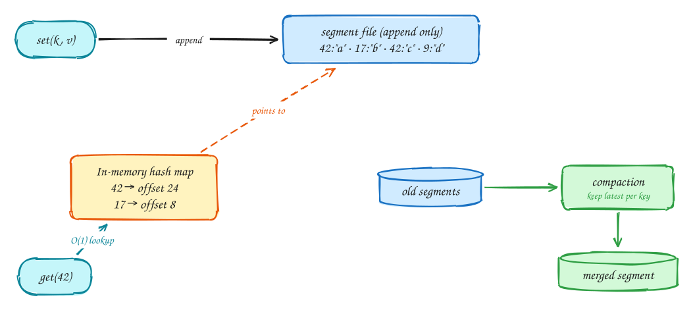
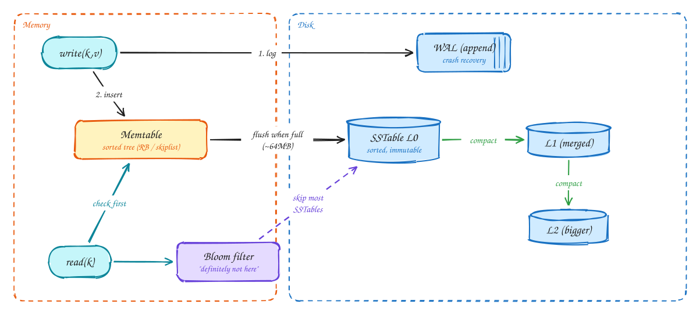
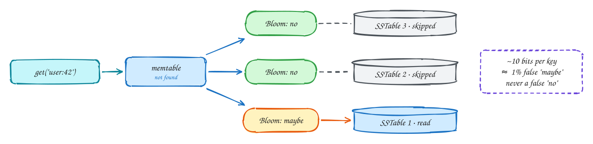
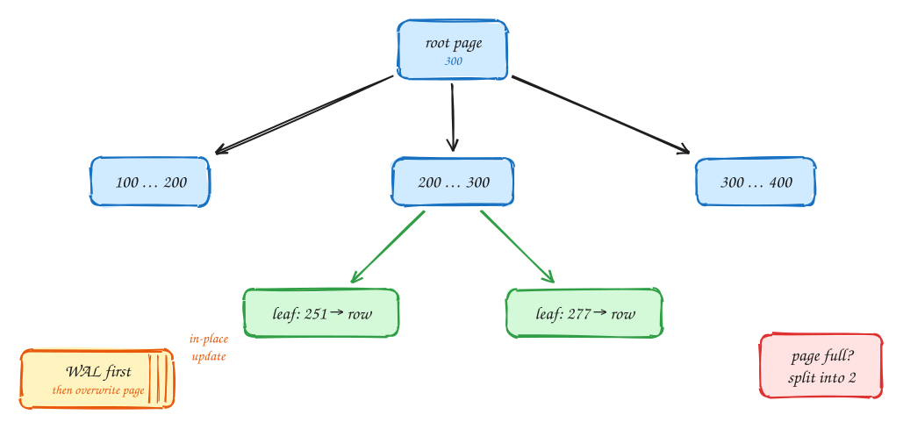
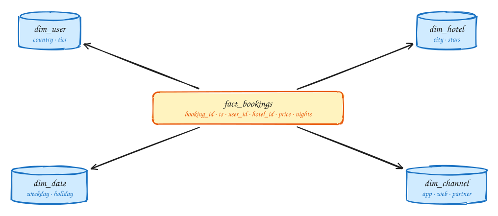
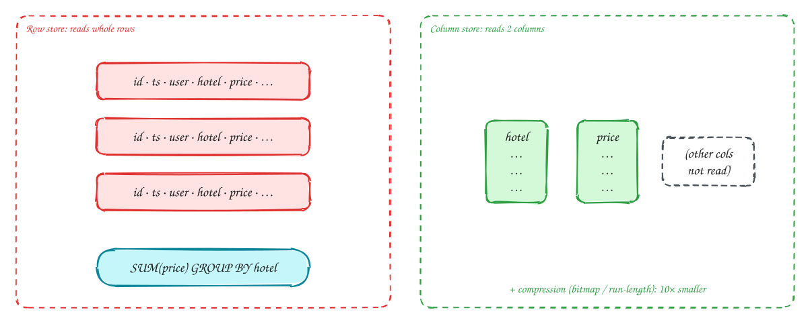
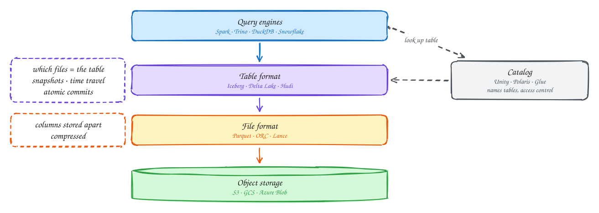
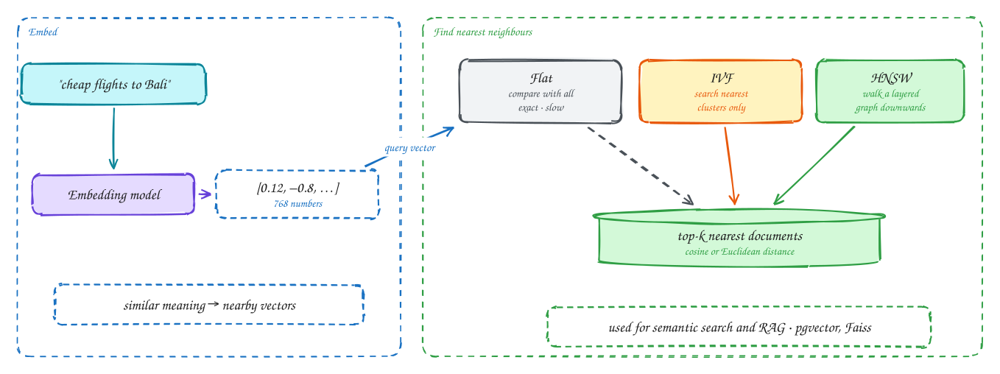

# DDIA Chapter 4: Storage & Retrieval

Intermediate

> These DDIA pages are study notes in our own words and diagrams, following the **2nd edition** of *Designing Data-Intensive Applications* by Martin Kleppmann and Chris Riccomini. They connect the book to interview problems and don't replace it; the book is worth reading in full.

> [!TIP]
> **One-page sketchnote:** [DDIA 4 · STORAGE & RETRIEVAL on a single page](../sketchnotes/ddia-04.svg), for revision or printing.

## TL;DR

How a database actually stores bytes. Two families power almost everything: **log-structured** engines (LSM trees in Cassandra, RocksDB, Kafka) that append, and **page-oriented** engines (B-trees in Postgres, MySQL) that update in place. Analytics needs a different layout, **column storage**, which cloud warehouses now split into separate layers on object storage. And two kinds of search need their own indexes: **full-text** and **vector** (semantic) search.

**Key ideas:** append-only log · SSTable · LSM-tree · Bloom filter · compaction · B-tree · WAL · column store · lakehouse · vectorized execution · inverted index · vector embeddings · HNSW

## The simplest database: append-only log + hash index

*Log-structured storage (Bitcask)*

To understand real storage engines, start by building the simplest possible database: a key-value store backed by one file.

1. **Writing:** every `set(key, value)` is **appended** to the end of the file. Nothing is ever changed in place. Appending is the fastest thing a disk can do, because it writes sequentially instead of jumping around the disk.
2. **Finding things:** scanning the whole file on every read would be hopeless, so keep an **index** in memory: a hash map from each key to the byte position (offset) where its **latest** value starts in the file.
3. **Reading:** look the key up in the hash map, jump straight to that offset, and read the value. That's one memory lookup and one disk read.
4. **Cleaning up:** if a key is updated a million times, the file holds a million old values. So the file is split into **segments**, and a background process called **compaction** rewrites old segments keeping only the newest value for each key, then deletes the old files.

This is a real design: Bitcask, the storage engine of the Riak database, works exactly like this, and it is very fast.

> [!WARNING]
> **Two limits:** every key must fit in the in-memory hash map, so you can't have billions of keys. And a hash map has no order, so **range queries** ("all keys between `user:100` and `user:200`") are impossible. Sorting the data, next, fixes both.

## LSM-tree: how Cassandra and RocksDB write so fast

*SSTables + LSM*

Keep the "only append, never overwrite" idea, but store the keys **sorted**. A sorted file of key-value pairs is called an **SSTable** (Sorted String Table). Because it is sorted, you no longer need every key in memory: a sparse index of every few-thousandth key is enough to find the right region of the file. Range scans become easy too. The challenge is keeping things sorted while writes arrive in random order. An **LSM-tree** (log-structured merge-tree) does it like this:

1. **Write:** each write is appended to a **write-ahead log** on disk (so it survives a crash) and inserted into a **memtable**, a sorted structure in memory such as a balanced tree. Sorting in memory is cheap, and no random disk writes happen.
2. **Flush:** when the memtable reaches a few megabytes, it is written to disk in one go as a new SSTable. That's one big sequential write. The file is never modified again.
3. **Compact:** over time there are many SSTables, and a key may appear in several of them. Background **compaction** merges files (like the merge step of merge sort), keeps only the newest value for each key, and drops deleted keys. Deletes are recorded as special markers called **tombstones**.
4. **Read:** check the memtable first, then the SSTables from newest to oldest, stopping at the first match. Checking many files would be slow, so each SSTable has a **Bloom filter**, a small structure that can say "this key is definitely not in this file" and skip it.

The result: writes are very cheap, always sequential and batched. Reads do a bit more work. That's the right trade for workloads that write far more than they read.

**How the Bloom filter saves reads.** The worst case for an LSM read is a key that doesn't exist: without help, the engine would open every SSTable to be sure.

A Bloom filter is a small bit array kept in memory for each SSTable. When a key is added, several hash functions each set one bit. To check a key, look at the same bits: if **any** is 0, the key was never added, so skip the file. If all are 1, the key is *probably* there (other keys may have set those bits), so read the file. It never gives a false "no", and with about **10 bits per key** it gives a false "maybe" only about 1% of the time.

**Compaction strategies.** *Size-tiered* compaction merges SSTables of similar size into bigger ones (good for write-heavy loads, but needs spare disk while merging). *Leveled* compaction keeps data in levels of non-overlapping key ranges, each about 10× larger than the last (reads touch fewer files, at the cost of more rewriting). Cassandra offers both; RocksDB defaults to leveled.

**LSM engines everywhere.** Because the files are immutable, LSM-trees fit object storage well: some newer systems keep their SSTables in S3 and only a cache on local disk. And **embedded** engines like RocksDB and SQLite run inside your application process rather than as a server. They power many bigger databases, and some multitenant apps give each customer its own small embedded database.

> [!NOTE]
> **Why it matters:** sequential writes give very high write throughput. Cassandra handles **10k+ writes a second per node** comfortably. That makes LSM-trees the default for metrics, logs, chat messages and event data.

## B-tree: how Postgres and MySQL store data

*Page-oriented storage*

The B-tree is the other big family, and it is the default in almost every relational database. Instead of appending files, it divides the disk into fixed-size **pages** (usually 4–16 KB) and **updates them in place**.

1. Pages form a tree. The **root** page holds a few keys that split the key space into ranges, and each range points to a child page: keys under 100 go left, 100 to 300 go to the middle, and so on.
2. Each level narrows the range further. A page holds hundreds of references (the **branching factor**, often about 500), so the tree is very shallow: **4 levels can address about 256 TB**.
3. At the bottom, the **leaf** page contains the row itself, or a pointer to it. Finding any key takes one page read per level, usually 3–4 reads, and the top levels are almost always in memory.
4. **Updating** a value means overwriting the leaf page where the key lives. Overwriting is dangerous: if the machine crashes halfway through writing a page, the page is corrupted. So every change is first written to a **write-ahead log (WAL)**, and after a crash the database replays the log to repair the pages. When a page fills up, it **splits** into two half-full pages, and the parent gets a new pointer.

**B-tree or B+ tree?** Strictly, what databases use is a **B+ tree**: internal pages hold only keys (as signposts), every value lives in the leaves, and neighbouring leaves are linked so a range scan can walk sideways. The book doesn't distinguish the variants, and most engineers just say "B-tree". The [B-trees and B+ trees](../core-concepts/b-trees.md) deep dive covers the differences, page splits and range scans step by step.

> [!NOTE]
> **Why it matters:** reads are fast and predictable, and each key lives in **exactly one place**. That makes locking a row or a range of rows simple, which is why transactional (OLTP) databases are built on B-trees.

## LSM vs B-tree: the trade-off you will be asked about

*Comparison*

Neither engine is better overall. An LSM-tree turns random writes into sequential ones, at the cost of reads that may look in several files and background compaction work. A B-tree gives fast, predictable reads and simple locking, at the cost of random writes and writing everything twice (WAL plus page). Choose by the workload:

|  | LSM-tree (Cassandra, RocksDB, HBase) | B-tree (Postgres, MySQL InnoDB) |
|---|---|---|
| Writes | Faster: sequential appends, less write amplification | Slower: random page writes + WAL (each write ≥ 2 writes) |
| Reads | Slower: may check several SSTables (Bloom filters help) | Faster, predictable: one path root → leaf |
| Space | Compresses well, little fragmentation | Pages partly empty after splits |
| Weak spot | Compaction competes with live traffic, so p99 spikes | Write-heavy workloads hit I/O limits |
| Transactions | Key may exist in many files, so locking is harder | Key in one place: easy range locks |
| Pick when | Write-heavy: metrics, logs, chat, IoT, events | Read-heavy, transactional: bookings, payments, users |

**Details that change the answer:**

- **Write amplification:** one logical write turns into several physical writes (WAL + page for a B-tree; repeated rewrites during compaction for an LSM-tree). On SSDs this matters doubly, because SSDs also rewrite internally (their own garbage collection) and wear out with writes.
- **Backpressure:** if writes arrive faster than compaction can merge files, unmerged SSTables pile up and reads slow down. A well-behaved LSM engine then **throttles writes** rather than falling over, so watch for that in benchmarks.
- **Snapshots:** immutable SSTables make consistent snapshots and backups easy; B-trees rely on the WAL and copy-on-write tricks.

> [!TIP]
> **Say this in the interview:** "Ad clicks are write-heavy and append-only, around 10k/sec, so an LSM-based store like Cassandra fits. Bookings need transactions and point reads, so a B-tree store like Postgres fits."

## Index types you should name in interviews

*Secondary indexes*

The primary index finds a row by its key. Real queries also filter by other columns, such as "this user's orders, newest first" or "hotels near me". Each of those needs a **secondary index** of the right type. Naming the exact index is one of the clearest signs of experience in an interview.

| Index | How | Use for |
|---|---|---|
| B-tree (default) | Sorted tree on column(s) | Equality + range: WHERE created_at > X, ORDER BY |
| Composite | Sorted by (a, b): leftmost prefix rule | WHERE user_id=? ORDER BY ts DESC: one index scan |
| Covering / INCLUDE | Index stores extra columns | Index-only scans: no heap lookup |
| Clustered | Rows stored in index order | InnoDB primary key; range scans on PK are cheap |
| Hash | Hash map | Equality only; no ranges |
| Geospatial | R-tree, geohash, quadtree (PostGIS) | "Hotels within 5km": Yelp, Uber, Gopuff |
| Inverted | term → list of doc IDs | Full-text search: Elasticsearch, Postgres GIN |
| Bloom filter | Probabilistic set membership | "Seen this URL?" in a web crawler, LSM reads |

**Where does the row live?** In a **clustered** index (MySQL InnoDB's primary key) the row itself sits in the index's leaf pages. Otherwise rows live in a **heap file** in no particular order, and indexes store pointers into it. A **covering** index stores a few extra columns so a query can be answered from the index alone, without visiting the heap.

**What about keeping everything in memory?** **In-memory databases** (Redis, VoltDB, SAP HANA) keep the whole dataset in RAM and use disk only for durability (a log or periodic snapshots). They're fast mainly because they skip the overhead of encoding data for disk, not just because RAM is faster to read.

> [!WARNING]
> **Indexes are not free:** every index must be updated on every write, and each one uses disk and memory. Index the **hot read queries** you identified, not every column "just in case".

## Data storage for analytics

*OLAP and the star schema*

So far we've looked at databases serving an application: look up a user, insert a booking, a few rows at a time. That is **OLTP** (online transaction processing). Analysts ask a different kind of question, such as "total revenue per city per weekday last quarter". That means scanning millions of rows and aggregating them. This is **OLAP** (online analytical processing), and Chapter 1 explained why it runs on a separate system, a **data warehouse**.

Warehouse data is usually organized as a **star schema** (Chapter 3):

1. In the middle, the **fact table** has one row per event, for example each booking: date, hotel ID, customer ID, price. It can have billions of rows. It is very long, and each row is fairly narrow.
2. Around it, **dimension tables** describe the who, what, where and when: hotel (city, star rating), customer (country, tier), date (weekday, holiday). A typical query filters and groups by dimensions and sums the facts: "revenue by city by weekday".

|  | OLTP | OLAP |
|---|---|---|
| Pattern | Few rows by key | Scan millions, aggregate |
| Users | App / customers | Analysts, dashboards |
| Size | GB – TB | TB – PB |
| Engine | Postgres, MySQL | Snowflake, BigQuery, ClickHouse, Druid |

## Column-oriented storage: why analytics is fast

*Column stores*

A fact table might have 100 columns, but a typical analytics query uses only three or four of them. How the data is laid out on disk makes a huge difference.

1. A normal database is a **row store**: each row's values sit together on disk. To sum `price` by `hotel`, it must read **every column of every row** from disk and throw most of it away.
2. A **column store** keeps each column in its own file. The same query reads only the `hotel` file and the `price` file, touching a small fraction of the data.
3. All the values in one column are similar (the same few hotel IDs repeated millions of times), so they **compress** extremely well, often 10× or more. And the CPU can process a tight array of one column very efficiently (vectorized processing). Together these make analytics scans 10–100× faster.

The catch: writing one new row means touching every column file. So column stores load data in large batches, and they don't replace your OLTP database.

> [!TIP]
> **Say this in the interview:** "The ad-click dashboard is an OLAP query, so I won't run it on the OLTP Postgres. Clicks flow through Kafka into a column store like ClickHouse or Druid for aggregation."

### Cloud warehouses are now separate layers

**Why it changed.** A classic warehouse was one product that owned its storage, its file layout and its query engine. Cloud warehouses split those apart, so the same data on cheap object storage can be read by many engines (SQL for analysts, Spark for data engineers, Python for ML) without copying it.

From the bottom up:

1. **Object storage** (S3, GCS) holds the bytes, cheaply and durably.
2. A **file format** (Parquet, ORC, or newer ones like Lance aimed at ML) lays out each file by column, compressed, with statistics per block so a query can skip blocks that can't match.
3. A **table format** (Apache Iceberg, Delta Lake, Hudi) records **which files make up the table** at each moment. Adding data means writing new files and then atomically switching the table to a new list. That gives transactions, safe schema changes and **time travel** (query the table as it was yesterday).
4. A **catalog** (Unity Catalog, Polaris, AWS Glue) gives tables names and controls who may access them.
5. **Query engines** (Snowflake, BigQuery, Trino, Spark, DuckDB) sit on top. An architecture built this way is often called a **lakehouse**.

### Making analytical queries fast

- **Query compilation vs vectorized execution.** Scanning a billion values one row at a time through a general-purpose interpreter wastes most of the CPU. Engines either **compile** each query into tight machine code, or use **vectorized** execution: operators that process a whole batch of one column's values in a simple loop the CPU can run very fast (with SIMD instructions). Both get close to the hardware's limits.
- **Materialized views and data cubes.** If the same aggregate is asked for again and again ("revenue per day per store"), compute it once and store the result. A **data cube** precomputes such aggregates along several dimensions, making those queries instant but every other query impossible to answer from it. Use cubes as a speed-up, not as the only copy.

## Multidimensional and full-text indexes

*Search*

**Why ordinary indexes fall short.** A B-tree sorts on one key. "Restaurants with latitude between A and B **and** longitude between C and D" can use it for only one of the two ranges. And "documents containing the word *replication*" can't use it at all, because the word sits somewhere inside a long text.

**How specialised indexes solve it:**

- **Multidimensional (spatial) indexes** like **R-trees** group nearby points into nested rectangles, so a map query only visits rectangles that overlap the viewport. Geohashes and quadtrees do a similar job by turning 2D positions into sortable keys.
- **Full-text search** uses an **inverted index**: for each term, a sorted list of the IDs of documents containing it (a *postings list*). A query for two words intersects two lists. Lucene, the engine inside Elasticsearch and Solr, stores these lists in LSM-like immutable segments.
- To match parts of words, index **n-grams** (every 3-letter substring, say). To tolerate **typos**, search for terms within a small **edit distance** (Levenshtein distance), which Lucene does efficiently with an automaton over its term dictionary.

## Vector embeddings and semantic search

**Why keyword search isn't enough.** A user searching "cheap flights to Bali" wants a page titled "Budget airfare to Denpasar", which shares no words with the query. Keyword search can't find it. Search needs to match **meaning**.

**How it works:**

1. An **embedding model** (a neural network) turns each document into a **vector**, a list of hundreds or thousands of numbers. It's trained so that texts with similar meaning get vectors that are close together.
2. The query is embedded the same way.
3. Search becomes **nearest-neighbour search**: find the stored vectors closest to the query vector, by **cosine similarity** (the angle between them) or **Euclidean distance**.
4. Comparing against every vector (a **flat** index) is exact but slow for millions of vectors, so vector indexes trade a little accuracy for speed:
    - **IVF** (inverted file) clusters the vectors and, at query time, searches only the few clusters nearest the query.
    - **HNSW** (hierarchical navigable small world) builds a graph in layers: sparse long-range links on top, dense local links below. A search starts at the top, jumps close quickly, then refines on lower layers.

This is the retrieval step behind **RAG** (retrieval-augmented generation), where an LLM is given the most relevant documents before it answers. You'll find it in Postgres (**pgvector**), in libraries like **Faiss**, and in dedicated vector databases.

> [!TIP]
> **Say this in the interview:** "For semantic search I'd embed documents at write time and store vectors in an HNSW index (pgvector is enough at this size), then combine the vector results with keyword search and filters for ranking."

## In the system design interview

> [!IMPORTANT]
> **Interviewer asks:** "Why Cassandra for this?"  
> → "LSM-tree storage: writes are sequential appends to memtable + commit log, so write throughput is very high. Reads are slower, which is fine for this append-heavy workload."

> [!IMPORTANT]
> **Interviewer asks:** "How do you make this query fast?"  
> → Name the **exact index**: "a composite index on (user_id, created_at DESC) turns it into a single index range scan."

> [!IMPORTANT]
> **Interviewer asks:** "Where do analytics queries run?"  
> → Never on the OLTP primary. Use CDC or Kafka into a column store (ClickHouse, BigQuery, Druid).

> [!IMPORTANT]
> **Interviewer asks:** "What does a WAL do?"  
> → Log the change before applying it. After a crash, replay the log. The same idea powers replication (Ch 6) and CDC (Ch 12).

> [!NOTE]
> **Underneath:** why sequential writes win and what fsync costs are explained in [OS 6: Files and durability](../os/06-files-and-durability.md) and [OS 7: Storage devices](../os/07-storage-devices.md).

> [!IMPORTANT]
> **Interviewer asks:** "How would you build search over these posts?"
> → Inverted index (Elasticsearch/OpenSearch) fed by CDC from the database; add a vector index if the search must match meaning, not just words.

## Self-check

Try to answer before you open each one.

Why are LSM-trees faster than B-trees for writes?

They buffer writes in memory and flush them to disk as large sequential files that are never modified, while a B-tree overwrites pages in random places and also writes the WAL.

What does a Bloom filter answer, and what is it never wrong about?

Whether a key might be in a given SSTable. It can say "maybe" for a key that isn't there (about 1% of the time with 10 bits per key), but it never says "no" for a key that is there, so skipping a file on "no" is always safe.

What does a table format like Iceberg add on top of Parquet files in S3?

It tracks which files make up the table at each point in time and switches to a new file list atomically, giving transactions, schema evolution and time travel over immutable files.

Why can't an inverted index find "budget airfare to Denpasar" for the query "cheap flights to Bali", and what can?

The two share no terms, and an inverted index matches terms. Vector search can: an embedding model places texts with similar meaning close together, and a nearest-neighbour index (HNSW, IVF) finds them.

## Related

- [Indexing](../core-concepts/indexing.md) · [Storage types](../101/storage-types.md)
- [Post search](../problems/post-search.md) (inverted index) · [Business discovery](../problems/business-discovery.md) (geo index) · [Metrics monitoring](../problems/metrics-monitoring.md) (LSM / column store)
- [B-trees and B+ trees](../core-concepts/b-trees.md) · [Probabilistic data structures](../core-concepts/probabilistic-data-structures.md)

---

← [Ch 3: Data models](03-data-models.md) · [Ch 5: Encoding and evolution](05-encoding-and-evolution.md) →
