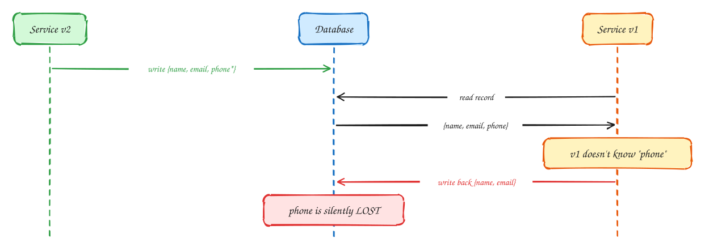
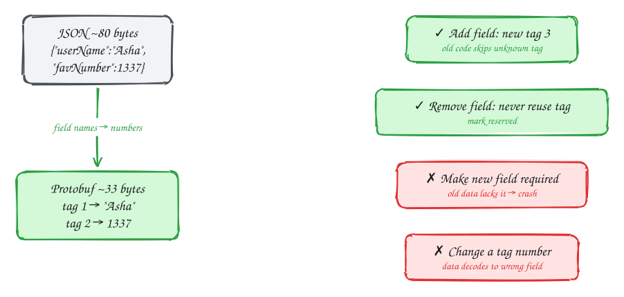
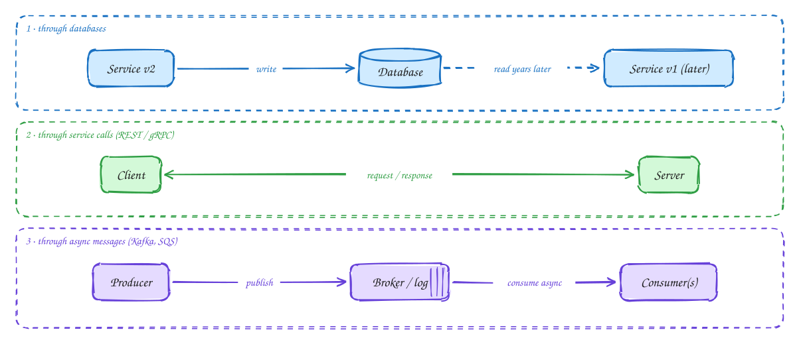
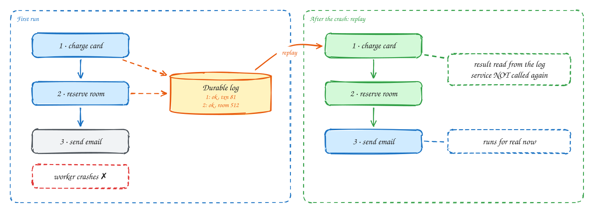

# DDIA Chapter 5: Encoding & Evolution

Intermediate

> These DDIA pages are study notes in our own words and diagrams, following the **2nd edition** of *Designing Data-Intensive Applications* by Martin Kleppmann and Chris Riccomini. They connect the book to interview problems and don't replace it; the book is worth reading in full.

> [!TIP]
> **One-page sketchnote:** [DDIA 5 · ENCODING & EVOLUTION on a single page](../sketchnotes/ddia-05.svg), for revision or printing.

## TL;DR

Data outlives code. During a rolling deploy, old and new versions of your service run at the same time, reading each other's data. Encoding formats such as Protobuf, Avro, and JSON decide whether that works or silently corrupts data.

Data also flows between services, and the 2nd edition adds two increasingly common ways it does: **durable execution** engines that make multi-step workflows survive crashes, and **event-driven** architectures built on message brokers.

**Key ideas:** backward compat · forward compat · JSON Schema · Protobuf field tags · Avro schemas · schema registry · REST / RPC · service discovery · durable execution · event-driven architecture

## Rolling upgrade: old and new code at the same time

*Why compatibility matters*

You almost never upgrade every server at the same instant. A **rolling deploy** replaces servers a few at a time, and mobile apps stay on old versions for months. So at any moment, **old code and new code are running side by side**, reading and writing the same database and the same messages. Each version must cope with data written by the other.

There are two directions to think about:

- **Backward compatibility:** new code can read data written by old code. This is usually easy: you know the old format, so you handle it.
- **Forward compatibility:** old code can read data written by new code. This is harder, because the old code was written before the new format existed.

Here is the classic way forward compatibility goes wrong:

1. You deploy v2 of the user service, which adds a new field, `phone`. A user updates their profile through a v2 server, and the record now includes a phone number.
2. The same user, a minute later, hits a server still running v1. It reads the record.
3. v1 decodes the record into its `User` class, which has no `phone` field, so the phone number is silently dropped in memory.
4. The user changes their name. v1 writes the **whole object** back, without `phone`. The phone number is now deleted from the database, and no error was raised anywhere.

The rule that prevents this: **old code must keep fields it doesn't understand** and write them back unchanged. Good encoding libraries (Protobuf, Avro) do this for you. Hand-written mapping code often doesn't.

> [!NOTE]
> **Summary of the two directions:** **backward compatible** means new code reads old data (easy). **Forward compatible** means old code reads new data (hard, and the example above).

## Protobuf / Thrift: field tags make evolution safe

*Binary encoding*

When data leaves a process, to disk or across the network, it must be turned into bytes (**encoding** or serialization). The format you choose decides how big the data is, how fast it is to process, and above all how safely it can **evolve**.

1. **JSON** is readable and everywhere, but it repeats every field name in every record, has no built-in schema, and is vague about numbers. JavaScript, for example, loses precision on integers above 2⁵³, which breaks large IDs. **JSON Schema** adds validation on top, and its evolution rules hinge on one setting: an **open content model** (`additionalProperties` allowed, the default) lets old readers accept records with new fields, while a **closed** one rejects them, which breaks forward compatibility.
2. **Protocol Buffers** (and Thrift) use a schema file in which every field gets a **tag number**: `string name = 1; string phone = 2;`. The encoded bytes contain only the tag numbers and values, not the names, so records are typically 2–3× smaller than JSON and faster to parse. Code for reading and writing is generated from the schema.
3. Tags are what make evolution safe. A reader that meets a tag it doesn't know just **skips it** (or keeps it, to write back). So the rules are: **add new fields with new tag numbers**, make them optional, and **never reuse** a tag number that was once used for something else.
4. Breaking changes are anything that makes old and new code read the same bytes differently: making a field required, changing a field's tag number, or changing its type to something incompatible (such as a string to a number).

> [!NOTE]
> **Avro does it differently:** Avro has no tag numbers. The reader is given **two schemas**, the one the data was written with (writer's schema) and the one it expects (reader's schema), and matches fields **by name**. That means every schema version must be stored somewhere, usually a **schema registry**, with each message carrying a schema ID. This setup is very common with Kafka.

## Three ways data flows between processes

*Modes of dataflow*

Encoded data travels in three main ways. Each has its own compatibility concerns.

1. **Through a database.** Writing to a database is like sending a message to your future self, or to a newer version of your code. A row written five years ago must still be readable today. Data outlives code, so you can't just rename a column and forget the old rows.
2. **Through service calls** (REST, gRPC). This looks like calling a function, but it isn't one. The call can time out, the network can lose the reply, and a retry can run it twice (see Chapter 9). Client and server deploy separately, and usually servers are upgraded first, so you need **backward compatibility on requests** (new server, old clients' requests) and **forward compatibility on responses** (old clients, new server's responses). Add optional fields, never change the meaning of existing ones, and version the API (`/v2/`, a header, or per-client pinned versions as Stripe does) for breaking changes.
3. **Through messages** (Kafka, RabbitMQ). The sender doesn't wait for the receiver. A broker in between stores the message, retries delivery and can deliver to several consumers. Producers and consumers are deployed by different teams at different times, so a schema registry that **rejects incompatible schema changes** keeps them from breaking each other.

**Finding the server.** A service runs on many instances that come and go, so callers need help to reach a healthy one: a **load balancer** (hardware, or software like nginx/Envoy) in front; **service discovery** (a registry such as Consul or DNS that lists live instances, so clients can pick one); or a **service mesh** (Istio, Linkerd), which runs a proxy next to every service to handle discovery, retries, TLS and metrics for it.

> [!WARNING]
> **The RPC illusion:** frameworks that make a remote call look exactly like a local function call hide the important parts: timeouts, retries and partial failure. Design every remote call with a timeout, and make it **idempotent** so a retry is harmless.

## Durable execution and workflows

*Making multi-step processes survive crashes*

**Why.** Booking a trip means: charge the card, reserve the room, send the confirmation email. Each step calls a different service. If the process crashes after charging the card but before reserving the room, what happens? Retry the whole thing and you charge twice; give up and the customer has paid for nothing. Writing the recovery logic by hand for every flow (state tables, retry jobs, compensation) is tedious and error-prone.

**How durable execution works** (Temporal, Restate, AWS Step Functions and similar):

1. You write the workflow as ordinary code: `charge(); reserve(); email();`. Each external call goes through the framework.
2. The framework **logs the result** of every step durably before moving on: "step 1 returned txn 81".
3. If the worker crashes, another worker starts the same workflow code from the top. This time, for steps already in the log, the framework **returns the recorded result instead of calling the service again**. The card is not charged twice.
4. Execution catches up to where it stopped and continues for real.

**The catches.** Replay only works if the workflow code is **deterministic**: given the same logged results, it must make the same calls in the same order. So no reading the clock, random numbers or unlogged I/O directly (the framework provides logged versions). Changing a workflow's code while old instances are still running needs care, because a replay must still line up with the old log; frameworks provide versioning for this. And the external services should still accept **idempotency keys**, because a crash between "call succeeded" and "result logged" can still cause one retry.

> [!NOTE]
> This is the engine-level version of the saga and orchestration patterns in [Multi-step processes](../patterns/multi-step-processes.md).

## Event-driven architectures

*Data flowing through messages*

**Why use a broker instead of calling directly.** With a direct call, the receiver must be up right now, and the sender must know who all the receivers are. A **message broker** (Kafka, RabbitMQ, Amazon SQS) sits in between and fixes both:

- It **buffers** messages if the receiver is down or slow, so the sender isn't blocked.
- It **redelivers** messages to a consumer that crashed, so nothing is lost.
- One message can go to **several consumers**, and the sender doesn't need to know who they are.
- It decouples deploys: sender and receiver evolve on their own schedules.

**Two delivery styles:** a **queue** gives each message to one of several consumers (to share out work), while a **topic** (publish/subscribe) gives every subscriber its own copy. Messages are usually one-way: the sender doesn't wait for an answer (if it needs one, the reply comes back on another channel).

**Compatibility still applies.** Producers and consumers are deployed by different teams, so messages need a schema, typically Avro, Protobuf or JSON Schema, with a **schema registry** that rejects incompatible changes. **AsyncAPI** documents message-based APIs the way OpenAPI documents REST ones.

**Distributed actors** (Akka, Orleans, Erlang/OTP) take the idea inside the program: each actor holds private state and communicates only by messages, and the framework can place actors on different machines. Rolling upgrades still need the messages to be forward and backward compatible.

## In the system design interview

> [!IMPORTANT]
> **Interviewer asks:** "How do you deploy schema changes with zero downtime?"  
> → **Expand → migrate → contract**: add the nullable column, deploy code that writes both, backfill, switch reads, and only then drop the old column.

> [!IMPORTANT]
> **Interviewer asks:** "How do Kafka producers and consumers evolve?"  
> → Avro or Protobuf with a **schema registry** enforcing backward-compatible changes. Consumers upgrade on their own schedule.

> [!IMPORTANT]
> **Interviewer asks:** "REST or gRPC between services?"  
> → gRPC (Protobuf, HTTP/2) for internal high-QPS calls; REST/JSON for public APIs and browsers.

> [!TIP]
> **Say this in the interview:** "Every message carries a schema version, and we only add optional fields. That lets the booking service deploy without coordinating with its consumers."

> [!IMPORTANT]
> **Interviewer asks:** "What happens if the order service crashes halfway through checkout?"
> → Model checkout as a durable workflow (Temporal-style) or a saga with persisted state: each step's result is recorded, so recovery resumes instead of repeating, and every external call carries an idempotency key.

## Self-check

Try to answer before you open each one.

Old code reads a record that new code wrote with an extra field, then saves it. What can go wrong, and what prevents it?

The old code may drop the unknown field when decoding and then write the record back without it, silently deleting data. Encoding libraries that preserve unknown fields (and code that doesn't rebuild records from a fixed class) prevent it.

Why must you never reuse a Protobuf tag number?

Old data and old code still associate that number with the old field. Reusing it makes the same bytes mean different things to different versions, corrupting data.

For a service API where servers upgrade before clients, which direction of compatibility do requests and responses need?

Requests need backward compatibility (the new server must accept old clients' requests). Responses need forward compatibility (old clients must cope with the new server's responses, e.g. ignore new fields).

Why must durable-execution workflow code be deterministic?

After a crash the code is re-run and logged results are fed back in. If the code makes different decisions on replay (because it read the clock or a random number), its calls no longer line up with the log and the recovery goes wrong.

## Related

- [REST vs GraphQL vs gRPC](../101/rest-graphql-grpc.md) · [Queue vs stream](../101/queue-vs-stream.md) · [Delivery guarantees](../101/delivery-guarantees.md)
- [Multi-step processes](../patterns/multi-step-processes.md) · [Long-running tasks](../patterns/long-running-tasks.md)

---

← [Ch 4: Storage and retrieval](04-storage-and-retrieval.md) · [Ch 6: Replication](06-replication.md) →
