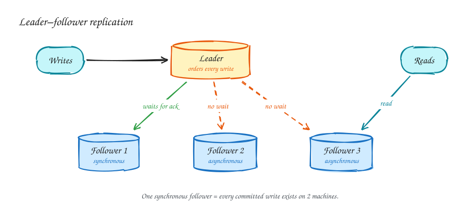
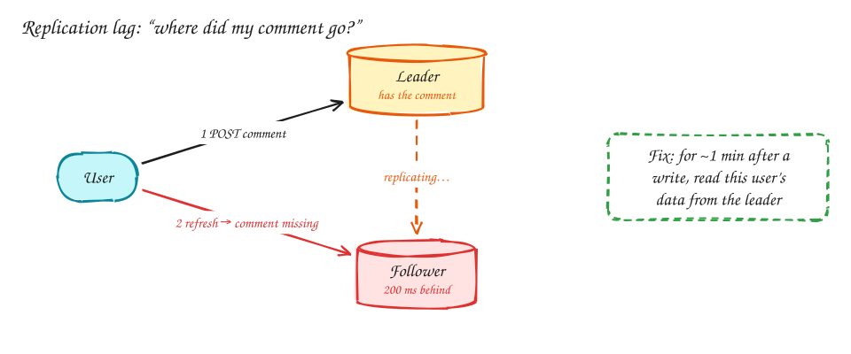
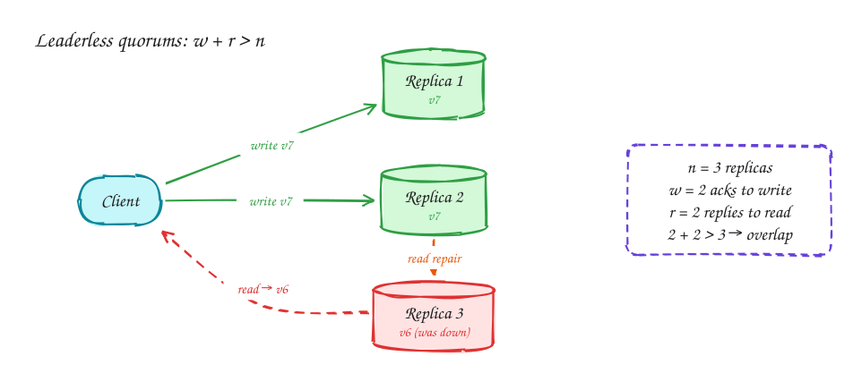

# DDIA Chapter 5: Replication

> This page is a study summary in our own words and diagrams, written to help you connect the book to interview problems. It is not a substitute for the book. *Designing Data-Intensive Applications* by Martin Kleppmann is worth reading in full.

## TL;DR

- Replication means keeping copies of the same data on several machines: to **survive failures**, to **serve more reads**, and to be **closer to users**.
- Copying data is easy. The hard part is **changes**: who accepts writes, how changes reach the copies, and what readers see while the copies disagree.
- Three designs: **single leader** (the default), **multi-leader** (writes in several regions), and **leaderless** (any replica accepts writes, using quorums).
- Most interview bugs here are **replication lag** bugs: a user writes something, reads it back from a replica, and it isn't there yet.

## 1. Leader–follower (single-leader) replication

- All writes go to **one leader**, which decides their order.
- The leader sends a stream of changes (its replication log) to every follower, and each follower applies them in the same order.
- Reads can go to followers. That spreads the load, but followers may be slightly behind.

Postgres, MySQL, MongoDB, Redis and Kafka (per partition) all work this way.

### Synchronous or asynchronous?

| | Synchronous follower | Asynchronous follower |
|---|---|---|
| Leader waits for it before confirming a write | Yes | No |
| Write latency | Higher; a slow follower slows every write | Unaffected |
| If the leader dies right after confirming | The write survives on the follower | Recent writes may be **lost** |

The common setup is **semi-synchronous**: one synchronous follower and the rest asynchronous. Every confirmed write then exists on at least two machines, without one slow follower blocking everything.

### When the leader dies (failover)

1. **Detect** it, usually because it stops answering for N seconds. Too short a timeout causes needless failovers; too long means more downtime.
2. **Promote** the most up-to-date follower.
3. **Reconfigure** clients and the remaining followers to use the new leader.

What goes wrong:

- **Lost writes:** with asynchronous replication, writes the old leader confirmed but never sent are gone.
- **Split brain:** the old leader comes back and still believes it's the leader, so two nodes accept writes. You need **fencing**: shut it out, or reject anything stamped with its old term number.

> [!TIP]
> **Say this in the interview:** "Failover is automatic, but with async replication we can lose the last moment of writes. For payments I'd require a synchronous replica before confirming."

## 2. Replication lag: the bugs users actually see

Followers are usually milliseconds behind, but under load it can be seconds or more. Three guarantees you may need:

| Guarantee | The bug without it | Common fix |
|---|---|---|
| **Read-your-writes** | "I posted a comment, refreshed, and it's gone." | Read the user's own data from the leader for a short window after they write, or until a replica has caught up to their last write. |
| **Monotonic reads** | "I saw 3 comments, refreshed, and now there are 2." | Pin each user to one replica, for example by a hash of their user id. |
| **Consistent prefix** | "I saw the reply before the question." | Keep related writes in the same partition, for example chat messages by conversation id. |

## 3. Multi-leader replication

Each region has its own leader that accepts local writes and syncs with the other regions asynchronously. Writes are fast everywhere and survive a region outage, **but two regions can change the same record at the same time**, and that conflict must be resolved somehow:

- **Last write wins:** simple, but it silently throws one write away.
- **Merge** the values, or keep both and ask the user, as file-sync tools do with "conflicted copy".
- **Conflict-free data types (CRDTs):** counters, sets and text editing that merge automatically.

The best strategy is usually to **avoid conflicts**: give each user or record a home region, so all its writes go to one leader.

## 4. Leaderless replication and quorums

There's no leader. The client (or a coordinator) sends each write to all *n* replicas and waits for *w* acknowledgements, and reads from *r* replicas.

- If **w + r > n**, the set of replicas you read from overlaps the set that took the latest write, so at least one reply is up to date. Pick the newest version.
- **Read repair** writes the newest value back to stale replicas you happened to read. A background anti-entropy process fixes the rest.
- Common setting: n = 3, w = 2, r = 2, which tolerates one replica down for both reads and writes.

Cassandra and DynamoDB-style systems use this. The catch: concurrent writes to the same key still need conflict handling, and "last write wins" by timestamp can drop data when clocks disagree.

## 5. How this shows up in interviews

| Interviewer asks | Answer from this chapter |
|---|---|
| "Your primary database dies. What happens?" | Automatic failover to a replica in tens of seconds. With async replication the last writes can be lost, so use a synchronous replica where that's unacceptable. |
| "A user updates a price, refreshes, and sees the old one." | Replication lag. Read-your-writes: route that user to the primary briefly. |
| "Active-active across regions?" | Multi-leader with conflicts. Prefer a home region per user or entity, and CRDTs for counters. |
| "Why Cassandra rather than Postgres replicas?" | Leaderless: no failover pause and writes keep working with a node down. The price is conflict handling and weaker consistency. |

## Related

- **Problems:** [Ticketmaster](../problems/ticketmaster.md): the seat map can come from a lagging replica; the booking must not.
- **Core concepts:** [Caching](../core-concepts/caching.md) has the same staleness trade-off as reading from replicas.
- **Next chapter:** Ch 6 Partitioning *(coming next)*
