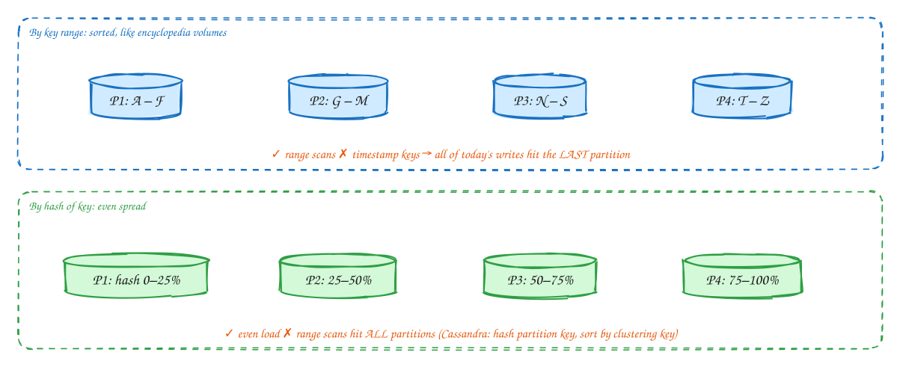
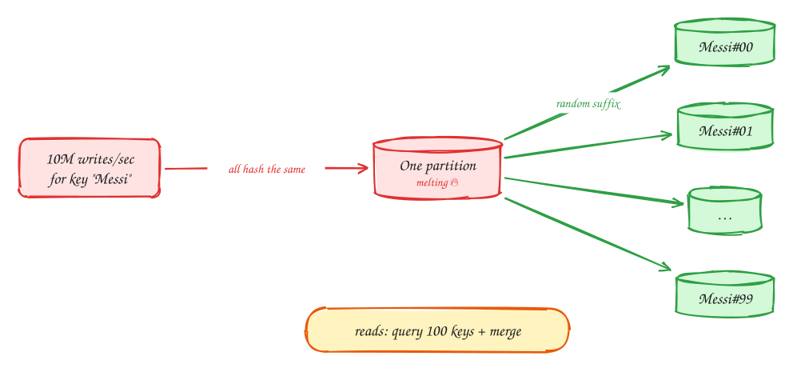
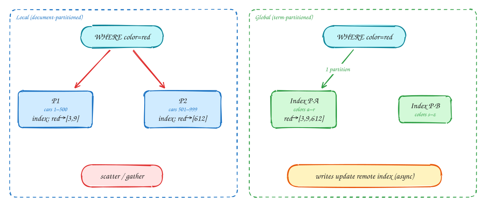
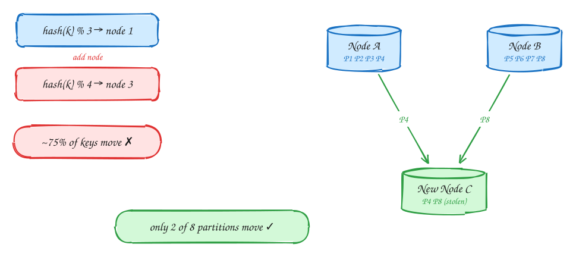
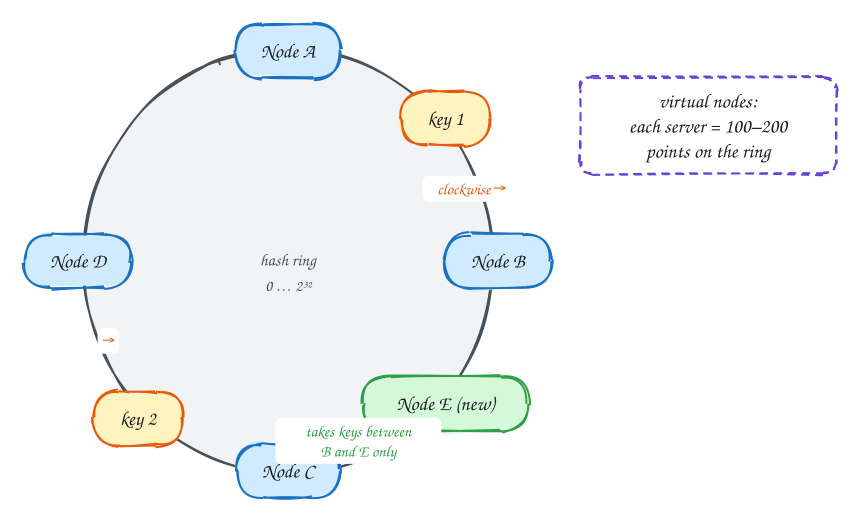
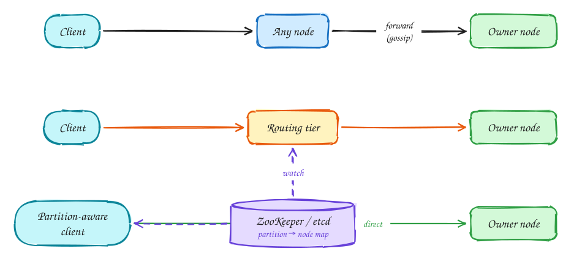

# DDIA Chapter 6: Partitioning (Sharding)

> These DDIA pages are study notes in our own words and diagrams, connecting the book to interview problems. They don't replace the book; *Designing Data-Intensive Applications* by Martin Kleppmann is worth reading in full.

> [!TIP]
> **One-page sketchnote:** [DDIA 6 · PARTITIONING (SHARDING) on a single page](../sketchnotes/ddia-06.svg), for revision or printing.

## TL;DR

When data or write load is too big for one machine, split it. Each record belongs to exactly one partition. The goals are to spread data and load evenly, avoid **hot spots**, and move as little data as possible when nodes are added.

**Key ideas:** key-range · hash partitioning · hot spots · secondary indexes · rebalancing · consistent hashing · request routing

## Key-range vs hash partitioning

*How to split*

1. **Key range**: efficient range queries. But sequential keys (timestamps, auto-increment IDs) send all writes to one partition, a hot spot.
2. **Hash**: hash(key) spreads keys evenly, so load is uniform. You lose range queries on the key. The compound-key trick: hash the first part (user_id), sort within it by the second (timestamp).

> [!TIP]
> **Say this in the interview:** "I'll partition messages by hash(conversation_id) and cluster by message timestamp, so one conversation's history is a single-partition range scan."

## Skew and hot spots: the celebrity problem

*Hot keys*

1. Hashing can't fix a single hot **key**. Every write for "Messi" goes to the same partition.
2. Split the key: append a random suffix 00–99 so writes spread over 100 partitions.
3. The cost moves to reads, which must fetch all 100 sub-keys and merge. Only do this for keys you **know** are hot, and track which ones those are.

> [!NOTE]
> **Interview examples:** Live comments on a celebrity post, Ticketmaster's Taylor Swift on-sale, YouTube view counters, an ad campaign's click counter. All use **key splitting or write buffering**.

## Secondary indexes: local vs global

*Partitioning + indexes*

1. **Local**: each partition indexes only its own documents. Writes are simple (one partition), but a query by color must ask **every** partition and merge, so tail latency compounds. Used by MongoDB, Cassandra, and Elasticsearch shards.
2. **Global**: the index itself is partitioned by term. A read hits one index partition, but a write must update index partitions on other nodes, usually **asynchronously**, so the index lags. Used by DynamoDB GSIs.

> [!WARNING]
> **DynamoDB GSI:** Global secondary indexes are **eventually consistent**. A read right after a write via the GSI may miss it.

## Rebalancing: never use hash mod N

*Adding nodes*

1. With mod N, changing N from 3 to 4 changes the answer for about 75% of keys, so almost all data moves.
2. Better: create **many more partitions than nodes** up front (for example 1,000 partitions on 10 nodes). Key→partition never changes; only partition→node does.
3. A new node **steals a few whole partitions** from each existing node. Used by Elasticsearch, Kafka, Riak, and Couchbase. Consistent hashing (next slide) is the ring version of this idea.

> [!NOTE]
> **Other strategies:** **Dynamic**: split a partition when it grows past ~10GB (HBase, MongoDB). **Per-node**: a fixed number of partitions per node (Cassandra vnodes).

## Consistent hashing: the ring

*Consistent hashing*

1. Hash both nodes and keys onto the same circle.
2. A key belongs to the **first node clockwise** from it.
3. Add node E: only keys between B and E move (from C to E). That is about 1/N of the data, not 75%.
4. With few nodes, arcs are uneven. **Virtual nodes** place each server at many points so load evens out, and a bigger server gets more points.

> [!TIP]
> **Say this in the interview:** "Cache keys are placed on a consistent-hash ring with virtual nodes, so adding a cache node remaps only about 1/N of keys and avoids a cold-cache stampede on the database."

## Request routing: who knows where key K lives?

*Service discovery*

1. ① Contact any node, which forwards the request if needed. Nodes learn the map via **gossip**. Used by Cassandra and Riak.
2. ② A partition-aware **routing tier** forwards the request. Used by MongoDB mongos and Vitess VTGate.
3. ③ A **smart client** knows the map and goes straight to the owner. Used by Kafka clients, Redis Cluster clients, and Cassandra drivers.
4. The map itself lives in a coordination service (ZooKeeper, etcd, KRaft), and routers or clients **watch** it for changes.

## In the interview

> [!IMPORTANT]
> **Interviewer asks:** "How would you shard this?"  
> → Name the **shard key** from the hottest query: "hash(user_id), because every hot query filters by user". Then name the cost: cross-user queries scatter.

> [!IMPORTANT]
> **Interviewer asks:** "What about the celebrity or hot hotel?"  
> → Key splitting with a suffix, write buffering in Redis or Kafka, and a cache in front for reads.

> [!IMPORTANT]
> **Interviewer asks:** "Adding shards later?"  
> → Pre-split into many logical partitions (e.g., 1024) mapped to few physical nodes, or consistent hashing. Never mod N.

> [!WARNING]
> **Sharding too early:** A single Postgres handles ~10–50k TPS and multiple TB. Shard only when the **calculation** says one primary can't take the write load.

---

← [Ch 5: Replication](05-replication.md) · [Ch 7: Transactions](07-transactions.md) →
