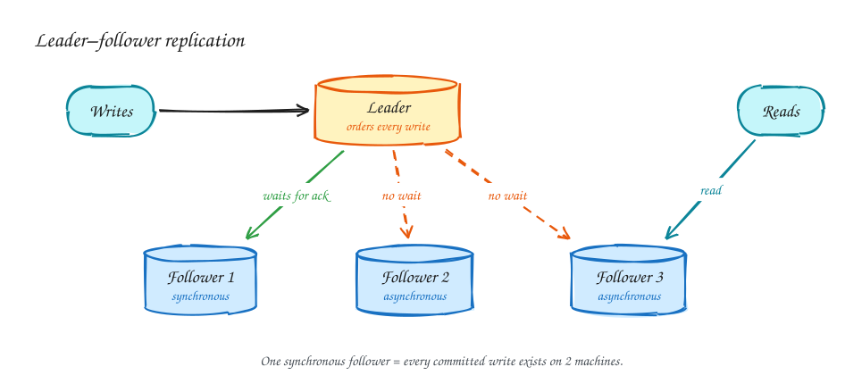
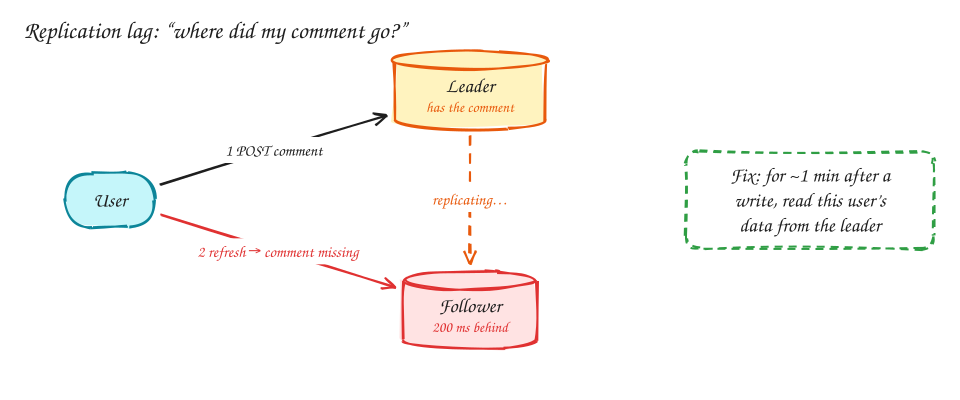
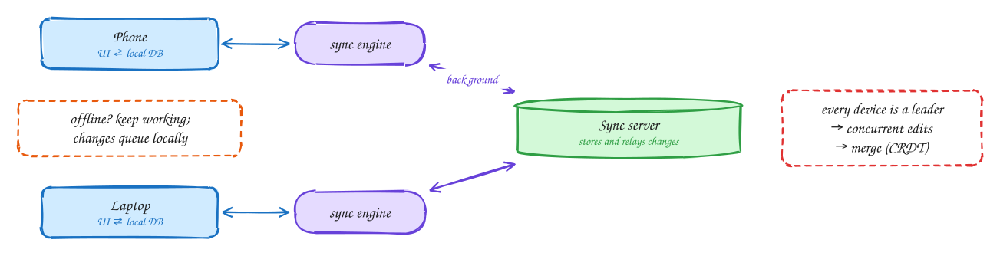
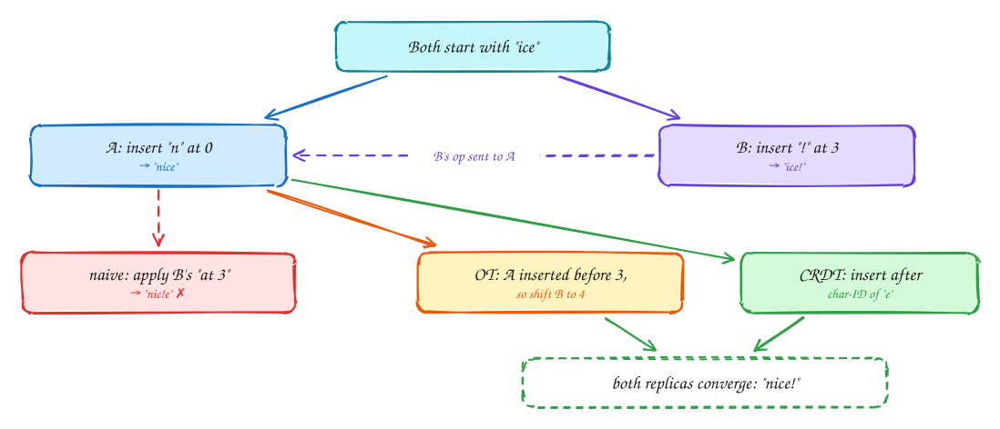
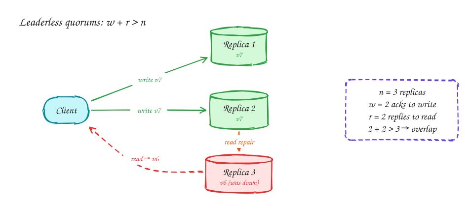

# DDIA Chapter 6: Replication

Advanced

> These DDIA pages are study notes in our own words and diagrams, following the **2nd edition** of *Designing Data-Intensive Applications* by Martin Kleppmann and Chris Riccomini. They connect the book to interview problems and don't replace it; the book is worth reading in full.

> [!TIP]
> **One-page sketchnote:** [DDIA 6 · REPLICATION on a single page](../sketchnotes/ddia-06.svg), for revision or printing.

## TL;DR

- Replication means keeping copies of the same data on several machines: to **survive failures**, to **serve more reads**, and to be **closer to users**.
- Copying data is easy. The hard part is **changes**: who accepts writes, how changes reach the copies, and what readers see while the copies disagree.
- Three designs: **single leader** (the default), **multi-leader** (writes in several regions), and **leaderless** (any replica accepts writes, using quorums).
- Most interview bugs here are **replication lag** bugs: a user writes something, reads it back from a replica, and it isn't there yet.
- New in the 2nd edition: databases that replicate through **object storage**, **sync engines** for offline-first apps (each device is a leader), and a deeper look at merging conflicts with **CRDTs** and operational transformation.

## 1. Leader–follower (single-leader) replication

- All writes go to **one leader**, which decides their order.
- The leader sends a stream of changes (its replication log) to every follower, and each follower applies them in the same order.
- Reads can go to followers. That spreads the load, but followers may be slightly behind.

Postgres, MySQL, MongoDB, Redis and Kafka (per partition) all work this way.

> [!WARNING]
> **Replication is not a backup.** A replica faithfully copies every change, including `DELETE FROM orders` run by mistake or data corrupted by a bug. A backup is a copy **from the past** that you can restore to. You need both: replication for availability, backups for recovering from mistakes.

### Synchronous or asynchronous?

| | Synchronous follower | Asynchronous follower |
|---|---|---|
| Leader waits for it before confirming a write | Yes | No |
| Write latency | Higher; a slow follower slows every write | Unaffected |
| If the leader dies right after confirming | The write survives on the follower | Recent writes may be **lost** |

The common setup is **semi-synchronous**: one synchronous follower and the rest asynchronous. Every confirmed write then exists on at least two machines, without one slow follower blocking everything.

### When the leader dies (failover)

1. **Detect** it, usually because it stops answering for N seconds. Too short a timeout causes needless failovers; too long means more downtime.
2. **Promote** the most up-to-date follower.
3. **Reconfigure** clients and the remaining followers to use the new leader.

What goes wrong:

- **Lost writes:** with asynchronous replication, writes the old leader confirmed but never sent are gone.
- **Split brain:** the old leader comes back and still believes it's the leader, so two nodes accept writes. You need **fencing**: shut it out, or reject anything stamped with its old term number.

> [!TIP]
> **Say this in the interview:** "Failover is automatic, but with async replication we can lose the last moment of writes. For payments I'd require a synchronous replica before confirming."

### Databases built on object storage

**Why.** Cloud object storage (S3, GCS) is cheap, very durable, and already replicated across availability zones. If the database writes its data there, it doesn't have to manage its own disk replication, and compute nodes become nearly stateless (Chapter 1).

**How.** The main obstacle used to be that object storage only let you write whole files, with no way to update in place or coordinate two writers. Object stores now support **conditional writes** ("create this file only if it doesn't exist", or "replace it only if its version is still X"), which is a compare-and-set that a database can build on, for example to elect a leader or commit a new version of a table. Systems like WarpStream and Bufstream (Kafka-compatible), Turbopuffer (vector search) and SlateDB (an LSM engine) use a **zero-disk architecture**: everything durable lives in object storage, and local disks are only caches. The trade-off is latency: an object-storage write takes tens of milliseconds, so writes are batched.

## 2. Replication lag: the bugs users actually see

Followers are usually milliseconds behind, but under load it can be seconds or more. Three guarantees you may need:

| Guarantee | The bug without it | Common fix |
|---|---|---|
| **Read-your-writes** | "I posted a comment, refreshed, and it's gone." | Read the user's own data from the leader for a short window after they write, or until a replica has caught up to their last write. |
| **Monotonic reads** | "I saw 3 comments, refreshed, and now there are 2." | Pin each user to one replica, for example by a hash of their user id. |
| **Consistent prefix** | "I saw the reply before the question." | Keep related writes in the same partition, for example chat messages by conversation id. |

## 3. Multi-leader replication

Each region has its own leader that accepts local writes and syncs with the other regions asynchronously. Writes are fast everywhere and survive a region outage, **but two regions can change the same record at the same time**, and that conflict must be resolved somehow.

Leaders can be wired together in different **topologies**: all-to-all (every leader sends to every other), a ring, or a star. All-to-all tolerates a failed node best, but messages can arrive out of order (an update can overtake the insert it modifies), so systems need version tracking to apply them correctly.

### Sync engines and local-first software

**Why.** Notes apps, to-do lists, Figma and Google Docs need to work **offline** and feel instant. If every keystroke waits for a server round trip, the app is slow on a bad connection and dead without one.

**How.**

1. Each device keeps a **local database** with the user's data. The UI reads and writes it directly, so it responds immediately, online or not.
2. A **sync engine** in the background pushes local changes to a server and pulls everyone else's changes.
3. Offline? Changes queue locally and sync when the connection returns, possibly days later.

Look closely and this is **multi-leader replication** where every device is a leader. So concurrent edits *will* happen and must merge cleanly. **Local-first** software takes the idea further: the copy on your device is the primary one, so the app keeps working even if the company's servers go away. Libraries such as Automerge and Yjs, and services like Firestore, provide sync engines.

### Dealing with conflicting writes

**Conflict avoidance** is still the best strategy where it fits: give each user or record a home leader, so all its writes go through one place.

When conflicts can't be avoided, the options:

- **Last write wins (LWW):** attach a timestamp and keep the newest. Simple, but it **silently discards** the other write, and with skewed clocks (Chapter 9) it can discard the *newer* one. Acceptable only when losing a concurrent write is fine, such as a cache.
- **Keep both ("siblings")** and let the application merge them, or show the user, like a "conflicted copy" in file sync. Merging needs care: Amazon's shopping cart merged siblings by taking the **union** of items, so an item a user *removed* could reappear, because the removal wasn't recorded as anything to merge.
- **Merge automatically**, using algorithms designed for it:

1. Both users start with the text "ice". User A inserts "n" at position 0 → "nice". User B, at the same time, inserts "!" at position 3 → "ice!".
2. If A's copy naively applies B's edit "insert at 3", it gets "nic!e": the position was correct for B's text but A's insert shifted everything.
3. **Operational transformation (OT)**, used by Google Docs, *transforms* incoming edits against the edits that happened concurrently: A's insert came before position 3, so B's insert moves to position 4 → "nice!".
4. A **CRDT** (conflict-free replicated data type), used by Automerge and Yjs, gives every character a unique ID and expresses edits relative to IDs ("insert after the 'e'"), so edits apply correctly in any order → "nice!".

CRDTs exist for counters, sets, maps, lists and text. They guarantee **strong eventual consistency**: any two replicas that have received the same set of updates are in the same state, whatever order the updates arrived in.

> [!NOTE]
> Merging automatically guarantees the replicas **agree**, not that the result makes sense to a human. Two people renaming the same file differently still need a rule, or a person, to pick one.

## 4. Leaderless replication and quorums

There's no leader. The client (or a coordinator) sends each write to all *n* replicas and waits for *w* acknowledgements, and reads from *r* replicas.

- If **w + r > n**, the set of replicas you read from overlaps the set that took the latest write, so at least one reply is up to date. Pick the newest version.
- **Read repair** writes the newest value back to stale replicas you happened to read. A background **anti-entropy** process fixes the rest: replicas compare **Merkle trees** (trees of hashes over key ranges) and walk down only the branches whose hashes differ, so they find the few out-of-date keys without comparing billions. See [Merkle trees](../core-concepts/merkle-trees.md).
- Common setting: n = 3, w = 2, r = 2, which tolerates one replica down for both reads and writes.

Cassandra and DynamoDB-style systems use this. The catch: concurrent writes to the same key still need conflict handling, and "last write wins" by timestamp can drop data when clocks disagree.

**Why leaderless helps with slow nodes.** A single-leader system stalls during failover, and it suffers when the leader is **slow but not dead** (a *gray failure*: a bad disk, a noisy neighbour), because nothing triggers a failover. A leaderless client just takes the fastest *w* or *r* responses and ignores the slow replica. **Request hedging** pushes this further: send to extra replicas and use whichever answers first.

**Across regions**, sending every write to replicas on other continents would make each one slow. Cassandra lets you choose quorums **within the local datacenter** (`LOCAL_QUORUM`) and replicate to other regions asynchronously, which brings back the multi-leader trade-off: fast local writes, conflicts across regions.

## 5. In the system design interview

| Interviewer asks | Answer from this chapter |
|---|---|
| "Your primary database dies. What happens?" | Automatic failover to a replica in tens of seconds. With async replication the last writes can be lost, so use a synchronous replica where that's unacceptable. |
| "A user updates a price, refreshes, and sees the old one." | Replication lag. Read-your-writes: route that user to the primary briefly. |
| "Active-active across regions?" | Multi-leader with conflicts. Prefer a home region per user or entity, and CRDTs for counters. |
| "Why Cassandra rather than Postgres replicas?" | Leaderless: no failover pause and writes keep working with a node down. The price is conflict handling and weaker consistency. |
| "The app must work offline." | Local database on the device plus a sync engine; every device is a leader, so merge concurrent edits with CRDTs (or OT for text). |

## Self-check

Try to answer before you open each one.

Why doesn't replication protect you from an accidental DELETE?

Replicas copy every change, including the mistaken delete, within seconds. Only a backup or point-in-time recovery restores data as it was before the mistake.

A user posts a comment, refreshes, and it's gone; refreshing again shows it. What happened, and what guarantee fixes it?

The refresh was served by a follower that hadn't received the write yet (replication lag). Read-your-writes: route that user's reads of their own data to the leader (or an up-to-date replica) for a while after they write.

With n = 3, w = 2, r = 2, why does every read see the latest acknowledged write?

w + r = 4 > 3, so the two replicas you read from must overlap with the two that acknowledged the write; at least one reply has the latest version.

Why is an offline-capable notes app a form of multi-leader replication, and what follows from that?

Every device accepts writes locally and syncs later, so each device acts as a leader. Concurrent edits on different devices are inevitable and must be merged, for example with CRDTs.

Why did Amazon's shopping cart sometimes bring back deleted items?

Conflicting versions of the cart were merged by taking the union of their items. A removal left nothing to merge, so the item from the other version came back. Deletions need to be recorded explicitly (as tombstones) for a merge to respect them.

## Related

- **Problems:** [Ticketmaster](../problems/ticketmaster.md): the seat map can come from a lagging replica; the booking must not.
- **Core concepts:** [Caching](../core-concepts/caching.md) has the same staleness trade-off as reading from replicas.
- **Pattern:** [Scaling reads](../patterns/scaling-reads.md)
- **Problems:** [Collaborative editor](../problems/collaborative-editor.md) (OT and CRDTs) · [File sync](../problems/file-sync.md) (offline edits and conflicts)
- **101:** [Replication](../101/replication.md)
- **Concepts:** [Disaster recovery and multi-region](../core-concepts/disaster-recovery.md) · [Merkle trees](../core-concepts/merkle-trees.md)
- **Problem:** [Distributed key-value store (Dynamo)](../problems/key-value-store.md) puts this chapter together

---

← [Ch 5: Encoding and evolution](05-encoding-and-evolution.md) · [Ch 7: Sharding](07-sharding.md) →
