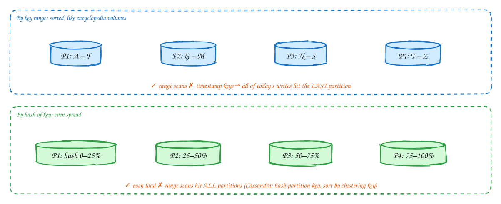
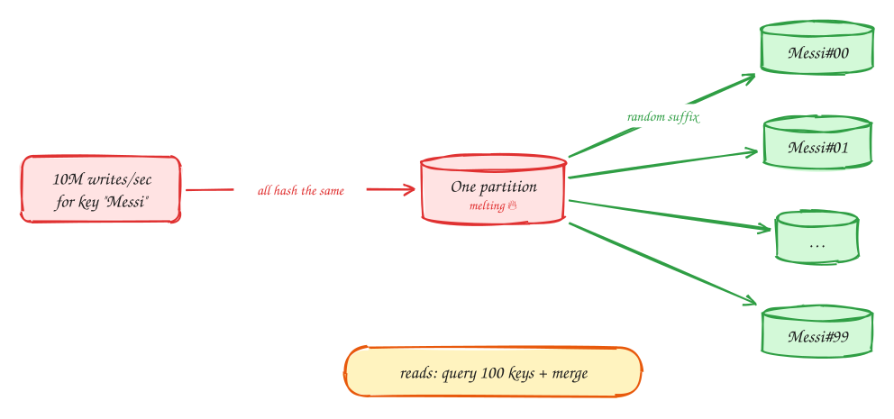
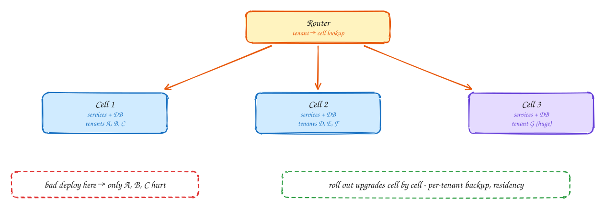
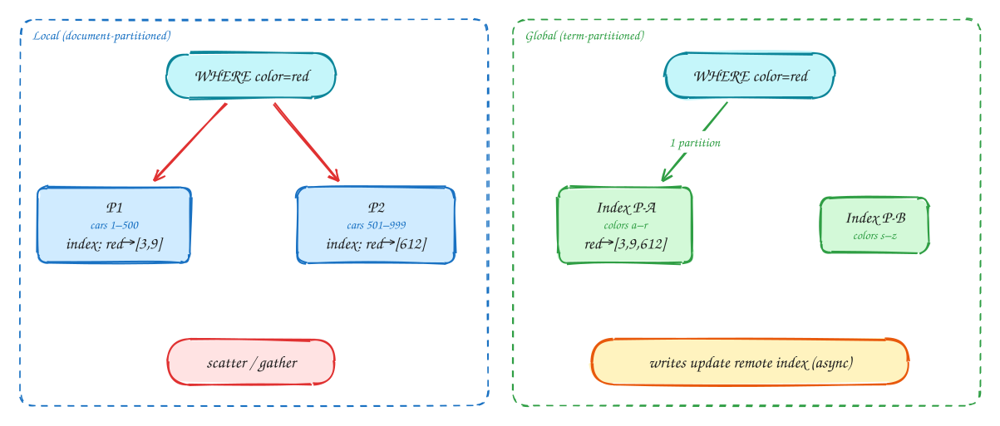
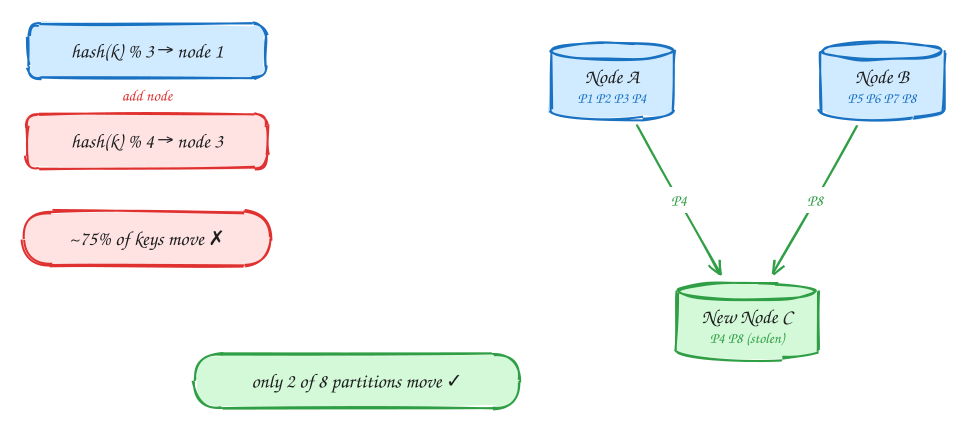
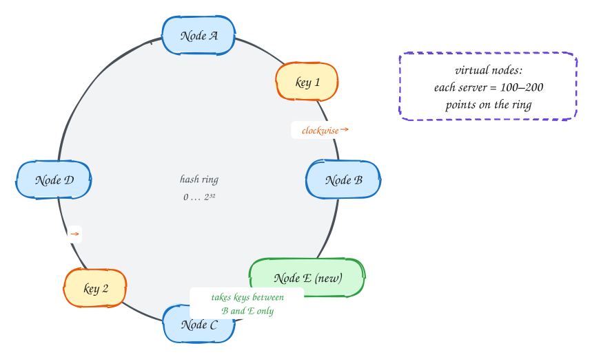
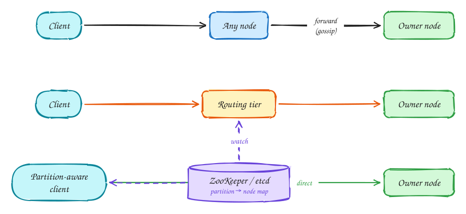

# DDIA Chapter 7: Sharding

Advanced

> These DDIA pages are study notes in our own words and diagrams, following the **2nd edition** of *Designing Data-Intensive Applications* by Martin Kleppmann and Chris Riccomini. They connect the book to interview problems and don't replace it; the book is worth reading in full.

> [!TIP]
> **One-page sketchnote:** [DDIA 7 · SHARDING on a single page](../sketchnotes/ddia-07.svg), for revision or printing.

## TL;DR

When data or write load is too big for one machine, split it. Each record belongs to exactly one **shard** (the 1st edition called it a *partition*; the 2nd edition uses *sharding* throughout). The goals are to spread data and load evenly, avoid **hot spots**, and move as little data as possible when nodes are added. Sharding is also how **multitenant** SaaS systems isolate customers.

**Key ideas:** key-range · hash sharding · hot spots · multitenancy · cells · secondary indexes · rebalancing · consistent hashing · request routing

## Sharding is heavyweight: do you need it?

*Before you split*

Sharding brings real costs: queries that span shards are slower and harder, transactions across shards need distributed protocols (Chapter 8), and operations get more complex. So the book's advice is blunt: **if one node can handle the data and the load, don't shard**. A single server today can hold tens of terabytes and handle tens of thousands of transactions a second, and replication (Chapter 6) handles read scaling and fault tolerance without sharding.

Two less obvious uses of the idea: some systems shard **inside one machine**, one shard per CPU core with no sharing between cores, to avoid lock contention (ScyllaDB and Redpanda work this way). And warehouses split big tables by a **partition key** (often date) and sort within each partition by a **cluster key**, purely so queries can skip whole chunks of data, not to spread load.

## Key-range vs hash sharding

*How to split*

Replication (Chapter 6) puts **copies of the same data** on several machines. Partitioning, also called **sharding**, is different: it splits the data so each machine holds **a different part**. You need it when the data is too big for one machine, or there are too many writes for one machine. Every record lives in exactly one partition, and the first decision is **how to choose the partition for a key**.

1. **By key range.** Like volumes of an encyclopedia: A–F on partition 1, G–M on partition 2, and so on. Keys stay sorted, so a range query such as "all orders from 1 to 7 March" reads one or two neighbouring partitions. The danger is keys that arrive **in order**. If the key is a timestamp or an auto-increment ID, every new write lands at the end, in the **same** partition. That partition gets all the write load while the others sit idle. This is a **hot spot**.
2. **By hash of the key.** Run the key through a hash function and use the result to pick the partition. Similar keys get completely different hashes, so data and load spread evenly. The cost: neighbouring keys are now scattered, so a range query over the key has to ask every partition.

**Splitting by hash range.** Instead of `hash mod N` (see rebalancing below), most systems give each shard a **contiguous range of hash values**, for example 0–999 on shard 1, 1000–1999 on shard 2. A hot or oversized shard can then be split in two by halving its hash range. DynamoDB, YugabyteDB and MongoDB (hashed shard keys) do this. Cassandra and ScyllaDB divide the hash ring into many ranges per node (by default 16 per node in Cassandra 4+, 256 in ScyllaDB).

A common way to get both is a **compound key**. Hash the first part, for example `user_id`, to pick the partition, and keep rows **sorted by the second part**, for example a timestamp, inside it. "User 42's messages from last week" then lives in one partition, already in order. This is how Cassandra's partition key plus clustering key works.

> [!TIP]
> **Say this in the interview:** "I'll partition messages by hash(conversation_id) and cluster by message timestamp, so one conversation's history is a single-partition range scan."

## Skew and hot spots: the celebrity problem

*Hot keys*

Hashing spreads **different keys** evenly, but it can't help when **one key** gets a huge share of the traffic. Every write for that key goes to the same partition, whatever the hash function.

1. A celebrity posts, and millions of likes and comments for that **one post ID** hit one partition. The rest of the cluster is fine; that one node is overloaded.
2. The fix is to **split the key**. Append a random number from 00 to 99 to it (`post123_07`, `post123_42`…), so the writes spread across up to 100 partitions.
3. The cost moves to reads: to get the full count or all the comments, you now read all 100 sub-keys and combine them. So only split keys you **know** are hot, and keep a list of which ones they are so readers know to combine.

> [!NOTE]
> **Interview examples:** live comments on a celebrity post, a Taylor Swift on-sale on Ticketmaster, YouTube view counters, an ad campaign's click counter. All use **key splitting** or **write buffering**: absorb the writes in Redis or Kafka and apply them in batches.

## Sharding for multitenancy

*One shard per customer*

**Why.** A SaaS product (Slack, Shopify, a CRM) serves thousands of business customers, called **tenants**. Putting every tenant's data in one big shared database is simple, but one tenant's runaway query slows everyone, a bug in one tenant's data can leak into another's, and a bad migration hits all customers at once.

**How.** Make the tenant the shard key: each tenant's data lives in one shard (small tenants can share a shard; a huge tenant gets its own). That buys:

- **Resource isolation:** a noisy tenant mostly hurts its own shard.
- **Permission isolation:** a query bug is less likely to cross tenants when tenants live in separate databases.
- **Per-tenant operations:** backup or restore one customer, delete one customer's data entirely (GDPR), keep a European customer's data in Europe (**data residence**), and roll out a schema migration to a few tenants first.

Taken further, this becomes a **cell-based architecture**:

1. A thin **router** looks up which cell a tenant belongs to.
2. Each **cell** is a complete, independent copy of the services and the database, serving a group of tenants.
3. A bad deploy, overload or outage in one cell affects only that cell's tenants: the **blast radius** is limited. Upgrades roll out cell by cell.

**The challenges:** a tenant that outgrows its shard needs moving or splitting; many small tenants on many shards make schema changes and monitoring heavier; and features that work **across** tenants (global search, analytics over all customers) need a separate pipeline, typically into a warehouse.

## Secondary indexes: local vs global

*Partitioning + indexes*

Partitioning by the primary key makes "get item 123" easy: hash the key, go to that partition. But what about "find all **red** cars"? Colour is not the partition key, so red cars are spread over every partition. A **secondary index** is needed, and there are two ways to partition it.

1. **Local index** (one index per partition): each partition indexes only its own records. Writing a car touches one partition, simple and fast. But a query for red cars must ask **every** partition and merge the answers (*scatter-gather*). The query is as slow as the slowest partition, and that gets worse as partitions are added (tail latency amplification, Chapter 2). MongoDB, Cassandra and Elasticsearch work this way.
2. **Global index** (the index is partitioned by the indexed value): all the "red" entries live on one index partition, so a query reads one place. But writing one car may now update index partitions on other machines. That is usually done **asynchronously**, so the index lags behind for a moment. DynamoDB's global secondary indexes work this way.

> [!WARNING]
> **DynamoDB GSI:** global secondary indexes are **eventually consistent**. A read through the GSI right after a write may not see it yet.

## Rebalancing: never use hash mod N

*Adding nodes*

Sooner or later you add machines, and some data must move to them. Moving data is expensive (network, disk, slower queries while it happens), so a good scheme moves **as little as possible**.

1. The tempting approach is `partition = hash(key) mod N`, where N is the number of nodes. Going from 3 to 4 nodes changes the result of `mod N` for about **75% of keys**, so nearly all the data has to move at once.
2. Better: create **many more partitions than nodes** from the start, for example 1,000 partitions on 10 nodes (100 each). The key-to-partition mapping is fixed forever. Only the **partition-to-node** assignment changes.
3. When an 11th node joins, it takes **a few whole partitions** from each existing node until all are even. Only those partitions move. Elasticsearch, Kafka, Riak and Couchbase work this way. Consistent hashing, next, is the same idea arranged as a ring.

> [!NOTE]
> **Other strategies:** **dynamic sharding** splits a shard when it grows past a size, such as about 10 GB, and merges small ones (HBase, MongoDB, DynamoDB). **Per-node ranges** give each node a fixed number of hash ranges (Cassandra, ScyllaDB). With a **fixed number of shards** chosen up front (Citus, Elasticsearch), choose generously, because changing the count later is painful.

**Automatic or manual rebalancing?** Fully automatic rebalancing is convenient but risky: if a node is merely slow, the system may decide it's dead and start moving its data, adding load to an already-struggling cluster and possibly triggering a **cascading failure**. Many operators prefer the system to *propose* a rebalancing plan and a human to approve it.

## Consistent hashing: the ring

*Consistent hashing*

**Consistent hashing** is a way to assign keys to nodes so that adding or removing a node moves only a small share of keys. It is used by caches, Cassandra and DynamoDB.

1. Picture a circle of hash values. Hash each **node** to a point on the circle, and hash each **key** to a point too.
2. A key belongs to the **first node clockwise** from it.
3. Add a new node E. It lands somewhere on the circle and takes over only the keys between its position and the previous node, keys that used to belong to the next node clockwise. Everything else stays put. On average about **1/N** of the keys move, not 75%.
4. With only a few nodes, their points can land unevenly, leaving one node a huge arc. **Virtual nodes** fix this: each server is placed at many points (say 100) around the circle, so arcs average out. A bigger server can be given more points so it takes more load.

**Other ways to get the same property.** **Rendezvous (highest-random-weight) hashing:** for each key, compute a score for every node as `hash(key, node)` and pick the highest; when a node is removed, only its keys move. **Jump consistent hash** maps a key to one of N buckets with a tiny, fast function, moving the minimum number of keys when N grows. Both avoid the ring's need for virtual nodes.

> [!TIP]
> **Say this in the interview:** "Cache keys are placed on a consistent-hash ring with virtual nodes, so adding a cache node remaps only about 1/N of keys and avoids a cold-cache stampede on the database."

## Request routing: who knows where key K lives?

*Service discovery*

Once data is split across machines, every request needs to reach the right one. And because partitions move during rebalancing, the answer changes over time. There are three common designs:

1. **① Ask any node.** The client connects to any node. If that node doesn't hold the key, it forwards the request to the one that does. Nodes share the partition map with each other by **gossip**. Used by Cassandra and Riak.
2. **② A routing tier.** Clients talk to a separate layer of routers that know the map and forward each request. Used by MongoDB (`mongos`) and Vitess (`VTGate`).
3. **③ A smart client.** The client library itself knows the map and connects directly to the right node, with no extra hop. Used by Kafka clients, Redis Cluster clients and Cassandra drivers.
4. Whoever does the routing needs an up-to-date map. It is usually stored in a coordination service such as **ZooKeeper** or **etcd** (or Kafka's KRaft). Routers and clients **watch** it, so they hear about every change immediately.

## In the system design interview

> [!IMPORTANT]
> **Interviewer asks:** "How would you shard this?"  
> → Name the **shard key** from the hottest query: "hash(user_id), because every hot query filters by user". Then name the cost: cross-user queries scatter.

> [!IMPORTANT]
> **Interviewer asks:** "What about the celebrity or hot hotel?"  
> → Key splitting with a suffix, write buffering in Redis or Kafka, and a cache in front for reads.

> [!IMPORTANT]
> **Interviewer asks:** "Adding shards later?"  
> → Pre-split into many logical partitions (e.g., 1024) mapped to few physical nodes, or consistent hashing. Never mod N.

> [!IMPORTANT]
> **Interviewer asks:** "How do you stop one big customer from hurting the others?"
> → Shard by tenant; give the largest tenants dedicated shards or cells; route via a tenant→cell lookup so incidents and deploys have a limited blast radius.

> [!WARNING]
> **Sharding too early:** A single Postgres handles ~10–50k TPS and multiple TB. Shard only when the **calculation** says one primary can't take the write load.

## Self-check

Try to answer before you open each one.

Why does sharding by timestamp create a hot spot, and how do you avoid it?

New writes all have the latest timestamp, so they all land on the shard holding the newest range. Hash a different key first (e.g. hash(sensor_id), then sort by time within the shard) so writes spread out.

Going from 3 to 4 nodes with hash(key) mod N moves about 75% of keys. What's the better approach?

Create many more shards than nodes up front (or split by hash range) and move whole shards to the new node, or use consistent/rendezvous hashing. Only about 1/N of the data then moves.

What does a local secondary index cost at query time, compared with a global one?

A local index must be queried on every shard and the results merged (scatter-gather), so the query is as slow as the slowest shard. A global index is read in one place but makes writes touch other shards, usually asynchronously, so it can lag.

Name three things you get from putting each tenant on its own shard or cell.

Resource isolation (noisy neighbours hurt only their shard), per-tenant backup/restore and deletion, data residence per region, gradual schema rollouts, and a limited blast radius for bad deploys.

## Related

- [Sharding](../core-concepts/sharding.md) · [Consistent hashing](../core-concepts/consistent-hashing.md)
- [Distributed cache](../problems/distributed-cache.md) · [Live comments](../problems/live-comments.md) (hot keys) · [Top-K videos](../problems/top-k-videos.md)

---

← [Ch 6: Replication](06-replication.md) · [Ch 8: Transactions](08-transactions.md) →
