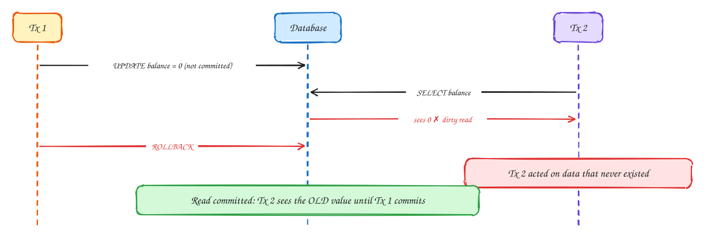
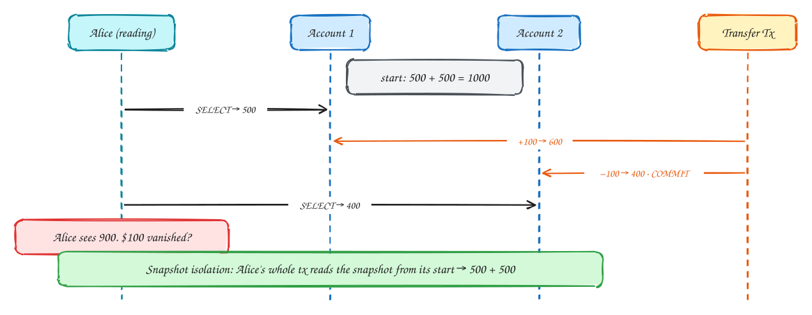
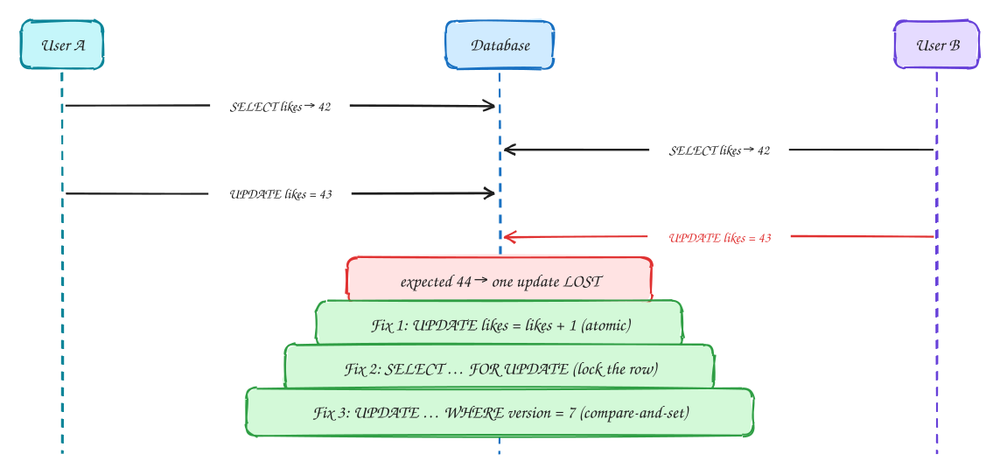
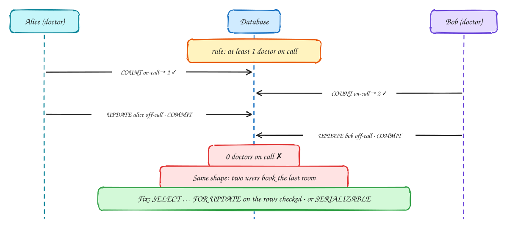
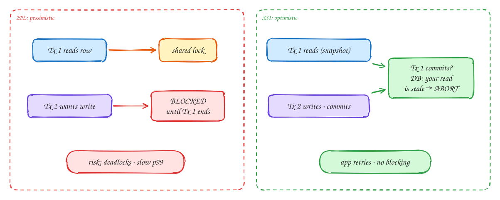

# DDIA Chapter 7: Transactions

> These DDIA pages are study notes in our own words and diagrams, connecting the book to interview problems. They don't replace the book; *Designing Data-Intensive Applications* by Martin Kleppmann is worth reading in full.

## TL;DR

A transaction groups reads and writes into one unit: all of it happens or none of it does, and concurrent transactions don't see each other's half-finished work. Most interview "contention" questions, such as seat booking, inventory, payments, and auctions, come down to which **isolation anomaly** you are defending against.

**Key ideas:** ACID · dirty reads · read skew · MVCC · lost update · write skew · phantoms · 2PL · SSI

## What ACID really means

*ACID*

| Letter | Common belief | What it actually guarantees |
|---|---|---|
| A · Atomicity | "Atomic like threads" | **Abortability**: on any error mid-transaction, all writes are rolled back. Safe to retry. |
| C · Consistency | "DB keeps data consistent" | Your **application's invariants** (debits = credits). This one is mostly the app's job, not the DB's. |
| I · Isolation | "Transactions are serial" | Concurrent transactions don't interfere. The strength depends on the **isolation level**, and most DBs default to weaker than serializable. |
| D · Durability | "Never lost" | Committed data survives crashes (WAL + fsync, or replication). Nothing is 100%. |

> [!WARNING]
> **The default is not serializable:** Postgres defaults to **Read Committed**. MySQL InnoDB defaults to Repeatable Read. Neither prevents write skew, so your booking code can double-book unless you add locks.

## Read committed: no dirty reads, no dirty writes

*Weakest useful level*

1. Tx 1 writes but hasn't committed.
2. Without isolation, Tx 2 reads the uncommitted value: a **dirty read**.
3. Tx 1 rolls back. Tx 2 made decisions based on a value that never existed.
4. **Read committed** prevents dirty reads (readers see the last committed value) and dirty writes (row locks until commit). It is the Postgres default.

## Read skew → snapshot isolation (MVCC)

*Repeatable read*

1. Alice reads account 1 (500) in the middle of a transfer.
2. The transfer commits between her two reads.
3. She reads account 2 after the commit: 500 + 400 = 900. This is **read skew**, and it breaks backups, analytics, and integrity checks.
4. **Snapshot isolation**: each transaction sees a consistent snapshot as of its start. It is implemented with **MVCC**: rows keep multiple versions tagged with created_by/deleted_by transaction IDs. Readers never block writers.

> [!NOTE]
> **MVCC in one line:** UPDATE = mark old version deleted by tx 13 + insert new version created by tx 13. Your snapshot ignores versions created after you started. VACUUM cleans up old versions later.

## Lost update: read-modify-write races

*Concurrent writes*

1. Both read the same value.
2. Both write value+1. The second write overwrites the first, so one like is lost.
3. **Atomic operations** are the best fix when possible: the DB does read+write as one step. Redis INCR works the same way.
4. **Pessimistic lock**: SELECT FOR UPDATE makes the second reader wait. Good under high contention.
5. **Optimistic (CAS)**: a version column; if 0 rows are updated, retry. Good under low contention. Postgres Repeatable Read also auto-detects lost updates and aborts.

> [!TIP]
> **Say this in the interview:** "For the auction, bids use a conditional write, UPDATE … SET max_bid=? WHERE max_bid < ?, so concurrent bids can't overwrite each other."

## Write skew: the double-booking bug

*The anomaly that bites interviews*

1. Both check a condition across rows and see it is safe.
2. Each updates a **different** row, so there is no write conflict and snapshot isolation allows both. The invariant is broken.
3. This is the pattern of every booking bug: "check availability, then insert booking". If the check finds no rows to lock, it is a **phantom**.
4. Fixes: lock the rows you checked; use SERIALIZABLE; add a unique constraint; or **materialize the conflict** by creating a row per seat or room-night so there is something to lock.

> [!TIP]
> **Say this in the interview:** "Each seat is a row with status AVAILABLE/HELD/SOLD. A hold is UPDATE seats SET status=HELD WHERE id=? AND status=AVAILABLE. If one row was updated I won it, if zero someone else did. No write skew possible."

## Isolation levels: what each prevents

*Cheat sheet*

| Anomaly | Read Committed | Snapshot / Repeatable Read | Serializable |
|---|---|---|---|
| Dirty read / write | ✓ prevented | ✓ | ✓ |
| Read skew (non-repeatable read) | ✗ | ✓ prevented | ✓ |
| Lost update | ✗ (use atomic op / lock) | ✓ Postgres detects; MySQL ✗ | ✓ |
| Write skew | ✗ | ✗ | ✓ prevented |
| Phantoms | ✗ | ✗ (mostly) | ✓ prevented |
| Default in | Postgres, Oracle, SQL Server | MySQL InnoDB | CockroachDB, FoundationDB |

> [!NOTE]
> **Serializable, three ways:** **Actual serial execution**: one thread, stored procedures (VoltDB, Redis Lua). **2PL**: readers block writers and vice versa, with predicate locks; slow, deadlocks. **SSI**: optimistic; detect stale reads at commit and abort (Postgres SERIALIZABLE).

## Two-phase locking vs serializable snapshot isolation

*Serializability*

1. **2PL**: readers hold shared locks and writers need exclusive locks, both held until commit. Correct, but throughput drops and p99 latency is unpredictable under contention.
2. **SSI**: everyone runs on snapshots without blocking. At commit, the DB checks whether anything you read has since changed and, if so, aborts you. Fast at low contention. Under high contention there are many aborts, so retries are needed.

## In the interview

> [!IMPORTANT]
> **Interviewer asks:** "Two users book the last room at the same time."  
> → Write skew. Use a row per room-night + **conditional UPDATE**, or SELECT FOR UPDATE, or a unique constraint on (room, date).

> [!IMPORTANT]
> **Interviewer asks:** "Like counter at 50k/sec?"  
> → Not row locks. Use atomic INCR in Redis, sharded counters, or batch into the DB asynchronously. The lost update is avoided because the increment is atomic.

> [!IMPORTANT]
> **Interviewer asks:** "Optimistic or pessimistic?"  
> → Low contention: optimistic version check. High contention on few rows (hot seat map): pessimistic lock or a queue to serialize.

> [!IMPORTANT]
> **Interviewer asks:** "Transaction across 2 services?"  
> → No distributed ACID. Use a **saga** with compensations plus the outbox pattern (Ch 9 and 12).

---

← [Ch 6: Partitioning](06-partitioning.md) · [Ch 8: Trouble with distributed systems](08-trouble-with-distributed-systems.md) →
