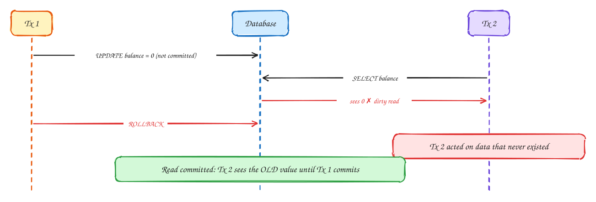
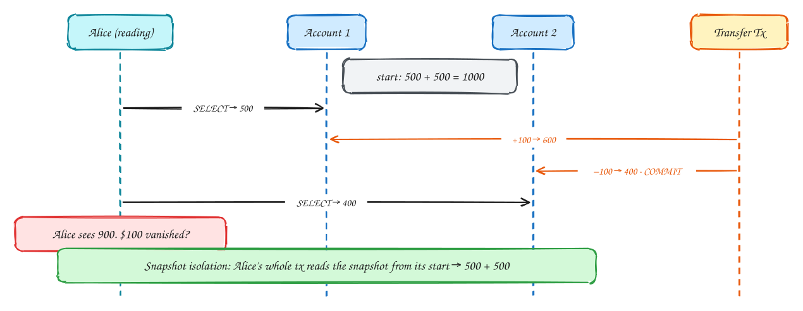
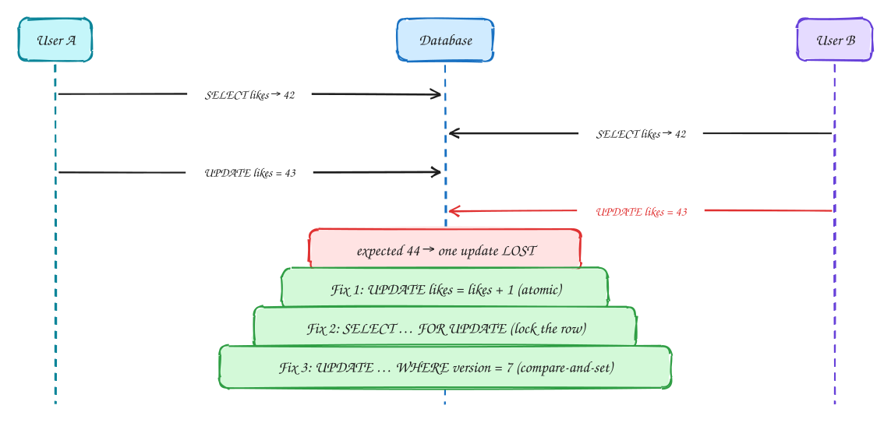
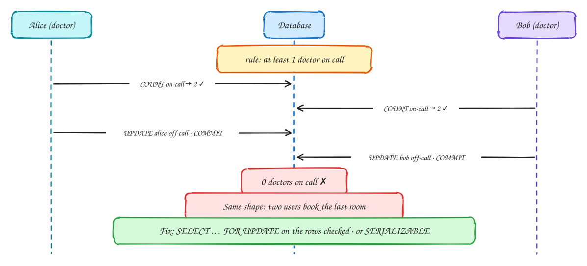
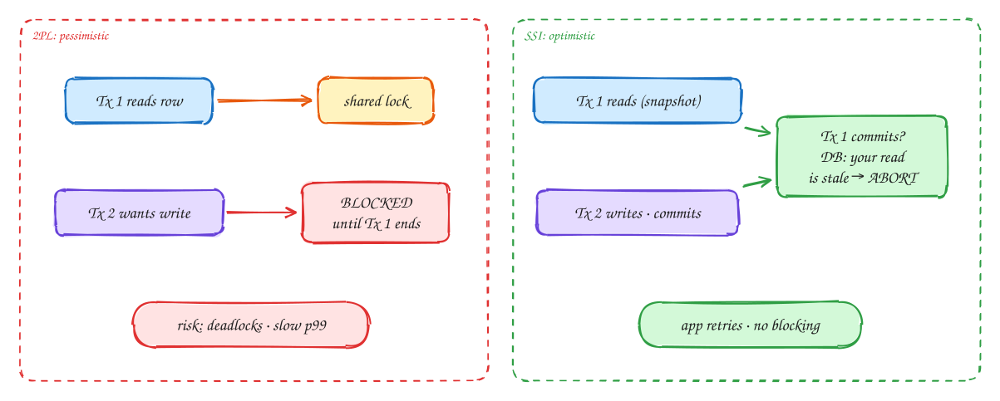
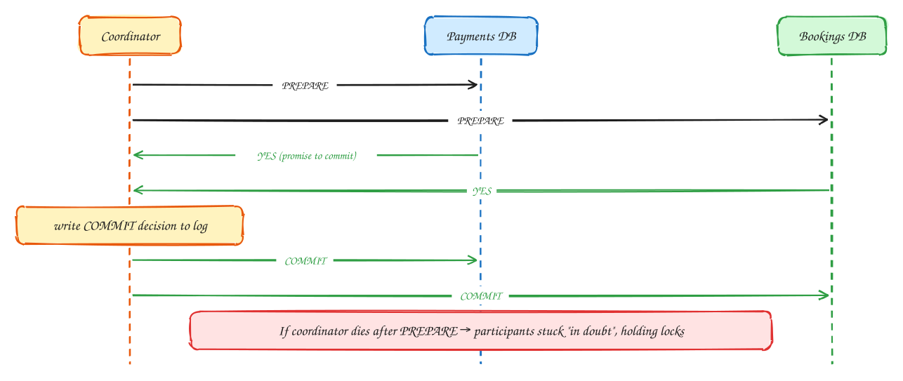
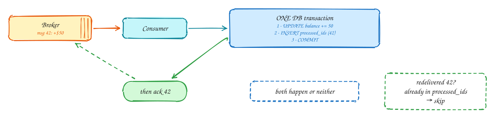

# DDIA Chapter 8: Transactions

Advanced

> These DDIA pages are study notes in our own words and diagrams, following the **2nd edition** of *Designing Data-Intensive Applications* by Martin Kleppmann and Chris Riccomini. They connect the book to interview problems and don't replace it; the book is worth reading in full.

> [!TIP]
> **One-page sketchnote:** [DDIA 8 · TRANSACTIONS on a single page](../sketchnotes/ddia-08.svg), for revision or printing.

## TL;DR

A transaction groups reads and writes into one unit: all of it happens or none of it does, and concurrent transactions don't see each other's half-finished work. Most interview "contention" questions, such as seat booking, inventory, payments, and auctions, come down to which **isolation anomaly** you are defending against.

The 2nd edition moves **distributed transactions** into this chapter: how two-phase commit makes one transaction atomic across several databases or shards, why it blocks when the coordinator fails, and how modern distributed databases make it work.

**Key ideas:** ACID · dirty reads · read skew · MVCC · lost update · write skew · phantoms · 2PL · SSI · atomic commit · 2PC · XA · exactly-once processing

## What ACID really means

*ACID*

A **transaction** wraps several reads and writes into one unit: `BEGIN … COMMIT`. The point is to let you write code as if nothing else were happening, and as if nothing could fail halfway through. The database handles the messy cases. Databases describe this promise with the letters **ACID**, but each letter means something more specific (and sometimes weaker) than people assume:

| Letter | Common belief | What it actually guarantees |
|---|---|---|
| A · Atomicity | "Atomic like threads" | **Abortability**: on any error mid-transaction, all writes are rolled back. Safe to retry. |
| C · Consistency | "DB keeps data consistent" | Your **application's invariants** (debits = credits). This one is mostly the app's job, not the DB's. |
| I · Isolation | "Transactions are serial" | Concurrent transactions don't interfere. The strength depends on the **isolation level**, and most DBs default to weaker than serializable. |
| D · Durability | "Never lost" | Committed data survives crashes (WAL + fsync, or replication). Nothing is 100%. |

The letter that causes nearly all interview bugs is **I**. Perfect isolation would mean concurrent transactions behave as if they ran one after another. That is expensive, so databases offer weaker **isolation levels**, each allowing certain kinds of interference, called **anomalies**. The rest of this chapter goes through them from weakest to strongest, with the bug each one lets through.

> [!WARNING]
> **The default is not serializable:** Postgres defaults to **Read Committed**, and MySQL InnoDB to Repeatable Read. Neither prevents write skew, so booking code can double-book unless you add locks or constraints.

## Read committed: no dirty reads, no dirty writes

*Weakest useful level*

The most basic promise: you never see another transaction's **unfinished** work.

1. Transaction 1 sets an account balance to 0 but hasn't committed yet. It might still roll back.
2. Without isolation, Transaction 2 reads the balance and sees **0**. That is a **dirty read**: reading data that isn't committed.
3. Transaction 1 hits an error and **rolls back**. The balance was never really 0, but Transaction 2 has already acted on it, perhaps declining a payment or sending a "you're overdrawn" email.
4. **Read committed** prevents this. Readers always see the **last committed** value; Transaction 2 sees the old balance until Transaction 1 commits. It also prevents **dirty writes** (overwriting someone else's uncommitted change) by locking a row from the moment it is written until commit. This is Postgres's default level.

## Read skew → snapshot isolation (MVCC)

*Repeatable read*

Read committed still has a gap: if your transaction reads several things, **other transactions can commit in between your reads**, and you see a mix of before and after.

1. Alice has $500 in each of two accounts, $1,000 in total. She opens her banking app, which reads account 1: **$500**.
2. At that moment, a transfer of $100 from account 2 to account 1 runs and commits.
3. The app then reads account 2: **$400**, the value after the transfer. Alice sees a total of $900, and $100 seems to have vanished. This is **read skew**: each read was of committed data, but they came from different moments. For Alice a refresh fixes it, but for a backup, an analytics query or an integrity check ("do all balances add up?"), it produces wrong results.
4. **Snapshot isolation** fixes it: each transaction reads from a **consistent snapshot** of the database as it was when the transaction started. Changes committed later are invisible to it, so Alice sees $500 + $500.

How can the database show each transaction a different point in time? With **MVCC** (multi-version concurrency control). It keeps **several versions** of each row, each tagged with the ID of the transaction that created it, and of the one that deleted it, if any. A transaction simply ignores versions created after it started. A nice consequence: **readers never block writers, and writers never block readers.**

> [!NOTE]
> **MVCC in one line:** an UPDATE doesn't overwrite. It marks the old version "deleted by transaction 13" and inserts a new version "created by transaction 13". Your snapshot ignores versions from transactions that started after you. Old versions are cleaned up later (Postgres calls this VACUUM).

## Lost update: read-modify-write races

*Concurrent writes*

A very common pattern in application code: **read** a value, **change** it in code, **write** it back. Run it twice at the same time and one change disappears.

1. A post has 42 likes. Users A and B both click "like" at the same moment, and both requests read `likes = 42`.
2. Both compute 42 + 1 and write **43**. The second write overwrites the first. There should be 44 likes, and one is **lost**. No error was raised.

Three ways to fix it, from simplest to most general:

3. **Atomic operation:** let the database do the read and write as one step: `UPDATE posts SET likes = likes + 1 WHERE id = ?`. There's no gap to race in. Redis `INCR` works the same way. Use this whenever the change can be expressed this way.
4. **Pessimistic lock:** `SELECT … FOR UPDATE` locks the row when you read it, so the second request **waits** until the first commits, then reads 43. Good when many requests fight over the same rows.
5. **Optimistic check (compare-and-set):** keep a `version` column. Write with `UPDATE … SET likes = 43, version = 8 WHERE id = ? AND version = 7`. If another write got there first, the version is no longer 7, **zero rows** are updated, and you re-read and retry. Good when conflicts are rare. (Postgres at Repeatable Read also detects lost updates itself and aborts one of the transactions.)

> [!TIP]
> **Say this in the interview:** "For the auction, bids use a conditional write, UPDATE … SET max_bid=? WHERE max_bid < ?, so concurrent bids can't overwrite each other."

## Write skew: the double-booking bug

*The anomaly that bites interviews*

This is the hardest anomaly to spot, because the two transactions **don't write the same row**, so nothing looks like a conflict.

1. A hospital rule: **at least one doctor must be on call**. Alice and Bob are both on call, and both feel unwell. At the same moment, each asks the app to go off call. Each transaction checks: "how many doctors are on call?" Both see **2**, so it's safe for one to leave.
2. Alice's transaction sets **Alice** off call. Bob's sets **Bob** off call. They update **different rows**, so there's no write conflict, and even snapshot isolation lets both commit. Now **zero** doctors are on call. Each decision was correct on its own snapshot; together they broke the rule. This is **write skew**.
3. It's the shape of nearly every booking bug: "check that the room is free (no booking row exists), then insert a booking". Two requests both see no booking and both insert one. Here there isn't even an existing row to lock, because the conflict is about a row that **doesn't exist yet**, a **phantom**.
4. The fixes:
   - **Lock the rows you checked** with `SELECT … FOR UPDATE`, so the second transaction waits and then sees the first one's change.
   - Use the **SERIALIZABLE** isolation level and retry on abort.
   - Add a **unique constraint** such as `UNIQUE (room_id, date)`, so the database rejects the second booking.
   - **Materialize the conflict**: create a row in advance for every seat, or every room-night, so there's always a real row to lock or conditionally update.

> [!TIP]
> **Say this in the interview:** "Each seat is a row with status AVAILABLE/HELD/SOLD. A hold is UPDATE seats SET status=HELD WHERE id=? AND status=AVAILABLE. If one row was updated I won it, if zero someone else did. No write skew possible."

## Isolation levels: what each prevents

*Cheat sheet*

Putting it together: each level closes more gaps and costs more. Know your database's **default**, and know which anomaly your feature is exposed to.

| Anomaly | Read Committed | Snapshot / Repeatable Read | Serializable |
|---|---|---|---|
| Dirty read / write | ✓ prevented | ✓ | ✓ |
| Read skew (non-repeatable read) | ✗ | ✓ prevented | ✓ |
| Lost update | ✗ (use atomic op / lock) | ✓ Postgres detects; MySQL ✗ | ✓ |
| Write skew | ✗ | ✗ | ✓ prevented |
| Phantoms | ✗ | ✗ (mostly) | ✓ prevented |
| Default in | Postgres, Oracle, SQL Server | MySQL InnoDB | CockroachDB, FoundationDB |

> [!NOTE]
> **Serializable, three ways:** **actual serial execution** runs transactions one at a time on a single thread, which is fast if each is tiny (VoltDB, Redis Lua scripts). **Two-phase locking (2PL)** makes readers and writers block each other. **Serializable snapshot isolation (SSI)** lets everyone run, then aborts transactions whose reads went stale. The last two are compared next.

## Two-phase locking vs serializable snapshot isolation

*Serializability*

There are two main ways a database provides full serializability while running transactions in parallel: wait when there might be a conflict (**pessimistic**), or carry on and check at the end (**optimistic**).

1. **Two-phase locking (2PL), pessimistic:** reading a row takes a shared lock, and writing needs an exclusive lock. Locks are held until the transaction ends. If Transaction 1 has read a row, Transaction 2 must **wait** to write it. It is correct, but under contention transactions queue behind each other, throughput drops, latency becomes unpredictable, and **deadlocks** happen (the database kills one transaction to break them).
2. **Serializable snapshot isolation (SSI), optimistic:** everyone runs on their own snapshot with no blocking. At commit, the database checks: "has anything this transaction **read** been changed by a transaction that committed since?" If so, the decision might have been based on stale data, so this transaction is **aborted** and the application retries it. This is fast when conflicts are rare. When many transactions fight over the same rows, it causes lots of aborts and retries. Postgres's SERIALIZABLE level uses SSI.

## Distributed transactions

*Atomic commit across machines*

**Why it's hard.** On one node, atomicity is easy: the commit is a single record written to the log; if it's there after a crash, the transaction happened. Across several nodes (two shards, or two different databases) there is no single log. If you just send "commit" to each, one might succeed while another fails a constraint or crashes, leaving the transaction half-applied. And a node can't take back a commit once others may have seen the data. This is the **atomic commitment** problem: every participant must reach the **same** decision, commit or abort.

### Two-phase commit (2PC)

Sometimes one transaction has to change data in **two different databases**, say the payments database and the bookings database, and both changes must happen or neither. Each database can only promise atomicity for itself, so a **coordinator** runs a protocol across them: **two-phase commit**.

1. **Phase 1, prepare:** the coordinator asks every participant, "can you commit this?"
2. Each participant checks it can (constraints pass, data written durably to disk) and replies **YES**. A YES is a **binding promise**: the participant must be able to commit later, even if it crashes and restarts in between. So it keeps the affected rows **locked** while it waits.
3. **Phase 2, commit:** once all participants have said YES, the coordinator writes its decision, "COMMIT", to its own log. That is the point of no return. Then it tells every participant to commit. If anyone said NO, it tells everyone to abort.
4. The weakness: if the coordinator **dies after the prepare phase**, the participants are stuck "in doubt". They promised to commit, so they can't abort on their own, and they don't know the decision, so they can't commit. They wait, **holding their locks**, until the coordinator recovers. Other transactions touching those rows stall too. That blocking, plus tight coupling between services, is why microservice architectures use **sagas** instead: a sequence of local transactions, each with a compensating action to undo it if a later step fails.

**Why not fix the coordinator problem with a smarter protocol?** **Three-phase commit (3PC)** avoids blocking only if network delays are bounded and failures can be detected perfectly, which real networks don't provide (Chapter 9). The real fix is to make the coordinator itself fault-tolerant, by replicating its decision with consensus (Chapter 10).

> [!TIP]
> **Say this in the interview:** "I won't use 2PC across the payment and booking services. I'll use a saga: reserve room → charge → confirm, with compensations (release room, refund), driven by events with the outbox pattern."

### XA and why it has a bad name

**XA** is a standard that lets one coordinator (often a library inside the application server) run 2PC across *different* systems, say a Postgres database and a message broker. In practice it causes trouble:

- If the coordinator runs inside the application server and that server dies, the in-doubt transactions wait for it to come back; the coordinator's log has become a critical part of the database's availability.
- **In-doubt locks** can't be released by the database on its own. Administrators sometimes make a **heuristic decision**, forcing a commit or abort by hand, which can break atomicity.
- XA must work with any system, so it's a lowest common denominator: it can't detect deadlocks across systems or support SSI across them.

### Distributed transactions inside one database

These problems mostly come from coordinating **heterogeneous** systems. When one distributed database runs 2PC between its **own** shards (Google Spanner, CockroachDB, YugabyteDB, TiDB, FoundationDB), it can do much better: the coordinator and its log are **replicated with consensus**, so a coordinator crash doesn't leave anyone in doubt; and the database controls locking and isolation on every shard. Cross-shard transactions still cost extra round trips, so good shard-key design keeps most transactions on one shard.

### Exactly-once message processing

**Why.** A consumer reads a message ("add $50 to account 7"), updates the database, then acknowledges the message to the broker. If it crashes between the update and the ack, the broker redelivers the message and the $50 is added twice. Wrapping the broker and the database in one XA transaction would fix it, at XA's cost.

**How to get the same effect without XA:**

1. Each message carries a unique ID.
2. In **one local database transaction**, the consumer applies the effect *and* inserts the message ID into a `processed_messages` table.
3. Only after commit does it acknowledge the broker.
4. If the message comes again, the consumer finds its ID already recorded and skips it.

The effect is applied exactly once even though the message may be **delivered** more than once. This is the same idea as the idempotency keys in Chapter 13.

## In the system design interview

> [!IMPORTANT]
> **Interviewer asks:** "Two users book the last room at the same time."  
> → Write skew. Use a row per room-night + **conditional UPDATE**, or SELECT FOR UPDATE, or a unique constraint on (room, date).

> [!IMPORTANT]
> **Interviewer asks:** "Like counter at 50k/sec?"  
> → Not row locks. Use atomic INCR in Redis, sharded counters, or batch into the DB asynchronously. The lost update is avoided because the increment is atomic.

> [!IMPORTANT]
> **Interviewer asks:** "Optimistic or pessimistic?"  
> → Low contention: optimistic version check. High contention on few rows (hot seat map): pessimistic lock or a queue to serialize.

> [!IMPORTANT]
> **Interviewer asks:** "Transaction across 2 services?"  
> → Across services owned by different teams: avoid 2PC; use a **saga** with compensations plus the outbox pattern (Ch 12 and 13). Within one distributed database (Spanner, CockroachDB), cross-shard transactions are fine but cost latency.

> [!IMPORTANT]
> **Interviewer asks:** "How do you avoid processing a message twice?"
> → Make the consumer idempotent: record the message ID in the same DB transaction as the effect, and ack only after commit.

## Self-check

Try to answer before you open each one.

Postgres defaults to Read Committed. Which booking bug can still happen?

Write skew: two transactions each check "the room is free", both see yes, and both insert a booking. Read Committed (and snapshot isolation) don't prevent it; you need a lock (SELECT FOR UPDATE), a unique constraint, a conditional update, or SERIALIZABLE.

How does snapshot isolation stop a long report from seeing half of a transfer?

The report reads from a consistent snapshot taken when it started (MVCC keeps old row versions), so it never sees writes committed after that point, including the second half of a transfer.

In 2PC, what is the point of no return, and why can participants get stuck?

The coordinator writing COMMIT to its log. Participants that voted YES have promised to commit and can't decide alone; if the coordinator dies before telling them, they wait, holding locks, until it recovers.

Why do distributed databases like Spanner run 2PC without XA's problems?

They replicate the coordinator's state and decision with consensus, so a crashed coordinator is replaced without losing the decision, and they control locking and isolation on all shards themselves.

How can a consumer apply each message exactly once when the broker may redeliver?

Store the message ID in a processed-messages table in the same local transaction as the effect, ack only after commit, and skip any message whose ID is already recorded.

## Related

- [ACID and isolation](../101/acid-and-isolation.md) · [Outbox](../101/outbox.md) · [Delivery guarantees](../101/delivery-guarantees.md)
- [Contention](../patterns/contention.md) · [Multi-step processes](../patterns/multi-step-processes.md)
- [Ticketmaster](../problems/ticketmaster.md) · [Payment system](../problems/payment-system.md) · [Online auction](../problems/online-auction.md)

---

← [Ch 7: Sharding](07-sharding.md) · [Ch 9: Trouble with distributed systems](09-trouble-with-distributed-systems.md) →
