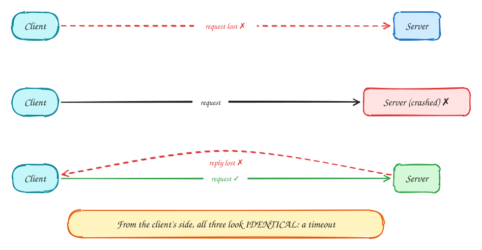
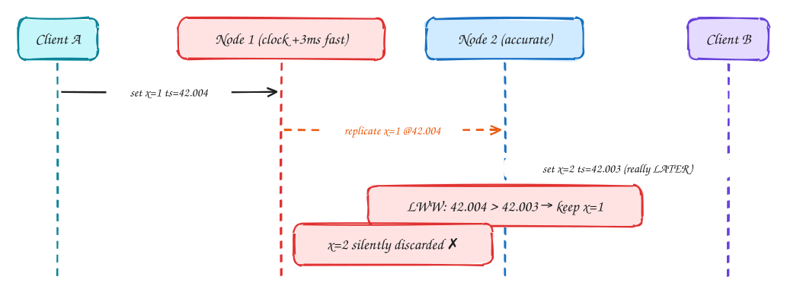
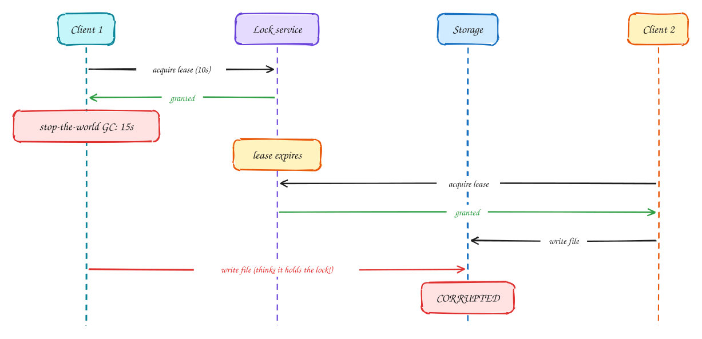
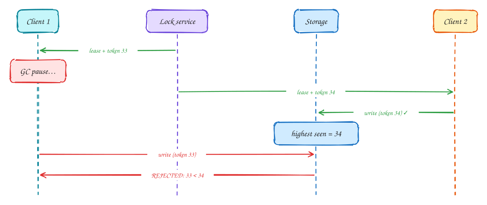

# DDIA Chapter 8: The Trouble with Distributed Systems

<span class="lvl lvl-a">Advanced</span>

> These DDIA pages are study notes in our own words and diagrams, connecting the book to interview problems. They don't replace the book; *Designing Data-Intensive Applications* by Martin Kleppmann is worth reading in full.

> [!TIP]
> **One-page sketchnote:** [DDIA 8 · THE TROUBLE WITH DISTRIBUTED SYSTEMS on a single page](../sketchnotes/ddia-08.svg), for revision or printing.

## TL;DR

On one machine, things either work or crash. Across machines you get **partial failure**: some parts work, some don't, and you often can't tell which. The three villains are unreliable networks, unreliable clocks, and process pauses.

**Key ideas:** partial failure · timeouts · clock skew · LWW danger · GC pauses · leases · fencing tokens · majority quorum

## The network: you cannot tell why there was no reply

*Unreliable networks*

Imagine your order service calls the payment service: "charge this card $50". You wait, and nothing comes back. What happened? On one computer a function call either returns or throws an error. Across a network there is a third outcome, **silence**, and silence can mean very different things.



There are three common reasons you got no reply:

1. **① The request never arrived.** It was dropped by a switch, or it is still sitting in a queue somewhere. The card was not charged.
2. **② The request arrived, but the server is stuck.** It crashed, or it is frozen in a long garbage-collection pause. The card may or may not be charged later.
3. **③ The server did the work, but the reply got lost.** The card **was** charged. If you retry now, you charge it twice.

From the caller's side, all three look exactly the same: no answer before the timeout. You can't find out which one happened by waiting longer. So the system has to be safe **whichever** one it was.

The standard answer is to make the operation **idempotent**: doing it twice has the same effect as doing it once. The caller generates an ID for the operation (an *idempotency key*) and sends the same ID on every retry. The server remembers which IDs it has already processed and, for a repeat, returns the stored result instead of charging again.

> [!TIP]
> **Say this in the interview:** "Payment calls to the provider can time out after the charge succeeded. Every request carries an idempotency key, so a retry is safe."

> [!NOTE]
> **Choosing a timeout:** a timeout is the only way to detect a problem, and it is always a guess. If it is too short, healthy but slow nodes are declared dead, work moves to other nodes, those get slower, and failures cascade. If it is too long, users wait. Start from the real p99.9 latency plus a margin, or use an adaptive detector (such as phi-accrual) that learns normal response times.

## Clocks: last-write-wins can drop the newer write

*Unreliable clocks*

Every machine has its own clock, and no two clocks agree exactly. NTP keeps them close, but "close" usually means a few milliseconds apart, sometimes much more. That sounds harmless until you use timestamps to decide **which write happened last**.

Many databases (Cassandra by default, and many caches) resolve conflicting writes with **last-write-wins (LWW)**: each write is stamped with the clock time of the node that received it, and the highest timestamp is kept.



Here is how that silently loses data:

1. Node 1's clock runs 3 ms fast. Client A writes `x = 1` through Node 1, and it is stamped **42.004**.
2. A moment later in real time, Client B writes `x = 2` through Node 2, whose clock is accurate. It is stamped **42.003**.
3. The two writes meet. Last-write-wins keeps the higher timestamp, so `x = 1` wins, even though `x = 2` really happened later.

Nobody gets an error. Client B was told its write succeeded, and it simply disappears. The clocks weren't broken; a 3 ms difference is normal.

So: **don't use wall-clock time to order events across machines.** Use something that can't disagree: a sequence number from a single leader, a Kafka partition offset, a version number checked with a conditional write, or logical clocks (see Chapter 9).

> [!NOTE]
> **Two kinds of clock on every machine:** the **time-of-day clock** (`System.currentTimeMillis()`, `Date.now()`) tells the date and time, but it can **jump backwards** when NTP corrects it, so never use it to measure how long something took. The **monotonic clock** (`System.nanoTime()`, `performance.now()`) only moves forward. Use it for durations and timeouts, but its value means nothing on another machine.

> [!IMPORTANT]
> **Interviewer asks:** "Can't you just use better clocks?" Google Spanner does: its **TrueTime** API returns an interval [earliest, latest] instead of one value, using GPS and atomic clocks to keep it about 7 ms wide. Before committing, a transaction **waits out** that uncertainty, so timestamps are guaranteed to respect real order. Without that hardware, you can't rely on timestamps for ordering.

## Process pauses: the expired-lease bug

*GC pauses*

A common way to make sure only one worker does something, such as writing a file or processing a job, is a **lease**: a lock that expires automatically after, say, 10 seconds. The expiry is there so that if the lock holder crashes, the lock frees itself and someone else can take over.

The trouble is that a program can **stop running for a while without knowing it**. Common causes:

- a "stop-the-world" garbage-collection pause, which can last seconds in Java or Go under memory pressure;
- the virtual machine being paused and moved to another host;
- the operating system swapping memory to disk;
- a laptop lid closing.

When the program resumes, it carries on from the exact line it was on, as if no time had passed.



Follow the diagram:

1. Client 1 gets a 10-second lease from the lock service.
2. Client 1 freezes in a 15-second GC pause. From its own point of view, nothing happens.
3. After 10 seconds the lease expires. As far as the lock service knows, Client 1 has crashed.
4. Client 2 asks for the lease, gets it, and writes the file. So far everything is correct.
5. Client 1 wakes up. It still believes it holds the lock, because nothing told it otherwise, and it writes the file too. Two writers have now overwritten each other: the file is **corrupted**.

> [!WARNING]
> **"Just check the lease before writing" does not fix it.** The pause can happen **after** the check and **before** the write: check (still valid) → pause 15 s → write (lease long gone). No check inside the client can close that gap, because the client can't know it paused.

## Fencing tokens: the fix

*Fencing*

The problem above is that the **storage** believes whoever writes to it. A paused client with an out-of-date lease looks exactly like a legitimate one. The fix is to give the storage a way to tell them apart, and that way is a number.

**The idea:** every time the lock service hands out the lock, it also hands out a **fencing token**: a number that goes up by one with every grant (33, then 34, then 35…). Every write to the storage must include the token. The storage remembers the **highest token it has accepted** and refuses any write with a lower one. A lower token means "you were the lock holder before someone else", so your lock is out of date.



Replay the same story with tokens:

1. Client 1 gets the lease with **token 33**, then freezes in a GC pause.
2. The lease expires. Client 2 gets the lease with **token 34**.
3. Client 2 writes with token 34. The storage accepts it and records "highest token seen = 34".
4. Client 1 wakes up and writes with token 33. The storage compares: **33 < 34**, so the write is **rejected**. Client 1 learns it has lost the lock, and the file stays correct.

The crucial point is **who does the check**. The client can't reliably know it is stale, so the **resource being protected** (the database, the file store) enforces it. The safety no longer depends on clients behaving well.

Where the numbers come from: ZooKeeper's transaction ID (`zxid`) or an etcd **revision** both increase on every change, so they make good fencing tokens. A plain Redis lock has no such number, which is why a Redis lock alone isn't enough when correctness matters.

In a SQL database, a version column does the same job:

```sql
-- token 34 was given with the lock; only apply if no newer holder has written
UPDATE files
SET    content = :new_content, lock_token = :token
WHERE  id = :file_id
  AND  lock_token < :token;
-- 0 rows updated  →  a newer lock holder exists; stop and give up the work
```

> [!TIP]
> **Say this in the interview:** "A Redis lock alone isn't safe under GC pauses: the lock can expire while the holder is paused, and it will still write when it wakes up. I'd pair the lock with a fencing token, for example a version column the database checks with `UPDATE … WHERE lock_token < :token`, so a stale holder's write is rejected."

> [!NOTE]
> **Truth is decided by the majority.** The deeper lesson: a node can't trust its own view of the world ("am I still the leader?", "do I still hold the lock?"), because it might have been paused or cut off. Important decisions are made by a **quorum**, a majority of nodes, and enforced where the data lives. That idea is the foundation of Chapter 9.

## System models and Byzantine faults

*Assumptions*

To reason about whether an algorithm (such as a leader election) is correct, you first have to state what can go wrong. A **system model** is that list of assumptions: how late messages can be, whether crashed nodes come back, whether nodes can lie. The more realistic the model, the harder the algorithm, but the more you can trust it in production.

| Model | Assumes | Reality |
|---|---|---|
| Timing: synchronous | Bounded network delay, pauses, clock drift | Not realistic |
| Timing: partially synchronous | Usually bounded, sometimes not | **The realistic model**; algorithms must stay safe when bounds break |
| Timing: asynchronous | No timing assumptions at all | Very restrictive; no timeouts |
| Node: crash-stop | Crashed nodes never return | Simplifies proofs |
| Node: crash-recovery | Nodes crash and return; disk survives, RAM doesn't | **Realistic** for datacenters |
| Node: Byzantine | Nodes may lie or act maliciously | Blockchains, aerospace. Rarely needed inside one company. |

> [!NOTE]
> **Safety vs liveness:** **Safety**: nothing bad ever happens (no two leaders). This must always hold. **Liveness**: something good eventually happens (a leader gets elected). This may wait for the network to heal.

## In the interview

> [!IMPORTANT]
> **Interviewer asks:** "What if the payment provider times out?"  
> → Outcome unknown. Retry with the **same idempotency key**, or reconcile with a status query. Never blindly charge again.

> [!IMPORTANT]
> **Interviewer asks:** "Distributed lock with Redis?"  
> → Fine for efficiency (avoid duplicate work). For correctness add **fencing tokens**, or use the DB's own conditional writes.

> [!IMPORTANT]
> **Interviewer asks:** "Order events by timestamp?"  
> → Wall clocks skew. Use a sequence from one leader, a Kafka partition offset, or logical clocks (Ch 9).

> [!IMPORTANT]
> **Interviewer asks:** "How do you detect a dead node?"  
> → Heartbeats + timeouts tuned to p99.9, and accept false positives. Leader election by majority, with epochs to fence the old leader.

> [!NOTE]
> **Underneath:** where process pauses come from (GC, swapping, CPU throttling) is explained in [OS 3: Memory and GC pauses](../os/03-memory.md) and [OS 8: Containers](../os/08-containers.md).

---

← [Ch 7: Transactions](07-transactions.md) · [Ch 9: Consistency and consensus](09-consistency-and-consensus.md) →
