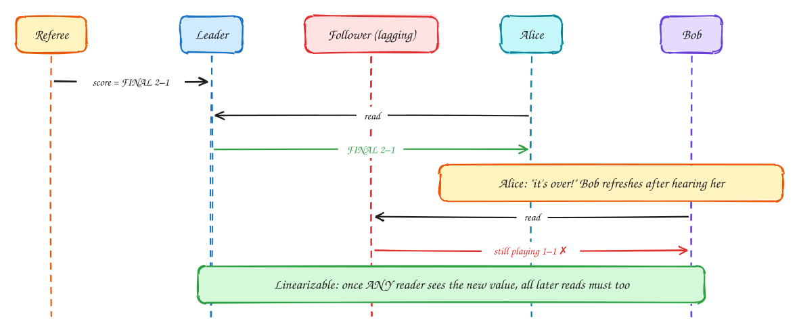
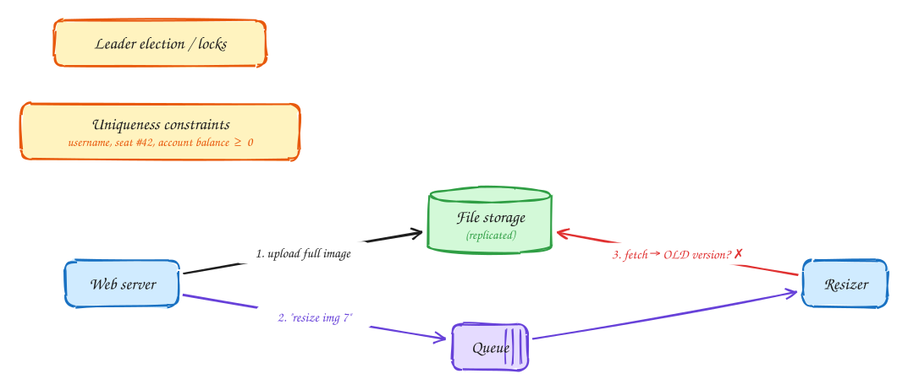
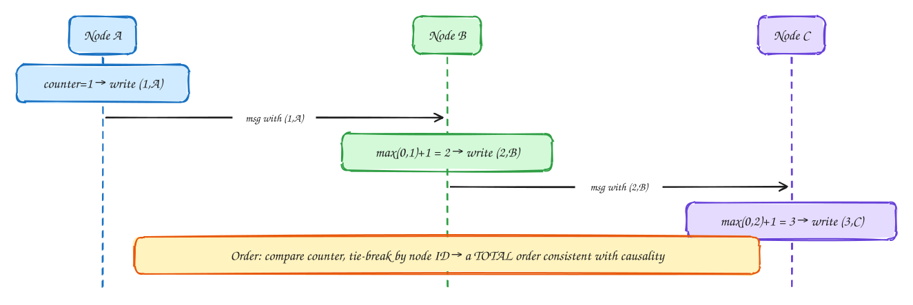
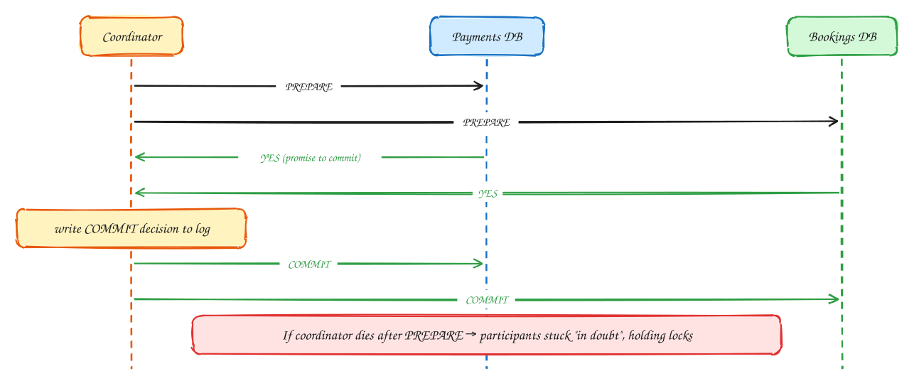
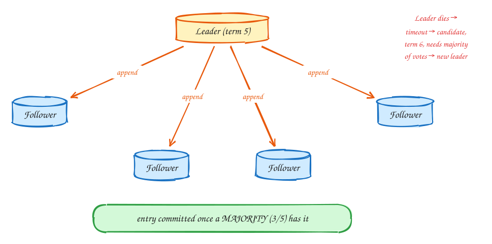
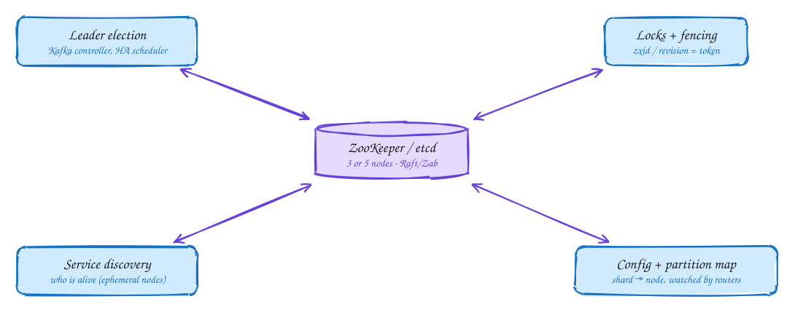

# DDIA Chapter 9: Consistency & Consensus

> These DDIA pages are study notes in our own words and diagrams, connecting the book to interview problems. They don't replace the book; *Designing Data-Intensive Applications* by Martin Kleppmann is worth reading in full.

> [!TIP]
> **One-page sketchnote:** [DDIA 9 · CONSISTENCY & CONSENSUS on a single page](../sketchnotes/ddia-09.svg), for revision or printing.

## TL;DR

Given everything in Ch 8, how do nodes **agree**? This chapter covers linearizability (behave like one copy), ordering and causality, distributed transactions (2PC), and consensus (Raft, Paxos, ZooKeeper), the tools behind leader election, locks, and uniqueness.

**Key ideas:** linearizability · CAP · causality · Lamport clocks · total order broadcast · 2PC · Raft · ZooKeeper

## Linearizability: behave as if there is one copy

*Strongest single-object guarantee*

1. The final score is written to the leader.
2. Alice reads it.
3. Bob reads **after** Alice (he heard her shout), from a lagging replica, and sees an older value. That violates linearizability.
4. **Linearizability** means every operation appears to take effect atomically at one point in time, consistent with real-time order. It is a recency guarantee on a single object.

> [!WARNING]
> **Not the same as serializability:** **Serializable** is about transactions over many objects (isolation, Ch 7). **Linearizable** is about recency of a single object. "Strict serializability" is both.

## When you actually need linearizability

*Use cases*

1. Leader election and locks need every node to agree on **one** holder, and uniqueness constraints need everyone to agree on who got there first. Both require linearizable storage.
2. **Cross-channel timing**: the web server stores an image, then sends a message through a different channel (the queue).
3. If the resizer reads a lagging storage replica, it resizes the old image. Two channels give a race. The fix is linearizable storage, or putting the version number in the message.

> [!NOTE]
> **Everything else:** Feeds, likes, view counts, search results: **eventual consistency is fine**. Saying this explicitly is a strong staff signal.

## Which systems are linearizable, and CAP done right

*CAP · PACELC*

| Replication | Linearizable? | Why |
|---|---|---|
| Single-leader (reads from leader) | Potentially yes | If reads hit the leader and the leader is really the leader (fencing) |
| Consensus (Raft / ZooKeeper / etcd) | Yes | Designed for it |
| Multi-leader | No | Concurrent writes on different leaders |
| Leaderless (Dynamo / Cassandra) | Probably not | LWW + clock skew, sloppy quorums, timing edge cases |

> [!NOTE]
> **CAP, correctly stated:** Network **partitions will happen**. When one does, choose: refuse some requests to stay consistent (**CP**), or answer from possibly stale data (**AP**). It is a decision per feature, not per database.

> [!NOTE]
> **PACELC:** **E**lse, when there is no partition, you trade **L**atency vs **C**onsistency. Linearizability is slow even when nothing fails, because each operation waits for a quorum round trip.

> [!TIP]
> **Say this in the interview:** "Inventory and payments are CP: I'd rather reject than oversell. Hotel search and reviews are AP: stale by a few seconds is fine."

## Ordering: Lamport timestamps

*Causality without clocks*

1. Each node keeps a counter and tags every operation with (counter, nodeId).
2. On receiving a message, a node sets counter = max(own, received) + 1. Causality is carried along with the message.
3. So if A happened before C, then A's timestamp is smaller than C's.
4. The limit: the order is only known **after the fact**. To decide "username taken?" right now you must know nobody else is claiming it concurrently, which needs **total order broadcast**, which is consensus.

> [!NOTE]
> **Total order broadcast:** Deliver all messages to all nodes in the same order, reliably. This is exactly a **replicated log**: Kafka partitions (within a partition), Raft logs, ZooKeeper's zab.

## Two-phase commit (2PC)

*Distributed atomic commit*

1. Phase 1: ask every participant "can you commit?"
2. A YES is a binding promise: the participant must be able to commit even after a crash, so it holds locks.
3. The coordinator logs its decision (the commit point), then tells everyone.
4. The weakness is that 2PC **blocks**. If the coordinator dies, participants hold locks until it recovers. This is why microservices use **sagas** instead.

> [!TIP]
> **Say this in the interview:** "I won't use 2PC across the payment and booking services. I'll use a saga: reserve room → charge → confirm, with compensations (release room, refund), driven by events with the outbox pattern."

## Consensus: Raft in one picture

*Raft / Paxos / Zab*

1. A cluster of 5 nodes (tolerates 2 failures). One elected leader per **term** (epoch).
2. The leader appends each command to its log and replicates it to followers.
3. An entry is **committed** once a majority store it. Any future majority overlaps this one, so committed entries are never lost.
4. If the leader goes silent, a follower times out, increments the term, and asks for votes. A majority makes it leader. A higher term **fences** the old leader.

> [!NOTE]
> **Sizing:** 2f+1 nodes tolerate f failures: 3 nodes → 1, 5 nodes → 2. Every write needs a majority round trip, so consensus is used for **metadata**, not bulk data.

## ZooKeeper / etcd: consensus as a service

*Coordination services*

1. You almost never implement consensus yourself. You use a small, strongly consistent store.
2. Common uses: elect one active scheduler or controller; distributed locks with fencing tokens.
3. Membership via **ephemeral nodes** that vanish when a session dies; config and shard maps that clients **watch** for changes.

> [!TIP]
> **Say this in the interview:** "The job scheduler runs active-passive. Leader election goes through etcd with a lease, and the lease revision is the fencing token on job-claim writes."

## In the interview

> [!IMPORTANT]
> **Interviewer asks:** "Is this CP or AP?"  
> → Answer **per feature**: booking and payment are CP, search and feeds are AP. Mention PACELC latency cost.

> [!IMPORTANT]
> **Interviewer asks:** "Transaction spanning booking + payment services?"  
> → Not 2PC (blocking, coupling). Use a **saga** + outbox + idempotent consumers.

> [!IMPORTANT]
> **Interviewer asks:** "Exactly one scheduler must run."  
> → Leader election via ZooKeeper or etcd (consensus), lease + fencing token.

> [!IMPORTANT]
> **Interviewer asks:** "Unique usernames across regions?"  
> → Needs linearizable compare-and-set: one strongly consistent store (Spanner, CockroachDB, or a single-leader region for usernames).

---

← [Ch 8: Trouble with distributed systems](08-trouble-with-distributed-systems.md) · [Ch 10: Batch processing](10-batch-processing.md) →
