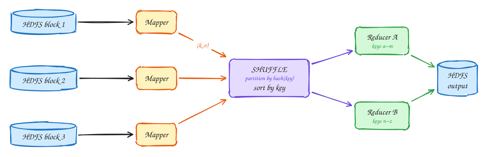
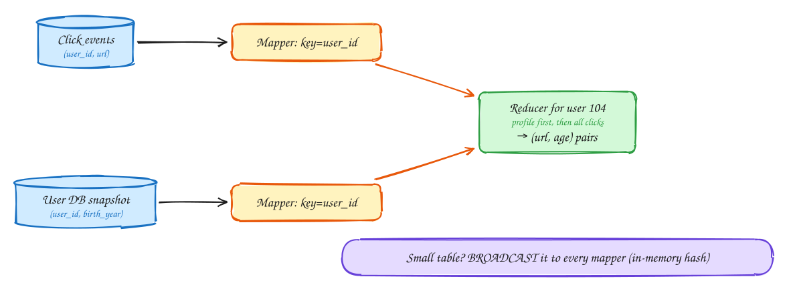
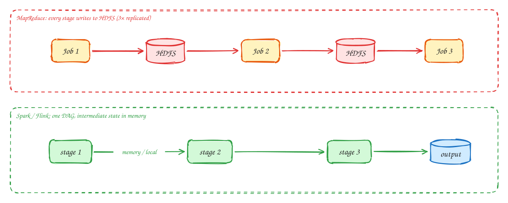

# DDIA Chapter 10: Batch Processing

Advanced

> These DDIA pages are study notes in our own words and diagrams, connecting the book to interview problems. They don't replace the book; *Designing Data-Intensive Applications* by Martin Kleppmann is worth reading in full.

> [!TIP]
> **One-page sketchnote:** [DDIA 10 · BATCH PROCESSING on a single page](../sketchnotes/ddia-10.svg), for revision or printing.

## TL;DR

Take a big, bounded, **immutable** input, run a pure function over it, and produce a derived output. Because inputs are never modified, a buggy job is fixed by re-running it. That property, being able to recompute from source, runs through all of Part III.

**Key ideas:** Unix philosophy · MapReduce · HDFS · shuffle · sort-merge join · broadcast join · Spark DAG

## The Unix philosophy: small tools, one interface

*Where batch comes from*

1. Read the log and extract the URL field from each line.
2. Sort so identical URLs are adjacent, then count each run. When the data is bigger than memory, sort spills to disk, so this scales past RAM.
3. Sort by count and take the top 5. Six tiny programs, composed through one uniform interface: a stream of lines.

- **Immutable input**: run it as many times as you like and nothing breaks.
- **Uniform interface**: every tool reads and writes files, so you can wire anything to anything.
- **Separation of logic and wiring**: the program doesn't know where its input came from.
- MapReduce is this same idea spread across thousands of machines, with HDFS as the "file".

## MapReduce: map, shuffle, reduce

*Distributed batch*

1. Input is split into blocks, replicated across machines (HDFS).
2. The scheduler runs a **mapper** next to each block (move the compute to the data). Mappers emit key-value pairs.
3. The **shuffle** sends every pair with the same key to the same reducer and sorts them. This is the expensive network step.
4. Each **reducer** sees all values for its keys together, aggregates them, and writes output files. If a task fails, just rerun that task, because inputs are immutable.

> [!NOTE]
> **Scale:** Mapper output goes to local disk; reducers pull over the network. Jobs at Google and Yahoo processed petabytes daily, and the same pattern now runs in Spark, BigQuery, and Snowflake.

## Joins in batch: bring related records together

*Sort-merge · broadcast · partitioned*

1. Goal: "which URLs are popular with which age group?" Don't query the user DB per event (millions of random lookups). Take a **snapshot** of it.
2. **Sort-merge join**: both mappers emit user_id as the key. The shuffle delivers one user's profile and clicks to the same reducer, adjacent. One linear pass joins them.
3. **Broadcast hash join**: if one side is small (a hotel dimension table), load it into each mapper's memory. No shuffle is needed. **Partitioned hash join**: both sides partitioned the same way, so join partition by partition.

> [!WARNING]
> **Skew:** One hot key (a celebrity user) sends millions of records to one reducer. Fixes: skewed-join handling (sample hot keys, spread them across reducers), the same idea as Ch 6.

## Beyond MapReduce: dataflow engines and batch outputs

*Spark · Flink · outputs*

1. Chaining MapReduce jobs **materializes** every intermediate result to replicated HDFS: slow, and each job waits for the whole previous one.
2. Dataflow engines run the whole workflow as one **DAG** and pipeline data between operators. On failure they recompute lost partitions from **lineage**, so typically 10–100× faster.

> [!NOTE]
> **What batch jobs produce:** Search indexes (build offline, swap atomically), pre-computed recommendations, ML features, read-only KV stores bulk-loaded into serving. A bad output is rolled back by pointing at yesterday's files.

## In the interview

> [!IMPORTANT]
> **Interviewer asks:** "Web crawler for 10B pages?"  
> → The frontier queue feeds fetchers. Text extraction and dedup run as batch (Spark) over S3. Re-runnable because raw pages are stored immutably.

> [!IMPORTANT]
> **Interviewer asks:** "Daily top-K or reconciliation reports?"  
> → Nightly batch over the event log in S3 or the warehouse. The streaming path gives fast approximate results and batch gives exact ones (Ch 12, Lambda).

> [!IMPORTANT]
> **Interviewer asks:** "How do you rebuild the search index?"  
> → Batch-build a new index from the source of truth, then atomically switch the alias. Old index kept for rollback.

> [!TIP]
> **Say this in the interview:** "Raw events land immutably in S3, partitioned by date. Any derived table can be recomputed from them, which is our safety net for bugs."

---

← [Ch 9: Consistency and consensus](09-consistency-and-consensus.md) · [Ch 11: Stream processing](11-stream-processing.md) →
