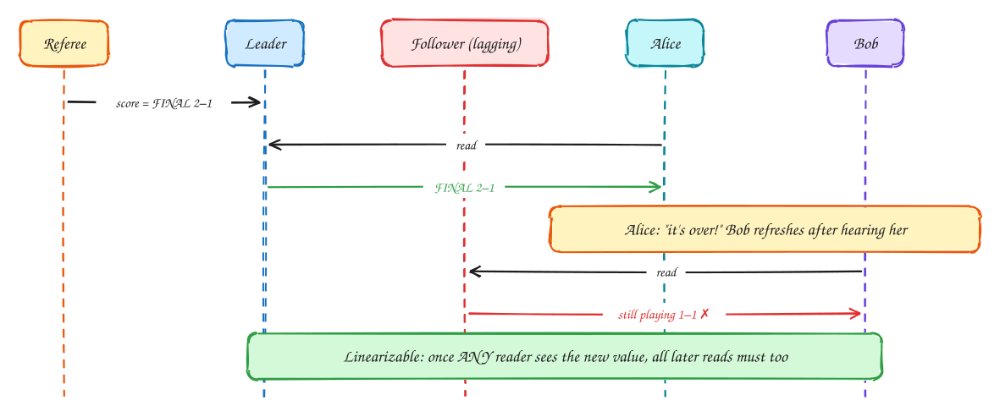
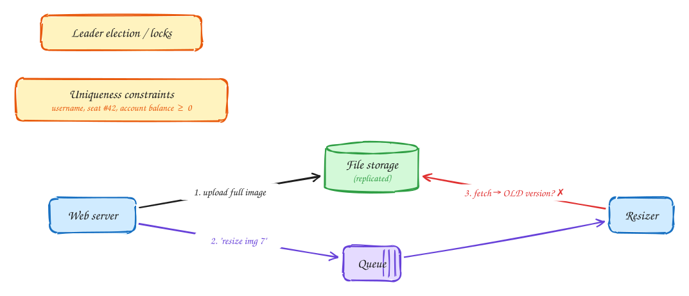
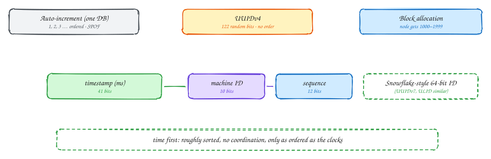
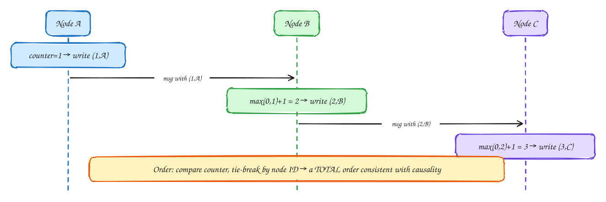
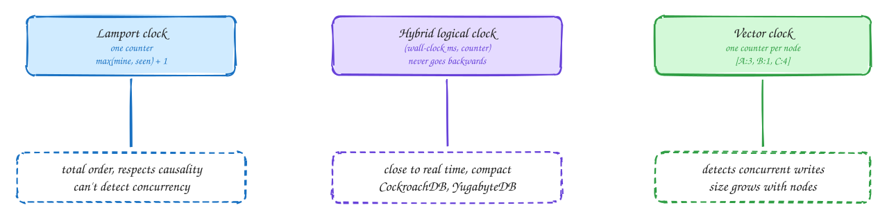
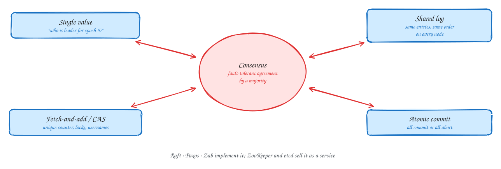
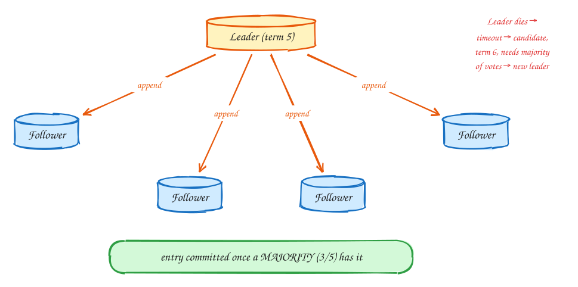
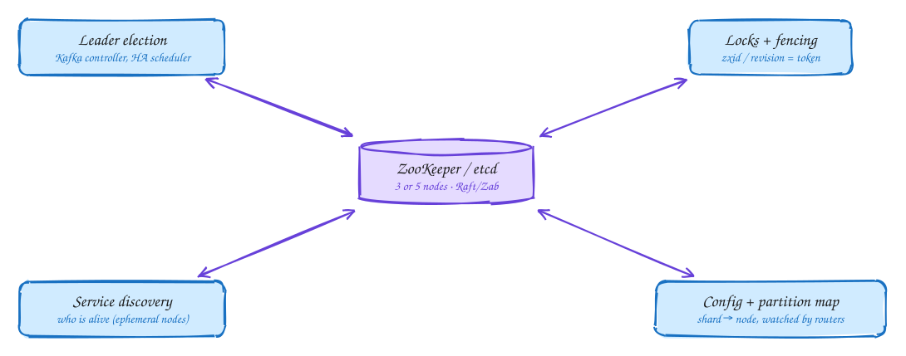

# DDIA Chapter 10: Consistency & Consensus

Advanced

> These DDIA pages are study notes in our own words and diagrams, following the **2nd edition** of *Designing Data-Intensive Applications* by Martin Kleppmann and Chris Riccomini. They connect the book to interview problems and don't replace it; the book is worth reading in full.

> [!TIP]
> **One-page sketchnote:** [DDIA 10 · CONSISTENCY & CONSENSUS on a single page](../sketchnotes/ddia-10.svg), for revision or printing.

## TL;DR

Given everything in Ch 9, how do nodes **agree**? This chapter covers linearizability (behave like one copy), unique IDs and logical clocks (ordering without trusting wall clocks), and consensus (Raft, Paxos, ZooKeeper), the tools behind leader election, locks, and uniqueness. In the 2nd edition, two-phase commit has moved to [Chapter 8](08-transactions.md#distributed-transactions).

**Key ideas:** linearizability · CAP · ID generators · Lamport clocks · hybrid logical clocks · vector clocks · total order broadcast · consensus equivalence · Raft · ZooKeeper

## Linearizability: behave as if there is one copy

*Strongest single-object guarantee*

Chapter 9 showed how networks, clocks and pauses make distributed systems unreliable. This chapter asks: given all that, **how can several machines agree on anything?** It starts with the strongest promise a replicated system can make: that it behaves as if there were **only one copy** of the data.

1. The referee records the final score of a match, 2–1, on the leader database.
2. Alice refreshes her phone. Her read goes to the leader, she sees **FINAL 2–1**, and she shouts "it's over!"
3. Bob, sitting next to her, hears her and refreshes **after** she did. His read goes to a follower that is a few seconds behind, and he sees **1–1, still playing**. Bob read later in real time but got an **older** answer.
4. **Linearizability** forbids exactly this. Once **any** reader has seen the new value, **every** later read, by anyone, must see it too (or something newer). The system must look like a single copy where each operation takes effect at one instant. Both readers did nothing wrong; the system broke the promise.

> [!WARNING]
> **Not the same as serializability, despite the similar name.** **Serializable** (Chapter 8) is about transactions touching many objects: they behave as if run one at a time. **Linearizable** is about one object: reads always reflect the latest write in real time. A database can be one without the other; "strict serializability" means both.

## When you actually need linearizability

*Use cases*

Linearizability is expensive: every read and write has to coordinate with other nodes. Most features don't need it. Here's where you do:

1. **Locks and leader election:** if two nodes can both believe they hold the lock, it isn't a lock. Every node must see the same, latest answer to "who holds it?".
2. **Uniqueness and limits:** "this username is taken", "seat 42 is sold", "the balance can't go below zero". When two people race for the last one, everyone must agree on who got there first.
3. **Two channels racing each other:** a web server saves an uploaded image to storage (1), then puts "resize image 7" on a queue (2). The queue message can arrive **faster** than the storage replication. The resizer fetches image 7 from a lagging storage replica and resizes the **old** version (3). Fixes: make that storage read linearizable (read from the leader), or put the version number in the message so the resizer can tell it got the wrong one and retry.

> [!NOTE]
> **Everything else:** feeds, likes, view counts and search results are fine with **eventual consistency**: slightly stale for a few seconds. Saying explicitly which parts of your design need linearizability and which don't is a strong staff-level signal.

## Which systems are linearizable, and CAP done right

*CAP · PACELC*

Whether a replicated database can be linearizable depends on how it replicates (see Chapter 6):

| Replication | Linearizable? | Why |
|---|---|---|
| Single-leader (reads from leader) | Potentially yes | If reads hit the leader and the leader is really the leader (fencing) |
| Consensus (Raft / ZooKeeper / etcd) | Yes | Designed for it |
| Multi-leader | No | Concurrent writes on different leaders |
| Leaderless (Dynamo / Cassandra) | Probably not | LWW + clock skew, sloppy quorums, timing edge cases |

This is also where the famous **CAP theorem** fits. It is often stated as "pick 2 of 3", which is misleading. The accurate version is narrower:

> [!NOTE]
> **CAP, correctly stated:** network **partitions will happen**; you don't get to opt out of them. While one is happening, a node cut off from the others has two choices: **refuse** requests it can't safely answer, staying consistent (**CP**), or **answer** from data that might be stale, staying available (**AP**). It's a decision per feature, not per database.

> [!NOTE]
> **PACELC adds the everyday case:** **E**lse, when there's no partition, you still trade **L**atency against **C**onsistency. Linearizability is slow even when nothing is failing, because each operation waits for other nodes (a quorum round trip, possibly across regions).

> [!WARNING]
> **The 2nd edition is blunter: CAP is mostly unhelpful for design.** It considers only one consistency model (linearizability) and one kind of fault (a network partition), ignoring slow nodes, crashes and latency. Real systems aren't simply "CP" or "AP"; most offer different guarantees for different operations. Use it as a reminder that consistency costs availability during partitions, not as a way to classify databases.

**Linearizability costs latency even without faults.** It's not only a distributed-systems issue: memory in a multi-core CPU isn't linearizable either, because each core has its own cache, and CPUs only synchronise when you ask (with memory barriers), for speed. For replicated systems, a theorem by Attiya and Welch shows the response time of linearizable reads and writes is at least proportional to the uncertainty in network delay. That's why many databases choose weaker guarantees for performance, not just to survive partitions.

> [!TIP]
> **Say this in the interview:** "Inventory and payments are CP: I'd rather reject than oversell. Hotel search and reviews are AP: stale by a few seconds is fine."

## ID generators and logical clocks

*Ordering without trusting wall clocks*

**Why IDs are a consensus problem in disguise.** A single database hands out `1, 2, 3…` from an auto-increment counter: unique, and in the order the rows were created. Once data is spread over many nodes, that counter is a single point of failure and a bottleneck. The alternatives each give up something:

- **Sharded counters:** node 1 issues odd numbers, node 2 even ones. Unique, but the order between nodes is meaningless.
- **Block allocation:** a central service hands each node a block (1000–1999, 2000–2999) to use up locally. Few round trips, but IDs aren't in creation order across nodes.
- **Random UUIDs (v4):** 122 random bits, no coordination at all. But they're unordered, so inserts land on random pages of a B-tree index, which hurts write performance.
- **Time-ordered IDs** (Twitter's **Snowflake**, **UUIDv7**, **ULID**): put a timestamp in the high bits, then a machine ID or random bits, then a sequence number. No coordination, and IDs sort roughly by creation time, so index inserts are mostly at the end. But "roughly": with clock skew, an ID from a later event can sort before an earlier one.

## Ordering: Lamport timestamps

*Causality without clocks*

Chapter 9 showed that wall clocks can't order events across machines. But we often need to know that one thing **caused** another: a reply must come after the message it answers. **Lamport timestamps** give an ordering that respects cause and effect, using only counters.

1. Every node keeps a simple counter, starting at 0. Each time it does something, it increments the counter and stamps the operation with **(counter, node ID)**. Node A writes something and stamps it **(1, A)**.
2. Every message carries the sender's counter. When a node receives one, it sets its counter to **max(its own, the received one) + 1**. Node B receives A's message (counter 1), so its next write is **(2, B)**. Node C hears from B and stamps **(3, C)**. The counter travels along the chain of cause and effect.
3. The result: if event X could have influenced event Y, X's timestamp is always smaller. To get one complete order, compare counters and break ties by node ID.
4. The limitation: you only know the order **after the fact**, once you've collected everyone's timestamps. Suppose two users register the same username at the same moment on different nodes. To answer "is it taken?" **right now**, a node needs to know nobody else is claiming it concurrently. Lamport timestamps can't tell you that. You need every node to process requests **in the same order as they happen**, and that requires **total order broadcast**, which turns out to be equivalent to consensus.

**Better logical clocks.** Lamport timestamps have two weaknesses: the numbers have nothing to do with real time, and they can't tell you whether two events were **concurrent**. Two refinements address each:

- A **hybrid logical clock (HLC)** combines the physical time in milliseconds with a Lamport-style counter. It stays close to wall-clock time (useful for humans and for "as of" queries) but never goes backwards and still respects causality. CockroachDB and YugabyteDB use HLCs.
- A **vector clock** keeps one counter **per node**, e.g. `[A:3, B:1, C:4]`. Comparing two vectors tells you whether one event happened before the other or whether they were concurrent, which is exactly what conflict detection in leaderless replication needs (Chapter 6). The cost is size: the vector grows with the number of nodes.

**When causality isn't enough: linearizable IDs.** Picture a user who first removes a colleague from a shared album's access list, then uploads a private photo. If the two operations get IDs from different nodes whose clocks disagree, a reader might see the photo ordered **before** the access change, and show it to the colleague. Logical clocks only order events that are causally connected *through messages*; these two were connected only through the user's head. To guarantee that every ID reflects real-time order you need a **linearizable ID generator**:

- A single **timestamp oracle** that hands out increasing numbers (TiDB's design), with **batching** so one round trip covers many transactions.
- Or Spanner's **TrueTime**: clocks with a known error bound, and each transaction **waits out** the uncertainty before committing, so later transactions always get larger timestamps.

> [!NOTE]
> **Total order broadcast:** deliver every message to every node, reliably, **in the same order**. That is exactly a **replicated log**: Kafka partitions (within one partition), Raft's log, ZooKeeper's Zab protocol. If every node applies the same log in the same order, they all end up in the same state.

## Consensus: many problems, one solution

*Why it's equivalent to so much*

**Consensus** means getting several nodes to agree on a value, such as "who is the leader" or "what is the next entry in the log", in a way that survives crashes and network problems. The reason it gets a whole chapter is that a surprising number of problems turn out to be **the same problem**:

- **Single-value consensus:** all nodes decide the same value, e.g. who leads epoch 5.
- **Shared log** (total order broadcast): every node sees the same entries in the same order. Repeated single-value consensus on "what is entry #n?" builds the log; a log gives you consensus by taking its first entry.
- **Linearizable compare-and-set or fetch-and-add:** with one, you can build a log (fetch-and-add hands out log positions); with a log, you can build one.
- **Atomic commitment** (Chapter 8): all participants commit or all abort is a decision that everyone must agree on, despite failures.

If you can solve any one of these in a fault-tolerant way, you can solve all of them. Once you have a shared log, you can replicate any deterministic service: every replica applies the same commands in the same order and ends up in the same state. That is **state machine replication**, and it's how etcd, ZooKeeper and the metadata layers of many databases work.

> [!NOTE]
> **The FLP impossibility result** says no algorithm can *always* reach consensus in a fully asynchronous system if a node might crash. Real algorithms escape it by using timeouts to suspect failures: they are always **safe** (never decide two different values) and are **live** (make progress) whenever the network behaves reasonably.

## Consensus: Raft in one picture

*Raft / Paxos / Zab*

Raft is the most widely taught consensus algorithm. The idea:

1. A cluster of 5 nodes elects **one leader** for each **term** (a numbered epoch: term 5, term 6…). The others are followers. Five nodes can tolerate 2 failures.
2. Every change goes to the leader, which **appends** it to its log and sends it to the followers.
3. An entry is **committed** as soon as a **majority** (3 of 5) have stored it. Why does that make it safe? Any future majority of 3 must include at least one node from this majority, because two groups of 3 out of 5 always overlap. So a committed entry can never be forgotten, whoever becomes leader next.
4. If the leader dies or goes silent, a follower's timer runs out. It becomes a **candidate**, increments the term to 6, and asks for votes. With votes from a majority it becomes the new leader. If the old leader comes back, it sees the higher term and steps down, and any message it sends with the old term is rejected. That is the same **fencing** idea as in Chapter 9.

**Two rounds of voting, and why both matter.** Every consensus algorithm has the same core: a vote to choose a leader for an **epoch** (term), then a vote by a majority to accept each proposal from that leader. A leader can't trust its own belief that it's still leader (Chapter 9), so the second vote is what checks it: if any node in the majority has seen a higher epoch, the proposal fails. Because any two majorities overlap, a new leader is guaranteed to hear about everything previously committed. Raft adds one more rule: a node only votes for a candidate whose log is **at least as up-to-date** as its own, so a leader can never be elected without the committed entries.

> [!WARNING]
> **Turning off the safety rule loses data.** Kafka (in older setups) has an option called **unclean leader election**: if no fully in-sync replica is available, promote an out-of-date one to restore availability. Writes that only the lost replicas had are then gone. It's the CAP trade-off made explicit, as a config flag.

> [!NOTE]
> **Sizing:** 2f + 1 nodes tolerate f failures: 3 nodes survive 1 failure, 5 nodes survive 2. Every write waits for a majority round trip, so consensus is used for small, critical **metadata** (who's leader, which node owns which shard), not for bulk data.

## ZooKeeper / etcd: consensus as a service

*Coordination services*

Consensus algorithms are hard to implement correctly, so in practice you don't. You run a small cluster of **ZooKeeper** or **etcd**, which implements it for you and exposes a simple, strongly consistent key-value store. Your services use it for a handful of coordination jobs:

1. It's a small store (keys with small values, a few nodes), where every read and write is **linearizable**.
2. **Leader election:** many scheduler instances try to create the same key, and exactly one succeeds. That one is active; the rest wait as standbys. **Distributed locks** work the same way, and the store's ever-increasing revision number is a ready-made **fencing token** (Chapter 9).
3. **Membership:** each live server registers an **ephemeral** key that disappears automatically when its session dies, so "which servers are alive?" is just a list. **Configuration and shard maps** live here too, and clients **watch** keys to be notified the moment they change (the routing in Chapter 7).

**Pros and cons of consensus.** It brings safety (no split brain, no lost committed writes) and automatic failover. The costs: every decision needs a majority round trip, so throughput is limited and latency rises across regions; a cluster needs a strict majority to work at all; and timeouts are tricky, because a node with a flaky network can trigger repeated elections. That's why consensus usually guards small metadata, and bulk data uses cheaper replication guided by it.

> [!TIP]
> **Say this in the interview:** "The job scheduler runs active-passive. Leader election goes through etcd with a lease, and the lease revision is the fencing token on job-claim writes."

## In the system design interview

> [!IMPORTANT]
> **Interviewer asks:** "Is this CP or AP?"  
> → Answer **per feature**: booking and payment are CP, search and feeds are AP. Mention PACELC latency cost.

> [!IMPORTANT]
> **Interviewer asks:** "Transaction spanning booking + payment services?"  
> → Not 2PC across services (blocking, coupling; see [Chapter 8](08-transactions.md#distributed-transactions)). Use a **saga** + outbox + idempotent consumers.

> [!IMPORTANT]
> **Interviewer asks:** "Exactly one scheduler must run."  
> → Leader election via ZooKeeper or etcd (consensus), lease + fencing token.

> [!IMPORTANT]
> **Interviewer asks:** "Unique usernames across regions?"  
> → Needs linearizable compare-and-set: one strongly consistent store (Spanner, CockroachDB, or a single-leader region for usernames).

> [!IMPORTANT]
> **Interviewer asks:** "How do you generate IDs for posts across many servers?"
> → Snowflake-style or UUIDv7: timestamp high bits + machine ID + sequence. Unique without coordination and roughly time-sorted (good for B-tree inserts); say that ordering is only as good as clock sync, and use a sequence from one leader where strict order matters.

## Self-check

Try to answer before you open each one.

Alice sees the final score; Bob refreshes after her and sees the old score. Which guarantee was broken, and what typically causes it?

Linearizability: once any read has returned the new value, all later reads must too. Bob's read went to a lagging follower.

Why are random UUIDv4 primary keys slower to insert into a B-tree than Snowflake or UUIDv7 IDs?

Random keys land on random leaf pages, so inserts touch pages all over the index (poor caching, more page splits). Time-ordered IDs mostly append to the rightmost pages.

What can a vector clock tell you that a Lamport timestamp can't?

Whether two events were concurrent. Lamport timestamps give every pair an order, so concurrent events look ordered; comparing vector clocks shows when neither happened before the other.

Why is a shared log (total order broadcast) equivalent to consensus?

Deciding each log position is a consensus decision, so consensus builds the log; and given a log, all nodes can take the first proposal appended as the decided value.

Why does Raft need a majority for each committed entry, not just for elections?

The leader may have been replaced without knowing it. The majority vote on each entry checks that no newer epoch exists, and because majorities overlap, any future leader will have the entry.

## Related

- [CAP theorem](../core-concepts/cap-theorem.md) · [Job scheduler](../problems/job-scheduler.md) (leader election) · [URL shortener](../problems/url-shortener.md) (ID generation)

---

← [Ch 9: Trouble with distributed systems](09-trouble-with-distributed-systems.md) · [Ch 11: Batch processing](11-batch-processing.md) →
