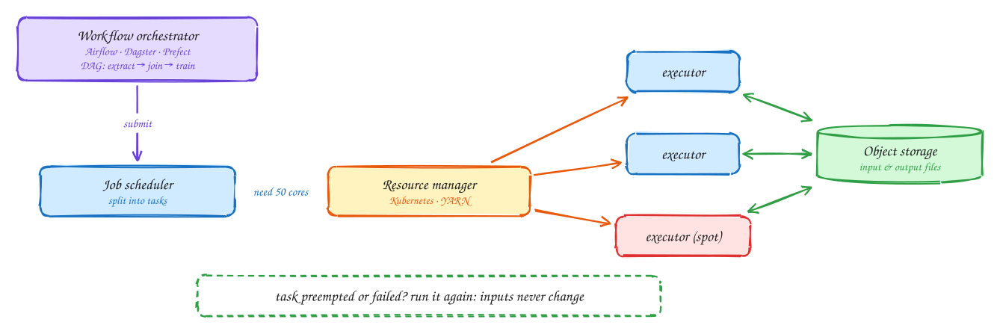
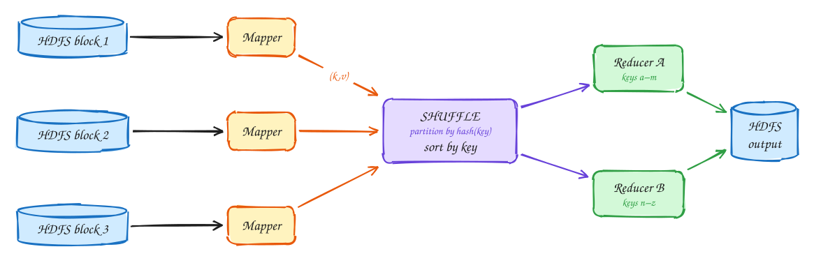
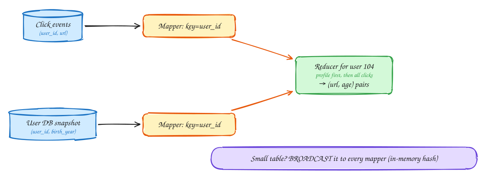
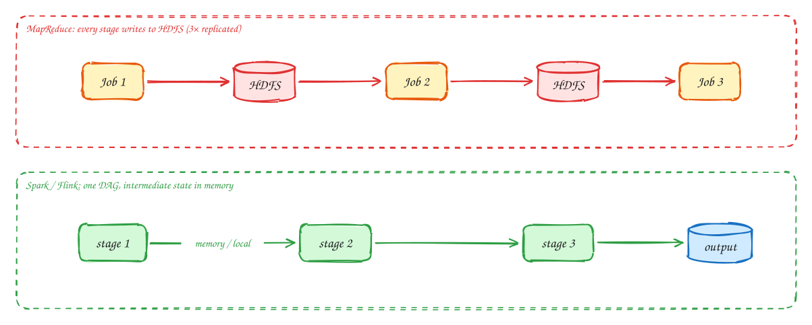

# DDIA Chapter 11: Batch Processing

<span class="lvl lvl-a">Advanced</span>

> These DDIA pages are study notes in our own words and diagrams, following the **2nd edition** of *Designing Data-Intensive Applications* by Martin Kleppmann and Chris Riccomini. They connect the book to interview problems and don't replace it; the book is worth reading in full.

> [!TIP]
> **Revision sketchnote:** [Batch processing on one page](../sketchnotes/ddia-10.svg) (drawn for the 1st edition, where this was Chapter 10).

## TL;DR

Take a big, bounded, **immutable** input, run a pure function over it, and produce a derived output. Because inputs are never modified, a buggy job is fixed by re-running it. That property, being able to recompute from source, runs through all of Part III.

The 2nd edition updates the tooling: object storage has largely replaced HDFS, orchestrators like Airflow schedule the jobs, MapReduce survives mostly as an idea inside Spark and cloud warehouses, and most batch logic is now written in **SQL or DataFrames**. It also surveys what batch is used for: ETL, analytics, machine learning and bulk-loading serving systems.

**Key ideas:** Unix philosophy · object storage · orchestration · MapReduce · shuffle · sort-merge join · broadcast join · Spark DAG · DataFrames · feature engineering · batch inference

## The Unix philosophy: small tools, one interface

*Where batch comes from*

Part III of the book is about **derived data**: indexes, caches, reports and recommendations computed from a source of truth. The simplest way to compute derived data is a **batch job**. Take a large, fixed input (yesterday's logs, say), run it through a program, and write a new output. The ideas behind modern batch systems were already in Unix decades ago.

Say you want the five most-visited pages from a web server log. In a Unix shell, this is one line:

```bash
cat access.log | awk '{print $7}' | sort | uniq -c | sort -rn | head -5
```


1. `awk` reads each line of the log and prints only the 7th field, the URL.
2. `sort` puts identical URLs next to each other, and `uniq -c` collapses each run into a count. If the log is bigger than memory, `sort` spills to disk and merges, so this works on files far larger than RAM.
3. `sort -rn` orders by count, highest first, and `head -5` keeps the top five. That's six tiny programs, none of which knows about the others, combined into a useful analysis.

Why does this work so well? Three properties, which carry straight over to big-data systems:

- **The input is never modified.** You can run the command a hundred times while experimenting, and the log is untouched. A mistake costs nothing.
- **One uniform interface:** every tool reads lines of text and writes lines of text, so any tool can feed any other.
- **Logic is separate from wiring:** `sort` doesn't know or care where its input comes from or where its output goes.

**MapReduce** is this same idea spread over thousands of machines, with a distributed filesystem (HDFS) playing the role of the file.

## Where the data lives: from HDFS to object storage

**Why it changed.** Hadoop's HDFS stored files on the same machines that ran the jobs, so a job could read its input from local disk. That tied storage to compute: to store more data you added compute nodes, and vice versa. In the cloud, networks became fast enough that reading over the network is fine, and **object storage** (S3, GCS, Azure Blob) became the default place for batch inputs and outputs: cheap, durable, effectively unlimited, and shared by every engine.

**How they differ.** A distributed filesystem offers a filesystem: directories, renames, appending to files. An object store offers a flat key → bytes map: write a whole object, read it (or a byte range), list by prefix, delete. There's no cheap rename and no append, so job outputs are written as new objects, and table formats like Iceberg (Chapter 4) track which objects form a table.

## Running jobs: orchestration and scheduling

**Why a job needs so much machinery.** A real pipeline runs dozens of jobs in a dependency order every night, each needing hundreds of cores for an hour, on a cluster shared with other teams, where machines fail and cheap **spot instances** can be taken away at any moment.



**How the pieces fit:**

1. A **workflow orchestrator** (Airflow, Dagster, Prefect) knows the pipeline as a DAG: "join runs after both extracts succeed; training runs after join". It triggers each job when its inputs are ready, retries failures and alerts humans.
2. Each job goes to a **job scheduler** (inside Spark, Flink and others), which splits it into tasks.
3. The scheduler asks a **resource manager** (Kubernetes, YARN) for machines. Deciding which tasks run where, fairly across teams and with the data close by, is an NP-hard optimisation, so schedulers use heuristics. Some jobs need **gang scheduling**: all their tasks must start together or none can make progress.
4. **Executors** on the allocated machines run the tasks, reading inputs from and writing outputs to object storage.
5. If a task fails or its spot machine is **preempted**, it's simply run again. That's safe because inputs are immutable and outputs are written fresh.

## MapReduce: map, shuffle, reduce

## MapReduce: map, shuffle, reduce

*Distributed batch*

Now the log is 10 TB, spread over hundreds of machines. MapReduce runs the same "extract, group, count" logic in parallel:



1. The input is stored in **HDFS**, split into blocks of about 128 MB, with each block copied to three machines.
2. The scheduler starts a **mapper** on a machine that already holds each block. Moving the code to the data is far cheaper than moving terabytes over the network. Each mapper reads its records and emits **key-value pairs**, for example `(url, 1)` for every log line. This is the `awk` step.
3. The **shuffle** then routes every pair to a **reducer** chosen by hashing its key, so all pairs for the same URL end up at the same reducer, sorted by key. This is the `sort` step. It is the expensive part, because most of the data crosses the network here.
4. Each **reducer** receives, for each key, all its values together (`url → 1, 1, 1, …`), combines them (adds them up), and writes its output files back to HDFS. This is the `uniq -c` step.

Fault tolerance comes almost for free. Because inputs are immutable and tasks have no side effects, if a machine dies mid-task the scheduler simply **re-runs that one task** somewhere else.

> [!NOTE]
> **Is MapReduce still used?** Barely as written: even Google, which introduced it, replaced it internally years ago. But its shape (map, shuffle by key, reduce) lives on inside Spark, Flink, BigQuery and Snowflake, and the **shuffle** remains the expensive step in any distributed query. It's worth understanding for that reason.

## Joins in batch: bring related records together

*Sort-merge · broadcast · partitioned*

Batch jobs often need to **combine** two datasets. Question: "which URLs are popular with which age group?" Clicks come from the event log (`user_id, url`). Ages come from the user database (`user_id, birth_year`).



1. The naive way is to look up each user in the live database for each click. With billions of clicks, that's billions of random network requests: far too slow, and it would hammer the production database. Instead, take a **snapshot** (a dump) of the user table into HDFS, so both datasets are plain files.
2. **Sort-merge join:** one mapper reads clicks and another reads users, and **both emit `user_id` as the key**. The shuffle delivers everything for user 104, the profile and all of their clicks, to the **same reducer**, next to each other, with the profile first (arranging the values in a chosen order within a key is called a **secondary sort**). The reducer reads the birth year, then streams through the clicks emitting `(url, age)` pairs. It is one linear pass, with no random lookups.
3. **Broadcast hash join:** if one side is **small**, such as a table of 5,000 hotels, skip the shuffle entirely. Load the small table into memory in **every** mapper, and each mapper joins its share of the big dataset by looking up the in-memory table. **Partitioned hash join:** if both datasets are already partitioned the same way (by the same key, into the same number of parts), each partition of one can be joined with the matching partition of the other independently.

> [!WARNING]
> **Skew:** if one key is extremely common, such as a celebrity with millions of clicks, all of its records go to **one** reducer, and the whole job waits for it. The fix is the same as hot keys in Chapter 7: detect the hot keys (for example by sampling) and spread their records across several reducers.

## Beyond MapReduce: dataflow engines and batch outputs

*Spark · Flink · outputs*

Real pipelines aren't one MapReduce job; they're chains of ten or twenty. MapReduce handles chains badly:



1. In MapReduce, every job writes its full output to HDFS, **replicated three times**, before the next job can start reading it. Most of those intermediate files are thrown away straight after. Each job also waits for the **entire** previous job to finish, even if the first results were ready long before.
2. **Dataflow engines** like Spark and Flink treat the whole pipeline as one graph of operators (a **DAG**). Data streams from one stage to the next in memory or on local disk, without the replicated writes. If a machine fails, lost pieces are **recomputed** from the steps that produced them (the **lineage**) instead of being stored three times just in case. The result is often 10–100× faster.

> [!NOTE]
> **What batch jobs produce:** search indexes (built offline, then swapped in atomically), precomputed recommendations, machine-learning features, and read-only key-value stores bulk-loaded into serving systems. Because outputs are new files rather than in-place changes, **rolling back a bad run** just means pointing back at yesterday's output.

## SQL and DataFrames: how batch jobs are written now

**Why.** Writing raw map and reduce functions for every join and aggregation is slow and error-prone. Batch processing and data warehouses have **converged**: Spark SQL, Hive, Trino and BigQuery let you write the job as a SQL query, and a query optimiser picks join strategies (sort-merge vs broadcast) and plans the shuffles. Data scientists use **DataFrame** APIs (Spark, pandas-style APIs on Dask or Polars, Ray Data) that build the same kind of plan step by step in Python. Either way, the engine does the distributed work; you describe the result.

## What batch processing is used for

**ETL and data integration.** Pull data from operational systems, clean and reshape it, and load it into the warehouse or lake (Chapter 1). As organisations grow, two ideas help keep this manageable: **data contracts** (the producing team promises a schema and quality, like an API) and **data mesh** (each domain team owns and publishes its data as a product, rather than one central data team doing everything).

**Analytics.** Big scheduled queries that produce reports and dashboards, increasingly run directly on lakehouse tables in object storage.

**Machine learning.** Batch jobs do most of the heavy lifting:

- **Feature engineering:** turning raw events into model inputs (e.g. "number of bookings in the last 30 days" per user).
- **Training:** reading huge datasets, often on GPU clusters orchestrated by frameworks like **Ray**.
- **Batch inference:** scoring every user or item with a trained model overnight (recommendations, fraud scores) and storing the results.
- **Graph algorithms** like PageRank, often in the **bulk synchronous parallel** style (Google's Pregel): each vertex processes messages and sends new ones, in rounds.
- **Preparing LLM training data:** deduplicating, filtering and cleaning trillions of tokens of text is itself a giant batch job.

**Serving derived data.** Batch outputs often have to reach a low-latency store the app reads (recommendations by user ID, say). Writing them one by one into the production database would overload it. Better: build the store's files offline and **bulk-load** them atomically, or publish the results to Kafka and let the serving store (LinkedIn's Venice is built for this) consume them at its own pace.

## In the system design interview

> [!IMPORTANT]
> **Interviewer asks:** "Web crawler for 10B pages?"  
> → The frontier queue feeds fetchers. Text extraction and dedup run as batch (Spark) over S3. Re-runnable because raw pages are stored immutably.

> [!IMPORTANT]
> **Interviewer asks:** "Daily top-K or reconciliation reports?"  
> → Nightly batch over the event log in S3 or the warehouse. The streaming path gives fast approximate results and batch gives exact ones (Ch 13, Lambda).

> [!IMPORTANT]
> **Interviewer asks:** "How do you rebuild the search index?"  
> → Batch-build a new index from the source of truth, then atomically switch the alias. Old index kept for rollback.

> [!TIP]
> **Say this in the interview:** "Raw events land immutably in S3, partitioned by date. Any derived table can be recomputed from them, which is our safety net for bugs."

## Self-check

Try to answer before you open each one.

<details class="question" markdown>
<summary>Why can a batch system simply re-run a failed task?</summary>

Inputs are immutable and each task writes a fresh output instead of modifying anything, so running it again produces the same result with no side effects to undo.

</details>

<details class="question" markdown>
<summary>What does the shuffle do, and why is it the expensive step?</summary>

It routes every key-value pair to the reducer responsible for its key (by hash) and sorts them, so all values for a key meet in one place. Most of the data crosses the network during it.

</details>

<details class="question" markdown>
<summary>When would you use a broadcast hash join instead of a sort-merge join?</summary>

When one side is small enough to fit in memory on every worker. Each worker loads it and joins its share of the big dataset locally, avoiding a shuffle of the big side.

</details>

<details class="question" markdown>
<summary>Your nightly recommendation job produces 200 million rows for the app to serve. Why not insert them into the production database row by row?</summary>

It would overload the database and slow live traffic, and a half-finished load would leave a mix of old and new data. Build the serving files offline and bulk-load or swap them atomically, or stream them through Kafka into the serving store at a controlled rate.

</details>

## Related

- [Web crawler](../problems/web-crawler.md) · [Top-K videos](../problems/top-k-videos.md) · [Ad click aggregator](../problems/ad-click-aggregator.md) (batch reconciliation)
- [Large blobs](../patterns/large-blobs.md) (object storage) · [Long-running tasks](../patterns/long-running-tasks.md)

---

← [Ch 10: Consistency and consensus](10-consistency-and-consensus.md) · [Ch 12: Stream processing](12-stream-processing.md) →
