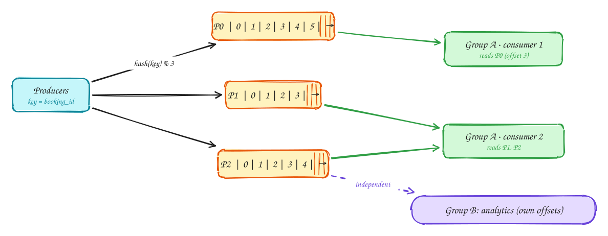
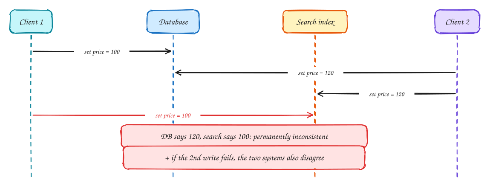
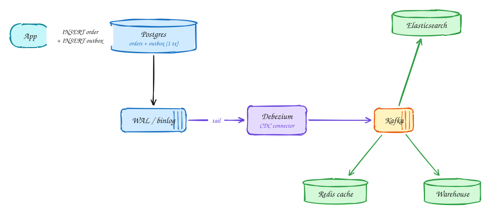
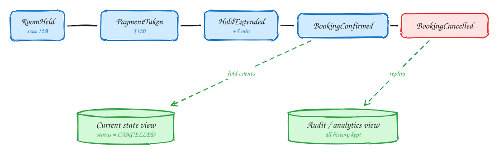
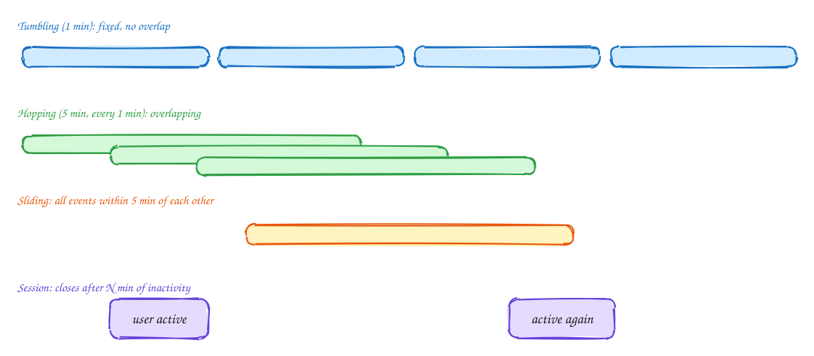
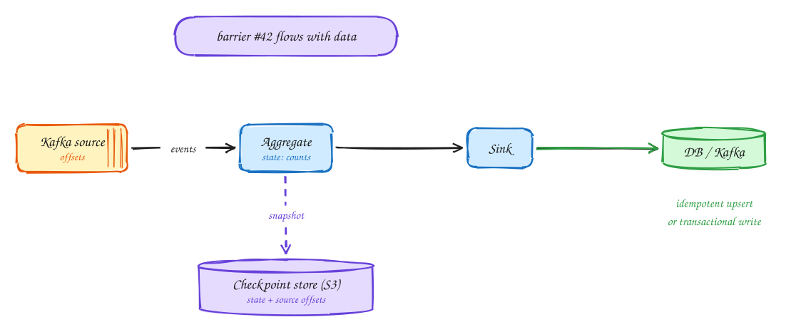

# DDIA Chapter 11: Stream Processing

Advanced

> These DDIA pages are study notes in our own words and diagrams, connecting the book to interview problems. They don't replace the book; *Designing Data-Intensive Applications* by Martin Kleppmann is worth reading in full.

> [!TIP]
> **One-page sketchnote:** [DDIA 11 · STREAM PROCESSING on a single page](../sketchnotes/ddia-11.svg), for revision or printing.

## TL;DR

Batch with the input never ending. Events are processed shortly after they happen. This is Kafka, CDC, the outbox pattern, event sourcing, windowed aggregation, and exactly-once semantics: the backbone of most modern interview designs.

**Key ideas:** message brokers · Kafka partitions · consumer groups · CDC · outbox · event sourcing · windows · watermarks · exactly-once

## Two kinds of message broker

*Queue vs log*

A batch job processes yesterday's data. A **stream processor** handles each event moments after it happens: a click, a booking, a payment. The events travel through a **message broker**, a service that sits between the producers sending events and the consumers handling them. It holds events until consumers are ready, so neither side has to wait for the other.

There are two very different kinds of broker, and choosing the wrong one is a common interview mistake:

- A **queue** (RabbitMQ, SQS) works like a to-do list shared by a team. Each message is a task. One worker takes it, does it, acknowledges it, and the message is **deleted**. Add workers to get through the list faster.
- A **log** (Kafka, Kinesis, Pulsar) works like an append-only journal. Messages are written in order and **kept** for days. Each consumer remembers how far it has read (its **offset**), so many independent consumers can read the same messages, and any of them can go back and **re-read** history.

|  | Queue (RabbitMQ, SQS, JMS) | Log (Kafka, Kinesis, Pulsar) |
|---|---|---|
| After consume | Message deleted once acked | Message stays; consumer just advances an offset |
| Ordering | Lost under parallel consumers + redelivery | Strict order **within a partition** |
| Parallelism | Any consumer takes any message (load balancing) | One consumer per partition per group |
| Replay | No: gone after ack | Yes: reset offset, re-read days of history |
| Slow message | Others continue (per-message ack) | Blocks its partition (head-of-line) |
| Best for | Task queues: send email, resize image, each job independent | Event streams: ordering matters, multiple consumers, replay, CDC |

> [!TIP]
> **Say this in the interview:** "Image resize jobs go on SQS, since they are independent with per-message retry. Booking events go on Kafka, since order per booking matters and several services consume them."

## Kafka: partitions, offsets, consumer groups

*Log-based broker*

One log on one machine can't handle millions of events a second, so Kafka splits each **topic** (a named stream, such as `bookings`) into **partitions**.

1. Each partition is its own append-only log, with messages numbered 0, 1, 2… (the **offset**). The producer chooses the partition by hashing the message **key**. With `key = booking_id`, every event for booking 123 lands in the same partition, **in the order it was sent**. Kafka guarantees order only within a partition, so the key is how you say what must stay in order.
2. Consumers join a **consumer group**. Kafka gives each partition to exactly **one** consumer in the group, so the partitions are shared out like work. The group can never have more active consumers than there are partitions, so the partition count caps your parallelism. Each consumer periodically saves (**commits**) its offset, and after a crash, it or its replacement resumes from the last committed offset.
3. A **different** group, say analytics, reads the very same partitions with **its own offsets**, at its own speed. Adding a new consumer group costs the producers nothing; they don't even know it exists.

> [!NOTE]
> **Numbers:** about 5–10k messages a second per partition is a comfortable planning figure, and one broker handles around a million messages a second. Default retention is 7 days. Size the partition count as target throughput ÷ what one consumer can handle, with room to grow.

## The dual-write problem

*Why not just write to both?*

A very common situation: your data lives in Postgres, but you also need it in a search index (Elasticsearch) and a cache (Redis). The obvious approach is for the application to write to all of them. That approach is broken in two ways:

1. Two clients change the same product's price at almost the same time: client 1 sets 100, client 2 sets 120. The database applies them in one order and ends at **120**.
2. Each client then writes to the search index too, but those requests travel separately, and the network delivers them in the **other** order. The index ends at **100**.
3. Now the database says 120 and search says 100, and **nothing will ever fix it**. There's no error, and no later process notices.
4. Even without a race, if the application crashes (or the second write fails) after writing to the database but before writing to the index, one system has the change and the other never will. **Writing to two systems is never atomic.**

> [!TIP]
> **Say this in the interview:** "I won't dual-write to Postgres and Elasticsearch. I'll write only to Postgres and stream changes to Elasticsearch with CDC, so one order, defined by the DB log, reaches every consumer."

## Change data capture (CDC) and the outbox pattern

*One source of truth → many views*

The fix is to write to **one** place, the database, and let everything else **follow the database's own record of changes**, in the database's order.

1. **Outbox:** when the app saves an order, it also inserts a row describing the event ("order 42 placed") into an `outbox` table, **in the same transaction**. Either both rows commit or neither does, so an event exists if and only if the change does.
2. **Change data capture (CDC):** every database already keeps a log of all changes for its own replicas, Postgres's **WAL** or MySQL's **binlog** (Chapter 5). A CDC tool such as **Debezium** reads that log like a replica would and publishes each change, outbox rows included, to Kafka, **in commit order**.
3. Every other system consumes from Kafka and updates itself: the search index, the cache, the data warehouse. They all see changes in the same order as the database, so they converge on the same state. And if one gets corrupted, or you add a new one, you rebuild it by **replaying** the log, or from a snapshot plus the log since then.

> [!NOTE]
> **Consumers must be idempotent:** the relay can publish an event twice (for example if it crashes after publishing but before recording that it did). Consumers should dedupe by event ID, or use upserts so applying the same change twice is harmless.

## Event sourcing: store what happened, derive the state

*Events as the source of truth*

Normally a database stores the **current state**: the booking's status is `CANCELLED`. **Event sourcing** flips that around and stores **what happened**, as a list of events that is never changed, and works out the current state from it.

1. Each user action is appended as an immutable **event** describing it: `RoomHeld (seat 12A)`, `PaymentTaken ($120)`, `HoldExtended (+5 min)`, `BookingConfirmed`.
2. When the customer cancels, nothing is deleted or overwritten. A new `BookingCancelled` event is appended, and the full history stays.
3. The current state ("status = CANCELLED") is a **view** computed by replaying the events in order (a *fold*). You can build **other** views from the same events later, such as an audit trail or an analytics table, even ones you didn't think of at the start. To debug, you can replay up to any moment and see exactly what the state was then.

> [!WARNING]
> **Costs:** replaying a long history gets slow, so you store periodic **snapshots**. Changing the format of old events is hard (Chapter 4). And "delete my data" requests (GDPR) clash with "never delete anything". Use event sourcing where the history really matters, such as payments, ledgers and orders, not everywhere.

> [!NOTE]
> **CDC vs event sourcing:** CDC turns low-level **row changes** into events after the fact ("row 42's status column changed"). Event sourcing records high-level **business events** as the source of truth ("customer cancelled"), so the intent is preserved.

## Time and windows

*Event time vs processing time*

Many stream questions are about counting over time: clicks per minute, failed logins in the last 5 minutes, sessions per user. Since a stream never ends, you count within **windows**, and there are four common kinds:

1. **Tumbling:** fixed, back-to-back windows, like 10:00–10:01, then 10:01–10:02. Each event falls in exactly one. Use for "clicks per minute".
2. **Hopping:** fixed-length windows that **overlap**, such as a 5-minute window starting every minute. Each event falls in several. Use for "5-minute moving average, updated every minute".
3. **Sliding:** defined by the events themselves, as in "any two failed logins within 5 minutes of each other". Use for fraud and abuse rules.
4. **Session:** groups one user's events until they go quiet for some time, say 30 minutes. Use for web analytics sessions or a workout recording.

> [!WARNING]
> **When it happened is not when it arrived.** A phone in a tunnel queues events and sends them 10 minutes late. If you count by arrival time, those clicks land in the wrong minute. Count by **event time**, the timestamp from when it happened. But then, when can you close the 10:00 window and publish its count? A **watermark** is the processor's estimate that "all events up to 10:00 have probably arrived". Events arriving after it are either dropped or used to correct the published result.

## Stream joins

*Three kinds*

Just like batch jobs, stream processors often need to combine data. Because both sides can keep changing, there are three different situations:

| Join | Example | How |
|---|---|---|
| Stream–stream (window join) | Search event + click event within 1 hour → click-through rate | Buffer both streams in state, indexed by session ID, for the window length |
| Stream–table (enrichment) | Click event + user profile → add country and age | Keep a **local copy** of the table in the processor, updated by CDC. No remote DB call per event. |
| Table–table (materialized view) | Tweets ⋈ follows → each user's timeline cache | Both are changelogs; maintain the joined view incrementally (fan-out on write from Ch 1) |

> [!NOTE]
> **Joins depend on time:** if you join a sale with a tax-rate table, do you want the rate when the sale happened or today's rate? Replaying later could give a different answer. To keep results reproducible, give each version of the record its own ID and join on that version.

## Exactly-once really means effectively-once

*Fault tolerance*

A stream processor runs forever, so it will crash at some point. When it restarts, how do you avoid losing events, or counting them twice?

1. The danger: a crash in the middle leaves things half-done. The processor may have read some events and updated its counts in memory, but not saved them, or saved the output but not the position it had read up to.
2. **Checkpointing** (as Flink does it): special **barrier** markers flow through the data with the events. When an operator sees barrier #42, it saves its state (the counts so far) to durable storage such as S3, together with the **source offsets** it had reached. After a crash, everything restores from the last complete checkpoint and re-reads the source from those offsets, so nothing is lost. Spark Streaming gets the same effect by processing small **micro-batches**.
3. But replaying from the checkpoint means some events are processed **again**, and their output may be written twice. So the destination must handle duplicates. Either make writes **idempotent** (upsert by key, so writing "ad 7, 10:00 → 523 clicks" twice gives the same result), or **transactional** (Kafka transactions commit the output and the new offsets together, atomically). Duplicates still occur inside the system; they just have **no effect** on the result. That's what "exactly-once" really means.

> [!TIP]
> **Say this in the interview:** "Flink checkpoints every 10s. The sink upserts (ad_id, minute) → count, so replays after a failure overwrite instead of double-counting."

## In the interview

> [!IMPORTANT]
> **Interviewer asks:** "Ad click aggregation at 10k/sec?"  
> → Kafka partitioned by ad_id → Flink 1-min tumbling windows on event time → OLAP store. Raw clicks to S3 for batch reconciliation.

> [!IMPORTANT]
> **Interviewer asks:** "Keep search, cache, and DB in sync?"  
> → CDC (Debezium) or outbox → Kafka → idempotent consumers. Never dual-write.

> [!IMPORTANT]
> **Interviewer asks:** "Kafka or SQS?"  
> → Ordering, replay, or many consumers → Kafka. Independent tasks with per-message retry and DLQ → SQS.

> [!IMPORTANT]
> **Interviewer asks:** "Exactly-once?"  
> → "At-least-once delivery plus idempotent processing equals effectively-once. I make the consumer idempotent with an event ID."

---

← [Ch 10: Batch processing](10-batch-processing.md) · [Ch 12: The future of data systems](12-future-of-data-systems.md) →
