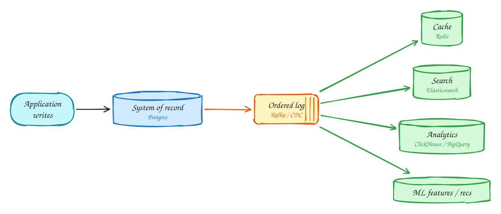
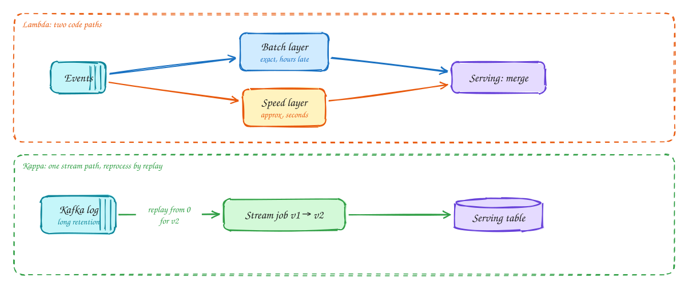
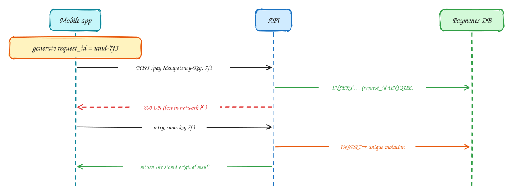

# DDIA Chapter 12: The Future of Data Systems

> These DDIA pages are study notes in our own words and diagrams, connecting the book to interview problems. They don't replace the book; *Designing Data-Intensive Applications* by Martin Kleppmann is worth reading in full.

> [!TIP]
> **One-page sketchnote:** [DDIA 12 · THE FUTURE OF DATA SYSTEMS on a single page](../sketchnotes/ddia-12.svg), for revision or printing.

## TL;DR

The book's conclusion: there is no one database that does everything. Build systems as a **source of truth plus derived views** connected by logs. Push correctness to the ends with idempotency, and separate "eventually up to date" (timeliness) from "never wrong" (integrity).

**Key ideas:** derived data · unbundling the DB · Lambda vs Kappa · end-to-end argument · idempotency keys · timeliness vs integrity · audit

## Unbundling the database

*Data integration*

1. One **system of record** accepts writes. Its change log is the single ordered history of what happened.
2. Every other store is a **derived view**, like an index or materialized view, except in separate specialized systems. Any view can be dropped and rebuilt by replaying the log. Inside one database these are "indexes"; across a company they are "unbundled" into Kafka plus separate stores.

> [!TIP]
> **Say this in the interview:** "Postgres is the source of truth for bookings. Search, the cache, and analytics are derived views fed from CDC, so they are eventually consistent and rebuildable."

## Lambda vs Kappa architecture

*Batch + stream*

1. **Lambda**: a fast approximate stream path plus a slow exact batch path, merged at query time. Correct, but the same logic is written twice in two frameworks.
2. **Kappa**: one streaming codebase. To fix a bug or change logic, start v2 reading the log from the beginning, let it catch up, and switch reads over. This needs long log retention, such as Kafka tiered storage.

> [!NOTE]
> **In interviews:** Top-K and ad clicks often still use a Lambda-like design: Flink for real-time dashboards, nightly batch reconciliation for billing accuracy. Say why: **money needs exact numbers**.

## The end-to-end argument: idempotency keys

*Correctness at the edges*

1. The **client** generates a unique ID for the operation, once, before the first attempt.
2. The server records it with a unique constraint in the same transaction as the effect.
3. The response is lost and the client retries. TCP, load-balancer, and DB-level dedup can't catch this, because it is a new connection and a new request.
4. The duplicate hits the unique constraint, and the server returns the original result. Only an **end-to-end** ID from the origin catches every duplicate.

> [!TIP]
> **Say this in the interview:** "Every mutating API takes an Idempotency-Key from the client. It is stored with a unique index, results are cached for 24h, and retries are always safe."

## Timeliness vs integrity

*Two kinds of "consistency"*

|  | Timeliness | Integrity |
|---|---|---|
| Means | Users see an up-to-date state | No corruption: no lost or double money, no contradictions |
| If violated | Temporary and self-healing: "wait and refresh" | **Permanent**: needs manual repair |
| Example | Booking shows in "My trips" 2s late | Room sold twice; card charged twice |
| Mechanism | Read-your-writes, sync replication | Idempotency, unique constraints, atomic log append, reconciliation |
| Can relax? | Often yes (eventual consistency) | Almost never |

> [!NOTE]
> **Apologize vs prevent:** Airlines overbook on purpose and compensate later. Some constraints can be checked **asynchronously** with a compensating action. Decide per invariant how much a violation costs.

> [!NOTE]
> **Trust, but verify:** Run **reconciliation and audit** jobs that recompute derived data from source and compare (ledger sums, inventory counts). Bugs and bit-rot happen; detect them.

## In the interview

> [!IMPORTANT]
> **Interviewer asks:** "How do you guarantee no double charge?"  
> → Client idempotency key + unique constraint + the payment provider's idempotency + a daily reconciliation job against provider settlement files.

> [!IMPORTANT]
> **Interviewer asks:** "Search shows a stale price."  
> → "Search is a derived view. Timeliness can lag seconds; the **checkout price is read from the source of truth** (integrity)."

> [!IMPORTANT]
> **Interviewer asks:** "How would you change the aggregation logic?"  
> → Kappa: deploy v2 consumer from offset 0 to a new table, compare, switch.

> [!TIP]
> **Say this in the interview:** "I separate integrity from timeliness: money and inventory are strongly consistent and audited; everything the user browses is a derived, eventually consistent view."

---

← [Ch 11: Stream processing](11-stream-processing.md)
