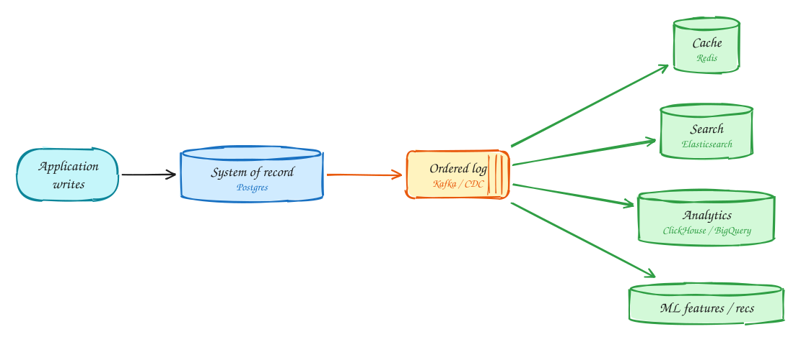
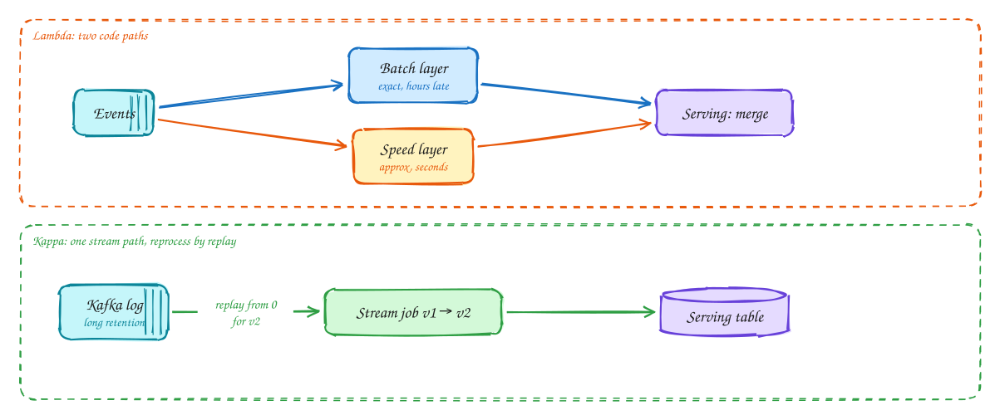
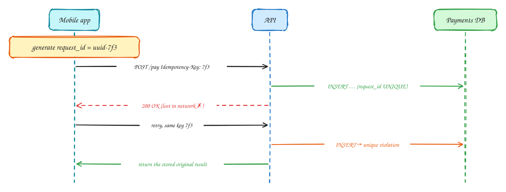

# DDIA Chapter 13: A Philosophy of Streaming Systems

Advanced

> These DDIA pages are study notes in our own words and diagrams, following the **2nd edition** of *Designing Data-Intensive Applications* by Martin Kleppmann and Chris Riccomini. They connect the book to interview problems and don't replace it; the book is worth reading in full.

> [!TIP]
> **Revision sketchnote:** [The future of data systems on one page](../sketchnotes/ddia-12.svg) (drawn for the 1st edition, where this was Chapter 12).

## TL;DR

In the 2nd edition this chapter is titled *A Philosophy of Streaming Systems*; it collects the book's architectural conclusions before the final chapter turns to ethics. The core message: there is no one database that does everything. Build systems as a **source of truth plus derived views** connected by logs. Push correctness to the ends with idempotency, and separate "eventually up to date" (timeliness) from "never wrong" (integrity).

**Key ideas:** derived data · unbundling the DB · reprocessing for schema migration · Lambda vs Kappa · write path vs read path · end-to-end argument · idempotency keys · timeliness vs integrity · audit

## Unbundling the database

*Data integration*

By the last chapter, the book's big lesson is that **no single database does everything well**. Postgres is great for transactions, Elasticsearch for text search, Redis for fast lookups, a column store for analytics. Real systems use several. The question is how to keep them all consistent without the dual-write mess from Chapter 12.

1. Pick **one system of record**, such as Postgres. It is the only place the application writes to, and the source of truth. Its change log, read via CDC into Kafka, is the **single ordered history** of everything that happened.
2. Every other store is a **derived view** of that history: the Redis cache, the Elasticsearch index, the analytics warehouse, the ML features. Each one consumes the log and keeps itself up to date. If one is wrong, or you need a new one, you **drop it and rebuild** it by replaying the log.

Why "unbundling"? Inside a single database, an **index** is exactly this: a derived copy of the data, organized differently, kept up to date automatically. The book's point is that at company scale you do the same thing with the database's parts **taken apart**: the log in Kafka, and each index in its own specialized system.

> [!TIP]
> **Say this in the interview:** "Postgres is the source of truth for bookings. Search, the cache, and analytics are derived views fed from CDC, so they are eventually consistent and rebuildable."

## Schema migrations on railways

*Evolving by reprocessing*

**Why it's hard.** Big data changes are frightening when there's only one copy of the data: an in-place migration of a billion rows can't easily be undone, and if the new schema turns out wrong you're stuck.

**How derived views make it gentler.** The book borrows an image from 19th-century England, where railways were built with different track widths (gauges) and had to be converted. The solution was a **third rail**, so trains of both gauges could run on the same line during the transition, then the old rail was removed. With derived data you do the same:

1. Keep the existing view (the old "gauge") serving users.
2. Build the new view, in the new schema, by **reprocessing** the log or the raw data from the start, running alongside the old one.
3. Move a small share of reads to the new view, compare, and increase gradually.
4. Once everything uses the new view, retire the old one. At every step you could switch back.

## Lambda vs Kappa architecture

*Batch + stream*

You often want results that are both **fast** (a live dashboard) and **exact** (billing). Two architectures combine batch (Chapter 11) and stream (Chapter 12) processing to get there.

1. **Lambda architecture:** run two paths side by side over the same events. A **speed layer** (stream processing) gives approximate answers within seconds. A **batch layer** recomputes exact answers from all the raw data every few hours. Queries merge the two: the batch result for older periods, the stream result for the last few hours. It is correct and robust, but you write the **same logic twice** in two different frameworks, and keeping them in agreement is painful.
2. **Kappa architecture:** use only the stream path. To fix a bug or change the logic, you don't patch old results. You start **version 2** of the stream job reading the log **from the beginning** into a new output table, let it catch up to the present, compare, then switch reads to the new table and stop version 1. This needs the log to keep all history, for example with Kafka's long retention or tiered storage.

> [!NOTE]
> **In interviews:** top-K and ad-click problems often still use a Lambda-like design: Flink for real-time dashboards, plus a nightly batch job that reconciles the exact counts for billing. Say why: **money needs exact numbers**, and a batch recount from immutable raw data is the simplest way to get them.

## Observing derived state: the write path and the read path

**Why think in two paths.** Every derived dataset splits work into the **write path** (work done when data comes in: updating the search index, fanning out a post) and the **read path** (work done when someone asks: querying the index, merging timelines). Caches, indexes and materialized views move work from the read path to the write path. The timeline case study in Chapter 2 is exactly this choice.

**Pushing the boundary all the way to the client.** Today, a web page or app usually fetches state when it loads and then shows something increasingly stale. But a phone or browser that keeps a local copy of data (Chapter 6's sync engines) is itself a derived view. Extend the write path to it: **push** changes from the server as they happen (WebSockets, server-sent events) so the client's state stays current, rather than the client polling. End-to-end, a change flows from the user who made it, through the log and stream processors, to every screen that shows it.

> [!NOTE]
> See [Real-time updates](../patterns/real-time-updates.md) for the mechanics of pushing changes to clients.

## The end-to-end argument: idempotency keys

*Correctness at the edges*

Where should duplicate protection live? You might think the lower layers handle it: TCP drops duplicate packets, and the database deduplicates its own retries. But duplicates that **start at the user's end** slip past all of them. The book's answer, the **end-to-end argument**, is that only a check spanning the whole path, from where the operation starts to where its effect is stored, can catch every case.

1. Before the first attempt, the **mobile app** generates a unique ID for this payment, for example `7f3`. It generates this once per payment, not once per attempt.
2. It sends `POST /pay` with the header `Idempotency-Key: 7f3`. The server stores the key in a column with a **unique constraint**, in the **same transaction** as the payment itself, and saves the result.
3. The server's `200 OK` is lost on the way back, so the app doesn't know the payment worked and retries **with the same key**. To TCP, the load balancer and the database, this is a brand-new connection and a brand-new request. None of them can tell it's a repeat.
4. The insert hits the unique constraint on `7f3`. The server recognises the duplicate and **returns the original stored result** instead of charging again. Only an ID created at the **origin** of the operation, and carried end to end, catches every duplicate.

> [!TIP]
> **Say this in the interview:** "Every mutating API takes an Idempotency-Key from the client. It is stored with a unique index, results are cached for 24h, and retries are always safe."

## Timeliness vs integrity

*Two kinds of "consistency"*

"Consistency" mixes up two very different requirements, and separating them is one of the most useful habits in system design:

- **Timeliness:** is the user seeing the latest state? If not, it's annoying but **temporary**. Wait a moment and refresh, and it's fixed.
- **Integrity:** is the data **correct**, with no money lost or created, nothing sold twice, nothing contradicting itself? If not, the damage is **permanent** until someone repairs it by hand.

Most systems can relax timeliness, which is what makes eventual consistency, caches and derived views acceptable. Almost none can relax integrity.

|  | Timeliness | Integrity |
|---|---|---|
| Means | Users see an up-to-date state | No corruption: no lost or double money, no contradictions |
| If violated | Temporary and self-healing: "wait and refresh" | **Permanent**: needs manual repair |
| Example | Booking shows in "My trips" 2s late | Room sold twice; card charged twice |
| Mechanism | Read-your-writes, sync replication | Idempotency, unique constraints, atomic log append, reconciliation |
| Can relax? | Often yes (eventual consistency) | Almost never |

> [!NOTE]
> **Prevent or apologise:** some rules don't have to be enforced up front. Airlines **overbook on purpose**, then compensate the few passengers who don't get a seat. Checking a constraint **after** the fact, with a compensating action, can be cheaper than strict coordination. For each rule, ask what a violation costs, and how often it would happen.

> [!NOTE]
> **Trust, but verify:** run regular **reconciliation and audit** jobs that recompute derived data from the source and compare: do ledger entries sum to zero, do inventory counts match? Bugs, bad deploys and disk corruption happen in real systems, so plan to **detect** them.

## In the system design interview

> [!IMPORTANT]
> **Interviewer asks:** "How do you guarantee no double charge?"  
> → Client idempotency key + unique constraint + the payment provider's idempotency + a daily reconciliation job against provider settlement files.

> [!IMPORTANT]
> **Interviewer asks:** "Search shows a stale price."  
> → "Search is a derived view. Timeliness can lag seconds; the **checkout price is read from the source of truth** (integrity)."

> [!IMPORTANT]
> **Interviewer asks:** "How would you change the aggregation logic?"  
> → Kappa: deploy v2 consumer from offset 0 to a new table, compare, switch.

> [!TIP]
> **Say this in the interview:** "I separate integrity from timeliness: money and inventory are strongly consistent and audited; everything the user browses is a derived, eventually consistent view."

## Self-check

Try to answer before you open each one.

What does "unbundling the database" mean?

Doing at company scale what a database does internally: one ordered log of changes (the system of record's CDC stream in Kafka) feeding separate specialised systems that each maintain a derived view, like indexes do inside a single database.

Why doesn't TCP's or the database's duplicate detection stop a double charge when the app retries?

The retry is a new connection and a new request as far as those layers know. Only an ID created at the origin (the client's idempotency key) and checked where the effect is stored can recognise it as the same operation.

How does the "third rail" idea let you change a view's schema safely?

Build the new view by reprocessing history, run it alongside the old one, shift reads over gradually while comparing, and retire the old view only at the end, so every step is reversible.

Give one example of a timeliness violation and one of an integrity violation in a booking system.

Timeliness: a new booking appears in "My trips" a few seconds late. Integrity: the same room is sold twice, or a card is charged twice. The first heals itself; the second needs repair.

## Related

- [Payment system](../problems/payment-system.md) (idempotency and reconciliation) · [Ad click aggregator](../problems/ad-click-aggregator.md) (Lambda-style reconciliation)
- [Outbox](../101/outbox.md) · [Real-time updates](../patterns/real-time-updates.md)

---

← [Ch 12: Stream processing](12-stream-processing.md) · [Ch 14: Doing the right thing](14-doing-the-right-thing.md) →
