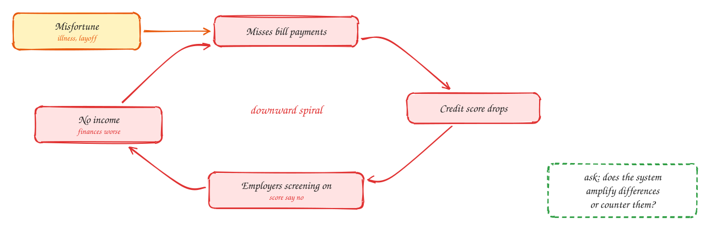

# DDIA Chapter 14: Doing the Right Thing

Beginner

> These DDIA pages are study notes in our own words and diagrams, following the **2nd edition** of *Designing Data-Intensive Applications* by Martin Kleppmann and Chris Riccomini. They connect the book to interview problems and don't replace it; the book is worth reading in full.

> [!TIP]
> **One-page sketchnote:** [DDIA 14 · DOING THE RIGHT THING on a single page](../sketchnotes/ddia-14.svg), for revision or printing.

## TL;DR

Every system is built for a purpose, and every design decision has consequences, intended or not. Many datasets are **about people**, so the engineers who build data systems share responsibility for what those systems do to people. The chapter looks at two areas: **using data to make decisions about people** (predictive analytics, bias, accountability, feedback loops) and **collecting data about people** (tracking, surveillance, consent, privacy). It ends with what we can do: collect less, keep it shorter, and treat users as people rather than metrics.

**Key ideas:** algorithmic prison · bias amplification · accountability · feedback loops · systems thinking · surveillance · meaningful consent · privacy as a decision right · data as a toxic asset · data minimisation

> [!NOTE]
> Ethics isn't a checklist you complete once. The book describes it as an ongoing process of reflection, in dialogue with the people affected, with accountability for the results. This page summarises the chapter's arguments; they're worth reading in the authors' own words.

## Predictive analytics: deciding about people

**Why it's different from predicting the weather.** Predicting rain or the spread of a disease affects no one individual. Predicting whether *this person* will repay a loan, reoffend, make an expensive insurance claim or be a good employee directly shapes their life.

**How it goes wrong.** From the organisation's side, the costs are lopsided: a missed opportunity (rejecting a good applicant) costs little, a bad loan or a bad hire costs a lot. So when the model is unsure, the rational answer is "no". Now multiply that across every bank, landlord, insurer, airline and employer using similar data and similar models. A person labelled risky, correctly or not, receives "no" after "no", and is shut out of jobs, housing, travel and credit. The book calls this an **algorithmic prison**: a punishment without proof of guilt, without a trial, and often without any way to appeal or even to find out why.

## Bias and discrimination

**Why "the data is objective" doesn't hold.** People hope that decisions based on data will be fairer than human gut feeling, and sometimes they are. But a predictive model doesn't just apply rules we wrote; it **infers the rules from past data**. If past decisions were biased, the model learns the bias, and then applies it consistently, at scale, behind a look of mathematical neutrality.

**How bias gets in even when you exclude protected attributes.** Laws forbid treating people differently by ethnicity, gender, age, disability or religion. Removing those columns isn't enough, because other features act as **proxies**: in segregated cities, a postcode or even an IP address strongly predicts race. The model rediscovers what you removed. A critic's phrase the book quotes sums it up: machine learning can be "money laundering for bias".

Predictive systems extrapolate from the past. If we want a future better than the past, that takes **moral imagination**, which only humans can supply. Data and models should be tools, not masters.

## Responsibility and accountability

**Who answers for an algorithm's mistake?** When a person makes a bad decision, they can be held accountable and the decision appealed. When a self-driving car crashes, or a credit model systematically disadvantages one group, who is responsible? Could you explain to a judge how your model reached a particular decision?

Two contrasts make the problem concrete:

- A **credit score** answers "how did *you* behave in the past?", based on your actual borrowing record, which you can (with effort) inspect and correct.
- **Predictive analytics** usually answers "how did *people like you* behave?" That is stereotyping by design, using inputs like where you live, and if you're put in the wrong bucket, or the data about you is wrong, there's rarely a way to fix it.

Predictions are also **statistical**: correct on average, often wrong for the individual. An average life expectancy of 80 doesn't mean you will die at 80. Treating a probabilistic output as a verdict about one person is a category error.

> [!WARNING]
> The same analysis that could direct help to people who need it can be used by predatory businesses to find vulnerable people and sell them high-cost loans or worthless products. Capability isn't the question; use is.

## Feedback loops

**Why harm can grow on its own.** Recommendation systems that learn what we like can end up showing us only what we already agree with, creating echo chambers. Worse are loops where a prediction changes the outcome it predicts.

The book's example:

1. A good worker with a good credit score suffers a misfortune outside their control, say an illness, and misses some bill payments.
2. Their credit score drops.
3. Employers who screen applicants by credit score now turn them down.
4. Without work, their finances get worse, which pushes the score down further.

Each step looks like a reasonable data-driven decision. Together they form a downward spiral, "hidden behind a camouflage of mathematical rigor". Another real example: when petrol stations in Germany adopted algorithmic pricing, prices for consumers went **up**, because the algorithms effectively learned to avoid competing.

**How to anticipate it: systems thinking.** Look at the whole system, including the people who interact with it, not just the software. Ask how it responds to different behaviours, and whether it **amplifies** existing differences (making the rich richer) or **counteracts** them.

## Privacy and tracking

**When does logging become something else?** If a system stores only what the user deliberately entered, to have it processed, the system is performing a service: the user is the customer. Once the system records the user's behaviour **as a side effect** of what they're doing, the relationship changes: the service develops interests of its own, which may conflict with the user's.

Some tracking genuinely serves users: which search results get clicked improves ranking; "people who bought X also bought Y" helps discovery; A/B tests improve the interface. But in an **advertising-funded** business, the advertisers are the paying customers. Tracking becomes more detailed, data is kept longer, and profiles grow, mainly to serve advertisers. A more accurate word for that relationship is **surveillance**.

### Surveillance

The book's thought experiment: replace the word *data* with *surveillance* and see if familiar phrases still sound good. "Our surveillance-driven organisation collects real-time surveillance streams into a surveillance warehouse, where our surveillance scientists derive new insights."

What's new isn't surveillance, but its scale and price. We carry internet-connected microphones and location trackers everywhere, voluntarily, and digitisation makes collecting and analysing the data almost free. Analysis can reveal things people haven't told anyone: illnesses or money trouble before the person knows themselves; motion sensors in a smartwatch can even reveal what you type. When such data feeds decisions about insurance or employment (car insurers pricing on driving data collected without clear consent, for example), it stops looking benign.

### Consent and freedom of choice

"Users agreed to the terms" is the usual defence. The book raises several problems with it:

- **Is the tracking actually necessary** for the service, or only for the ads that fund it?
- **Users can't meaningfully consent** to what they don't understand. Privacy policies obscure more than they explain, and derived datasets combining many sources are opaque even to engineers. Data about one user also reveals things about others who never agreed to anything.
- **The terms are one-sided.** There's no negotiation over what data you give and what you get back.
- **Opting out isn't free.** When a service is effectively required for social or professional life, refusing it carries a real cost, and only people with time, knowledge and security can afford to pay it. Engagement-maximising design, borrowing techniques from gambling, makes leaving harder still.

The EU's GDPR requires consent to be freely given, specific, informed and unambiguous, refusable without penalty, and never assumed from silence or pre-ticked boxes. (Consent isn't the only legal basis for processing; "legitimate interest" covers uses like fraud prevention, which fraudsters would hardly consent to.)

### Privacy as a decision right

"Privacy is dead, look at what people post" misunderstands privacy. Privacy doesn't mean keeping everything secret; it means **deciding for yourself** what to reveal, to whom and for what. A patient might gladly share their medical data with researchers working on their condition, and refuse to let it reach their insurer.

Surveillance doesn't destroy that right; it **transfers it to the company**, which then decides what to reveal and to whom (for instance by letting advertisers target "people with condition X"), guided by profit, not by the person's wishes. Companies also tend to manage how *creepy* they appear rather than how intrusive they are. And data can be correct yet hurtful: a "memories" feature that resurfaces a painful event. Systems need ways to handle data that is wrong, unwanted or inappropriate, and judging that requires humans.

## Data as assets and power

**Why "data exhaust" is the wrong image.** Behavioural data is sometimes called exhaust, worthless by-product that analytics recycles. The book argues the reverse: if ads pay for the service, users' activity is a kind of unpaid labour, and the app can be seen as a way to draw more of it out. Data brokers buy and sell personal profiles; startups are valued by their "eyeballs".

Because data is valuable, many want it: companies, criminals, hostile states, and governments through legal compulsion. Companies go bankrupt and their data is sold. Breaches are routine. Hence the critics' phrases: data as a **toxic asset**, "hazardous material", "the new uranium" rather than the new oil. Whenever we collect it, we must weigh its benefits against the chance it ends up in the wrong hands, including a future management or government that doesn't share our values. As Bruce Schneier puts it, it's poor civic hygiene to install technologies that could someday facilitate a police state.

## Remembering the Industrial Revolution

The Industrial Revolution brought huge long-term gains and also polluted air and rivers, dangerous factories and child labour. It took decades to establish environmental rules, workplace safety and food inspections. They raised the cost of doing business, and almost nobody would go back. The book suggests the information age is in a similar place, with data collection as its pollution problem and privacy protection as the environmental challenge. Future generations will judge how we handled it.

## Legislation and self-regulation

**What the law asks.** GDPR requires personal data to be collected for "specified, explicit and legitimate purposes" and to be "limited to what is necessary": **data minimisation**. That directly contradicts the big-data instinct to collect everything, combine it with other datasets and explore. Enforcement has been weak so far, and industry culture hasn't changed much.

**Regulation has costs too.** Medical data sharing, for example, carries privacy risk but could also lead to better diagnoses and save lives. Balancing opportunity and risk is genuinely hard.

**What the book asks of us** is mainly a **culture shift**: stop treating users as metrics to optimise, and remember they're people owed respect, dignity and agency. Self-regulate collection and processing to earn and keep trust. Explain to users how their data is used. Protect individuals' control over their data the way we protect a national park, because if nobody looks after it, it will be lost. Ubiquitous surveillance isn't inevitable.

## What this means for a system design

These principles turn into concrete design choices you can make, and mention, in any design:

| Principle | In the design |
|---|---|
| Collect less | Only log fields with a stated purpose; don't store raw location or contacts "in case they're useful later" |
| Keep it shorter | A **retention period** per dataset, enforced by TTLs, partition expiry or lifecycle rules on object storage |
| Data you don't have can't leak | Purge when no longer needed; aggregate or anonymise analytics data early |
| Deletion must actually work | Know every derived copy (caches, search indexes, warehouse, backups, Kafka topics); use per-user encryption keys (crypto-shredding) for immutable logs |
| Least privilege | Access controls and audit logs on personal data; separate PII from behavioural data |
| Accountability for decisions | Log model inputs and versions so decisions can be explained; give people a way to appeal to a human |
| Watch for loops | Monitor outcomes across groups, not just aggregate accuracy |

## In the system design interview

> [!IMPORTANT]
> **Interviewer asks:** "How long do you keep this data?"
> → Give a retention period tied to a purpose (e.g. raw events 30 days, aggregates 2 years), enforced automatically (TTLs, partition drops, S3 lifecycle rules), and say what's deleted versus anonymised.

> [!IMPORTANT]
> **Interviewer asks:** "A user deletes their account. What happens to their data?"
> → Delete from the system of record, propagate deletion events to every derived store, handle backups and immutable logs with per-user keys (crypto-shredding), and keep only what law requires (e.g. invoices), separately.

> [!IMPORTANT]
> **Interviewer asks:** "This recommendation/ranking model decides what users see. Any concerns?"
> → Feedback loops and bias via proxy features. Monitor outcomes by group, keep model versions and inputs for explanations, and offer a human appeal path for consequential decisions.

## Self-check

Try to answer before you open each one.

What is an "algorithmic prison"?

When many organisations use similar data and models, a person labelled risky receives "no" from employers, lenders, landlords and insurers alike, excluding them from society without proof, trial or a real way to appeal.

Why doesn't removing protected attributes like race from the training data make a model fair?

Other features act as proxies (postcode, IP address, purchasing patterns), so the model can rediscover the protected attribute and the bias in past decisions from them.

Describe the feedback loop in using credit scores for hiring.

A misfortune causes missed payments, the credit score drops, employers screening on credit reject the person, unemployment worsens their finances, and the score drops further: a downward spiral driven by the system itself.

What does the book mean by privacy being a "decision right", and what does surveillance do to it?

Privacy is the freedom to choose what to reveal, to whom and for what purpose. Surveillance transfers that decision from the individual to the company holding the data.

Name three design choices that reduce the harm a dataset can do.

Collect only what has a purpose (minimisation); enforce retention periods and purge old data; make deletion reach every derived copy (including crypto-shredding for immutable logs); restrict and audit access to personal data.

## Related

- [Chapter 1: Data systems, law and society](01-trade-offs-in-data-systems-architecture.md#data-systems-law-and-society)
- [Storing passwords](../101/storing-passwords.md) · [Observability](../101/observability.md) (what not to log)
- [Encryption and secrets](../core-concepts/encryption-and-secrets.md) (crypto-shredding, KMS) · [Authorization](../core-concepts/authorization.md)

---

← [Ch 13: A philosophy of streaming systems](13-philosophy-of-streaming-systems.md)
