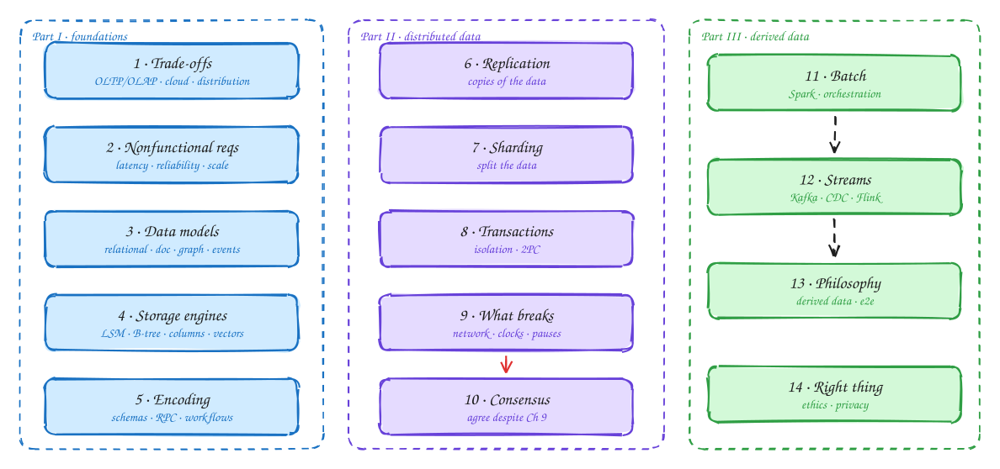

# DDIA, chapter by chapter

> These DDIA pages are study notes in our own words and diagrams, following the **2nd edition** of *Designing Data-Intensive Applications* by Martin Kleppmann and Chris Riccomini. They connect the book to interview problems and don't replace it; the book is worth reading in full.

1. **Part I, foundations (Ch 1–5)**, is about data on one machine and the choices around it: operational vs analytical systems, cloud vs self-hosting, what "fast" and "reliable" mean in numbers, and how data is modelled, stored and encoded.
2. **Part II, distributed data (Ch 6–10)**, spreads data across machines. Replication copies it, sharding splits it, transactions keep it correct. Ch 9 lists everything that breaks and Ch 10 shows how nodes still agree.
3. **Part III, derived data (Ch 11–14)**, connects many systems: a source of truth plus derived views (caches, search indexes, analytics) kept in sync with batch and stream processing. The book ends with the ethics of building systems that hold data about people.

## Chapters

| # | Chapter | Read it for |
|---|---|---|
| 1 | [Trade-offs in data systems architecture](01-trade-offs-in-data-systems-architecture.md) | OLTP vs OLAP, warehouses and lakes, system of record vs derived data, cloud vs self-hosting, when to distribute |
| 2 | [Defining nonfunctional requirements](02-nonfunctional-requirements.md) | timeline fan-out numbers, response vs service time, retry storms, p99, faults vs failures, shared-nothing |
| 3 | [Data models](03-data-models.md) | relational, document, graph, star schema, event sourcing and CQRS, DataFrames |
| 4 | [Storage and retrieval](04-storage-and-retrieval.md) | LSM-trees, Bloom filters, B-trees, column stores, lakehouse layers, full-text and vector search |
| 5 | [Encoding and evolution](05-encoding-and-evolution.md) | backward/forward compatibility, Protobuf and Avro, RPC, durable execution, event-driven architecture |
| 6 | [Replication](06-replication.md) | leader/follower, replication lag, multi-leader, sync engines, CRDTs, quorums |
| 7 | [Sharding](07-sharding.md) | key-range vs hash, hot spots, multitenancy and cells, rebalancing, routing |
| 8 | [Transactions](08-transactions.md) | isolation anomalies, MVCC, write skew, SSI, two-phase commit, exactly-once |
| 9 | [The trouble with distributed systems](09-trouble-with-distributed-systems.md) | partial failure, clocks, pauses, fencing tokens, deterministic simulation testing |
| 10 | [Consistency and consensus](10-consistency-and-consensus.md) | linearizability, ID generators, logical clocks, consensus, Raft, ZooKeeper/etcd |
| 11 | [Batch processing](11-batch-processing.md) | object storage, orchestration, MapReduce and the shuffle, joins, ML and ETL uses |
| 12 | [Stream processing](12-stream-processing.md) | Kafka, CDC, outbox, event sourcing, incremental view maintenance, windows, exactly-once |
| 13 | [A philosophy of streaming systems](13-philosophy-of-streaming-systems.md) | unbundling the database, Lambda vs Kappa, end-to-end idempotency, timeliness vs integrity |
| 14 | [Doing the right thing](14-doing-the-right-thing.md) | bias, feedback loops, surveillance, consent, data minimisation |

## Coming from the 1st edition?

The 2nd edition (Kleppmann and Riccomini) reorganises and updates the book. The main moves:

| 1st edition | 2nd edition |
|---|---|
| Ch 1 Reliable, scalable, maintainable | Split into **Ch 1** (new: architecture trade-offs, cloud, distribution, law) and **Ch 2** (nonfunctional requirements) |
| Ch 2 – Ch 7 | **Ch 3 – Ch 8**, each expanded (event sourcing, vector search, durable execution, sync engines, multitenancy) |
| Ch 6 Partitioning | **Ch 7 Sharding** |
| Two-phase commit in Ch 9 | Moved to **Ch 8 Transactions** |
| Ch 8, 9 | **Ch 9, 10** (adds deterministic simulation testing, ID generators, logical clocks) |
| Ch 10, 11 | **Ch 11, 12** (object storage, orchestration, IVM) |
| Ch 12 The future of data systems | **Ch 13 A philosophy of streaming systems** |
| (part of Ch 12) | **Ch 14 Doing the right thing** (ethics, now a full chapter) |

Old links to 1st-edition page addresses redirect to the matching new page.

## Which chapter shows up in which problem

| Chapter | Concept | Shows up in |
|---|---|---|
| [1 Trade-offs](01-trade-offs-in-data-systems-architecture.md) | OLTP vs OLAP, source of truth, managed services | Ad clicks, Metrics, any design with dashboards |
| [2 Nonfunctional requirements](02-nonfunctional-requirements.md) | Fan-out load parameter, p99, retry storms | News Feed, Instagram, Twitter-style feeds |
| [3 Data models](03-data-models.md) | Document vs relational, event sourcing | Yelp, Ticketmaster, Dropbox metadata, Payments ledger |
| [4 Storage](04-storage-and-retrieval.md) | LSM vs B-tree, column stores, inverted and vector indexes | Metrics (Datadog), Ad clicks, Yelp, Post Search, LLM chat (RAG) |
| [5 Encoding](05-encoding-and-evolution.md) | Schema evolution, gRPC vs REST, durable workflows | Any microservice design; Kafka schemas; checkout flows |
| [6 Replication](06-replication.md) | Lag, read-your-writes, failover, quorum, CRDTs | Bitly, Distributed Cache, WhatsApp, Google Docs |
| [7 Sharding](07-sharding.md) | Shard key, hot keys, consistent hashing, tenants | Distributed Cache, Live Comments, Top-K, Rate Limiter |
| [8 Transactions](08-transactions.md) | Lost update, write skew, row locks, 2PC vs sagas | Ticketmaster, Auction, Payments, Robinhood, Gopuff inventory |
| [9 Distributed trouble](09-trouble-with-distributed-systems.md) | Timeouts, idempotency, fencing | Payments, Job Scheduler, Uber matching locks |
| [10 Consensus](10-consistency-and-consensus.md) | Leader election, linearizable CAS, ID generation | Job Scheduler, URL shortener IDs, unique usernames |
| [11 Batch](11-batch-processing.md) | Shuffle, joins, rebuildable outputs | Web Crawler, Top-K reconciliation, recommendations |
| [12 Streams](12-stream-processing.md) | Kafka, CDC, windows, exactly-once | Ad Clicks, Top-K, Metrics, Strava, Price Tracking |
| [13 Streaming philosophy](13-philosophy-of-streaming-systems.md) | Derived data, end-to-end idempotency | Payments, every system with search + cache |
| [14 Doing the right thing](14-doing-the-right-thing.md) | Retention, deletion, bias | Any design holding personal data |
