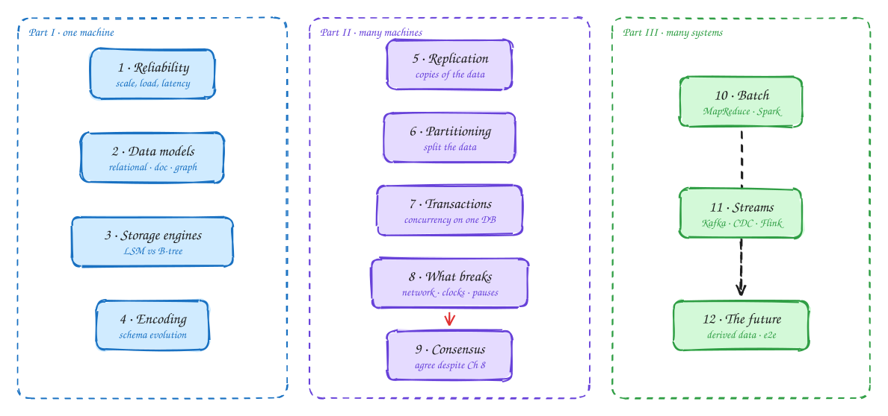

# DDIA, chapter by chapter

> These DDIA pages are study notes in our own words and diagrams, connecting the book to interview problems. They don't replace the book; *Designing Data-Intensive Applications* by Martin Kleppmann is worth reading in full.

1. **Part I** is about one database on one machine: what "good" means, how data is shaped, stored, and encoded.
2. **Part II** spreads data across machines. Replication copies it, partitioning splits it. Ch 8 lists everything that breaks and Ch 9 shows how nodes still agree.
3. **Part III** connects many systems: the source of truth plus derived data (caches, search indexes, analytics) kept in sync with batch and stream processing.

## Chapters

| # | Chapter | Read it for |
|---|---|---|
| 1 | [Reliable, scalable, maintainable](01-reliability-scalability-maintainability.md) | faults vs failures, load parameters, p99 latency, tail amplification |
| 2 | [Data models](02-data-models.md) | relational, document, graph, normalization |
| 3 | [Storage and retrieval](03-storage-and-retrieval.md) | append-only log, hash index, SSTable, LSM-tree |
| 4 | [Encoding and evolution](04-encoding-and-evolution.md) | backward compat, forward compat, Protobuf field tags, Avro schemas |
| 5 | [Replication](05-replication.md) | leader / follower, sync vs async, failover, replication lag |
| 6 | [Partitioning](06-partitioning.md) | key-range, hash partitioning, hot spots, secondary indexes |
| 7 | [Transactions](07-transactions.md) | ACID, dirty reads, read skew, MVCC |
| 8 | [Trouble with distributed systems](08-trouble-with-distributed-systems.md) | partial failure, timeouts, clock skew, LWW danger |
| 9 | [Consistency and consensus](09-consistency-and-consensus.md) | linearizability, CAP, causality, Lamport clocks |
| 10 | [Batch processing](10-batch-processing.md) | Unix philosophy, MapReduce, HDFS, shuffle |
| 11 | [Stream processing](11-stream-processing.md) | message brokers, Kafka partitions, consumer groups, CDC |
| 12 | [The future of data systems](12-future-of-data-systems.md) | derived data, unbundling the DB, Lambda vs Kappa, end-to-end argument |

## Which chapter shows up in which problem

| Chapter | Concept | Shows up in |
|---|---|---|
| [1 Reliability / load](01-reliability-scalability-maintainability.md) | Fan-out load parameter, p99 | News Feed, Instagram, Twitter-style feeds |
| [2 Data models](02-data-models.md) | Document vs relational | Yelp, Ticketmaster, Dropbox metadata |
| [3 Storage](03-storage-and-retrieval.md) | LSM vs B-tree, column stores, geo / inverted index | Metrics (Datadog), Ad clicks, Yelp, Post Search |
| [4 Encoding](04-encoding-and-evolution.md) | Schema evolution, gRPC vs REST | Any microservice design; Kafka schemas |
| [5 Replication](05-replication.md) | Lag, read-your-writes, failover, quorum | Bitly, Distributed Cache, WhatsApp, Google Docs |
| [6 Partitioning](06-partitioning.md) | Shard key, hot keys, consistent hashing | Distributed Cache, Live Comments, Top-K, Rate Limiter |
| [7 Transactions](07-transactions.md) | Lost update, write skew, row locks | Ticketmaster, Auction, Payments, Robinhood, Gopuff inventory |
| [8 Distributed trouble](08-trouble-with-distributed-systems.md) | Timeouts, idempotency, fencing | Payments, Job Scheduler, Uber matching locks |
| [9 Consensus](09-consistency-and-consensus.md) | Leader election, linearizable CAS, sagas vs 2PC | Job Scheduler, Payments, unique usernames |
| [10 Batch](10-batch-processing.md) | MapReduce, joins, rebuildable outputs | Web Crawler, Top-K reconciliation, recommendations |
| [11 Streams](11-stream-processing.md) | Kafka, CDC, windows, exactly-once | Ad Clicks, Top-K, Metrics, Strava, Price Tracking |
| [12 Future](12-future-of-data-systems.md) | Derived data, end-to-end idempotency | Payments, every system with search + cache |

