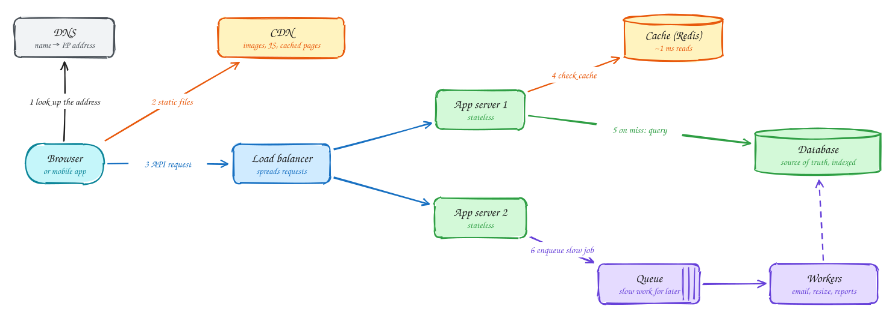

# The basics

Beginner-friendly

Every system design builds on the same handful of parts. This page walks one request through them, in plain language. If these feel familiar, skip to [How to approach any design](how-to-approach-a-design.md).

## 1. DNS: finding the server

Your browser knows a name (`api.example.com`), but the network needs an IP address. **DNS** is the internet's phone book: the browser asks a resolver, which finds the address and caches it for a while (the record's TTL).

**Why it matters in design:** DNS can send users in different countries to different data centers, and it is one of the first things involved in failover between regions.

## 2. CDN: serving files close to the user

Images, JavaScript, videos and pages that look the same for everyone don't need to come from your servers. A **CDN** keeps copies on servers in hundreds of cities, so a user in Dhaka gets the file from nearby instead of from a data center on another continent.

**Why it matters:** a CDN removes most of the traffic before it reaches you, and makes pages load faster. If 90% of requests hit the CDN, your servers only see the other 10%.

## 3. Load balancer: spreading the work

You run several copies of your application so that one machine isn't a bottleneck or a single point of failure. A **load balancer** sits in front of them, sends each request to a healthy server, and stops sending traffic to servers that fail health checks.

- An **L4** load balancer forwards network connections without looking inside them. It's very fast.
- An **L7** load balancer reads the HTTP request and can route by URL path or header, for example `/api/*` to one group of servers and `/ws/*` to another.

## 4. Stateless app servers: easy to add more

An app server is **stateless** when it keeps nothing about a user between requests: no sessions in memory, no files on local disk. Everything it needs comes with the request (such as a login token) or from shared storage (a database or cache).

**Why it matters:** if servers are stateless, any server can handle any request. Scaling becomes adding servers behind the load balancer, and a crashed server loses nothing. Keeping state *outside* your servers is the single most important habit in system design.

## 5. Cache: answering from memory

Reading from a database takes a few to tens of milliseconds. Reading from memory takes about one. A **cache** such as Redis keeps copies of frequently read data in memory.

The usual pattern (**cache-aside**): check the cache; if the data is there, use it; if not, read the database and store a copy in the cache with an expiry time (TTL).

**Why it matters:** most apps read far more than they write, and a small share of items gets most of the reads. A cache can absorb the large majority of reads. See [Caching](../core-concepts/caching.md).

## 6. Database and indexes: the source of truth

The **database** holds the real, durable copy of the data. When the cache and the database disagree, the database is right.

An **index** is what makes a database fast. Without one, finding a user by email means checking every row. With an index on `email`, the database looks it up in a sorted tree in a few steps, like using the index at the back of a book instead of reading every page.

**Why it matters:** choosing the right index is often the cheapest performance fix there is. But every index also slows down writes slightly, so index the queries you actually run. See [Database indexing](../core-concepts/indexing.md).

## 7. Queue and workers: doing slow work later

Some work is too slow to do while the user waits: sending email, resizing an image, generating a report. The app puts a message on a **queue** and responds immediately. Separate **worker** processes take messages from the queue and do the work.

**Why it matters:** users get fast responses, spikes of work are smoothed out, failed jobs can be retried, and workers can be scaled separately from the app. See [Long-running tasks](../patterns/long-running-tasks.md).

## Putting it together

| Piece | Solves | Typical tool |
|---|---|---|
| DNS | Finding the server by name | Route 53, Cloudflare DNS |
| CDN | Slow, repeated downloads of the same content | CloudFront, Cloudflare, Akamai |
| Load balancer | Spreading traffic; surviving a dead server | nginx, Envoy, cloud load balancers |
| Stateless app servers | Handling more requests by adding machines | Your application |
| Cache | Repeated reads hitting the database | Redis, Memcached |
| Database + indexes | Storing data safely and finding it fast | Postgres, MySQL |
| Queue + workers | Slow or bursty work | SQS, RabbitMQ, Kafka |

Almost every design in this handbook is this picture, plus one or two extra pieces added because a specific number required them.

## Next

1. [How to approach any design](how-to-approach-a-design.md): the method used on every page.
2. [Numbers and estimation](numbers-and-estimation.md): how much each of these pieces can handle.
3. Not sure about a term? Check the [glossary](../glossary.md), or hover over it on any page.
