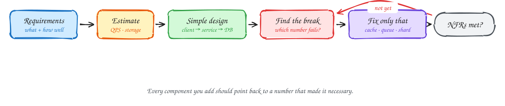

# How to approach any design

Good designs aren't memorized. They are **derived**: you start from what the system must do, put numbers on how well it must do it, and add complexity only when a number forces you to.

## The loop

1. **Requirements.** Write down what users can do (functional) and how well it must work (non-functional: latency, availability, consistency, scale, durability). See [NFRs](nfrs.md).
2. **Estimate.** Turn the NFRs into a few numbers: requests per second, storage, fan-out, bandwidth. See [Numbers and estimation](numbers-and-estimation.md).
3. **Simple design.** Client → service → one database. It is almost always the right starting point, and often more capable than people assume.
4. **Find the break.** Compare your numbers with what each component can handle. The first limit you exceed is the bottleneck.
5. **Fix only that.** Apply the [pattern](../patterns/index.md) that removes that specific bottleneck: a cache for reads, a queue for spiky writes, a conditional update for contention.
6. **Repeat** until every NFR is met. Then stop.

## Why this works in interviews

- It **shows reasoning**, which is what interviewers grade, rather than a recited architecture.
- It **keeps you out of trouble**: you never add Kafka, sharding or microservices without a reason you can state.
- It gives you **natural deep dives**: each "break" is a place the interviewer can push, and you've already thought about it.

> [!TIP]
> **Say this in the interview:** "Let me start with the simplest design that meets the functional requirements, then use the numbers to find where it breaks and fix those points one at a time."

## A worked mini-example

*"Design a URL shortener for 100M daily users."*

| Step | What you say |
|---|---|
| Requirements | Create short links; redirect fast (p99 < 100 ms); links never collide. |
| Estimate | 1B redirects/day ≈ 12k/s average, ~100k/s peak. Writes ≈ 12/s. 1B links × 500 B = 500 GB. |
| Simple design | API service + Postgres. 500 GB and 12 writes/s fit one database easily. |
| Find the break | 100k reads/s on one Postgres is too much. |
| Fix only that | Redis cache in front; popular links dominate traffic, so most reads never reach Postgres. |
| Repeat | Codes must be unique: counter + base62. Done. No sharding needed. |

The full version is the [URL shortener page](../problems/url-shortener.md).

## Where to go next

- [Non-functional requirements](nfrs.md): the numbers that drive every decision.
- [Numbers and estimation](numbers-and-estimation.md): what modern hardware can actually do.
- [The 7 patterns](../patterns/index.md): the fixes you'll apply in step 5.
