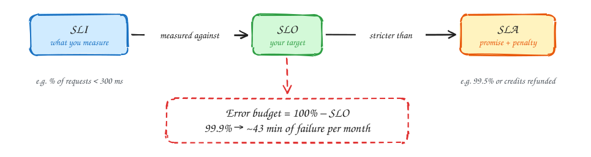

# Non-functional requirements

Functional requirements say **what** the system does. Non-functional requirements (NFRs) say **how well**, and they decide the architecture. Two systems with identical features but different NFRs look nothing alike.

> [!TIP]
> **Say this in the interview:** "Before designing, let me pin down the NFRs with numbers, because they drive every decision that follows."

## The NFRs that matter, and how to quantify them

| NFR | Question to ask | Say it as a number | What it changes in the design |
|---|---|---|---|
| **Scale** | How many users? Peak vs average? | "100M DAU, 50k reads/s at peak" | Caching, replicas, sharding |
| **Latency** | Which path must be fast? | "Feed p99 < 200 ms" | Caches, precomputation, CDN |
| **Availability** | What can be down, and for how long? | "99.99% for reads (≈ 4 min/month)" | Redundancy, failover, multi-AZ |
| **Consistency** | Where is stale data unacceptable? | "Booking: never oversell; browse: ≤ 5 s stale" | Transactions, read-from-primary, CP vs AP |
| **Durability** | Can we ever lose data? | "Payments: zero loss after ack" | Sync replication, write-ahead logs, backups |
| **Throughput** | Sustained work per second? | "10k events/s ingest" | Queues, batching, partitions |
| **Read:write ratio** | Which dominates? | "100:1" | Read path vs write path optimizations |
| **Data size / growth** | How much, how fast? | "500 GB now, +1 TB/year" | Storage engine, partitioning, tiering |
| **Freshness** | How quickly must changes appear? | "New posts visible within 1 min" | Sync vs async pipelines |
| **Security / privacy** | Who can see what? PII? | "Card data never leaves the vault" | Tokenization, isolation, encryption |
| **Cost** | Any hard constraints? | "GPU capacity is fixed" | Queues, priorities, admission control |

You rarely need all of them. Pick the **three to five** that matter for this problem and quantify those.

## Latency: use percentiles, not averages

An average hides the slow requests users actually notice. Use **p50** (typical user), **p99** (one request in a hundred) and sometimes **p99.9**.

Tail latency compounds: if one page calls 10 services in parallel and each is slow 1% of the time, about **10%** of page loads hit at least one slow call (1 − 0.99¹⁰ ≈ 0.096). Set targets on p99 and use timeouts.

## SLIs, SLOs, SLAs and error budgets

| Term | Meaning | Example |
|---|---|---|
| **SLI** (indicator) | What you measure | Share of requests served in < 300 ms |
| **SLO** (objective) | Your internal target for the SLI | 99.9% of requests < 300 ms over 30 days |
| **SLA** (agreement) | External promise, with penalties | 99.5%, or customers get credits |
| **Error budget** | 100% − SLO: how much failure you can "spend" | 0.1% of a month ≈ 43 minutes |

The error budget turns reliability into a decision rule: while budget remains, ship features; when it's spent, focus on reliability.

### Availability in minutes

| Availability | Downtime per month | Per year |
|---|---|---|
| 99% | ~7.3 hours | ~3.65 days |
| 99.9% | ~43 minutes | ~8.8 hours |
| 99.99% | ~4.3 minutes | ~53 minutes |
| 99.999% | ~26 seconds | ~5 minutes |

Two components in series multiply: 99.9% × 99.9% ≈ 99.8%. Redundant components in parallel help: two independent 99% replicas give ≈ 99.99%.

## Consistency is a per-feature choice

Don't declare a whole system "strongly consistent" or "eventually consistent". Decide feature by feature:

- **Strong (CP):** money, inventory, seat holds, unique usernames.
- **Eventual (AP):** feeds, search results, like counts, reviews, recommendations.

See [CAP theorem and PACELC](../core-concepts/cap-theorem.md).

## Common mistakes

- Listing NFRs without numbers ("it should be fast and scalable").
- Using averages instead of percentiles for latency.
- Asking for "five nines" everywhere. Each extra nine costs a lot; choose it where it matters.
- Forgetting that consistency can differ between the read path and the write path.
