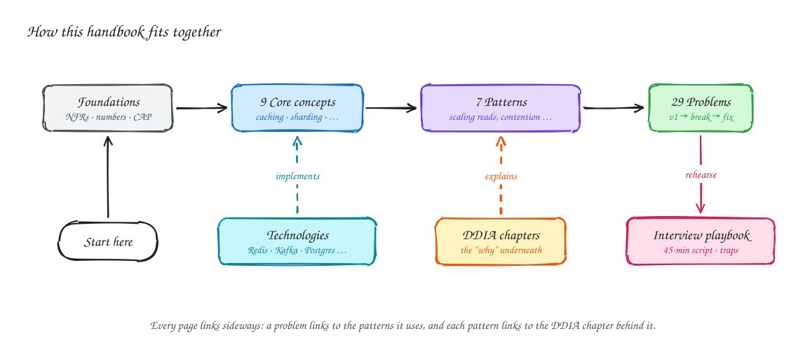

# System Design, Step by Step

A free, diagram-first handbook for system design interviews and for building real systems.

Most resources show you a finished architecture and expect you to memorize it. This one shows **how you get there**: start with the simplest design that works, calculate where it breaks, fix only that, and repeat. Every page has hand-drawn diagrams you can open and edit in [Excalidraw](https://excalidraw.com).

> [!TIP]
> **New here?** [Start here](start-here.md) has a learning path for your level, from intermediate to staff, with checkpoints. Every page is marked Beginner-friendly, Intermediate or Advanced, and you can hover over technical terms for a definition, or look them up in the [glossary](glossary.md).

## What's inside

| Section | What you get |
|---|---|
| [Start here](start-here.md) | Learning paths for intermediate, senior and staff engineers |
| [Foundations](foundations/index.md) | The basics of how requests flow, the method, non-functional requirements and the numbers to know |
| [Core concepts](core-concepts/index.md) | Networking, API design, data modeling, indexing, caching, sharding, consistent hashing, CAP |
| [7 patterns](patterns/index.md) | Scaling reads and writes, real-time updates, contention, multi-step processes, large blobs, long-running tasks |
| [Technologies](technologies.md) | Postgres, Redis, Kafka, Cassandra, DynamoDB, Elasticsearch, Flink, ZooKeeper, API gateways: when and when not |
| [29 problems](problems/index.md) | URL shortener to payments, each from v1 to final design with an interview script |
| [DDIA, chapter by chapter](ddia/index.md) | All 12 chapters of *Designing Data-Intensive Applications* as diagrams, tied to interview problems |
| [Low-level design](lld/index.md) | File system, movie booking, logger, inventory: class diagrams and tested Java |
| [Interview playbook](playbook/index.md) | The 45-minute framework, what senior answers sound like, quick-fire practice |
| [Staff-level answers](playbook/staff-level.md) | Senior vs staff, and all 29 problems through a staff lens ([interactive atlas](slides/staff-atlas.html)) |
| [Sketchnotes](sketchnotes/index.md) | 59 dense hand-drawn pages, one per topic, for revision and printing |
| [Slide decks](slides/index.md) | Three interactive decks for review and out-loud rehearsal |
| [Glossary](glossary.md) | Plain-language definitions of 100+ terms |

## Pick your path

| If you want to… | Do this |
|---|---|
| **Learn system design** | Follow the [intermediate path](start-here.md#path-1-intermediate-engineer-about-23-weeks-1-hour-a-day): basics, core concepts, three patterns, then eight problems in order, with checkpoints. |
| **Prepare for an interview in two weeks** | Read the [playbook](playbook/index.md), then do two problems a day: read the page, then rehearse it with the [interview deck](slides/interview.html). |
| **Know how deep to go** | Read [What's expected at each level](playbook/levels.md): the same problem answered at mid-level, senior, staff and principal. |
| **Interviewing for staff or above** | Read [Staff-level answers](playbook/staff-level.md), then use the [staff atlas](slides/staff-atlas.html) to rehearse all 29 problems at that level. |
| **Understand the theory** | Read the [DDIA pages](ddia/index.md) alongside the book; every chapter ends with how it shows up in interviews. |
| **Review the night before** | Flip through the [sketchnotes](sketchnotes/index.md), starting with the [interview cheat sheet](sketchnotes/interview-cheat-sheet.svg), then do the [quick-fire questions](playbook/quick-fire.md). |

## Every problem page has the same shape

1. **TL;DR**: three lines you could say out loud.
2. **Requirements**: functional, then non-functional with numbers.
3. **Back-of-envelope numbers**: only the ones that change the design.
4. **Core entities and API**
5. **v1, and where it breaks**
6. **The final design**, step by step, with why each part exists
7. **Deep dives**: the questions interviewers push on
8. **Interview script**: what to do in each part of 45 minutes
9. **Common mistakes** and **related** pages

## Formats

- **Website**: searchable, with dark mode and mobile layout.
- **GitHub**: every page is plain Markdown that renders in the repository.
- **Sketchnotes**: [one hand-drawn page per topic](sketchnotes/index.md), also as a [printable PDF](downloads/sketchnotes.pdf).
- **Slides**: [three interactive decks](slides/index.md) that work offline.
- **PDF**: the [whole handbook in one file](downloads/system-design-step-by-step.pdf) for printing or reading offline.
- **Editable diagrams**: every diagram has an `.excalidraw` source next to its `.svg`.

## Contributing

Fixes and new pages are welcome. See [CONTRIBUTING](contributing.md) for the page template and how to edit diagrams.

## Credits

Written in our own words, with our own diagrams. The DDIA pages are study notes on *Designing Data-Intensive Applications* by Martin Kleppmann; please read the book. Diagrams use the open-source [Excalifont](https://plus.excalidraw.com/excalifont) (SIL OFL 1.1). Problem names refer to well-known products only to describe the kind of system; this project is not affiliated with any company or course.
