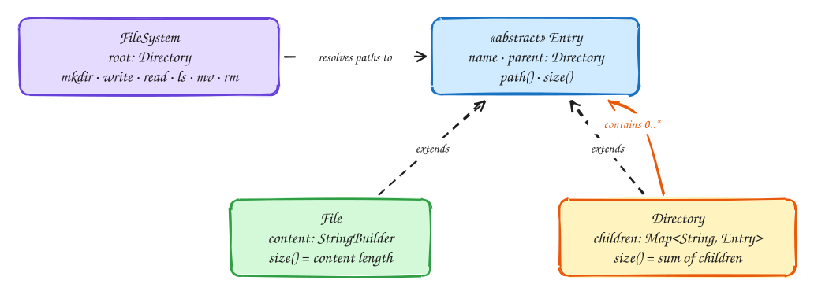

# LLD: In-memory file system

## Requirements

- `mkdir(path)` creates directories, including missing parents.
- `write(path, text)` creates or appends to a file; `read(path)` returns its content.
- `ls(path)` lists a directory's children in sorted order (or returns the file name).
- `rm(path)` deletes a file or directory; `mv(src, dst)` moves one.
- Paths are absolute, like `/a/b/c.txt`. Many threads may call these at once.

## Design



- **Composite pattern:** `File` and `Directory` both extend `Entry`, so code that walks the tree treats them the same way. `size()` is a leaf value for a file and the sum of children for a directory.
- **Directory children are a map** from name to entry, giving O(1) lookup per path segment. `ls` sorts the keys, or uses a `TreeMap` if listing is frequent.
- **Parent pointers** let any entry compute its full path and let `mv` detach an entry from its old parent cheaply.
- **Concurrency:** reads (`ls`, `read`) far outnumber structural changes, so one `ReentrantReadWriteLock` lets reads run in parallel while writes are exclusive. Finer locks (per directory) are possible but make `mv` across directories much harder to get right; mention it as a later step.

## Code

```java
import java.util.*;
import java.util.concurrent.locks.ReentrantReadWriteLock;

abstract class Entry {
    String name;
    Directory parent;
    Entry(String name, Directory parent) { this.name = name; this.parent = parent; }
    abstract long size();
    String path() { return parent == null ? "/" : (parent.parent == null ? "" : parent.path()) + "/" + name; }
}

class File extends Entry {
    private final StringBuilder content = new StringBuilder();
    File(String name, Directory parent) { super(name, parent); }
    long size() { return content.length(); }
    void append(String text) { content.append(text); }
    String read() { return content.toString(); }
}

class Directory extends Entry {
    final Map<String, Entry> children = new HashMap<>();
    Directory(String name, Directory parent) { super(name, parent); }
    long size() { return children.values().stream().mapToLong(Entry::size).sum(); }
}

public class FileSystem {
    private final Directory root = new Directory("", null);
    private final ReentrantReadWriteLock lock = new ReentrantReadWriteLock();

    private static List<String> parts(String path) {
        if (!path.startsWith("/")) throw new IllegalArgumentException("absolute path required: " + path);
        List<String> out = new ArrayList<>();
        for (String p : path.split("/")) if (!p.isEmpty()) out.add(p);
        return out;
    }

    /** Walks to the entry at path; returns null if any segment is missing. */
    private Entry find(String path) {
        Entry cur = root;
        for (String p : parts(path)) {
            if (!(cur instanceof Directory d)) return null;
            cur = d.children.get(p);
            if (cur == null) return null;
        }
        return cur;
    }

    /** Walks to the directory at path, creating missing directories. */
    private Directory mkdirs(List<String> segments) {
        Directory cur = root;
        for (String p : segments) {
            Entry next = cur.children.computeIfAbsent(p, n -> new Directory(n, null));
            if (!(next instanceof Directory d)) throw new IllegalStateException(p + " is a file");
            d.parent = cur;
            cur = d;
        }
        return cur;
    }

    public void mkdir(String path) {
        lock.writeLock().lock();
        try { mkdirs(parts(path)); } finally { lock.writeLock().unlock(); }
    }

    public void write(String path, String text) {
        lock.writeLock().lock();
        try {
            List<String> ps = parts(path);
            Directory dir = mkdirs(ps.subList(0, ps.size() - 1));
            String name = ps.get(ps.size() - 1);
            Entry e = dir.children.computeIfAbsent(name, n -> new File(n, dir));
            if (!(e instanceof File f)) throw new IllegalStateException(path + " is a directory");
            f.append(text);
        } finally { lock.writeLock().unlock(); }
    }

    public String read(String path) {
        lock.readLock().lock();
        try {
            if (!(find(path) instanceof File f)) throw new NoSuchElementException(path);
            return f.read();
        } finally { lock.readLock().unlock(); }
    }

    public List<String> ls(String path) {
        lock.readLock().lock();
        try {
            Entry e = find(path);
            if (e == null) throw new NoSuchElementException(path);
            if (e instanceof File) return List.of(e.name);
            List<String> names = new ArrayList<>(((Directory) e).children.keySet());
            Collections.sort(names);
            return names;
        } finally { lock.readLock().unlock(); }
    }

    public void rm(String path) {
        lock.writeLock().lock();
        try {
            Entry e = find(path);
            if (e == null || e == root) throw new NoSuchElementException(path);
            e.parent.children.remove(e.name);
        } finally { lock.writeLock().unlock(); }
    }

    public void mv(String src, String dst) {
        lock.writeLock().lock();
        try {
            Entry e = find(src);
            if (e == null || e == root) throw new NoSuchElementException(src);
            List<String> ps = parts(dst);
            Directory target = mkdirs(ps.subList(0, ps.size() - 1));
            for (Directory d = target; d != null; d = d.parent)
                if (d == e) throw new IllegalArgumentException("cannot move a directory into itself");
            String newName = ps.get(ps.size() - 1);
            if (target.children.containsKey(newName)) throw new IllegalStateException(dst + " exists");
            e.parent.children.remove(e.name);
            e.name = newName;
            e.parent = target;
            target.children.put(newName, e);
        } finally { lock.writeLock().unlock(); }
    }
}
```

## Follow-up questions

| Question | Answer |
|---|---|
| How would you support permissions? | Add owner and mode to `Entry`; check them during path resolution. |
| Very large directories? | `TreeMap` for sorted listing, or paginate `ls` with a cursor. |
| More write concurrency? | Lock per directory, taking locks top-down in path order; `mv` locks the common ancestor. |
| Persist to disk? | Separate the tree from storage behind an interface; write an append-only journal of operations. |

## Related

- [Low-level design approach](index.md)
