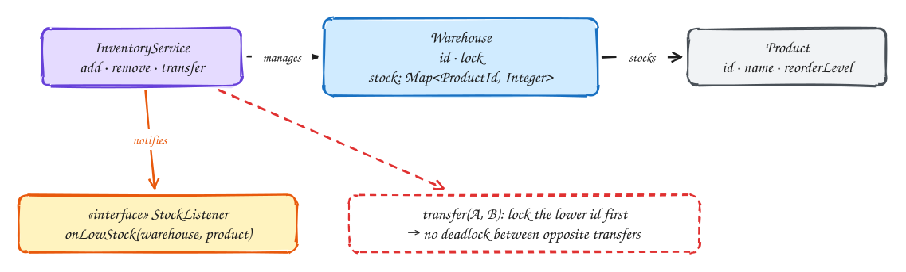

# LLD: Inventory management

<span class="lvl lvl-i">Intermediate</span>

## Requirements

- Track stock of each product in each warehouse.
- `add` stock (deliveries) and `remove` stock (orders); never let stock go negative.
- `transfer` stock between two warehouses atomically: it leaves one and arrives in the other, or nothing happens.
- Notify interested parties when a product's stock in a warehouse falls below its reorder level.
- Many threads operate at once.

## Design



- **One lock per warehouse.** Operations on different warehouses run in parallel; only operations on the same warehouse wait for each other.
- **Remove is check-then-act**, so it happens under the warehouse lock: check stock ≥ quantity, then subtract.
- **Transfer needs two locks.** If one thread transfers A→B while another transfers B→A, each could hold one lock and wait forever for the other. Fix: **always lock the warehouse with the smaller id first.** With one global order, a cycle of waiting is impossible.
- **Observer for low stock.** The service doesn't know who cares (purchasing, alerting). Listeners register themselves; notifications are sent **after** releasing locks, so a slow listener can't block inventory operations.

## Code

```java
import java.util.*;
import java.util.concurrent.ConcurrentHashMap;
import java.util.concurrent.CopyOnWriteArrayList;
import java.util.concurrent.locks.ReentrantLock;

record Product(String id, String name, int reorderLevel) {}

interface StockListener { void onLowStock(String warehouseId, Product product, int remaining); }

final class Warehouse {
    final String id;
    final ReentrantLock lock = new ReentrantLock();
    private final Map<String, Integer> stock = new HashMap<>();   // guarded by lock
    Warehouse(String id) { this.id = id; }
    int get(String productId) { return stock.getOrDefault(productId, 0); }
    void set(String productId, int qty) { stock.put(productId, qty); }
}

public class InventoryService {
    private final Map<String, Warehouse> warehouses = new ConcurrentHashMap<>();
    private final Map<String, Product> products = new ConcurrentHashMap<>();
    private final List<StockListener> listeners = new CopyOnWriteArrayList<>();

    public void addWarehouse(String id) { warehouses.putIfAbsent(id, new Warehouse(id)); }
    public void addProduct(Product p) { products.put(p.id(), p); }
    public void subscribe(StockListener l) { listeners.add(l); }

    public void add(String warehouseId, String productId, int qty) {
        if (qty <= 0) throw new IllegalArgumentException("qty must be positive");
        Warehouse w = warehouses.get(warehouseId);
        w.lock.lock();
        try { w.set(productId, w.get(productId) + qty); } finally { w.lock.unlock(); }
    }

    /** Returns false (and changes nothing) if there isn't enough stock. */
    public boolean remove(String warehouseId, String productId, int qty) {
        if (qty <= 0) throw new IllegalArgumentException("qty must be positive");
        Warehouse w = warehouses.get(warehouseId);
        int remaining;
        w.lock.lock();
        try {
            int have = w.get(productId);
            if (have < qty) return false;
            remaining = have - qty;
            w.set(productId, remaining);
        } finally { w.lock.unlock(); }
        notifyIfLow(warehouseId, productId, remaining);    // outside the lock
        return true;
    }

    /** Moves stock atomically. Locks are always taken in warehouse-id order to prevent deadlock. */
    public boolean transfer(String fromId, String toId, String productId, int qty) {
        if (fromId.equals(toId)) throw new IllegalArgumentException("same warehouse");
        if (qty <= 0) throw new IllegalArgumentException("qty must be positive");
        Warehouse from = warehouses.get(fromId), to = warehouses.get(toId);
        Warehouse first = fromId.compareTo(toId) < 0 ? from : to;
        Warehouse second = first == from ? to : from;
        int remaining;
        first.lock.lock();
        try {
            second.lock.lock();
            try {
                int have = from.get(productId);
                if (have < qty) return false;
                remaining = have - qty;
                from.set(productId, remaining);
                to.set(productId, to.get(productId) + qty);
            } finally { second.lock.unlock(); }
        } finally { first.lock.unlock(); }
        notifyIfLow(fromId, productId, remaining);
        return true;
    }

    public int stock(String warehouseId, String productId) {
        Warehouse w = warehouses.get(warehouseId);
        w.lock.lock();
        try { return w.get(productId); } finally { w.lock.unlock(); }
    }

    private void notifyIfLow(String warehouseId, String productId, int remaining) {
        Product p = products.get(productId);
        if (p != null && remaining < p.reorderLevel())
            for (StockListener l : listeners) l.onLowStock(warehouseId, p, remaining);
    }
}
```

## Why lock ordering works

Deadlock needs a cycle: thread 1 holds A and waits for B, while thread 2 holds B and waits for A. If every thread takes locks in the same global order (here, by warehouse id), thread 2 must also take A first, so it waits *before* holding B. No cycle can form.

## Follow-up questions

| Question | Answer |
|---|---|
| Reserve stock for an order before payment? | Add a `reserved` count per product: available = stock − reserved; a reservation expires like a seat hold. |
| One very hot product? | Split its stock into several buckets, each with its own lock, and take from any bucket that has enough. |
| Distributed across services? | Conditional database updates: `UPDATE stock SET qty = qty - :n WHERE … AND qty >= :n`. A transfer becomes one transaction, or a saga across databases. |
| Audit trail? | Append every change to a movements table (who, what, when, why) and derive totals from it. |

## Related

- [Dealing with contention](../patterns/contention.md)
- [Local delivery](../problems/local-delivery.md): the system-scale version of "never oversell".
