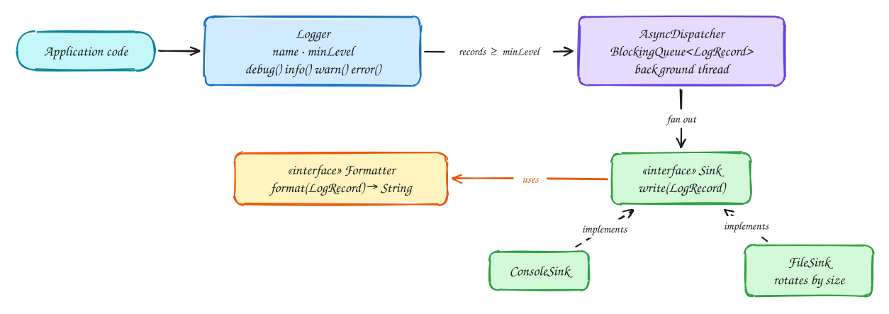

# LLD: Logging library

## Requirements

- Log messages at levels `DEBUG < INFO < WARN < ERROR`; each logger has a minimum level.
- Send records to one or more destinations (**sinks**): console, file, later a network service.
- Format records differently per sink (plain text, JSON).
- Logging must not slow the application down, must be safe from many threads, and must flush on shutdown.

## Design



- **`Sink` is an interface**, so a new destination is a new class, not an edit to the logger (open/closed principle). Composition, not inheritance: the logger *has* sinks.
- **`Formatter` is a strategy** each sink is given, so the same record can be plain text on the console and JSON in a file.
- **Level filtering happens first**, in the caller's thread, before any work like string formatting is done.
- **Asynchronous dispatch:** the caller puts the record on a bounded queue and returns immediately; one background thread writes to the sinks. Sinks then see one thread and need no locks of their own.
- **Backpressure policy:** when the queue is full, drop `DEBUG`/`INFO` but block briefly for `WARN`/`ERROR`. Losing an error log is worse than a short pause.

## Code

```java
import java.io.*;
import java.time.Instant;
import java.util.List;
import java.util.concurrent.*;

enum Level { DEBUG, INFO, WARN, ERROR }

record LogRecord(Instant time, Level level, String logger, String message, Throwable error) {}

interface Formatter { String format(LogRecord r); }

class PlainFormatter implements Formatter {
    public String format(LogRecord r) {
        String base = r.time() + " " + r.level() + " [" + r.logger() + "] " + r.message();
        return r.error() == null ? base : base + " | " + r.error();
    }
}

class JsonFormatter implements Formatter {
    private static String q(String s) { return "\"" + s.replace("\\", "\\\\").replace("\"", "\\\"") + "\""; }
    public String format(LogRecord r) {
        return "{\"time\":" + q(r.time().toString()) + ",\"level\":" + q(r.level().name())
             + ",\"logger\":" + q(r.logger()) + ",\"message\":" + q(r.message()) + "}";
    }
}

interface Sink extends Closeable { void write(LogRecord r) throws IOException; }

class ConsoleSink implements Sink {
    private final Formatter fmt;
    ConsoleSink(Formatter fmt) { this.fmt = fmt; }
    public void write(LogRecord r) { System.out.println(fmt.format(r)); }
    public void close() { System.out.flush(); }
}

class FileSink implements Sink {
    private final Formatter fmt;
    private final Writer out;
    FileSink(String path, Formatter fmt) throws IOException {
        this.fmt = fmt;
        this.out = new BufferedWriter(new FileWriter(path, true));
    }
    public void write(LogRecord r) throws IOException { out.write(fmt.format(r)); out.write('\n'); }
    public void close() throws IOException { out.close(); }
}

/** One background thread drains a bounded queue into the sinks. */
class AsyncDispatcher implements AutoCloseable {
    private static final LogRecord STOP = new LogRecord(Instant.EPOCH, Level.ERROR, "", "", null);
    private final BlockingQueue<LogRecord> queue = new ArrayBlockingQueue<>(10_000);
    private final List<Sink> sinks;
    private final Thread worker;

    AsyncDispatcher(List<Sink> sinks) {
        this.sinks = List.copyOf(sinks);
        this.worker = new Thread(this::run, "log-dispatcher");
        this.worker.setDaemon(true);
        this.worker.start();
    }

    void submit(LogRecord r) {
        if (r.level().compareTo(Level.WARN) < 0) {
            queue.offer(r);                                    // drop low-priority records if full
        } else {
            try { queue.offer(r, 100, TimeUnit.MILLISECONDS); }  // wait briefly for important ones
            catch (InterruptedException e) { Thread.currentThread().interrupt(); }
        }
    }

    private void run() {
        try {
            for (LogRecord r = queue.take(); r != STOP; r = queue.take())
                for (Sink s : sinks) {
                    try { s.write(r); } catch (IOException e) { System.err.println("sink failed: " + e); }
                }
        } catch (InterruptedException e) { Thread.currentThread().interrupt(); }
    }

    public void close() throws Exception {
        queue.put(STOP);           // records already queued are written first
        worker.join(5_000);
        for (Sink s : sinks) s.close();
    }
}

public class Logger {
    private final String name;
    private final Level minLevel;
    private final AsyncDispatcher dispatcher;

    public Logger(String name, Level minLevel, AsyncDispatcher dispatcher) {
        this.name = name; this.minLevel = minLevel; this.dispatcher = dispatcher;
    }

    public boolean isEnabled(Level level) { return level.compareTo(minLevel) >= 0; }

    public void log(Level level, String message, Throwable error) {
        if (!isEnabled(level)) return;                      // cheap filter in the caller's thread
        dispatcher.submit(new LogRecord(Instant.now(), level, name, message, error));
    }
    public void debug(String m) { log(Level.DEBUG, m, null); }
    public void info(String m)  { log(Level.INFO, m, null); }
    public void warn(String m)  { log(Level.WARN, m, null); }
    public void error(String m, Throwable t) { log(Level.ERROR, m, t); }
}
```

Usage:

```java
var dispatcher = new AsyncDispatcher(List.of(
        new ConsoleSink(new PlainFormatter()),
        new FileSink("app.log", new JsonFormatter())));
var log = new Logger("checkout", Level.INFO, dispatcher);
log.info("order placed");
log.debug("ignored: below INFO");
dispatcher.close();   // flush on shutdown
```

## Follow-up questions

| Question | Answer |
|---|---|
| A sink is slow (network) | Give it its own queue and thread so it can't delay the others. |
| Expensive messages at DEBUG | Check `isEnabled(DEBUG)` first, or accept a `Supplier<String>` so the message is built only when needed. |
| File grows forever | A rolling `FileSink`: rotate when size or date crosses a limit. |
| Per-package levels | A `LoggerFactory` holding a level per name prefix, returning cached loggers. |

## Related

- [Low-level design approach](index.md)
- [Long-running tasks](../patterns/long-running-tasks.md): the same producer–consumer idea at system scale.
