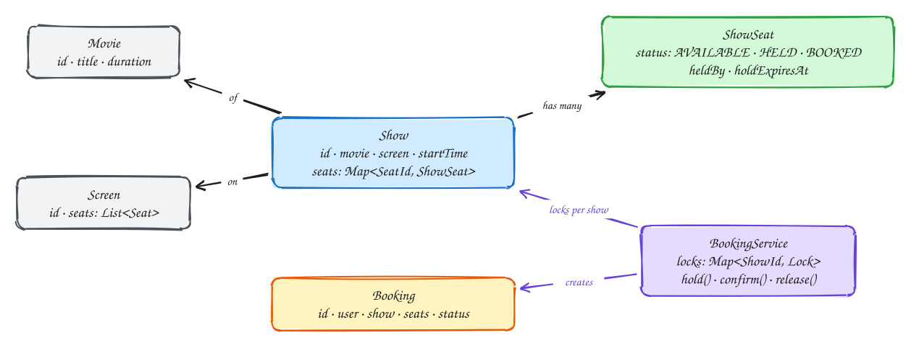

# LLD: Movie ticket booking

<span class="lvl lvl-i">Intermediate</span>

## Requirements

- Browse shows (a movie on a screen at a time) and see which seats are free.
- **Hold** several seats at once for a few minutes while the user pays: all of them or none.
- **Confirm** a hold after payment; **release** it if the user cancels. Expired holds free their seats automatically.
- A seat is never sold twice, even when many users click the same seats at the same moment.

## Design



- **`ShowSeat` carries the state** for one seat in one show: `AVAILABLE`, `HELD` (with holder and expiry) or `BOOKED`. The physical `Seat` stays immutable and is shared by all shows on that screen.
- **One lock per show.** Holding seats is a check-then-act over several seats, so it must be atomic. Locking the whole service would serialize every booking in the city; locking one show only serializes users fighting over the same screening, which is exactly where contention is.
- **All-or-nothing holds:** check every requested seat first, and only then mark them all held. If any seat is unavailable, change nothing.
- **Lazy expiry:** a held seat whose expiry has passed counts as available. No background thread is needed for correctness; an optional sweeper just tidies up.
- **Injected clock**, so expiry is testable.

## Code

```java
import java.time.*;
import java.util.*;
import java.util.concurrent.ConcurrentHashMap;
import java.util.concurrent.locks.ReentrantLock;

enum SeatStatus { AVAILABLE, HELD, BOOKED }

final class ShowSeat {
    final String seatId;
    SeatStatus status = SeatStatus.AVAILABLE;
    String heldBy;
    Instant holdExpiresAt;
    ShowSeat(String seatId) { this.seatId = seatId; }

    boolean isFree(Instant now) {
        return status == SeatStatus.AVAILABLE
            || (status == SeatStatus.HELD && holdExpiresAt.isBefore(now));
    }
}

final class Show {
    final String id;
    final Map<String, ShowSeat> seats = new HashMap<>();
    Show(String id, Collection<String> seatIds) {
        this.id = id;
        seatIds.forEach(s -> seats.put(s, new ShowSeat(s)));
    }
}

record Booking(String id, String userId, String showId, List<String> seatIds, Instant expiresAt) {}

public class BookingService {
    private final Map<String, Show> shows = new ConcurrentHashMap<>();
    private final Map<String, ReentrantLock> locks = new ConcurrentHashMap<>();
    private final Map<String, Booking> holds = new ConcurrentHashMap<>();
    private final Clock clock;
    private final Duration holdTime;

    public BookingService(Clock clock, Duration holdTime) { this.clock = clock; this.holdTime = holdTime; }

    public void addShow(Show show) { shows.put(show.id, show); locks.put(show.id, new ReentrantLock()); }

    /** Holds all requested seats or none. Returns the hold, or empty if any seat is taken. */
    public Optional<Booking> hold(String showId, String userId, List<String> seatIds) {
        Show show = shows.get(showId);
        ReentrantLock lock = locks.get(showId);
        lock.lock();
        try {
            Instant now = clock.instant();
            for (String id : seatIds) {
                ShowSeat s = show.seats.get(id);
                if (s == null || !s.isFree(now)) return Optional.empty();   // nothing changed yet
            }
            Instant expires = now.plus(holdTime);
            for (String id : seatIds) {
                ShowSeat s = show.seats.get(id);
                s.status = SeatStatus.HELD; s.heldBy = userId; s.holdExpiresAt = expires;
            }
            Booking b = new Booking(UUID.randomUUID().toString(), userId, showId, List.copyOf(seatIds), expires);
            holds.put(b.id(), b);
            return Optional.of(b);
        } finally { lock.unlock(); }
    }

    /** Called after payment succeeds. Fails if the hold expired and someone else took a seat. */
    public boolean confirm(String bookingId) {
        Booking b = holds.get(bookingId);
        if (b == null) return false;
        Show show = shows.get(b.showId());
        ReentrantLock lock = locks.get(b.showId());
        lock.lock();
        try {
            Instant now = clock.instant();
            for (String id : b.seatIds()) {
                ShowSeat s = show.seats.get(id);
                boolean stillMine = s.status == SeatStatus.HELD && b.userId().equals(s.heldBy) && !s.holdExpiresAt.isBefore(now);
                if (!stillMine) return false;          // caller refunds the payment
            }
            for (String id : b.seatIds()) show.seats.get(id).status = SeatStatus.BOOKED;
            holds.remove(bookingId);
            return true;
        } finally { lock.unlock(); }
    }

    public void release(String bookingId) {
        Booking b = holds.remove(bookingId);
        if (b == null) return;
        Show show = shows.get(b.showId());
        ReentrantLock lock = locks.get(b.showId());
        lock.lock();
        try {
            for (String id : b.seatIds()) {
                ShowSeat s = show.seats.get(id);
                if (s.status == SeatStatus.HELD && b.userId().equals(s.heldBy)) {
                    s.status = SeatStatus.AVAILABLE; s.heldBy = null; s.holdExpiresAt = null;
                }
            }
        } finally { lock.unlock(); }
    }

    public List<String> freeSeats(String showId) {
        Show show = shows.get(showId);
        ReentrantLock lock = locks.get(showId);
        lock.lock();
        try {
            Instant now = clock.instant();
            return show.seats.values().stream().filter(s -> s.isFree(now)).map(s -> s.seatId).sorted().toList();
        } finally { lock.unlock(); }
    }
}
```

## Why the details matter

| Detail | What goes wrong without it |
|---|---|
| Check all seats before changing any | A user gets seats 1–2 of 3 they asked for, and the others are left half-held. |
| Lock per show, not global | Every booking in every cinema waits on one lock. |
| `confirm` re-checks ownership | A hold expires during a slow payment, another user takes the seat, and the first user's confirm overwrites it. |
| Lazy expiry inside `isFree` | A crashed sweeper thread would leave seats stuck as held forever. |

## Taking it to a real system

In a distributed service the in-memory lock becomes a **conditional update** in the database, so the database enforces the rule for all servers:

```sql
UPDATE show_seats SET status = 'HELD', held_by = :user, hold_until = now() + interval '10 minutes'
WHERE show_id = :show AND seat_id = ANY(:seats)
  AND (status = 'AVAILABLE' OR (status = 'HELD' AND hold_until < now()));
-- success only if the number of updated rows equals the number of seats requested; otherwise roll back
```

See the system design version in [Ticketmaster](../problems/ticketmaster.md).

## Related

- [Dealing with contention](../patterns/contention.md)
- [DDIA Ch 7: Transactions](../ddia/07-transactions.md) explains write skew, the bug this design prevents.
