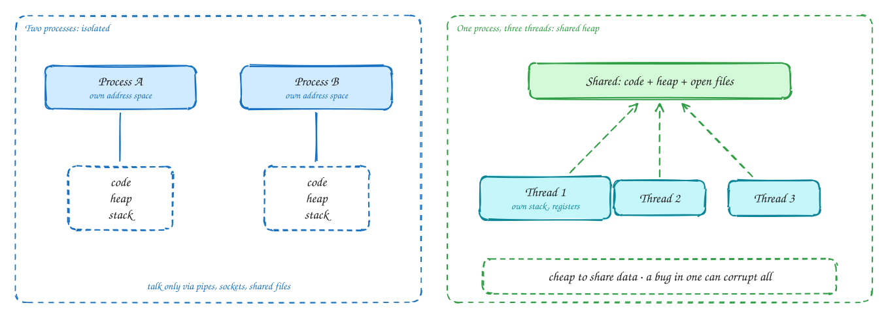
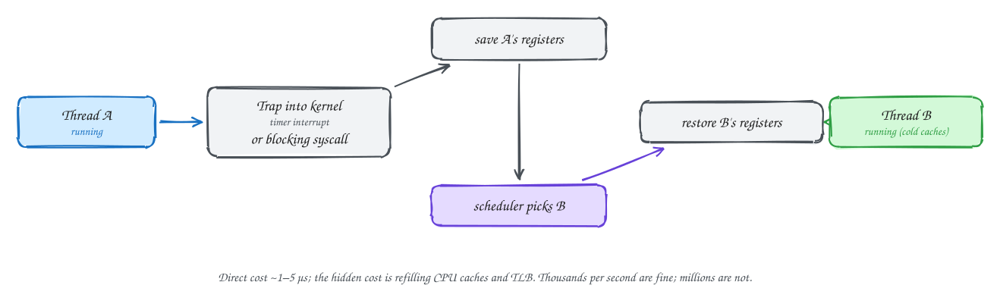
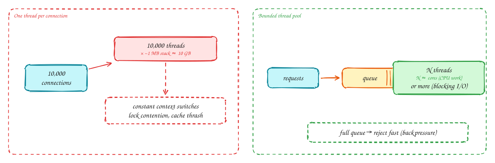

# Processes, threads and context switches

Beginner-friendly

> Part of [Operating Systems for system design](index.md): notes in our own words, following the themes of *Operating Systems: Three Easy Pieces* by Remzi and Andrea Arpaci-Dusseau (free at [ostep.org](https://pages.cs.wisc.edu/~remzi/OSTEP/)).

## TL;DR

A **process** is a running program with its own private memory. A **thread** is a path of execution inside a process; threads share the process's memory. The OS gives each the illusion of having the CPU to itself by switching between them very quickly, and each **context switch** costs a few microseconds plus colder caches. That's why "one thread per request" works for hundreds of concurrent requests but not for tens of thousands, and why servers use **thread pools** and **event loops**.

**Key ideas:** process · address space · thread · shared memory · context switch · system call · thread pool · process vs thread trade-offs

## Processes and threads

**Why the OS has them:** a machine runs hundreds of programs at once on a handful of CPU cores, and a bug in one program mustn't crash or read another. The OS **virtualises** the CPU and memory, so each program behaves as if it had the machine to itself.

**How they differ:**

- A **process** has its own **address space**: its own view of memory, containing its code, its **heap** (data allocated while running) and a **stack** (function calls and local variables), plus open files and sockets. One process cannot read another's memory. They communicate only through the OS: pipes, sockets, files or explicitly shared memory. If one crashes, the others carry on.
- A **thread** runs inside a process. All threads of a process **share** its code, heap and open files, and each has its own **stack** and **registers** (its current position in the code). Sharing makes threads cheap to create and makes passing data between them trivial. But a bug in one thread, such as writing to the wrong memory, can corrupt them all, and shared data needs careful locking (see [Concurrency](04-concurrency.md)).

**System calls** are how programs ask the OS to do something privileged: read a file, send on a socket, start a process. The CPU switches into **kernel mode**, the OS does the work, and control returns. Each crossing costs time, which is why batching I/O (one large `write` instead of thousands of small ones) is faster.

> [!NOTE]
> **Processes vs threads in practice:** Postgres runs one **process** per connection: isolated and robust, but heavy, which is why it needs a connection pooler such as PgBouncer. MySQL uses **threads**, which are lighter. Python often uses several processes to get around its global interpreter lock. Chrome runs each tab as a process so one bad page can't crash the browser.

## Context switches

**Why they happen:** there are more threads that want to run than there are CPU cores. The OS **time-slices**: it runs a thread for a short while, then switches to another. It also switches whenever a thread **blocks**, for example waiting for disk or network, so the core isn't left idle.

**How a switch works:**

1. Thread A is running. A **timer interrupt** fires (its time slice is up), or A makes a **blocking system call** (it waits for data).
2. The CPU traps into the kernel, which **saves A's registers** (where it was, what it was holding).
3. The **scheduler** picks the next thread to run (see [CPU scheduling](02-cpu-scheduling.md)).
4. The kernel **restores B's registers**, and B continues exactly where it last stopped.

**What it costs:** the direct cost is a few microseconds. The hidden cost is larger: B's data isn't in the CPU caches (A's was), so B runs slowly for a while as caches refill. Switching to a different **process** also changes the memory mapping, which flushes the address-translation cache (TLB). A few thousand switches a second is nothing. Hundreds of thousands a second spend a real share of the CPU on switching instead of work.

## Why thread-per-request stops scaling

**Why it's tempting:** the simplest server design gives each connection its own thread. The code reads top to bottom: read the request, query the database (the thread just waits), write the response. It's easy to write and debug.

**How it breaks:**

- **Memory:** each thread reserves a stack, often about 1 MB by default. 10,000 connections means roughly **10 GB** of stacks before doing any work.
- **Switching:** thousands of threads waking and sleeping means constant context switches, and caches that never stay warm.
- **Contention:** more threads fighting over the same locks and connection pools makes everything slower.
- **No backpressure:** if every incoming request gets a new thread, a traffic spike creates thousands of threads, and the server falls over instead of saying "busy".

**The fixes:**

1. **A bounded thread pool:** a fixed number of worker threads take work from a queue. For CPU-bound work, about one thread per core. For work that blocks on I/O, more, sized to keep the cores busy. When the queue is full, **reject quickly** (HTTP 503) instead of accepting work you can't finish.
2. **Event-driven I/O:** a few threads each handle thousands of connections by only touching the ones with data ready. This is how Nginx, Node.js and Redis work (see [I/O models](05-io-models.md)).
3. **Lightweight threads:** language runtimes with very cheap user-space threads, like Go's goroutines or Java's virtual threads, keep the simple "one per request" code but map millions of them onto a few OS threads, with an event loop underneath.

> [!TIP]
> **Say this in the interview:** "Each service instance runs a bounded worker pool sized to its cores, with a short queue in front. When the queue is full we return 503 so the load balancer tries another instance, instead of piling up thousands of threads."

## In the system design interview

> [!IMPORTANT]
> **Interviewer asks:** "Why does Postgres need a connection pooler?"
> → Each connection is a separate OS process with its own memory. Thousands of them waste memory and cause heavy context switching. PgBouncer multiplexes many client connections onto a few dozen server connections.

> [!IMPORTANT]
> **Interviewer asks:** "How many threads should this service have?"
> → CPU-bound work: about the number of cores. Blocking I/O: more, roughly cores × (1 + wait time ÷ compute time). Always bounded, with a queue and rejection when full.

> [!IMPORTANT]
> **Interviewer asks:** "Why is Redis single-threaded and still fast?"
> → Its operations are in-memory and tiny, so one thread with an event loop avoids locks and context switches entirely. The bottleneck is the network, not the CPU. (Recent versions add I/O threads for network reads and writes.)

## Self-check

Try to answer before you open each one.

What do threads of the same process share, and what does each have of its own?

They share the code, heap and open files. Each has its own stack and registers.

What is the hidden cost of a context switch?

Besides saving and restoring registers (microseconds), the new thread starts with cold CPU caches (and, between processes, a flushed TLB), so it runs slower until they refill.

Give two reasons thread-per-connection fails at 50,000 connections.

Memory: each thread's stack (~1 MB) adds up to tens of GB. CPU: constant context switching and lock contention. Also, there's no natural backpressure.

## Related

- [CPU scheduling](02-cpu-scheduling.md) · [I/O models](05-io-models.md)
- [Long-running tasks](../patterns/long-running-tasks.md) · [Choosing technologies](../technologies.md) (Redis, Postgres)

---

[OS 2: CPU scheduling](02-cpu-scheduling.md) →
