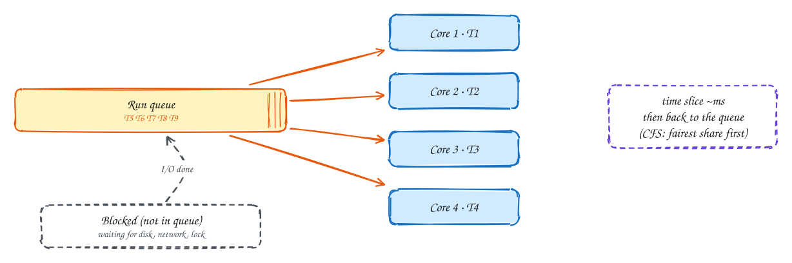
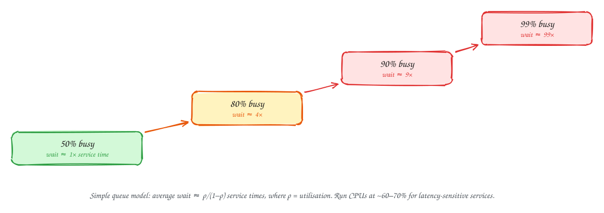

# CPU scheduling and utilisation

Intermediate

> Part of [Operating Systems for system design](index.md): notes in our own words, following the themes of *Operating Systems: Three Easy Pieces* by Remzi and Andrea Arpaci-Dusseau (free at [ostep.org](https://pages.cs.wisc.edu/~remzi/OSTEP/)).

## TL;DR

When more threads want to run than there are cores, they wait in a **run queue**, and the **scheduler** decides who runs next and for how long. The details of scheduling algorithms rarely matter in system design. One consequence matters a lot: **waiting time grows explosively as utilisation approaches 100%**. A service at 95% CPU isn't "using its hardware efficiently"; it's queueing every request. Plan for headroom, and watch out for **noisy neighbours** sharing the same machine.

**Key ideas:** run queue · time slice · preemption · fairness (CFS) · priorities · load average · utilisation vs latency · noisy neighbours

## How the scheduler shares the CPU

**Why it's needed:** a server might have 16 cores and 500 threads. Most threads are **blocked** (waiting for network, disk or a lock) and don't need a core. The ones that are **runnable** compete for the cores.

**How it works:**

1. Runnable threads wait in a **run queue** (in Linux, one per core, with balancing between them).
2. The scheduler picks one, runs it for a **time slice** (a few milliseconds), then **preempts** it: interrupts it and puts it back in the queue, so others get a turn.
3. A thread that **blocks** leaves the queue entirely, and returns to it when its I/O completes or its lock is free.
4. Linux's default scheduler (CFS, and its successor EEVDF) tries to give every runnable thread a **fair share**: it picks the thread that has had the least CPU time so far, adjusted by priority (`nice` values).

Two classic goals pull in opposite directions. **Throughput** favours long time slices (fewer switches). **Responsiveness** favours short slices (nobody waits long). Interactive and latency-sensitive work wants the second.

> [!NOTE]
> **Load average** (shown by `uptime` and `top`) is the average number of threads running **or waiting** to run (on Linux, also those waiting on disk). On a 16-core machine, a load of 16 means all cores are busy. 48 means each runnable thread waits for two others ahead of it.

## Why latency explodes near 100% utilisation

**Why it surprises people:** if a request takes 10 ms of CPU, it seems it should take 10 ms whether the server is 50% or 95% busy. It doesn't, because requests don't arrive evenly. They arrive in random bursts, and during a burst they **queue**.

**How it grows:** in the simplest queueing model, the average wait is about **ρ / (1 − ρ)** service times, where ρ is the utilisation:

| Utilisation | Average wait (in service times) | A 10 ms request takes about |
|---|---|---|
| 50% | 1 | 20 ms |
| 80% | 4 | 50 ms |
| 90% | 9 | 100 ms |
| 95% | 19 | 200 ms |
| 99% | 99 | 1 second |

Real systems differ in the exact numbers, but the **shape** always holds: flat for a long time, then a cliff. And **tail latency** (p99) hits the cliff earlier than the average does.

**What to do:**

- **Keep headroom.** Run latency-sensitive services at around 50–70% CPU at peak, and autoscale on that target.
- **Shed load** before the cliff: reject excess requests quickly rather than letting queues grow (see [Rate limiting and load shedding](../101/load-shedding.md)).
- **Separate** batch work from latency-sensitive work: different machines, or a lower priority, so a big background job can't push interactive requests to the back of the queue.

## Noisy neighbours

**Why it happens:** your service often shares a physical machine with others: other containers on the same host, other VMs on the same hypervisor. They share CPU cores, CPU caches, memory bandwidth, disk and network. When a neighbour suddenly gets busy, your latency rises even though **your** load didn't change.

**How to handle it:**

- Set **CPU and memory limits** on everything, so no one can take the whole machine (see [Containers](08-containers.md)).
- For very latency-sensitive services, use **dedicated** cores or instances, or pin threads to specific cores.
- Watch for **CPU steal time** (in VMs, the share of time your virtual CPU wanted to run but the hypervisor ran someone else). High steal means a noisy neighbour.
- Spread replicas across hosts, so one bad neighbour affects only one replica.

## In the system design interview

> [!IMPORTANT]
> **Interviewer asks:** "What CPU utilisation would you target?"
> → For latency-sensitive services, about 60–70% at peak, because queueing delay grows sharply near 100%. Batch jobs can run close to 100%.

> [!IMPORTANT]
> **Interviewer asks:** "Latency doubled but traffic only rose 10%. Why?"
> → The service crossed into the steep part of the utilisation curve: from 80% to 88% busy roughly doubles the queueing delay. Scale out, or shed load.

> [!IMPORTANT]
> **Interviewer asks:** "Should the nightly batch job run on the API servers?"
> → No, or only at a lower priority and with limits. It competes for the same cores and pushes interactive requests into longer queues.

## Self-check

Try to answer before you open each one.

Which threads are in the run queue: blocked ones or runnable ones?

Runnable ones. Blocked threads (waiting for I/O or a lock) leave the queue and return when they can run again.

Why does p99 latency rise long before average CPU reaches 100%?

Requests arrive in bursts. As utilisation rises, bursts create queues more often and longer, and the unlucky requests at the back of those queues are the tail. Waiting time grows like ρ / (1 − ρ).

What is a noisy neighbour, and one way to detect it in a VM?

Another workload on the same physical machine competing for CPU, cache, memory bandwidth or I/O. In a VM, high CPU steal time shows the hypervisor is running someone else when you wanted to run.

## Related

- [Processes and threads](01-processes-and-threads.md) · [Containers](08-containers.md)
- [Rate limiting and load shedding](../101/load-shedding.md) · [DDIA Ch 1: percentiles](../ddia/01-reliability-scalability-maintainability.md)

---

← [OS 1: Processes and threads](01-processes-and-threads.md) · [OS 3: Memory](03-memory.md) →
