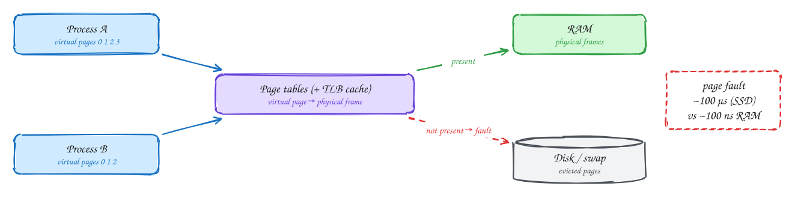
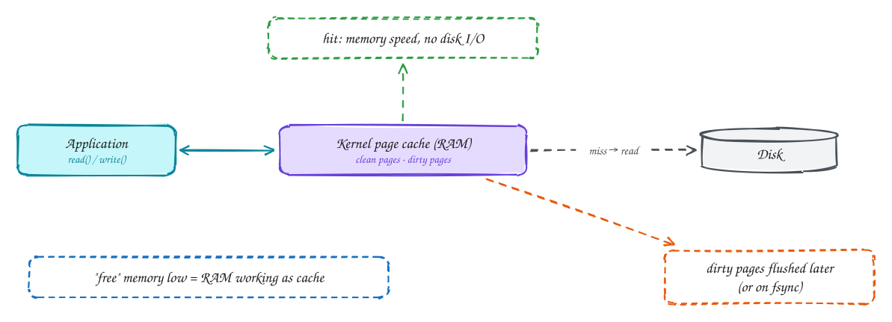
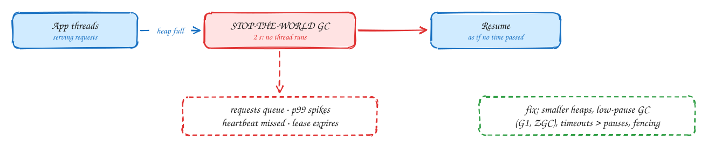

# Memory, the page cache and GC pauses

Intermediate

> Part of [Operating Systems for system design](index.md): notes in our own words, following the themes of *Operating Systems: Three Easy Pieces* by Remzi and Andrea Arpaci-Dusseau (free at [ostep.org](https://pages.cs.wisc.edu/~remzi/OSTEP/)).

## TL;DR

Every process sees a private **virtual** address space; the OS maps it onto physical RAM page by page, and can push rarely used pages to disk. Touching a page that isn't in RAM causes a **page fault**, which costs about 1,000× a normal memory access. The OS uses all spare RAM as a **page cache** for files, so low "free" memory on a server is normal and good. When memory really runs out, the system either **swaps** (and gets very slow) or the **OOM killer** ends a process. In garbage-collected languages, the runtime's own **GC pauses** can freeze a process for long enough to cause tail latency and even correctness bugs.

**Key ideas:** virtual memory · pages and page tables · TLB · page faults · swapping · page cache · mmap · OOM killer · GC pauses

## Virtual memory

**Why it exists:** if programs used physical memory addresses directly, any program could overwrite another's memory, and every program would need to know where in RAM it had been loaded. Virtual memory gives each process its own private, simple view of memory, and lets the OS move things around underneath.

**How it works:**

1. Memory is divided into **pages**, usually 4 KB. Each process has a **page table** that maps its virtual pages to physical **frames** in RAM.
2. On every memory access, the CPU translates the virtual address through the page table. That would be slow, so recent translations are cached in the **TLB** (translation lookaside buffer).
3. A page table entry can say **"not present"**: the page was never loaded, or it was moved out to disk. Touching it causes a **page fault**. The CPU traps into the kernel, which finds a free frame, loads the page from disk, updates the table, and lets the program continue.
4. A RAM access takes about 100 ns. A page fault that reads from an SSD takes about 100 µs, **1,000× slower**, and on a spinning disk about 10 ms.

Virtual memory also enables tricks that systems rely on: **memory-mapped files** (`mmap`), where file contents appear directly in memory and are loaded page by page on demand (used by databases such as LMDB and by Kafka's index files), and **copy-on-write** after `fork()`, which Redis uses to snapshot its data while still serving requests.

## The page cache

**Why it exists:** disk is thousands of times slower than RAM, and programs often read the same file data repeatedly. So the OS keeps recently used file data in RAM.

**How it works:**

- **Reads** go through the page cache. If the data is there (a **hit**), it returns at memory speed with no disk I/O. If not, the kernel reads it from disk and keeps a copy.
- **Writes** usually just update the page in the cache and mark it **dirty**. The kernel writes dirty pages to disk later, in the background. `write()` returning doesn't mean the data is on disk; that's what `fsync()` is for (see [Files and durability](06-files-and-durability.md)).
- The kernel uses **all otherwise unused RAM** as page cache, and gives it back instantly when programs need memory.

So a database server showing "1 GB free" out of 64 GB is usually **healthy**: most of the rest is cached file data. Look at "available" memory, not "free". This is also why Kafka is fast without its own cache: it writes to the page cache and lets the OS serve recent messages straight from RAM. And it's why Postgres sizes its own buffer cache at only about a quarter of RAM, leaving the rest for the OS page cache.

## Swapping and the OOM killer

**Why it goes wrong:** when programs need more memory than physically exists, the OS has two choices, and both hurt.

**How each plays out:**

- **Swapping:** move rarely used pages of process memory to a swap area on disk, freeing RAM. Fine for idle pages. But if the working set doesn't fit, the system starts **thrashing**: constantly faulting pages in and out, with latency rising from microseconds to milliseconds or seconds. A swapping server is often worse than a dead one, because it's too slow to be useful but still passes health checks. Many production servers run with little or no swap for this reason.
- **The OOM killer:** when memory is exhausted, Linux picks a process (usually the biggest) and **kills it** to free memory. Containers have their own memory limit (see [Containers](08-containers.md)), and exceeding it gets the container killed, often appearing as a mysterious restart with exit code 137.

**What to do:** size memory for the real working set plus headroom, set memory limits deliberately, alert on memory pressure (not on low "free" memory), and make services restart cleanly when killed.

## Garbage-collection pauses

**Why they happen:** in Java, Go, C#, JavaScript and Python, memory is freed automatically by a **garbage collector** that finds objects no longer in use. Some collection work requires **stopping all application threads** briefly, a *stop-the-world* pause, so the heap doesn't change while it's examined. With large heaps or heavy allocation, pauses can last hundreds of milliseconds, sometimes seconds.

**How a pause becomes a production problem:**

1. **Tail latency:** every request in flight during the pause waits. A 300 ms pause every few minutes shows up as a p99.9 spike.
2. **Missed heartbeats:** the process doesn't answer health checks, so the load balancer or cluster manager may mark it dead and fail over.
3. **Expired leases (correctness bug):** a process holding a lock or lease pauses, the lease expires, another process takes over, and then the first process wakes up and acts as if it still holds it. This is the scenario in [DDIA Ch 8](../ddia/08-trouble-with-distributed-systems.md), and the reason **fencing tokens** exist.

Swapping, VM migration and CPU throttling (see [Containers](08-containers.md)) cause exactly the same kind of freeze.

**What to do:**

- Use a low-pause collector (Java's G1 or ZGC, and Go's concurrent collector), keep heaps reasonably sized, and reduce allocation in hot paths.
- Set timeouts and heartbeat intervals comfortably longer than the worst pauses you observe.
- Never rely on "I checked my lease a moment ago" for correctness. Use **fencing tokens** enforced by the storage.

> [!TIP]
> **Say this in the interview:** "A Java service can freeze for a GC pause longer than its lock's TTL, wake up and still think it holds the lock. So the lock comes with a fencing token, and the database rejects writes with a stale token."

## In the system design interview

> [!IMPORTANT]
> **Interviewer asks:** "The database server shows almost no free memory. Is that a problem?"
> → Usually not. Linux uses spare RAM as page cache. Check "available" memory, swap activity and page-fault rates instead.

> [!IMPORTANT]
> **Interviewer asks:** "Why do Kafka and other log systems rely on the OS page cache?"
> → Recent messages stay in RAM through the page cache, so consumers reading near the end of the log are served from memory, and the broker doesn't need its own cache or the GC pressure that comes with one.

> [!IMPORTANT]
> **Interviewer asks:** "Where do random p99.9 latency spikes come from?"
> → Often GC pauses, swapping, CPU throttling or noisy neighbours, not the code path itself. Correlate spikes with GC logs, page faults and throttling metrics.

## Self-check

Try to answer before you open each one.

What is a page fault, and roughly how much slower is it than a normal memory access?

An access to a virtual page that isn't in RAM. The kernel must load it from disk: about 100 µs from SSD versus about 100 ns from RAM, roughly 1,000× slower.

Does write() returning mean the data is on disk?

No. It usually means the data was copied into the page cache and marked dirty. It reaches disk later, or when fsync is called.

How can a GC pause cause a correctness bug, not just latency?

A process paused longer than its lease's TTL loses the lease to another process, then wakes up still believing it holds it, and writes. Without fencing tokens, two writers corrupt data.

## Related

- [Files and durability](06-files-and-durability.md) · [Containers](08-containers.md)
- [DDIA Ch 8: process pauses and fencing](../ddia/08-trouble-with-distributed-systems.md) · [Distributed cache](../problems/distributed-cache.md)

---

← [OS 2: CPU scheduling](02-cpu-scheduling.md) · [OS 4: Concurrency](04-concurrency.md) →
