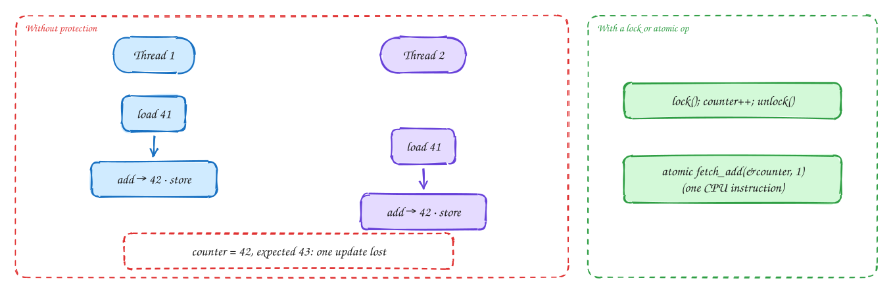
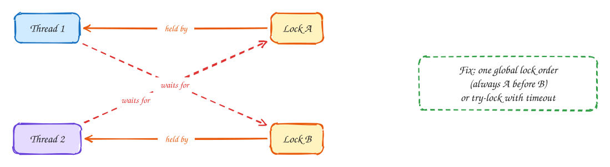

# Concurrency: races, locks and deadlock

Intermediate

> Part of [Operating Systems for system design](index.md): notes in our own words, following the themes of *Operating Systems: Three Easy Pieces* by Remzi and Andrea Arpaci-Dusseau (free at [ostep.org](https://pages.cs.wisc.edu/~remzi/OSTEP/)).

## TL;DR

When threads share memory, operations that look like one step (`counter++`) are really several, and the scheduler can interleave threads between them. That's a **race condition**, and it loses updates silently. **Locks** make a section of code run one thread at a time; **atomic instructions** do small updates indivisibly; **condition variables** let threads wait for something to happen. Locks bring their own problems: **contention** (threads queueing) and **deadlock** (threads waiting for each other forever). Every one of these ideas reappears in distributed systems, with databases and lock services in place of memory.

**Key ideas:** race condition · critical section · mutex · atomic operations (compare-and-swap) · condition variables · contention · deadlock and lock ordering · lock-free structures

## Race conditions

**Why they happen:** `counter++` compiles to three steps: **load** the value from memory, **add** one in a register, **store** it back. The scheduler can switch threads, or two cores can run truly in parallel, between any of those steps.

**How an update gets lost:**

1. The counter is 41. Thread 1 loads 41.
2. Before it stores, thread 2 also loads 41.
3. Thread 1 adds one and stores **42**. Thread 2 adds one and stores **42**.
4. Two increments happened; the counter went up by one. No error, no crash, just a wrong number, and only sometimes, depending on timing. That makes races notoriously hard to reproduce and debug.

The code that touches shared data and must not be interleaved is a **critical section**. The goal is **mutual exclusion**: only one thread inside it at a time.

This is exactly the **lost update** from databases ([DDIA Ch 7](../ddia/07-transactions.md)), with threads in place of transactions and memory in place of rows.

## Locks, atomics and condition variables

**Why several tools:** different situations need different strengths and costs.

**How each works:**

- **Mutex (lock):** `lock(); counter++; unlock();`. Only one thread can hold the lock. Others trying to take it wait, either by **spinning** (looping, good for very short waits) or by **sleeping** until woken (the OS parks them). Correct, and easy to reason about, as long as every access to the shared data takes the lock.
- **Atomic operations:** the CPU provides instructions that do a read-modify-write **indivisibly**, such as **fetch-and-add** and **compare-and-swap (CAS)**. CAS means "set this to the new value **only if** it still equals the old value I saw", and it reports whether it worked. No lock needed. That's ideal for counters, flags and building lock-free data structures.
- **Condition variables:** let a thread **sleep until a condition becomes true**, such as "the queue is not empty", without wasting CPU checking. A producer adds an item and **signals**, and a waiting consumer wakes. This is how bounded queues between threads work: producers wait when full, consumers wait when empty.
- **Read-write locks:** many readers at once, or one writer alone. Useful when reads vastly outnumber writes.

> [!NOTE]
> **CAS is everywhere in system design:** a database conditional update (`UPDATE … WHERE version = 7`), Redis `SET key value NX`, and DynamoDB conditional writes are all compare-and-swap across a network. When the condition fails, you re-read and retry, exactly as with the CPU instruction.

## Contention

**Why locks get slow:** a lock is free to take when nobody else wants it. When many threads want the same lock, they **queue**: only one makes progress, and the rest wait, sleep and wake (with context switches). Adding threads makes it **worse**, not better.

**How to reduce it:**

- **Hold locks briefly:** never do I/O (database calls, network) while holding a lock.
- **Split the lock:** instead of one lock for a whole hash map, use one per bucket or shard (**lock striping**). Different keys no longer block each other.
- **Avoid sharing:** give each thread its own counter and add them up on read (like sharded counters).
- Use **atomics** or lock-free structures for simple updates.

These are the same moves used for hot rows and hot keys in databases: hold briefly, split the key, aggregate locally.

## Deadlock

**Why it happens:** with more than one lock, threads can end up waiting for each other in a circle.

**How it happens:** a transfer between accounts locks both accounts. Thread 1 transfers A → B: it locks A, then tries to lock B. At the same moment, thread 2 transfers B → A: it locks B, then tries to lock A. Each holds what the other needs, and **neither can ever continue**.

Deadlock needs four conditions at once: locks are exclusive; threads hold one lock while waiting for another; locks can't be taken away; and there's a **cycle** of waiting. Break any one and deadlock is impossible. The practical fixes:

1. **Global lock ordering:** always acquire locks in the same order, for example by account ID, lowest first. Then a cycle can't form. This is the standard fix.
2. **Try-lock with timeout:** if the second lock isn't available within a short time, release the first, back off and retry.
3. **Take all locks at once**, or redesign to need only one.

Databases detect deadlocks between transactions automatically and abort one of them, which is why applications must be ready to **retry** a transaction that failed with a deadlock error.

> [!TIP]
> **Say this in the interview:** "When a booking touches several seats, I lock them in a fixed order, sorted by seat ID, so two overlapping bookings can't deadlock. The database would detect a deadlock anyway, but ordering avoids the abort and retry."

## In the system design interview

> [!IMPORTANT]
> **Interviewer asks:** "How is a distributed lock different from a mutex?"
> → A mutex lives in one process's memory, and the holder can't vanish without the OS noticing. A distributed lock lives in another system (Redis, etcd), so the holder can crash or pause, which means it needs a TTL, and correctness needs fencing tokens.

> [!IMPORTANT]
> **Interviewer asks:** "Your in-memory counter is wrong under load. Why?"
> → A race: `count++` isn't atomic. Use an atomic increment, or a lock, or per-thread counters summed on read.

> [!IMPORTANT]
> **Interviewer asks:** "Transactions occasionally fail with a deadlock error. What do you do?"
> → Acquire rows in a consistent order (sort the IDs), keep transactions short, and retry the failed transaction.

## Self-check

Try to answer before you open each one.

Why can two threads doing counter++ lose an update?

counter++ is load, add, store. If both threads load the same value before either stores, both store the same result, and one increment is lost.

What does compare-and-swap do, and where does the same idea appear in databases?

It sets a value only if it still equals the value you read, atomically, and tells you whether it succeeded. Databases use the same idea in conditional updates (WHERE version = ?) and optimistic concurrency control.

What is the standard way to prevent deadlock with several locks?

Always acquire locks in one global order (for example, sorted by ID), so no cycle of waiting can form.

## Related

- [Dealing with contention](../patterns/contention.md) · [DDIA Ch 7: transactions](../ddia/07-transactions.md)
- [ACID and isolation levels](../101/acid-and-isolation.md) · [Ticketmaster](../problems/ticketmaster.md)

---

← [OS 3: Memory](03-memory.md) · [OS 5: I/O models](05-io-models.md) →
