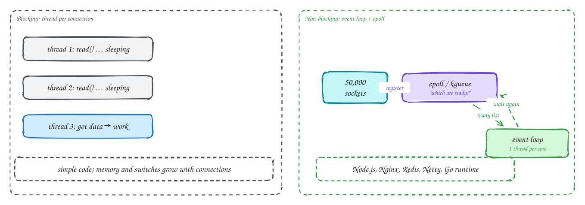
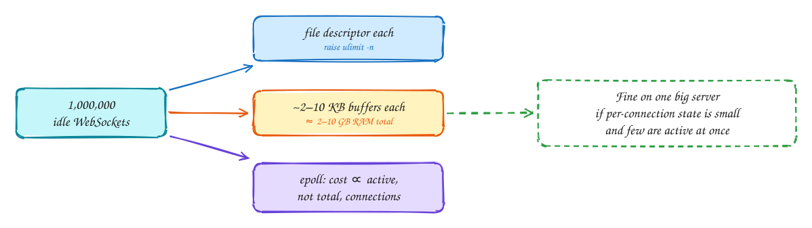

# I/O models: blocking, event loops and epoll

Intermediate

> Part of [Operating Systems for system design](index.md): notes in our own words, following the themes of *Operating Systems: Three Easy Pieces* by Remzi and Andrea Arpaci-Dusseau (free at [ostep.org](https://pages.cs.wisc.edu/~remzi/OSTEP/)).

## TL;DR

Most server time is spent **waiting**: for the client to send, for the database to answer, for the disk. How a program waits decides how many connections one machine can handle. **Blocking I/O** parks a thread per waiting operation, which is simple but limited by threads. **Non-blocking I/O with an event loop** lets one thread watch thousands of sockets and handle whichever are ready, using the kernel's **epoll** (Linux) or **kqueue** (BSD/macOS). That's how Nginx, Node.js, Redis and Netty serve huge numbers of connections, and how a well-built server holds **a million mostly idle WebSockets**.

**Key ideas:** blocking vs non-blocking · file descriptors · select/poll/epoll · event loop · async/await · io_uring · C10K → C10M · per-connection cost

## Blocking I/O and its limits

**Why it's the default:** a blocking `read()` on a socket puts the calling thread to sleep until data arrives, then returns it. The code reads naturally, step by step. With one thread per connection, it works well for hundreds of connections.

**How it breaks at scale:** each waiting connection holds a whole **thread**: its stack memory, its scheduler entry, a context switch every time it wakes. Most of those threads are just sleeping. At tens of thousands of connections, memory and switching costs dominate (see [Processes and threads](01-processes-and-threads.md)). In the early 2000s this was known as the **C10K problem**: how to handle 10,000 concurrent connections on one server.

## Non-blocking I/O and the event loop

**Why it scales:** instead of one thread waiting on each socket, **one thread asks the kernel which sockets are ready** and only touches those. Waiting costs almost nothing, because a waiting connection is just an entry in a kernel table.

**How it works:**

1. Sockets are set to **non-blocking**: `read()` returns immediately with whatever is available, or "would block" if nothing is.
2. The program **registers** all its sockets (as **file descriptors**) with **epoll**: "tell me when any of these can be read or written".
3. The **event loop** calls `epoll_wait()`, which sleeps until **at least one** socket is ready, then returns **only the ready ones**.
4. For each ready socket, the loop runs a short handler: read what's there, parse, maybe start a database query (also non-blocking), write a response. Then it goes back to waiting.

The crucial property: epoll's cost is proportional to the number of **active** sockets, not the total. The older `select` and `poll` scanned the whole list on every call. That's what makes tens of thousands, and then millions, of connections practical.

**The catch:** a handler must **never block**. One slow computation, or one accidental blocking call, inside the loop stalls **every** connection on that thread. Heavy CPU work goes to a separate worker pool. Servers run **one event loop per core** to use all CPUs.

> [!NOTE]
> **async/await** is syntax that lets you write event-loop code as if it were blocking. `await db.query()` pauses that function and returns control to the loop, which resumes it when the result is ready. Python asyncio, JavaScript, C# and Rust work this way. Go and Java virtual threads hide the loop entirely: you write blocking code, and the runtime turns it into non-blocking I/O underneath.

> [!NOTE]
> **Disk I/O is different.** epoll works for sockets, but regular files always count as "ready", so traditional event loops send disk reads to a thread pool (as Node.js's libuv does). Linux's newer **io_uring** interface makes both network and disk I/O truly asynchronous, with fewer system calls.

## Holding a million connections

**Why it comes up:** chat apps, live comments, notifications and multiplayer games keep a **long-lived connection** (WebSocket or SSE) open for every online user. Most of those connections are idle most of the time.

**How one server holds a million:**

- **A file descriptor per connection:** raise the per-process limit (`ulimit -n`) and the system-wide limit from the defaults (often 1,024) to over a million.
- **Memory per connection:** kernel socket buffers plus your own per-connection state. At a few KB each, a million connections need a few GB, which is fine. At 100 KB each it's 100 GB, which isn't. Keep per-connection state small, and tune socket buffer sizes.
- **An event loop (epoll):** only active connections cost CPU.
- **Heartbeats:** idle connections are silently dropped by NATs and load balancers after a timeout, so send small pings every 30–60 seconds, and let clients reconnect automatically.
- **Ports:** each connection is identified by the four-tuple, so a server can hold millions on one listening port. The client-side ephemeral port limit only matters for proxies making many outbound connections to the same backend.

In practice you'd run **many** such servers for redundancy, with a load balancer that supports long-lived connections, and accept that a deploy or crash disconnects that server's users, who then reconnect elsewhere.

> [!TIP]
> **Say this in the interview:** "Connection servers use an event loop, epoll-based through Netty or Go, so a server holds a few hundred thousand idle WebSockets with a few KB of state each. We size by memory per connection, not threads, and clients reconnect with backoff when a server is drained for deploy."

## In the system design interview

> [!IMPORTANT]
> **Interviewer asks:** "How many WebSocket connections can one server handle?"
> → Hundreds of thousands to a million mostly idle connections with an event-loop server, limited mainly by memory per connection and file descriptor limits, not CPU. Plan for far fewer if each connection is busy.

> [!IMPORTANT]
> **Interviewer asks:** "Why is Node.js fast for I/O but bad for CPU-heavy work?"
> → One event loop thread serves all connections. Waiting is cheap, but any long computation blocks every connection on that loop. Move CPU work to worker threads or another service.

> [!IMPORTANT]
> **Interviewer asks:** "Why do idle connections drop after a few minutes?"
> → NATs, firewalls and load balancers forget idle connections after a timeout. Send application-level heartbeats more often than the shortest timeout on the path.

## Self-check

Try to answer before you open each one.

Why does epoll scale better than select or poll?

It returns only the ready file descriptors, so its cost grows with active connections, not total connections. select and poll scan the whole list on every call.

What is the one rule an event-loop handler must never break?

It must never block (no blocking I/O, no long computation), because the loop thread serves every connection, and blocking it stalls them all.

What limits a server holding a million idle WebSockets?

Mainly memory per connection (kernel buffers plus app state) and file descriptor limits. Not threads or CPU, as long as an event loop is used and few connections are active at once.

## Related

- [Processes and threads](01-processes-and-threads.md) · [Real-time updates](../patterns/real-time-updates.md)
- [Chat app](../problems/chat-app.md) · [Live comments](../problems/live-comments.md) · [Networking Ch 3: transport layer](../cn/03-transport-layer.md)

---

← [OS 4: Concurrency](04-concurrency.md) · [OS 6: Files and durability](06-files-and-durability.md) →
