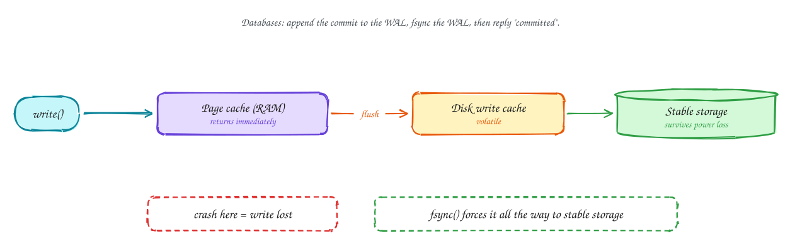
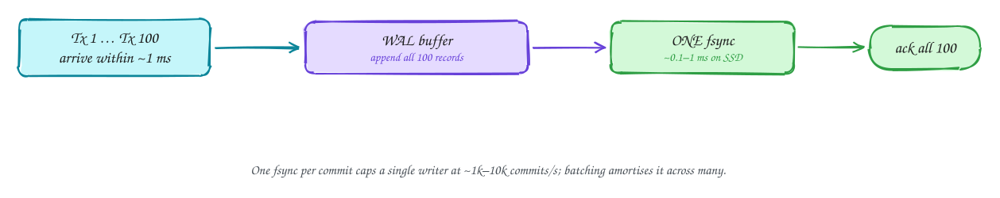

# Files and durability: the write path and fsync

Advanced

> Part of [Operating Systems for system design](index.md): notes in our own words, following the themes of *Operating Systems: Three Easy Pieces* by Remzi and Andrea Arpaci-Dusseau (free at [ostep.org](https://pages.cs.wisc.edu/~remzi/OSTEP/)).

## TL;DR

When `write()` returns, your data is usually only in RAM. A crash or power cut can still lose it. **`fsync()`** forces it all the way to stable storage, and it's slow: from well under a millisecond on a good SSD to many milliseconds on spinning disks or network storage. Databases make commits durable by appending to a **write-ahead log** and fsyncing it before saying "committed". They make that fast with **group commit**: one fsync covers many transactions. This is why a database's single-row commit rate is limited, while batched writes go much faster.

**Key ideas:** files and inodes · the write path · page cache · fsync and fdatasync · disk write caches · journaling file systems · write-ahead logs · group commit · crash consistency

## Files in one paragraph

A **file** is a named sequence of bytes. Behind the name, the file system keeps an **inode** with the file's metadata (size, owner, permissions) and pointers to the **blocks** on disk that hold its data. A **directory** is a file that maps names to inodes. Opening a file gives the program a **file descriptor**, and reads and writes go through it. Renaming a file within a directory is **atomic**, which gives a simple way to replace a file safely: write a new copy under a temporary name, fsync it, then rename it over the old one.

## The write path

**Why `write()` isn't enough:** disks are slow, so the OS doesn't make programs wait for them. `write()` copies your data into the **page cache** and returns. The data reaches the disk later, typically within seconds, in the background.

**How data travels, and where it can be lost:**

1. **`write()`** copies the data into the page cache and marks those pages **dirty**. A **crash or power loss now loses it**, even though the program was told the write succeeded.
2. The kernel **flushes** dirty pages to the disk in the background, or immediately when you call **`fsync(fd)`**.
3. Many disks have their own small **volatile write cache**. Data there can also be lost on power failure. `fsync` asks the disk to flush that cache too. Enterprise SSDs with power-loss protection can treat their cache as durable, which makes fsync much faster.
4. Only after `fsync` returns successfully is the data on **stable storage** and guaranteed to survive a crash.

`fsync` can take anywhere from tens of microseconds (NVMe with power-loss protection) to 10+ ms (spinning disks, some cloud network volumes). That number directly limits how many commits per second a system can make one at a time.

> [!WARNING]
> **fsync errors matter.** If fsync reports an error, the dirty data may already have been discarded by the kernel, and retrying fsync can falsely report success. Postgres learned this the hard way in 2018 and now crashes and recovers from its log on fsync failure rather than continuing.

## Crash consistency and journaling

**Why it's a problem:** a single logical change, like appending to a file, touches several places on disk: the data block, the inode (new size), and the bitmap of free blocks. A crash halfway through can leave them inconsistent: an inode pointing at garbage, or a block marked used but belonging to nothing.

**How file systems handle it:** **journaling** (ext4, XFS, NTFS). Before changing the real structures, the file system writes a description of the change to a **journal** and makes it durable. Then it applies the change. After a crash, it **replays** the journal: completed entries are reapplied, incomplete ones discarded. The structures always end up consistent. Most file systems journal only **metadata** by default, so the file system's own structure survives, but your application data is only safe if **you** fsync it.

Databases use exactly the same idea for user data: the **write-ahead log**.

## Write-ahead logs and group commit

**Why databases need a log:** a transaction may change many pages scattered across the data files. Writing and fsyncing all of them on every commit would be slow (many random writes), and a crash in the middle would leave the data half-updated.

**How the WAL works:**

1. The transaction's changes are described as **records appended to the WAL**, a single sequential file. Appends are the fastest kind of disk write.
2. On **COMMIT**, the database **fsyncs the WAL** and only then tells the client "committed". From that moment the commit survives any crash.
3. The changed data pages are written to the data files **later**, in the background (at checkpoints), with no fsync on the critical path.
4. After a crash, the database **replays the WAL** from the last checkpoint, redoing committed changes. The data files are brought back up to date.

The same log is reused for replication: replicas just apply the leader's WAL ([DDIA Ch 5](../ddia/05-replication.md)), and change data capture reads it ([DDIA Ch 11](../ddia/11-stream-processing.md)).

**Group commit** makes it fast. If each commit needed its own fsync, a disk with 1 ms fsyncs would cap the database at about **1,000 commits a second**, however fast the CPU. But one fsync costs about the same whether it flushes one transaction's records or a hundred. So while one fsync is in progress, the database collects the commits arriving behind it and makes them durable **together** with the next fsync. Under load, hundreds of commits share each fsync. That's why:

- many concurrent clients get far higher total commit throughput than one client committing in a loop;
- **batching** writes (multi-row inserts, several statements per transaction) is so much faster than one row per transaction;
- some systems offer a "relaxed durability" option (Postgres `synchronous_commit = off`) that acknowledges before the fsync, trading the last few milliseconds of commits on a crash for speed.

> [!TIP]
> **Say this in the interview:** "Single-row commits on Postgres are bounded by WAL fsync latency, a few thousand to around ten thousand per second depending on the disk. For the click firehose I'd batch: buffer in Kafka and insert thousands of rows per transaction, so one fsync covers them all."

## In the system design interview

> [!IMPORTANT]
> **Interviewer asks:** "Why is Postgres's write throughput lower for single-row inserts than batched ones?"
> → Every commit waits for a WAL fsync. Batching (and group commit across concurrent clients) shares one fsync among many rows.

> [!IMPORTANT]
> **Interviewer asks:** "When is data actually durable in Kafka?"
> → Kafka writes to the page cache and relies on **replication** (acks=all to in-sync replicas) rather than fsyncing every message. Durability comes from copies on several machines that are unlikely to all lose power at once.

> [!IMPORTANT]
> **Interviewer asks:** "How do you replace a config file safely?"
> → Write a temporary file, fsync it, rename it over the old file (atomic), then fsync the directory. Readers always see either the old or the new file, never a half-written one.

## Self-check

Try to answer before you open each one.

A program calls write() and the machine loses power a second later. Is the data safe?

Not necessarily. write() usually only puts data in the page cache. It's only guaranteed durable after a successful fsync (and the disk honouring cache flushes).

Why does a database fsync the WAL on commit but not the data files?

The WAL is one sequential append, which is fast to flush. Data pages are scattered random writes. Once the WAL is durable, the data pages can be written later, and replayed from the WAL after a crash.

What does group commit do?

It makes many transactions durable with a single fsync, by collecting the commits that arrive while a flush is in progress, which multiplies commit throughput.

## Related

- [Storage devices](07-storage-devices.md) · [Memory and the page cache](03-memory.md)
- [DDIA Ch 3: storage and retrieval](../ddia/03-storage-and-retrieval.md) · [Numbers and estimation](../foundations/numbers-and-estimation.md)

---

← [OS 5: I/O models](05-io-models.md) · [OS 7: Storage devices](07-storage-devices.md) →
