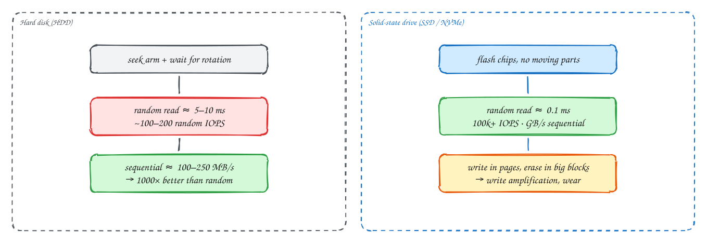

# Storage devices: HDDs, SSDs and access patterns

Intermediate

> Part of [Operating Systems for system design](index.md): notes in our own words, following the themes of *Operating Systems: Three Easy Pieces* by Remzi and Andrea Arpaci-Dusseau (free at [ostep.org](https://pages.cs.wisc.edu/~remzi/OSTEP/)).

## TL;DR

Storage performance has two numbers: **IOPS** (how many separate operations per second) and **throughput** (how many bytes per second). On a **hard disk**, every random access means physically moving an arm and waiting for the platter to spin round, so random I/O is about **1,000× slower** than sequential. **SSDs** have no moving parts and handle random reads well, but they write in pages and erase in large blocks, which brings **write amplification** and wear. Many database and log designs, LSM-trees and append-only logs above all, exist to turn random writes into **sequential** ones.

**Key ideas:** IOPS vs throughput vs latency · seek and rotation · sequential vs random · flash pages and erase blocks · flash translation layer · write amplification · wear · NVMe · network block storage · RAID

## Hard disks

**Why random access is slow:** a hard disk stores data on spinning magnetic platters. To read a particular block, the **arm** must move to the right track (**seek**, a few milliseconds), then wait for the right part of the track to rotate under the head (**rotational delay**, ~4 ms at 7,200 rpm). Only then does the transfer start.

**How that plays out:**

- **Random** small reads: about 5–10 ms each, so only **100–200 IOPS**. Reading 1 GB as random 4 KB blocks would take over 20 minutes.
- **Sequential** reads: once the head is in place, data streams off the platter at **100–250 MB/s**. The same 1 GB takes about 5 seconds.

Hard disks are still used where capacity per pound matters and access is mostly sequential: backups, archives, big object stores and data lakes.

## SSDs

**Why they're different:** SSDs store data in flash memory chips, with no moving parts. A random read takes about 0.1 ms or less, and a modern **NVMe** SSD handles **hundreds of thousands of IOPS** and several GB/s.

**How flash complicates writes:**

1. Flash is written in **pages** (a few KB), but can only be erased in much larger **blocks** (hundreds of KB to MB). You can't overwrite a page in place; it must be erased first, and erasing hits the whole block.
2. So the SSD's controller, the **flash translation layer**, writes updates to fresh pages, marks the old ones invalid, and later **garbage-collects** blocks: it copies the still-valid pages elsewhere, then erases the block.
3. That copying means the drive writes more data internally than you asked for: **write amplification**. It also uses up the drive, since each cell survives only a limited number of erase cycles (**wear**).
4. Sustained heavy random writes can make an SSD slow down noticeably once its spare space is used up and garbage collection runs constantly.

Sequential writes and large writes are still friendlier to SSDs than small random overwrites: they fill whole blocks, which can later be erased with little copying.

## Why sequential access shapes system design

**Why it matters:** many famous designs exist to avoid random writes:

- **Append-only logs** (Kafka, write-ahead logs): every write goes to the end of a file, purely sequential.
- **LSM-trees** (Cassandra, RocksDB): buffer writes in memory, then write sorted files sequentially, and merge them in the background (see [DDIA Ch 3](../ddia/03-storage-and-retrieval.md)). Random writes become sequential ones.
- **Column stores** read long contiguous runs of one column (sequential), rather than hopping between rows.
- **B-trees** do random page writes. That's fine on SSDs, but it's why write-heavy workloads often prefer LSM engines.

The rule of thumb survives even on SSDs: **batch small writes into large sequential ones** whenever you can.

## Cloud and network storage

**Why it's different again:** cloud block volumes (AWS EBS, GCP persistent disks) are **network** storage. Every I/O crosses the data centre network to a storage service that keeps several copies.

**What that means:**

- **Latency** is higher than a local SSD, roughly 0.5–2 ms instead of ~0.1 ms, and fsync costs more.
- Performance is often **provisioned**: you pay for a number of IOPS and an amount of throughput, and exceeding them throttles you. Check them when a database is slow.
- **Local NVMe** instance storage is much faster but **disappears** if the instance stops or fails. It's fine for caches, or for databases that replicate to other machines, but never the only copy.
- **RAID** combines disks, either for speed (striping) or safety (mirroring, parity). In the cloud, replication inside the storage service, and between your own database replicas, plays that role.

> [!TIP]
> **Say this in the interview:** "The metrics store is write-heavy, about 5M points a second, so I want an LSM-style engine that turns writes into sequential appends, on local NVMe with replication across nodes, rather than a B-tree database on network volumes."

## In the system design interview

> [!IMPORTANT]
> **Interviewer asks:** "Why is Kafka fast on ordinary disks?"
> → It only appends to log files and consumers read them sequentially, which disks (even HDDs) handle at high throughput. Recent data is served from the page cache.

> [!IMPORTANT]
> **Interviewer asks:** "The database got slow but CPU is low. What do you check?"
> → Disk: IOPS and throughput against the volume's provisioned limits, I/O wait, queue depth and fsync latency. Then cache hit rate: is the working set still fitting in memory?

> [!IMPORTANT]
> **Interviewer asks:** "Local SSD or network volume for the database?"
> → Network volumes survive instance failure and are easy to snapshot, at higher latency. Local NVMe is much faster but ephemeral, so it's only safe with replication to other machines.

## Self-check

Try to answer before you open each one.

Why are random reads so slow on a hard disk compared with sequential ones?

Each random access needs a mechanical seek plus waiting for the platter to rotate (several ms), while sequential reads stream continuously once the head is in place.

What is write amplification on an SSD?

The drive writes more data internally than the host asked for, because it can only erase large blocks and must copy still-valid pages out before erasing. It costs performance and wears the flash.

How do LSM-trees use the sequential-is-faster rule?

They buffer writes in memory and flush them as sorted files with large sequential writes, merging files in the background, instead of updating pages in place randomly.

## Related

- [Files and durability](06-files-and-durability.md) · [DDIA Ch 3: storage and retrieval](../ddia/03-storage-and-retrieval.md)
- [Block, file and object storage](../101/storage-types.md) · [Metrics monitoring](../problems/metrics-monitoring.md)

---

← [OS 6: Files and durability](06-files-and-durability.md) · [OS 8: Containers](08-containers.md) →
