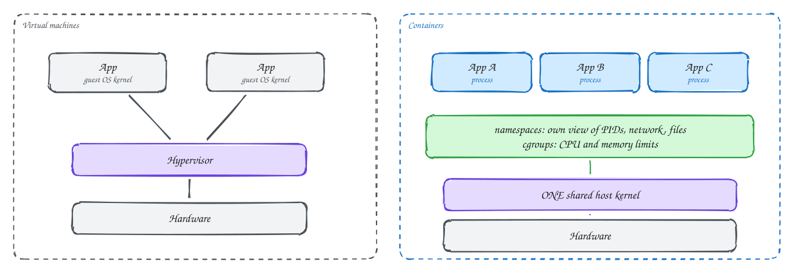
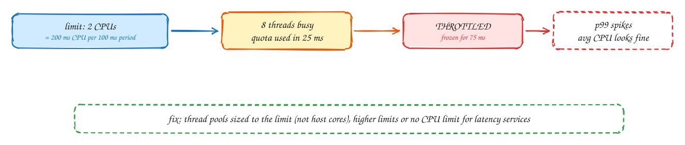

# Containers: namespaces, cgroups and limits

Intermediate

> Part of [Operating Systems for system design](index.md): notes in our own words, following the themes of *Operating Systems: Three Easy Pieces* by Remzi and Andrea Arpaci-Dusseau (free at [ostep.org](https://pages.cs.wisc.edu/~remzi/OSTEP/)).

## TL;DR

A container isn't a small virtual machine. It's an **ordinary process** on a shared Linux kernel, given its own **view** of the system by **namespaces** (its own process list, network, file system) and kept within **resource limits** by **cgroups** (CPU, memory, I/O). That makes containers fast to start and cheap to run, but the limits behave in ways that surprise people: a CPU limit can **throttle** a busy container into latency spikes while average usage looks low, and a memory limit **kills** the container when exceeded. Understanding both prevents a whole class of production mysteries.

**Key ideas:** containers vs VMs · namespaces · cgroups · images and layers · CPU requests and limits · CFS throttling · memory limits and OOM kills · sizing thread pools and heaps to limits

## Containers vs virtual machines

**Why containers took over:** a VM emulates a whole machine and runs a full guest operating system, which means seconds to minutes to boot and hundreds of MB of overhead each. Most of the time we only want to isolate **applications** from each other on the same OS.

**How each isolates:**

- **Virtual machines:** a **hypervisor** runs several guest kernels, each believing it owns the hardware. Isolation is strong (separate kernels), at the cost of overhead and slow start-up. Cloud instances are VMs.
- **Containers:** all containers share **one host kernel**. Each container's processes are ordinary Linux processes, isolated by two kernel features:
  - **Namespaces** control what a process can **see**: its own process IDs (it sees itself as PID 1), its own network interfaces and ports, its own file system root, hostname and users.
  - **cgroups** control how much a process can **use**: CPU time, memory, disk I/O and number of processes.
- A container **image** is a stack of read-only file system layers (base OS files, runtime, your app) plus a thin writable layer on top. Layers are shared between containers and cached, so starting a container takes about a second.

Sharing a kernel means weaker isolation than VMs: a kernel bug can let one container affect others. For untrusted code (an online judge, multi-tenant platforms), add a **sandbox** such as gVisor, or use lightweight VMs (Firecracker), as described in the [Online judge](../problems/online-judge.md) problem.

## CPU requests, limits and throttling

**Why it matters:** in Kubernetes, each container has a CPU **request** (what it's guaranteed, used for scheduling it onto a node) and optionally a **limit** (the most it may use). The limit is enforced in a way that often surprises people.

**How the limit is enforced:** the kernel gives the container a **quota** of CPU time per **period**, usually 100 ms. A limit of 2 CPUs means 200 ms of CPU time per 100 ms period, which can be spent on any number of cores.

1. A request arrives and the service runs **8 threads** in parallel (say the JVM or Go runtime saw the host's 64 cores and sized its pools for them).
2. 8 threads × 25 ms = 200 ms: the **whole quota is used in the first 25 ms** of the period.
3. For the remaining **75 ms**, the container is **throttled**: none of its threads may run at all.
4. Requests caught in that window wait up to 75 ms extra. The p99 latency spikes, while the dashboard shows average CPU at a comfortable 40%.

**What to do:**

- Size **thread pools and runtimes to the container's limit**, not the host's core count. Modern JVMs and Go (with `GOMAXPROCS` set, or automatic in newer versions) can read cgroup limits.
- Monitor **throttling** metrics (`nr_throttled`, throttled time), not only CPU usage.
- For latency-sensitive services, many teams set CPU **requests** but no CPU **limits**, or generous ones, and rely on requests for fair sharing.

## Memory limits and OOM kills

**Why it's different from CPU:** CPU over the limit is **slowed**; memory over the limit is **killed**. Memory can't be throttled: if a process needs a page and none is allowed, something has to give.

**How it plays out:**

- When the container's total memory (application heap, native memory, thread stacks and, depending on settings, page cache it dirtied) hits the limit, the kernel's OOM killer **kills a process in the container**. The orchestrator restarts it, and you see restarts with exit code **137** (killed by signal 9) and reason `OOMKilled`.
- Garbage-collected runtimes make this easy to hit. If the JVM's maximum heap is set from the **host's** RAM, it happily grows past the container's limit. Set the heap as a fraction of the container limit (for example 70–75%), leaving room for off-heap memory and stacks.
- Memory **requests** affect scheduling. If many pods use more than they requested, the node runs short, and the kernel and kubelet evict or kill pods, starting with those furthest over their requests.

> [!TIP]
> **Say this in the interview:** "Each service has CPU and memory requests based on load tests, a memory limit with the heap set to about 75% of it, and thread pools sized to the CPU request. We alert on CPU throttling and OOM kills, because both show up as latency spikes and restarts rather than obvious errors."

## In the system design interview

> [!IMPORTANT]
> **Interviewer asks:** "Pods restart randomly with exit code 137. What's happening?"
> → They're being OOM-killed for exceeding their memory limit. Check heap sizing relative to the limit, off-heap usage and leaks, then raise the limit or fix the usage.

> [!IMPORTANT]
> **Interviewer asks:** "Latency spikes, but CPU usage is only 40%. Why?"
> → Likely CFS throttling. A bursty multi-threaded service uses its CPU quota early in each 100 ms period and is frozen for the rest. Check throttling metrics, size thread pools to the limit, or raise or remove the CPU limit.

> [!IMPORTANT]
> **Interviewer asks:** "Containers or VMs for running customer code?"
> → Containers alone share the host kernel, which isn't enough isolation for untrusted code. Use microVMs (Firecracker) or a sandboxed runtime (gVisor), plus no network and strict limits.

## Self-check

Try to answer before you open each one.

What do namespaces control, and what do cgroups control?

Namespaces control what a process can see (PIDs, network, file system, hostname). cgroups control how much it can use (CPU, memory, I/O).

Why can a container be throttled when its average CPU usage is well under its limit?

The limit is a quota per short period (e.g. 200 ms per 100 ms). A burst on many threads spends the quota early in the period, and the container is frozen until the period ends, even though the average is low.

What happens when a container exceeds its memory limit, and how do you avoid it for a JVM?

The kernel OOM-kills a process in it (exit code 137) and it restarts. Set the JVM heap as a fraction of the container limit (about 70–75%), leaving room for off-heap memory and thread stacks.

## Related

- [CPU scheduling](02-cpu-scheduling.md) · [Memory and GC pauses](03-memory.md)
- [Online judge](../problems/online-judge.md) (sandboxing) · [Deploying safely](../101/safe-deploys.md)

---

← [OS 7: Storage devices](07-storage-devices.md) · [Operating Systems overview](index.md)
