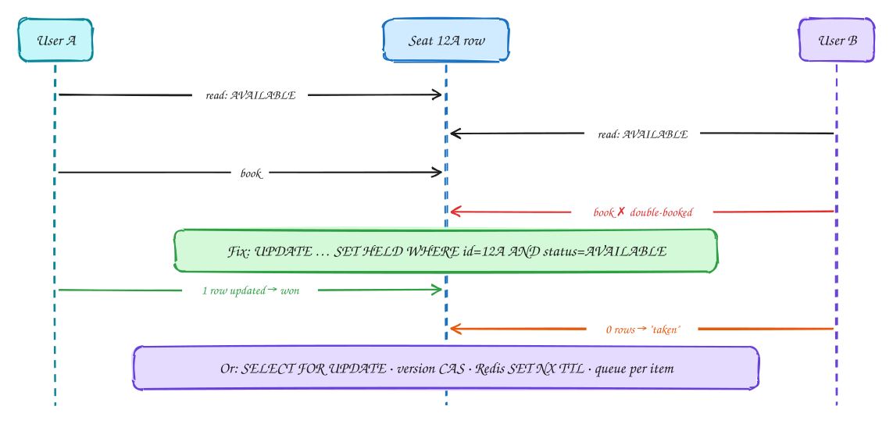

# Dealing with contention

<span class="lvl lvl-i">Intermediate</span>

*Many users want the same thing at the same moment. Exactly one should win, every time.*

> [!TIP]
> **One-page sketchnote:** [DEALING WITH CONTENTION on a single page](../sketchnotes/pattern-contention.svg), for revision or printing.

## When to reach for it

- Limited resources: seats, stock, a username, a driver, the highest bid.
- Any "check, then act" sequence that two requests can run at the same time.

## The problem

**Contention** is many users competing for the **same limited thing** at the same moment: the last seat, the last item in stock, the highest bid, the nearest driver. The natural way to write it is **check, then act**: read whether the seat is free, and if so, book it. Under concurrency, that has a gap between the check and the act, and two users can both pass the check.

## The idea, step by step



1. **The bug.** Users A and B both load seat 12A at the same moment. Both read `status = AVAILABLE`. Both send "book". Both bookings succeed, and the seat is **sold twice**. No error was raised; each request was correct on its own. In database terms this is a race condition (*write skew*, see [DDIA Ch 7](../ddia/07-transactions.md)).
2. **The fix: make the check and the write a single atomic step**, so there's no gap. Put the condition **inside** the update:

    ```sql
    UPDATE seats SET status = 'HELD', held_by = :user
    WHERE id = '12A' AND status = 'AVAILABLE';
    ```

    The database applies updates to one row one at a time. The first request finds the seat AVAILABLE, changes it, and reports **1 row updated**: you won. The second finds it already HELD, matches nothing, and reports **0 rows updated**: tell that user "sorry, just taken". No locks to manage, no window for a race.
3. **Other tools, for situations the single statement doesn't cover:**

| Tool | Use when |
|---|---|
| Atomic conditional UPDATE | Single row, single DB: the default |
| SELECT … FOR UPDATE | Multi-step logic on few rows, high contention |
| Optimistic (version column) | Low contention; retry on conflict |
| Redis lock SET NX PX | Temporary holds across services (seat hold, driver lock) |
| Queue per resource | Extreme hot spots (auction last seconds) |

- **`SELECT … FOR UPDATE`** (pessimistic lock): lock the rows when you read them, so other transactions wait until you commit. Use it when you must read, run some logic, then write, and conflicts are frequent.
- **Version column** (optimistic): read the row with its version, then `UPDATE … WHERE version = 7`. If someone else changed it first, 0 rows update and you retry. It's cheap when conflicts are rare.
- **Redis lock with an expiry** (`SET key value NX PX 600000`): a temporary hold that spans services or minutes, such as "this seat is held for you for 10 minutes while you pay" or "this driver is being offered a ride". The expiry frees it automatically if the user walks away. For correctness, back it with the database check (see [fencing tokens](../ddia/08-trouble-with-distributed-systems.md)).
- **A queue per item:** for extreme hot spots, such as the last seconds of a popular auction, send every request for that item through one queue and process them **one at a time**. No contention is possible, at the cost of throughput on that one item.

## Decision checklist

1. Can the check and the write be one statement? Use a conditional UPDATE (… WHERE status = AVAILABLE). This is the default.
2. Multi-step logic on a few rows with high contention? SELECT … FOR UPDATE, locking rows in a fixed order.
3. Low contention? Optimistic concurrency with a version column; retry on conflict.
4. A temporary hold that spans services? A lock with a TTL (Redis SET NX EX), plus a fencing token if correctness depends on it.
5. Extremely hot single item? Serialize requests through a queue partitioned by item.

## In the interview

> [!TIP]
> "The check and the write must be atomic, so the hold is a single conditional UPDATE. One row updated means you got the seat; zero means someone else did."

## Common mistakes

- Check-then-act in application code.
- Holding database locks while waiting on a human (payment, form).
- Trusting a distributed lock without fencing when a paused process could wake up later.

## Problems that use it

- [Rate limiter](../problems/rate-limiter.md): Every public API needs one, and the obvious implementation has a race condition.
- [Online auction](../problems/online-auction.md): Many people bid on one row at the same time, and exactly one of them must win each race.
- [Ticketmaster](../problems/ticketmaster.md): Millions of people arrive for one on-sale, and no seat may ever be sold twice.

## The theory underneath

- [DDIA Ch 7: Transactions](../ddia/07-transactions.md)
- [DDIA Ch 8: Trouble with distributed systems](../ddia/08-trouble-with-distributed-systems.md)
