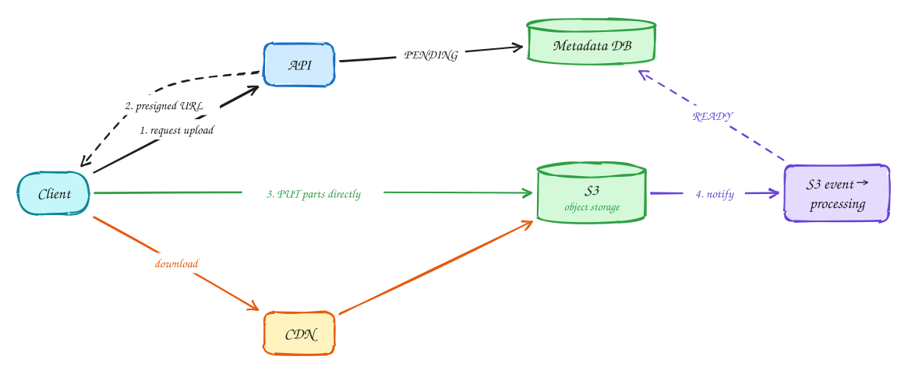

# Handling large blobs

Beginner-friendly

*Files, photos and videos belong in object storage, and their bytes should never pass through your application servers.*

> [!TIP]
> **One-page sketchnote:** [HANDLING LARGE BLOBS on a single page](../sketchnotes/pattern-large-blobs.svg), for revision or printing.

## When to reach for it

- Users upload or download files larger than a few megabytes.
- Media needs processing after upload (thumbnails, transcoding).

## The idea in one diagram

1. Pushing gigabytes through your API servers wastes their bandwidth and memory and fails on long uploads.
2. The API hands out a **presigned URL**; the client uploads directly to S3 (**multipart**: parallel, resumable chunks). Metadata is recorded separately.
3. S3 **event notifications** trigger processing (thumbnails, transcoding) and flip status to READY. Don't trust the client to say it finished.
4. Downloads come from a **CDN** (or presigned GET URLs), never through the app servers.

## Decision checklist

1. Upload with presigned URLs directly to object storage.
2. Use multipart upload for anything big: parallel, resumable chunks.
3. Store metadata (owner, status, size, checksum) in a database, separate from the bytes.
4. React to storage events to start processing; mark the item ready only when done.
5. Serve downloads through a CDN or presigned GET URLs.

## In the interview

> [!TIP]
> "The API only hands out a presigned multipart URL; the client uploads straight to S3. An S3 event triggers processing, and the file shows as ready when processing finishes."

## Common mistakes

- Streaming file bytes through API servers.
- Storing blobs in the database.
- Trusting the client to report that an upload completed.

## Problems that use it

- [Video platform (YouTube)](../problems/video-platform.md): Two hard problems: getting gigabyte uploads in reliably, and streaming smoothly on any connection.
- [File storage and sync (Dropbox)](../problems/file-sync.md): Syncing a 50 GB file after a one-byte edit should not mean uploading 50 GB again.
- [Photo sharing (Instagram)](../problems/photo-sharing.md): A news feed plus a media pipeline: two well-known problems combined.

## The theory underneath

- [DDIA Ch 10: Batch processing](../ddia/10-batch-processing.md)
