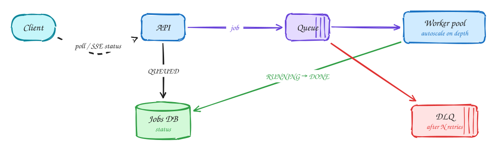

# Long-running tasks

Beginner-friendly

*If work takes longer than a request should, accept it, queue it, and let the client check back.*

> [!TIP]
> **One-page sketchnote:** [LONG-RUNNING TASKS on a single page](../sketchnotes/pattern-long-running-tasks.svg), for revision or printing.

## When to reach for it

- Work takes more than a second or two: transcoding, report generation, code execution, model inference.
- Work is bursty and expensive, so it needs backpressure.

## The idea in one diagram

1. Doing heavy work inside the request: timeouts, retried requests duplicate work, and no backpressure.
2. Return a job ID immediately; enqueue the work. Workers scale independently of the API.
3. Workers update the job status; the client polls or subscribes (SSE/WebSocket) for progress.
4. Failures retry with backoff (visibility timeout); poison jobs go to a dead-letter queue. Jobs must be idempotent.

## Decision checklist

1. Return a job ID immediately (HTTP 202) and enqueue the work.
2. Workers scale on queue depth, independently of the API.
3. Store status (queued, running, done, failed); clients poll or subscribe.
4. Retry with backoff using a visibility timeout; send poison jobs to a dead-letter queue.
5. Make jobs idempotent: a retried job must not duplicate side effects.

## In the interview

> [!TIP]
> "Submission returns a job ID right away. The job goes on a queue; autoscaled workers run it and update its status, and the client polls every second."

## Common mistakes

- Doing heavy work inside the HTTP request.
- No dead-letter queue, so one bad job blocks or loops forever.
- Non-idempotent jobs combined with at-least-once delivery.

## Problems that use it

- [Distributed cache](../problems/distributed-cache.md): Design Redis itself: data structures inside one node, then distribution across many.
- [Online judge (LeetCode)](../problems/online-judge.md): You are running strangers' code on your servers, so isolation comes first.
- [Job scheduler](../problems/job-scheduler.md): Ten thousand jobs per second, each within two seconds of its scheduled time.

## The theory underneath

- [DDIA Ch 11: Stream processing](../ddia/11-stream-processing.md)
- [DDIA Ch 8: Trouble with distributed systems](../ddia/08-trouble-with-distributed-systems.md)
