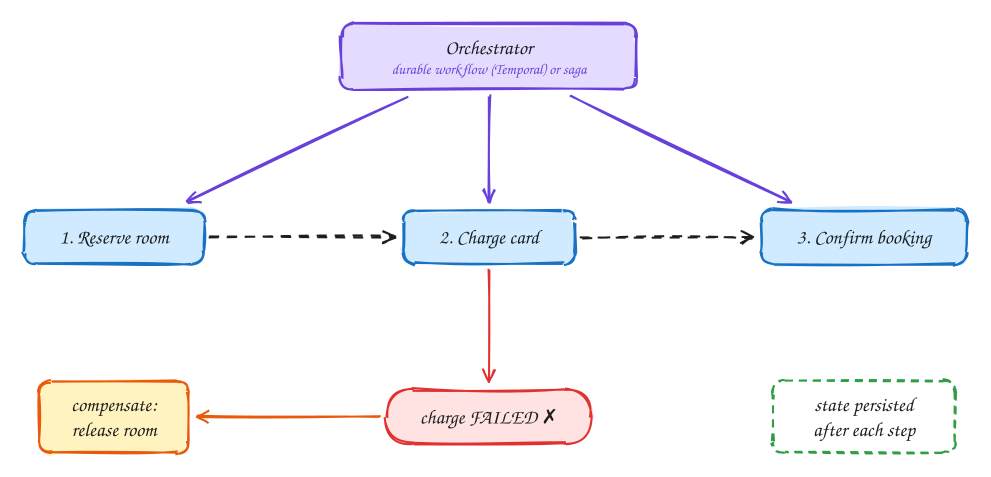

# Multi-step processes

Advanced

*A business action spans several services and any step can fail halfway. Make progress durable and failures reversible.*

> [!TIP]
> **One-page sketchnote:** [MULTI-STEP PROCESSES on a single page](../sketchnotes/pattern-multi-step-processes.svg), for revision or printing.

## When to reach for it

- One user action touches several services or external APIs: booking + payment + confirmation, ride lifecycle, order fulfilment.
- Steps can take seconds to days, or depend on outside callbacks.

## The problem

Booking a hotel room isn't one action. It's three, in three different services: **reserve** the room, **charge** the card, **confirm** the booking (and send the email). Inside a single database you'd wrap them in one transaction, so all of it happens or none of it does. But these steps live in different services, each with its own database, and some talk to outside companies like the payment provider. There is no transaction that spans all of them (and the protocol that tries, two-phase commit, blocks and couples services too tightly, see [DDIA Ch 9](../ddia/09-consistency-and-consensus.md)).

So you need another way to guarantee that the process either **finishes** or is **cleanly undone**, even if a step fails or a server crashes in the middle.

## The idea, step by step

1. **The setup.** An **orchestrator** runs the steps in order: 1. reserve the room, 2. charge the card, 3. confirm the booking.
2. **The failure.** The room is reserved, then the card charge **fails**: declined, or the provider is down. Step 1 has already happened in another service, and you can't roll it back with a database rollback.
3. **The saga: undo with compensating actions.** For every step, define an action that **semantically reverses** it: release the room for "reserve", refund for "charge", cancel for "confirm". When a step fails, run the compensations for the steps that already succeeded, **in reverse order**. Here: release the room. The overall result is as if the booking never happened. This sequence of local steps, each with its compensation, is called a **saga**.
4. **Make it crash-proof.** The orchestrator itself can crash halfway. So it **records progress durably after every step** ("room reserved", "card charged"). When it restarts, it reads that record and carries on from where it stopped, instead of starting again (double-charging) or forgetting (leaving the room reserved forever). Workflow engines such as **Temporal**, AWS Step Functions or Cadence do this bookkeeping for you. You write the steps as ordinary code, and they persist and replay it.

> [!NOTE]
> **Building blocks that make sagas safe:**
>
> - **Idempotent steps:** after a crash, a step may run twice, so "charge the card" must carry an idempotency key.
> - **The outbox pattern:** reliably emit "step done" events from a service's database (see [Transactional outbox](../101/outbox.md)).
> - **Timeouts with unknown outcomes:** if the payment call times out, you don't know whether it charged. Query its status by your key before deciding to retry or compensate.

**Orchestration vs choreography:** a central orchestrator, as above, is easiest to follow and debug. The alternative, **choreography**, has each service react to the previous service's events with no central coordinator. It's more decoupled, but the overall flow is hard to see. Prefer orchestration for anything involving money.

## Decision checklist

1. Is there a cross-service transaction? Replace it with a saga: a compensating action for each step.
2. Who drives the steps? An orchestrator (Temporal, Step Functions) is easier to reason about than event choreography for complex flows.
3. Are all steps idempotent so retries are safe?
4. Do events leave the database reliably? Use the outbox pattern.
5. What happens on timeouts with unknown outcomes? Query status; don't blindly retry side effects.

## In the interview

> [!TIP]
> "There is no distributed transaction across booking and payment, so I'll run a saga: hold the room, charge, confirm, and if the charge fails, release the hold. A workflow engine persists progress so a crash resumes instead of restarting."

## Common mistakes

- Proposing two-phase commit across microservices.
- Non-idempotent steps that double-charge on retry.
- Dual writes to a database and a queue without an outbox.

## Problems that use it

- [Payment system (Stripe)](../problems/payment-system.md): Throughput is moderate. The hard part is staying correct when a call to the bank has an unknown outcome.
- [Online judge (LeetCode)](../problems/online-judge.md): You are running strangers' code on your servers, so isolation comes first.
- [Job scheduler](../problems/job-scheduler.md): Ten thousand jobs per second, each within two seconds of its scheduled time.

## The theory underneath

- [DDIA Ch 9: Consistency and consensus](../ddia/09-consistency-and-consensus.md)
- [DDIA Ch 11: Stream processing](../ddia/11-stream-processing.md)
- [DDIA Ch 12: The future of data systems](../ddia/12-future-of-data-systems.md)
