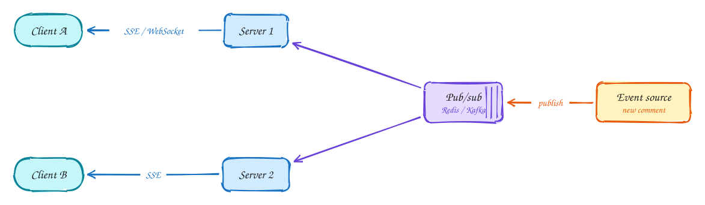

# Real-time updates

*Push changes to clients the moment they happen, even when the sender and receiver are connected to different servers.*

> [!TIP]
> **One-page sketchnote:** [REAL-TIME UPDATES on a single page](../sketchnotes/pattern-real-time-updates.svg), for revision or printing.

## When to reach for it

- Users expect to see changes within about a second: chat, live comments, prices, collaboration, ride tracking.
- Polling would be mostly empty responses or far too frequent.

## The idea in one diagram

1. **Polling**: simple, but latency = interval and most requests return nothing. Fine for slow updates (every ~30s).
2. **Server push**: SSE (server→client, plain HTTP, auto-reconnect) or WebSocket (bidirectional). Long-polling is the fallback.
3. With many servers, the receiver's connection lives on **another server** than the one that got the event.
4. **Pub/sub** routes events to whichever servers hold the interested connections: channel per video, per user, or per symbol.

> [!NOTE]
> **Choosing:** Updates rare → poll. Server→client stream → SSE. Chat, games, collaboration → WebSocket. Between servers → pub/sub.

## Decision checklist

1. How fresh must it be? Every 30 s or slower: just poll.
2. Server-to-client only? Use Server-Sent Events (plain HTTP, auto-reconnect).
3. Both directions, low latency? Use WebSockets.
4. Many servers? Route events with pub/sub (Redis, Kafka) to whichever server holds the connection.
5. Can events be lost? If not, persist first and let clients resume from an offset after reconnecting.

## In the interview

> [!TIP]
> "Viewers only receive, so SSE is enough. Each comment is published once to a channel per video; every server holding viewers of that video is subscribed and pushes it to them."

## Common mistakes

- Polling at large scale.
- Assuming sender and receiver share a server.
- No plan for reconnects and missed messages.

## Problems that use it

- [Ride sharing (Uber)](../problems/ride-sharing.md): Four problems in one: a flood of location updates, matching, locking drivers, and a multi-step trip lifecycle.
- [Live comments (Facebook Live)](../problems/live-comments.md): One popular stream can mean a million viewers each expecting new comments within a fraction of a second.
- [Collaborative editor (Google Docs)](../problems/collaborative-editor.md): The challenge is correctness, not scale: everyone must end up with the same document.
- [Stock trading (Robinhood)](../problems/stock-trading.md): Two separate problems: pushing live prices to millions, and never losing or duplicating an order.
- [Online auction](../problems/online-auction.md): Many people bid on one row at the same time, and exactly one of them must win each race.
- [LLM chat (ChatGPT)](../problems/llm-chat.md): GPUs are the scarce resource, so every queueing decision is really a cost decision.
- [Chat app (WhatsApp)](../problems/chat-app.md): Chat looks like CRUD until you notice the two users are on different servers and one of them is offline.

## The theory underneath

- [DDIA Ch 11: Stream processing](../ddia/11-stream-processing.md)
