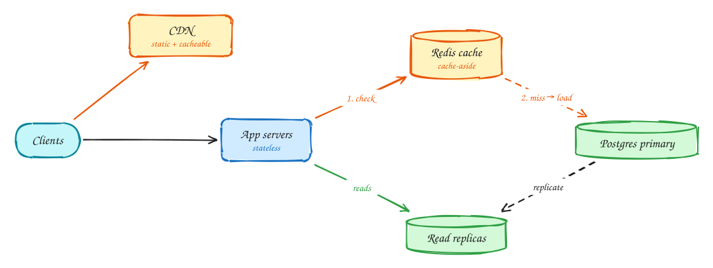

# Scaling reads

*Most systems read far more than they write. Make the common read cheap, and the database only sees what the cache can't answer.*

> [!TIP]
> **One-page sketchnote:** [SCALING READS on a single page](../sketchnotes/pattern-scaling-reads.svg), for revision or printing.

## When to reach for it

- Read:write ratio is 10:1 or higher.
- The same items are read over and over (popularity is skewed).
- A read path misses its latency target, or the calculated read QPS exceeds what one database serves (~10–50k/s).

## The idea in one diagram

1. One database serves every read. At ~10k+ reads/sec it becomes the bottleneck.
2. **Cache-aside**: check Redis; on a miss, read the DB and populate the cache with a TTL. A hit takes <1ms vs ~5–50ms from the DB.
3. **Read replicas** spread the remaining reads (expect replication lag, DDIA Ch 5).
4. **CDN** serves static and shared responses from the edge, so origin never sees them.

> [!WARNING]
> **Cache problems to name:** **Stampede**: a hot key expires and 10k requests hit the DB (fix: lock/single-flight, jittered TTL). **Invalidation**: delete on write, short TTL. **Hot key**: replicate or use a local L1 cache.

## Decision checklist

1. Is the response the same for many users? Put a CDN in front.
2. Is it per-user but read often? Cache-aside in Redis with a TTL.
3. Still too much load on the primary? Add read replicas and accept replication lag.
4. Is one key extremely hot? Replicate the key or add a short-lived local cache.
5. Which reads must never be stale? Send those to the primary.

## In the interview

> [!TIP]
> "Reads outnumber writes about 100 to 1 and popularity is skewed, so a cache-aside Redis layer should absorb most reads. The rest go to replicas; only checkout reads the primary."

## Common mistakes

- Sharding the database before trying a cache and replicas.
- Caching data that must be exact (stock at checkout, balances).
- Forgetting cache stampedes on hot keys.

## Problems that use it

- [URL shortener (Bitly)](../problems/url-shortener.md): It sounds like a toy, but it is the cleanest example of a read-heavy system: almost every request is a redirect.
- [Rate limiter](../problems/rate-limiter.md): Every public API needs one, and the obvious implementation has a race condition.
- [Business discovery (Yelp)](../problems/business-discovery.md): The trap is over-engineering: the whole dataset fits on one database server.
- [News feed (Facebook)](../problems/news-feed.md): The canonical fan-out problem: build a personalised feed for billions of users in a few hundred milliseconds.
- [News aggregator (Google News)](../problems/news-aggregator.md): A feed problem where the feed is the same for everyone in a region, which changes everything.
- [Local delivery (Gopuff)](../problems/local-delivery.md): It looks like an ordering system, but most of the load is people checking what is available near them.
- [Dating app (Tinder)](../problems/dating-app.md): Swipes are a firehose of writes, and two people swiping right at the same moment must never miss their match.
- [Distributed cache](../problems/distributed-cache.md): Design Redis itself: data structures inside one node, then distribution across many.
- [Post search (Facebook)](../problems/post-search.md): Search over billions of posts, where like counts change constantly.
- [Price tracker (CamelCamelCamel)](../problems/price-tracker.md): Five hundred million products can't all be crawled often, so decide what is worth checking.
- [Ticketmaster](../problems/ticketmaster.md): Millions of people arrive for one on-sale, and no seat may ever be sold twice.
- [Video platform (YouTube)](../problems/video-platform.md): Two hard problems: getting gigabyte uploads in reliably, and streaming smoothly on any connection.
- [Photo sharing (Instagram)](../problems/photo-sharing.md): A news feed plus a media pipeline: two well-known problems combined.

## The theory underneath

- [DDIA Ch 5: Replication](../ddia/05-replication.md)
- [DDIA Ch 6: Partitioning](../ddia/06-partitioning.md)
