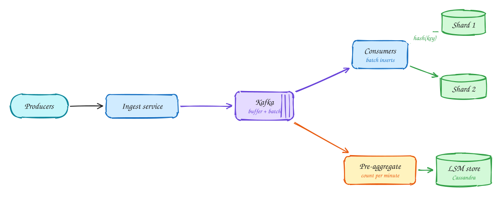

# Scaling writes

Intermediate

*When writes outgrow one machine, absorb the spikes, write in batches, split the data, and write less.*

> [!TIP]
> **One-page sketchnote:** [SCALING WRITES on a single page](../sketchnotes/pattern-scaling-writes.svg), for revision or printing.

## When to reach for it

- Sustained writes exceed what one primary handles (roughly 10k+ per second for simple rows).
- Write traffic is spiky: events, clicks, telemetry.
- Data is append-mostly and read in aggregate (counts, time series).

## The idea in one diagram

1. Every event is an individual synchronous DB write. Spikes overwhelm the database.
2. A **queue/log** (Kafka) absorbs spikes and decouples producers from the DB. Consumers write in **batches**.
3. **Shard** by a key that spreads load evenly (hash of id); each shard takes a fraction of the writes.
4. **Reduce the writes**: pre-aggregate (10k clicks → 1 row per minute), and use write-optimized LSM storage.

> [!WARNING]
> **Hot partition:** One key (celebrity, viral ad) can still overload one shard: split the key with a suffix, or aggregate before writing.

## Decision checklist

1. Can the client get a quick ack while the work happens later? Put a durable log (Kafka) in front.
2. Can writes be grouped? Batch inserts in consumers.
3. Can you store less? Pre-aggregate (one row per key per minute instead of one per event).
4. Still too much for one node? Shard by a key that spreads load evenly.
5. Write-heavy and simple key access? Use an LSM-based store such as Cassandra.

## In the interview

> [!TIP]
> "Clicks arrive at 10k/s with spikes, so they go to Kafka first. A stream job aggregates per ad per minute, which cuts the database writes by orders of magnitude."

## Common mistakes

- A hot partition: one key still lands on one shard.
- Losing data by acknowledging before anything is durable.
- Using a B-tree OLTP database for a firehose of append-only events.

## Problems that use it

- [Top-K videos (YouTube)](../problems/top-k-videos.md): The design falls straight out of one number: hundreds of thousands of views per second.
- [Ad click aggregator](../problems/ad-click-aggregator.md): Clicks are money, so the numbers must be fast for dashboards and exact for billing.
- [Web crawler](../problems/web-crawler.md): Ten billion pages in five days is a pipeline problem, constrained by politeness and network bandwidth.
- [Metrics monitoring (Datadog)](../problems/metrics-monitoring.md): Millions of data points per second arrive, and alerts must fire within a minute.
- [Fitness tracking (Strava)](../problems/fitness-tracking.md): The key insight is where the work happens: on the phone, not the server.
- [Post search (Facebook)](../problems/post-search.md): Search over billions of posts, where like counts change constantly.
- [Price tracker (CamelCamelCamel)](../problems/price-tracker.md): Five hundred million products can't all be crawled often, so decide what is worth checking.

## The theory underneath

- [DDIA Ch 3: Storage and retrieval](../ddia/03-storage-and-retrieval.md)
- [DDIA Ch 6: Partitioning](../ddia/06-partitioning.md)
- [DDIA Ch 11: Stream processing](../ddia/11-stream-processing.md)
