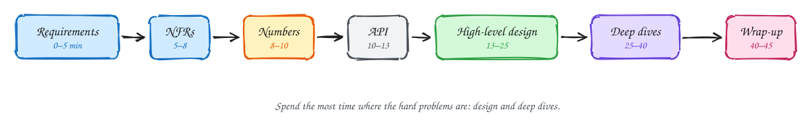

# The 45-minute delivery framework

Beginner-friendly

| Time | Phase | Do | Avoid |
|---|---|---|---|
| 0–5 | **Functional requirements** | 3 "users can…" statements. Say what's out of scope. | Listing ten features. |
| 5–8 | **Non-functional requirements** | 3–5 NFRs **with numbers**. Say where you need consistency vs availability. | "It should be fast and scalable." |
| 8–10 | **Estimates** | Only the numbers that change a decision: QPS, storage, fan-out. | Ten minutes of arithmetic. |
| 10–13 | **Entities and API** | Core entities; 3–5 endpoints; idempotency keys; cursor pagination. | Perfecting every field. |
| 13–25 | **High-level design** | Satisfy each functional requirement with the simplest components. Walk one request end to end. | Adding Kafka or sharding nobody asked for. |
| 25–40 | **Deep dives** | Take each NFR, show where the simple design breaks with a number, fix it. Follow the interviewer's lead. | Defending a choice instead of discussing trade-offs. |
| 40–45 | **Wrap-up** | Remaining bottlenecks, failure modes, what you'd monitor, what you'd do next. | Silence. |

## Phase by phase

### Requirements (0–8 minutes)

Ask, then write down. Good questions: *Who are the users? What's the most important action? How many users, and how spiky? What must never go wrong?*

> [!TIP]
> "Let me confirm scope: users can A, B and C. I'll leave D out unless you want it. For NFRs, the key ones are…"

### Estimates (8–10 minutes)

Use the method in [Numbers and estimation](../foundations/numbers-and-estimation.md). Finish each number with a conclusion: *"…so one Postgres is enough for writes, but reads need a cache."*

### High-level design (13–25 minutes)

Start from [the simplest design](../foundations/how-to-approach-a-design.md). Draw the client, the service and the database, then trace one request through it for each functional requirement. Add components only when a requirement needs them.

### Deep dives (25–40 minutes)

This is where senior candidates separate themselves. For each NFR:

1. Point to where the current design fails it, with a number.
2. Propose the fix (usually one of the [7 patterns](../patterns/index.md)).
3. Name the trade-off you're accepting.
4. Mention a failure mode and how you'd handle it.

If the interviewer steers you somewhere else, follow them. They're telling you what they want to grade.

### Wrap-up (40–45 minutes)

> [!TIP]
> "The biggest remaining risk is X. I'd monitor p99 latency, error rate and queue depth, and I'd alert on Y. With more time I'd look at Z."

## Related

- [Phrases, signals and traps](phrases-and-traps.md)
- [Quick-fire practice](quick-fire.md)
