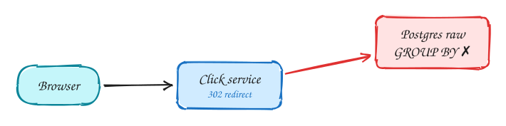
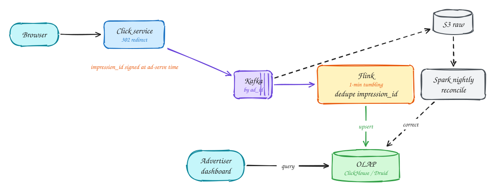

# Ad click aggregator

<span class="lvl lvl-a">Advanced</span>

**Difficulty:** Hard · **Patterns:** [Scaling writes](../patterns/scaling-writes.md) · **DDIA:** [Ch 11](../ddia/11-stream-processing.md) windows, exactly-once · [Ch 12](../ddia/12-future-of-data-systems.md) Lambda · [Ch 3](../ddia/03-storage-and-retrieval.md) column stores

*Clicks are money, so the numbers must be fast for dashboards and exact for billing.*

> [!TIP]
> **One-page sketchnote:** [AD CLICK AGGREGATOR on a single page](../sketchnotes/problem-ad-click-aggregator.svg), for revision or printing.

## TL;DR

- Redirect immediately and publish the click to Kafka; never aggregate raw rows at query time.
- A stream processor counts clicks per ad per minute and writes them to a column store for fast queries.
- Deduplicate by a signed impression ID, and recount from raw logs in a nightly batch job for billing accuracy.

## 1. Requirements

**Functional**

1. Click on an ad redirects the user to the advertiser
2. Advertisers query click metrics over time (minute granularity), with filters

**Non-functional**

- 10k clicks/s peak, 100M/day
- Never lose or double-count clicks (it is billing)
- Metrics queries < 1s
- Freshness ~1 minute

## 2. Back-of-envelope numbers

100M clicks × 100B ≈ **10GB/day raw**. Aggregated rows: ads × minutes, which is small. A 10k/s peak is easy for Kafka.

## 3. Core entities and API

```text
click(impression_id, ad_id, ts, user) → agg(ad_id, minute, count)
```

```http
GET /click?ad_id&impression_id → 302 advertiser_url
GET /metrics?ad_id&from&to&granularity
```

## 4. v1: the simplest design, and where it breaks



Naive: insert each click into Postgres and GROUP BY at query time. Slow queries, and writes compete with reads.

## 5. Evolving to the final design



Each step fixes one specific problem with the step before it:

1. Naive: insert each click into Postgres and GROUP BY at query time. Slow queries, and writes compete with reads.
2. Click service redirects immediately and publishes to Kafka. Flink aggregates per (ad, minute) on event time and upserts into an OLAP column store.
3. Idempotency: every impression gets a **signed unique ID** when the ad is served; Flink dedupes on it, so double-clicks and retries count once and forged clicks are rejected.
4. Lambda-style safety net: raw clicks to S3; a nightly batch recount corrects aggregates, because billing must be exact.

## 6. Deep dives

### Flink crashes?

Checkpoints + Kafka offsets give replay; the sink upserts (ad_id, minute), so replays overwrite instead of double-counting.

### Hot ad (Super Bowl)?

Key on ad_id:random(0..N) to spread across partitions, then aggregate twice.

### Why also batch?

Streams give fast numbers; batch from immutable raw data gives exact billing numbers.

### Why OLAP?

Column store and pre-aggregates make time-range queries over billions of rows sub-second.

## 7. Interview script (45 minutes)

| Time | What you do | Content |
|---|---|---|
| 0–5 | Functional requirements | Click on an ad redirects the user to the advertiser; Advertisers query click metrics over time (minute granularity), with filters |
| 5–8 | Non-functional requirements | 10k clicks/s peak, 100M/day; Never lose or double-count clicks (it is billing); Metrics queries < 1s; Freshness ~1 minute |
| 8–10 | Numbers that drive the design | 100M clicks × 100B ≈ **10GB/day raw**. Aggregated rows: ads × minutes, which is small. A 10k/s peak is easy for Kafka. |
| 10–13 | Entities and API | Keep it short: the endpoints in §3, idempotency keys on writes. |
| 13–25 | v1, then evolve it | Draw v1 and show where it breaks. Then add, in order: Kafka → Flink → OLAP → Advertiser → S3 raw → Spark nightly. Justify each addition with a number. |
| 25–40 | Deep dives | Flink crashes? · Hot ad (Super Bowl)? · Why also batch? · Why OLAP? |
| 40–45 | Wrap-up | Remaining bottlenecks, failure modes, what you would monitor. |


## Staff-level lens

| Question | Staff answer |
|---|---|
| **The real problem** | Counts that are fast for dashboards and exact for billing. |
| **Deciding number** | 10k clicks/s at peak, 100M/day, ~10 GB/day raw. |
| **Staff call and trade-off** | Kafka → Flink (dedupe by signed impression ID) → OLAP store, plus a nightly batch recount. Accept running two paths to get money right. |
| **Raise before you're asked** | Click fraud; double counting on replay (idempotent upserts); events arriving after the window closed. |
| **Senior stops at** | Stream aggregation. |
| **Staff goes on to** | Adds batch reconciliation because it is money, signed impression IDs, and an audit trail for advertiser disputes. |
| **Run it** | Watch stream vs batch difference, consumer lag, dedupe rate. |

All 29 problems through this lens: [Staff-level answers](../playbook/staff-level.md).

## 8. Common mistakes

- Aggregating raw rows at query time in the OLTP database.
- Adding components before showing which number makes them necessary.
- Skipping failure handling: what happens on timeouts, retries and crashes.

## Related

- **Patterns:** [Scaling writes](../patterns/scaling-writes.md)
- **DDIA:** [Ch 11](../ddia/11-stream-processing.md) windows, exactly-once · [Ch 12](../ddia/12-future-of-data-systems.md) Lambda · [Ch 3](../ddia/03-storage-and-retrieval.md) column stores
- **Similar problems:** [Top-K videos (YouTube)](top-k-videos.md) · [Web crawler](web-crawler.md) · [Metrics monitoring (Datadog)](metrics-monitoring.md) · [Fitness tracking (Strava)](fitness-tracking.md)
