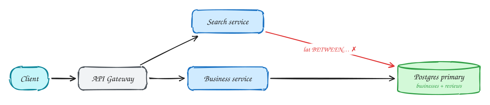
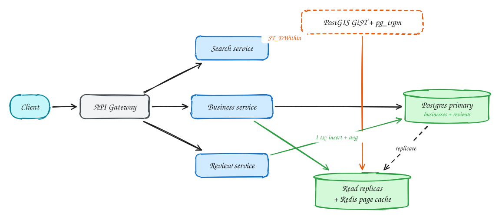

# Business discovery (Yelp)

<span class="lvl lvl-i">Intermediate</span>

**Difficulty:** Medium · **Patterns:** [Scaling reads](../patterns/scaling-reads.md) · **DDIA:** [Ch 3](../ddia/03-storage-and-retrieval.md) geo indexes · [Ch 7](../ddia/07-transactions.md) atomic updates · [Ch 5](../ddia/05-replication.md) read replicas

*The trap is over-engineering: the whole dataset fits on one database server.*

> [!TIP]
> **One-page sketchnote:** [BUSINESS DISCOVERY (YELP) on a single page](../sketchnotes/problem-business-discovery.svg), for revision or printing.

## TL;DR

- Ten million businesses at ~1 KB each is about 10 GB, small enough for one Postgres instance.
- Two-dimensional "near me" queries need a geospatial index (PostGIS, geohash), not two B-tree indexes.
- Keep the average rating correct under concurrent reviews by updating it atomically in the same transaction.

## 1. Requirements

**Functional**

1. Search businesses by location + radius, category, text
2. View business details and reviews
3. Leave one review per user per business; see average rating

**Non-functional**

- Search p99 < 500ms
- 100M DAU, read-heavy
- Ratings can lag slightly (eventual)
- Reviews durable

## 2. Back-of-envelope numbers

10M businesses × 1KB = **10GB**, which fits in memory. Search: 100M × 5 / 86,400 ≈ **6k/s, ~20k/s peak**. Reviews ~12/s.

## 3. Core entities and API

```text
businesses(id, name, location, category, avg_rating, num_ratings)
reviews(id, business_id, user_id, rating, text, UNIQUE(user_id, business_id))
```

```http
GET /businesses?lat&lng&radius&category&q&cursor
GET /businesses/{id}
POST /businesses/{id}/reviews {rating, text}
```

## 4. v1: the simplest design, and where it breaks



Naive: WHERE lat BETWEEN … AND lng BETWEEN …. Two 1-D B-tree indexes can't do a 2-D range efficiently.

## 5. Evolving to the final design



Each step fixes one specific problem with the step before it:

1. Naive: WHERE lat BETWEEN … AND lng BETWEEN …. Two 1-D B-tree indexes can't do a 2-D range efficiently.
2. Add a geospatial index (PostGIS GiST, ST_DWithin) and pg_trgm for name search. **10GB fits one Postgres**, so no extra search cluster yet.
3. ~20k searches/sec: serve reads from replicas and cache hot business pages in Redis. The primary only takes writes.
4. Reviews: a unique (user, business) constraint, and the average updated in the same transaction as the insert, with no lost updates.

## 6. Deep dives

### Which geo index?

**Geohash**: prefix = area, B-tree friendly; query the cell plus 8 neighbours to handle edges. **Quadtree**: adapts to density. **R-tree / PostGIS**: the production default.

### Average rating with concurrent reviews?

Store sum and count; UPDATE … SET sum=sum+:r, count=count+1 in the review's transaction. That is an atomic operation, so no lost update.

### One review per user?

A DB unique constraint, not an application check (check-then-insert races).

### When would you add Elasticsearch?

Only if search needs relevance ranking, fuzzy matching, and facets beyond pg_trgm, or QPS outgrows replicas. Then feed it from Postgres via CDC; never dual-write.

## 7. Interview script (45 minutes)

| Time | What you do | Content |
|---|---|---|
| 0–5 | Functional requirements | Search businesses by location + radius, category, text; View business details and reviews; Leave one review per user per business; see average rating |
| 5–8 | Non-functional requirements | Search p99 < 500ms; 100M DAU, read-heavy; Ratings can lag slightly (eventual); Reviews durable |
| 8–10 | Numbers that drive the design | 10M businesses × 1KB = **10GB**, which fits in memory. Search: 100M × 5 / 86,400 ≈ **6k/s, ~20k/s peak**. Reviews ~12/s. |
| 10–13 | Entities and API | Keep it short: the endpoints in §3, idempotency keys on writes. |
| 13–25 | v1, then evolve it | Draw v1 and show where it breaks. Then add, in order: PostGIS GiST + pg_trgm → Read replicas → Review service. Justify each addition with a number. |
| 25–40 | Deep dives | Which geo index? · Average rating with concurrent reviews? · One review per user? · When would you add Elasticsearch? |
| 40–45 | Wrap-up | Remaining bottlenecks, failure modes, what you would monitor. |


## Staff-level lens

| Question | Staff answer |
|---|---|
| **The real problem** | 2-D "near me" search and correct ratings, without over-engineering. |
| **Deciding number** | 10M businesses × 1 KB ≈ 10 GB; ~20k searches/s at peak. |
| **Staff call and trade-off** | One Postgres + PostGIS + replicas + page cache. Accept simpler ranking for far less to operate; add Elasticsearch only when relevance needs it. |
| **Raise before you're asked** | Replica lag hiding a new review; hot cities skewing load; review spam. |
| **Senior stops at** | Adds a geo index. |
| **Staff goes on to** | Uses the 10 GB number to argue against a search cluster, and defines the trigger and CDC migration path for adding one later. |
| **Run it** | Watch search p99, replica lag, cache hit. Trigger for Elasticsearch: fuzzy relevance or QPS beyond replicas. |

All 29 problems through this lens: [Staff-level answers](../playbook/staff-level.md).

## 8. Common mistakes

- A geo-sharded cluster for 10GB of data. One Postgres with PostGIS plus replicas is enough.
- Adding components before showing which number makes them necessary.
- Skipping failure handling: what happens on timeouts, retries and crashes.

## Related

- **Patterns:** [Scaling reads](../patterns/scaling-reads.md)
- **DDIA:** [Ch 3](../ddia/03-storage-and-retrieval.md) geo indexes · [Ch 7](../ddia/07-transactions.md) atomic updates · [Ch 5](../ddia/05-replication.md) read replicas
- **Similar problems:** [URL shortener (Bitly)](url-shortener.md) · [Rate limiter](rate-limiter.md) · [News feed (Facebook)](news-feed.md) · [News aggregator (Google News)](news-aggregator.md)
