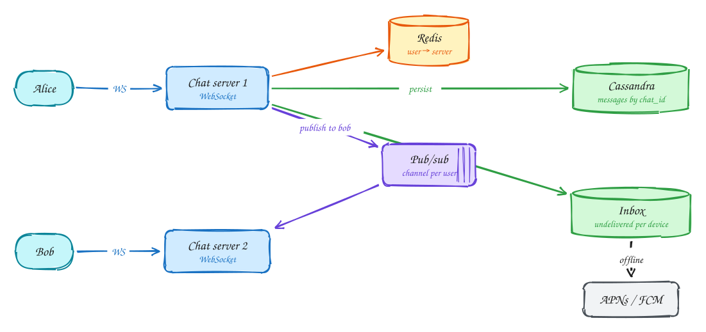

# Chat app (WhatsApp)

**Difficulty:** Medium · **Patterns:** [Real-time updates](../patterns/real-time-updates.md) · **DDIA:** [Ch 5](../ddia/05-replication.md) consistent prefix · [Ch 11](../ddia/11-stream-processing.md) at-least-once + idempotency

*Chat looks like CRUD until you notice the two users are on different servers and one of them is offline.*

## TL;DR

- Keep a persistent WebSocket per device; route messages between chat servers with a registry and per-user pub/sub.
- Persist each message and add it to the recipient's inbox before acknowledging the sender, so nothing is lost.
- Partition by conversation and number messages within it so every device shows the same order.

## 1. Requirements

**Functional**

1. 1:1 and group chats (up to ~100 members)
2. Send and receive messages in real time
3. Offline users get messages when they reconnect
4. Delivery and read receipts; media

**Non-functional**

- Delivery < 500ms when online
- Messages never lost
- Ordered within a chat
- 1B DAU

## 2. Back-of-envelope numbers

50B messages/day ≈ **~600k msgs/s**. Hundreds of millions of concurrent connections, at ~1M connections per tuned server → hundreds of chat servers.

## 3. Core entities and API

```text
messages(chat_id, seq, msg_id, sender, body, ts) partitioned by chat_id
inbox(device_id, msg_id) until acked
chat_members
```

```http
WS connect → send {chat_id, client_msg_id, body}; receive {msg, seq}; ack {msg_id}
POST /media → presigned upload URL
```

## 4. v1: the simplest design, and where it breaks

Persistent **WebSocket** connections for both directions, so there is no polling.

## 5. Evolving to the final design



Each step fixes one specific problem with the step before it:

1. Persistent **WebSocket** connections for both directions, so there is no polling.
2. Alice and Bob are usually connected to **different** servers, so you need routing between them.
3. A registry (user → server) and a pub/sub channel per user: server 1 publishes to Bob's channel; server 2, which holds Bob's connection, delivers.
4. Durability first: persist to the messages table and the recipient's inbox **before** acknowledging Alice. Bob's device acks on receipt and the inbox entry is deleted; offline devices get a push and sync on reconnect.

## 6. Deep dives

### Never lose a message?

Persist before ack; at-least-once delivery from the inbox; client dedupes by msg_id.

### Ordering?

Per-chat sequence numbers, with chat_id as the partition key so one writer orders them (DDIA Ch 5 consistent prefix).

### Groups?

Fan-out per member at send time (≤ ~100 members) into inboxes and channels.

### Media?

Upload to S3 via presigned URL; the message carries only the object key.

## 7. Interview script (45 minutes)

| Time | What you do | Content |
|---|---|---|
| 0–5 | Functional requirements | 1:1 and group chats (up to ~100 members); Send and receive messages in real time; Offline users get messages when they reconnect; Delivery and read receipts; media |
| 5–8 | Non-functional requirements | Delivery < 500ms when online; Messages never lost; Ordered within a chat; 1B DAU |
| 8–10 | Numbers that drive the design | 50B messages/day ≈ **~600k msgs/s**. Hundreds of millions of concurrent connections, at ~1M connections per tuned server → hundreds of chat servers. |
| 10–13 | Entities and API | Keep it short: the endpoints in §3, idempotency keys on writes. |
| 13–25 | v1, then evolve it | Draw v1 and show where it breaks. Then add, in order: Chat server 2 → Redis → Pub/sub → Cassandra → Inbox → APNs / FCM. Justify each addition with a number. |
| 25–40 | Deep dives | Never lose a message? · Ordering? · Groups? · Media? |
| 40–45 | Wrap-up | Remaining bottlenecks, failure modes, what you would monitor. |

## 8. Common mistakes

- Assuming both users share a server or are always online.
- Adding components before showing which number makes them necessary.
- Skipping failure handling: what happens on timeouts, retries and crashes.

## Related

- **Patterns:** [Real-time updates](../patterns/real-time-updates.md)
- **DDIA:** [Ch 5](../ddia/05-replication.md) consistent prefix · [Ch 11](../ddia/11-stream-processing.md) at-least-once + idempotency
- **Similar problems:** [Ride sharing (Uber)](ride-sharing.md) · [Live comments (Facebook Live)](live-comments.md) · [Collaborative editor (Google Docs)](collaborative-editor.md) · [Stock trading (Robinhood)](stock-trading.md)
